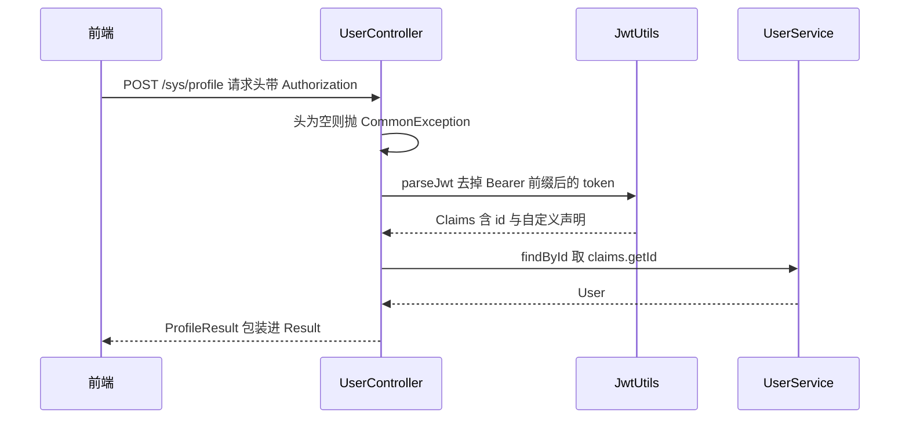

# 接口里校验 token：从 Authorization 头反查用户，把异常兜干净

> 🔒 安全提示：文中示例的口令/密钥均为课程教学环境演示口径，生产环境的安全要求见《安全与合规须知》。

上一课 profile 接口里用户 id 还是写死的「1」，等于谁登录进来查到的都是同一个人。这一课把 token 接进来：前端带着登录时发的凭证请求，服务端从请求头里取出、验签、解出用户 id，再回库查人。顺带处理一个真实踩过的坑：token 明明签得好好的，claims 里的 id 解出来却是 null。

## 先给结论

- 前后端约定请求头 `Authorization`，值形如「Bearer + 空格 + token」，服务端用 `request.getHeader` 取出。
- 头为空按未登录处理：抛自定义异常 `CommonException`，交给全局异常处理器统一转 JSON，不在业务代码里拼错误响应。
- 取出的头先去掉 `Bearer ` 前缀，`parseJwt` 验签后从 `Claims.getId()` 拿用户 id，回库查用户再包装返回。
- `setClaims(map)` 会整体替换 claims 容器，把已设的 id 与 subject 清掉，解出来就是 null；逐个 `claim()` 追加才是对的，这是本课真实踩到并修复的 bug。
- 接口内校验是起步写法，接口一多就该抽成拦截器统一做，登录接口本身要放行。

## 一、从请求头把 token 捞出来

前后端先立一个约定：所有需要身份的请求，在请求头里加一个 `Authorization`，值是「Bearer + 空格 + token」。Bearer 是 HTTP 认证方案里的通行写法，含义是「持有此凭证的人」。profile 接口按这个约定补全后长这样（方法签名里多了一个 `HttpServletRequest`）：

```java
/**
 * 用户登录成功之后获取用户信息
 */
@RequestMapping(value = "/profile", method = RequestMethod.POST)
public Result profile(HttpServletRequest request) {
    // 1.从请求头获取 Authorization
    String authorization = request.getHeader("Authorization");
    // 2.头为空说明未登录，抛异常交给全局处理
    if (StringUtils.isEmpty(authorization)) {
        throw new CommonException(ResultCode.UNAUTHENTICATED.message());
    }
    // 3.去掉约定的 Bearer 前缀，得到纯 token
    String token = authorization.replace("Bearer ", "");
    // 4.解析 token，验签通过才能拿到 claims
    Claims claims = jwtUtils.parseJwt(token);
    // 5.从 claims 取出用户 id，回查用户
    String userId = claims.getId();
    User user = userService.findById(userId);
    return new Result(ResultCode.SUCCESS, new ProfileResult(user));
}
```

`StringUtils` 用的是 `org.springframework.util.StringUtils`，`isEmpty` 判断 null 与空串。`ResultCode.UNAUTHENTICATED` 是通用枚举里现成的项，编码 10002、消息「您还未登录」。

验证流程与登录衔接：先请求 `POST /sys/login` 拿到 token，再请求 `POST /sys/profile`，在 Postman 里手动加一个 Header，Key 填 `Authorization`，Value 填「Bearer + 空格 + 刚才的 token」。返回 data 里手机号、用户名、企业名、三类权限标识齐全，而且换一个账号登录就查到另一个人的资料，token 正式接管了身份识别。

整个链路画出来是这样：



图里的关键卡点在 `parseJwt`：签名不符或 token 过期都会在这里抛异常，请求根本走不到查用户那一步。

## 二、异常兜底：抛出去，比拼响应干净

头为空、token 失效这些情况，接口层只负责抛异常，把「怎么组织错误响应」这件事交给全局异常处理器。自定义异常是课程通用模块里的老朋友（按课程通用写法补全，资料包未含 day04 对应文件）：

```java
package com.example.common.exception;

public class CommonException extends RuntimeException {
    private String msg;
    private int code = 500;

    public CommonException(String msg) {
        super(msg);
        this.msg = msg;
    }

    public CommonException(String msg, int code) {
        super(msg);
        this.msg = msg;
        this.code = code;
    }

    public String getMsg() { return msg; }
    public int getCode() { return code; }
}
```

继承 `RuntimeException` 意味着不用在方法签名上层层声明，哪里出问题哪里抛。全局处理器接住它，转成统一的 JSON：

```java
@RestControllerAdvice
public class BaseExceptionHandler {
    // 业务异常：把消息原样交给前端
    @ExceptionHandler(CommonException.class)
    public Result common(CommonException e) {
        return new Result(ResultCode.FAIL.code(), e.getMessage(), false);
    }

    // 兜底：其余异常统一转系统繁忙，不向前端暴露堆栈
    @ExceptionHandler(Exception.class)
    public Result error(Exception e) {
        return new Result(ResultCode.SERVER_ERROR);
    }
}
```

（全局异常处理器为按课程全局异常处理思路补全的示例，用到的 `Result` 与 `ResultCode` 均为课程通用模块真实代码。）业务异常与未知异常分开处理的好处是语义清晰：未登录就明确说未登录，程序 bug 就说系统繁忙，前端拿到 `success` 与 `code` 就能分流处理，不用猜。

## 三、id 解出来是 null：setClaims 的覆盖坑

第一次联调时踩过一个怪坑：登录返回的 token 看着一切正常，profile 里 `claims.getId()` 却返回 null，查用户自然查了个空。

排查下来根因在工具类的签发代码。当时自定义数据图省事用了 `setClaims`，问题就出在这个方法会替换整个 claims 容器：

```java
// 错误写法：setClaims 整体替换，jti 与 sub 被清空
JwtBuilder jwtBuilder = Jwts.builder().setId(id).setSubject(name)
        .setIssuedAt(new Date())
        .signWith(SignatureAlgorithm.HS256, key);
jwtBuilder.setClaims(map);   // map 里只有 companyId 与 companyName

// 正确写法：逐个 claim 追加，已有声明全部保留
for (Map.Entry<String, Object> entry : map.entrySet()) {
    jwtBuilder.claim(entry.getKey(), entry.getValue());
}
```

`setId`、`setSubject` 设置的 jti、sub 都存在 claims 容器里，`setClaims(map)` 等于把容器倒掉换成 map 的内容，签出来的 token 天然没有 id 字段，解析端 `getId()` 返回 null 顺理成章。修复就是把工具类改成循环 `claim` 逐个追加，课程资料包里 `JwtUtils` 成例用的正是这个写法。填进 token 的声明从此分两类：标准字段走 `setId` 这类专用方法，自定义字段走循环 `claim`，两者互不干扰。

## 常见误区

- **忘掉 `Bearer ` 前缀直接解析**：头里的值带着前缀，直接喂给 `parseJwt` 会在 Base64 解码处报 `MalformedJwtException`。取出后先 `replace("Bearer ", "")`，同时和前端把「Bearer + 一个空格」的格式约定死。
- **校验代码 try-catch 后返回 null 继续往下走**：调用方拿到 null 的 claims 再一串空指针，报错位置离真正的病灶十万八千里。异常要么向上抛给全局处理器，要么在工具类边界转成明确的业务异常。
- **过期与签名异常落进「系统繁忙」**：全局处理器里兜底的 `Exception` 会把 `ExpiredJwtException`、`SignatureException` 一并吞成系统繁忙，用户体验上是错的。单独捕获这两类异常，转成「登录已过期」与未登录响应。
- **每个接口复制一遍校验代码**：取头、判空、去前缀、解析这套动作写三五个接口就该收敛了。抽成拦截器统一校验，登录接口用 `excludePathPatterns` 放行，课程下一阶段的真实配置已经按这个思路组织。

## 面试可能被问到的问题

1. 面试官追问：「为什么用 Authorization 请求头传 token，Bearer 是什么意思？」
   答：Authorization 是 HTTP 标准的认证头，Bearer 表示持有者凭证方案，格式约定为「Bearer + 空格 + token」。用它而不是自定义头，网关、鉴权中间件都能按标准识别，也和 OAuth 2.0 生态保持兼容。

2. 面试官追问：「token 校验放接口里还是拦截器里？」
   答：一两个接口时写在方法里最直接；接口多了一定抽成拦截器或过滤器统一做，业务代码只声明「我需要登录」，登录、注册等公开接口通过排除路径放行。校验逻辑只有一份，规则变更不用挨个接口改。

3. 面试官追问：「未登录和 token 过期怎么给前端统一响应？」
   答：接口内抛自定义业务异常，全局异常处理器统一捕获转成 JSON，code 用专门的未登录或过期返回码，前端凭 code 跳登录页。JWT 相关的 SignatureException 与 ExpiredJwtException 要单独映射，避免被兜底成系统繁忙。

4. 面试官追问：「claims 里的用户 id 取出来是 null，怎么排查？」
   答：先确认解析与签发用的是同一把私钥，再解码 token 的第二段直接看 payload 里有没有 id 字段。payload 里没有，多半是签发时用了 `setClaims` 整体替换把标准声明清掉了，改成逐个 `claim` 追加即可。

5. 面试官追问：「验签通过的 claims 就可信吗，还需要查库吗？」
   答：验签通过说明内容是本系统签发且未被篡改，claims 里的用户 id 可以直接信任，身份识别不必查库。但角色权限这类实时性要求高的数据，要么每次回库查，要么控制 token 有效期加缓存，因为 token 签出后载荷无法更新。

## 配套资料

- JWT 工具类成例（`parseJwt` 与修复后的循环 `claim` 签发）：`materials/code/02/day14 微服务网关与社保模块开发/day14/03-资料/common模块的工具类/JwtUtils.java`
- 拦截器统一校验的真实注册写法（含 `excludePathPatterns("/sys/login")` 放行登录）：
  `materials/code/02/day05 JWT的权限控制与Shiro入门/JWT的权限控制与Shiro入门/资源/通用代码/SystemConfig.java`
- 未登录与系统繁忙返回码：`materials/code/02/day01 SAAS-HRM系统概述与搭建环境/SAAS-HRM系统概述与搭建环境/资源/通用代码/common/ResultCode.java`（`UNAUTHENTICATED` 10002、`SERVER_ERROR` 99999）与同目录 `Result.java`
- profile 方法、`CommonException` 与全局异常处理器为按本课视频与课程通用写法补全的示例，day04 资料包未含对应源文件
