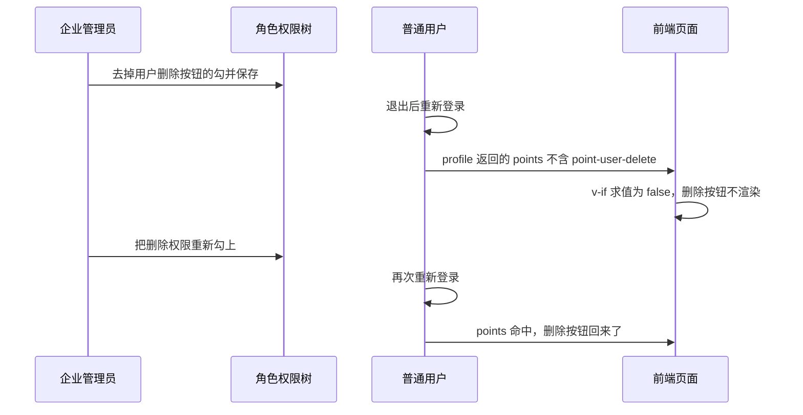

# 删除按钮去而复返：用权限点 code 做按钮级权限控制

菜单已经能按权限显隐，但按钮还没设防：普通用户进了员工列表，查看、分配角色、删除一字排开，删除这种高危操作和查看一样随手可点。这一课给删除按钮挂上权限点，让它的显隐跟着角色勾选走，也顺带把一个事实挑明：前端藏按钮只是体验层的礼貌，接口层的防御一步都不能少。

## 先给结论

- 按钮权限的前置条件是把权限点（type 为 2 的权限资源）勾给角色，用户登录后 profile 接口把 `points` 集合带回来。
- 每个权限点用 `code` 标识，如 `point-user-delete`，一个 code 对应页面上一个受控动作。
- 页面模板里用 `v-if` 挂判断方法，方法拿 Vuex 里的 points 与 code 比对，命中渲染、未命中隐藏。
- 比对逻辑抽成工具函数 `hasPermissionPoint`，做不区分大小写的 some 匹配，全站复用。
- 前端控制防不住接口工具直接调 API，服务端必须基于 API 权限编码做二次校验。

## 一、权限点先在数据侧就位

权限分三类，实体字段写得明明白白（真实实体节选）：

```java
public class Permission implements Serializable {
    @Id
    private String id;
    // 权限名称
    private String name;
    // 权限类型 1 为菜单 2 为功能（按钮） 3 为 API
    private Integer type;
    // 权限编码
    private String code;
    // 可见状态
    private String enVisible;
}
```

按钮就是一个 type 为 2 的权限行，挂在对应菜单（type 为 1）下面。建表脚本里的种子数据能直接看到这条链：

```sql
-- 员工管理菜单（type 1，code 即模块路由名）
INSERT INTO `pe_permission` VALUES ('1063315016368918528', '用户管理菜单', '员工管理', '1', '0', 'employees', '1');
-- 用户删除按钮（type 2，父级 pid 指向员工管理菜单）
INSERT INTO `pe_permission` VALUES ('1063315194329042944', '用户删除按钮', '用户删除按钮', '2', '1063315016368918528', 'point-user-delete', '1');
-- 删除按钮对应的 API 权限（type 3，服务端校验用）
INSERT INTO `pe_permission` VALUES ('1063322760811515904', '删除api', '删除用户api', '3', '1063315194329042944', 'API-USER-DELETE', '1');
```

三行数据正好把三层串起来：菜单的 code 喂给路由过滤，按钮的 code 喂给页面 `v-if`，API 的 code 喂给服务端校验。`enVisible` 为 1 表示企业可见，分配权限树里才会出现它。

分配动作发生在角色的权限树里。企业管理员进入权限设置，给「人事经理」角色勾权限，把「用户删除按钮」的勾去掉再保存，走的是现成的角色接口：

```javascript
// src/module-settings/components/role-list.vue：保存勾选的权限 id 集合
assignPrem() {
  assignPrem({ id: this.formData.id, permIds: this.$refs.tree.getCheckedKeys() }).then(res => {
    // 保存成功后关闭弹层并刷新角色列表
  })
}
```

权限树的数据来自 `permApi.list({type: 0, pid: null, enVisible: 1})`（role-list.vue 原代码）。保存之后，人事经理角色的 permIds 里就没有这个权限点的 id，数据侧就此就位。

## 二、模板里挂上 v-if

员工列表的操作列原来是三个按钮平铺（真实模板节选）：

```vue
<el-table-column fixed="right" label="操作" align="center" width="220">
  <template slot-scope="scope">
    <router-link :to="{'path':'/employees/details/' + scope.row.id}"
      class="el-button el-button--text el-button--small">查看</router-link>
    <el-button @click="handleRole(scope.row)" type="text" size="small">分配角色</el-button>
    <el-button @click="handleDelete(scope.row)" type="text" size="small">删除</el-button>
  </template>
</el-table-column>
```

改造只动删除按钮一处，套上判断方法，参数就是库表里那个 code：

```vue
<el-button v-if="show('point-user-delete')" @click="handleDelete(scope.row)"
  type="text" size="small">删除</el-button>
```

show 方法把 store 里的权限点集合交给工具函数比对：

```javascript
import { hasPermissionPoint } from '@/util/permission'

export default {
  name: 'employeesList',
  methods: {
    // 判断当前用户是否拥有指定权限点
    show(name) {
      const points = this.$store.getters.roles.points  // 登录时存下的按钮权限集合
      return hasPermissionPoint(points, name)
    }
  }
}
```

`v-if` 的语义与权限判断严丝合缝：方法返回 true 渲染按钮，返回 false 整个元素不进 DOM。分到删除权限的人看到三个按钮，没分到的只有查看与分配角色。

## 三、比对函数：一次实现，处处复用

```javascript
// src/util/permission.js：权限点比对工具
export function hasPermissionPoint(points, point) {
  if (points && points.length > 0) {
    // 不区分大小写逐个比对，命中任意一个即视为拥有
    return points.some(p => p.toLowerCase() === point.toLowerCase())
  }
  return false
}
```

`some` 做的是短路匹配：集合里任何一项与目标 code 小写后相等就立刻返回 true，全不命中才返回 false。小写化是给配置留的容错，库里 code 大小写没统一时判断不至于失效。

整条验证链跑一遍：



链路里两次「重新登录」都不是仪式感：points 是登录时 profile 给的快照，角色改完不重登，前端拿着的还是旧集合。验证按钮权限时，「改了没反应」多半是省了这一步。

## 四、前端是体验，接口才是底线

按钮藏住了，请求层面呢。拿着合法 token 用接口工具直接发删除请求，服务端此时毫无防御，照样执行。所以说前端控制只是皮毛：它挡的是误操作与越界视线，挡不住故意构造的请求。删除按钮那行 SQL 的隔壁还有一条 `API-USER-DELETE`（type 3），它的消费方不在浏览器，而在服务端：接口上线时按 API 权限编码做校验，没分配的用户带着 token 来打也是被拒。这套服务端校验从下一课的概念铺垫开始，后面用拦截器与注解的方式落地。

## 常见误区

- **v-if 里的 code 与库表不一致**：多一个横杠、少一个字母，判断永远为 false，按钮永远消失。code 建议抽成常量统一维护，别在模板里裸写字符串。
- **改了角色权限不重新登录就验证**：points 是登录快照，怎么测都看不出变化。
- **权限点没挂在菜单下**：pid 为 0 或挂错层级，分配权限树里根本找不到它，自然勾不上。
- **以为按钮隐藏就是安全**：删除接口对未授权用户照常放行，接口层必须单独做 API 权限校验。

## 面试可能被问到的问题

1. 面试官追问：「按钮级权限和菜单级权限的数据从哪来？」
   答：同一个 profile 接口，roles 里的 menus 与 points 两个集合分别服务两层。菜单编码用于路由过滤，权限点编码用于页面 v-if 比对，同源保证两层不会互相矛盾。

2. 面试官追问：「v-if 和自定义指令控制按钮显隐有什么取舍？」
   答：v-if 直观、无需封装，适合零散场景；按钮多且判断逻辑一致时，封装成 v-permission 之类的自定义指令更干净，模板里只写 code。两者最终都落到同一份 points 集合上。

3. 面试官追问：「为什么前端按钮控制不能替代接口鉴权？」
   答：前端的一切控制都在客户端，可被绕过或篡改；接口是唯一执行点，必须在服务端基于用户权限校验。前端控制降低误操作概率，服务端校验提供安全保证，两者缺一不可。

4. 面试官追问：「权限变更后怎么让在线用户立即生效？」
   答：前端快照方案要重新登录或重新拉取用户信息；要求实时生效的系统可在路由守卫或请求拦截器里校验最新权限，或由服务端在权限变更时使旧 token 失效。多数管理后台接受重新登录生效。

5. 面试官追问：「hasPermissionPoint 里为什么做小写比较，有风险吗？」
   答：目的是容忍配置时的大小写不一致，降低运营出错率。风险是两个仅大小写不同的 code 会被当成同一个权限，所以约定 code 全小写加横杠命名，从源头避免歧义。

## 配套资料

- 员工列表页成例（操作列原始模板与脚本）：`materials/code/02/day04 权限分配与jwt概述/权限分配与jwt概述/资源/前端代码/module-employees/pages/index.vue`
- 角色分配权限成例（assignPrem 与权限树加载）：`materials/code/02/day04 权限分配与jwt概述/权限分配与jwt概述/资源/前端代码/module-settings/components/role-list.vue`
- 角色 API 成例（assignPrem 接口声明）：`materials/code/02/day04 权限分配与jwt概述/权限分配与jwt概述/资源/前端代码/api/base/role.js`
- 权限实体成例（type/code/enVisible 字段）：`materials/code/02/day04 权限分配与jwt概述/权限分配与jwt概述/资源/实体类/Permission.java`
- 权限种子数据（point-user-delete 与 API-USER-DELETE 所在行）：`materials/code/02/day02 SAAS-HRM数据库设计与前端框架/3-3 SAAS-HRM数据库设计与前端框架/资源/ihrm.sql`
- v-if 改造、show 方法与 hasPermissionPoint 为按本课视频写法补全的示例（资料包未含该工具文件）
