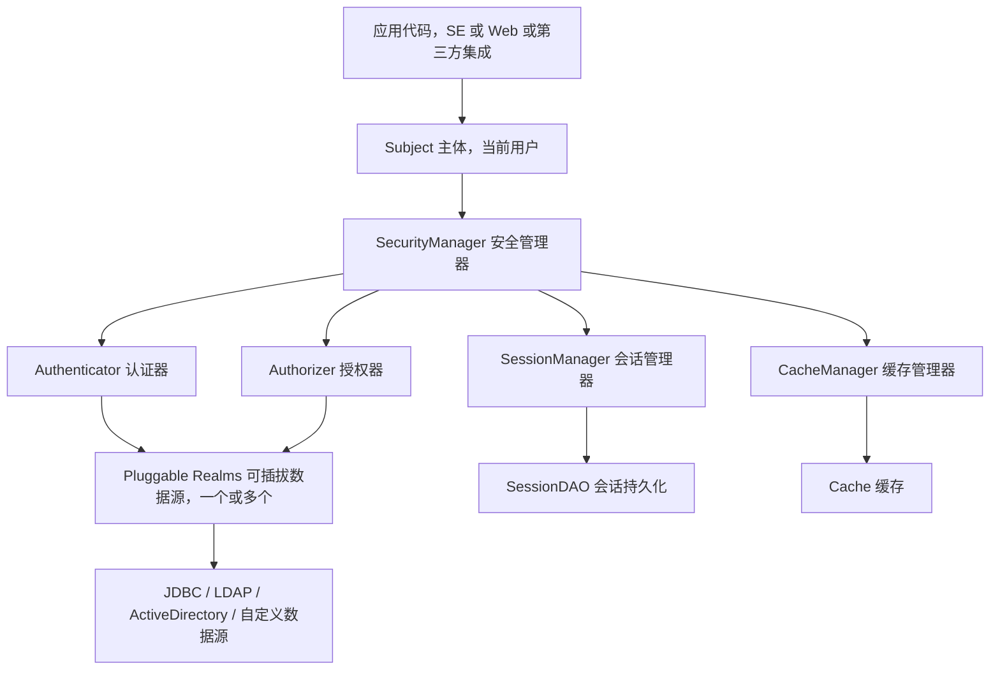
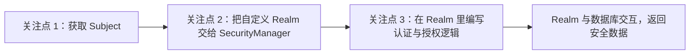

# Subject、SecurityManager、Realm：看懂 Shiro 的内部体系结构

上一节末尾出现过五行代码：`SecurityUtils.getSubject()` 拿到 Subject，`login` 完成登录，`isPermitted` 判断权限。顺手就会冒出两个疑问：`login` 内部拿用户输入的密码去跟谁比对？`isPermitted` 判断所依据的角色权限数据从哪来？这两个问题的答案都藏在一张体系结构图里。用 Shiro 之前把这张图看懂，后面写每一行代码都知道它在框架里走到了哪一站。

## 先给结论

- 应用代码永远只跟 Subject 打交道，Subject 是当前操作用户的「代言人」，是进入框架的门。
- SecurityManager 是 Shiro 的心脏与大脑，内部所有组件都由它统一调度。
- 认证器与授权器只负责流程调度，它们自己不碰数据，真正接触用户、角色、权限数据的是 Realm。
- Realm 是可插拔的安全数据源，可以配置一个或多个，JDBC、LDAP 还是自定义实现全由使用方决定。
- 使用 Shiro 要关心的只有三件事：拿到 Subject、把 Realm 交给 SecurityManager 管理、在 Realm 里写认证与授权的数据逻辑。

## 一、一张图看全貌

把官方的内部结构图按层级画出来，大致是下面这个样子：



这张图有两条阅读路径。横向看，任何语言、任何类型的应用，最终都通过 Subject 这一个入口访问框架；纵向看，SecurityManager 把请求分发给四个内部组件，其中认证器与授权器完成判断之前，都要把「取数据」这件事下发给 Realm，数据源类型由 Realm 决定。整个框架里，只有 Realm 一层是需要使用者自己动手写的。

## 二、五个组件各管什么

**第一，Subject，主体。** 翻译成中文叫「主体」，代表当前正在使用系统的用户。叫「主体」而不是「用户」，是因为它不一定是一个真人，可能是一个第三方程序、一个定时任务，凡是发起操作的都是主体。它是应用与 Shiro 交互的唯一入口，登录、判断角色、判断权限都从它这里发起。

**第二，SecurityManager，安全管理器。** 它是整个框架最核心的部分，比喻成 Shiro 的心脏或大脑很贴切：所有的 Subject 由它管理，认证器、授权器、会话管理器、缓存管理器由它协调调度。认证和授权的请求都会先汇聚到这里，再被分派给对应的组件。

**第三，Authenticator 与 Authorizer，认证器与授权器。** 认证器负责主体认证，Subject 带着登录信息找到 SecurityManager，SecurityManager 立即将认证内容委托给认证器；授权器又称访问控制器，负责判断「这个人能不能做这个操作」。这里有一个容易忽略的细节：这两个组件都不会真正去查数据。用户名密码存在哪、密码规则是什么、权限表在哪张表里，它们一概不知，判断所需的数据要继续向下委托。

**第四，Realm，域，安全数据源。** 委托的终点就是 Realm。它可以有一个或多个，负责连接不同的数据源，把当前用户的数据查出来交给上层完成认证与授权。框架内置了 JDBC Realm、LDAP Realm 等实现，但真实项目里用户表、权限表是自己的设计，所以 Realm 通常都要自定义，这是使用 Shiro 时工作量最集中的一层。

**第五，SessionManager、SessionDAO 与 CacheManager。** Shiro 自己定义了会话体系，完全脱离 Web 层的 HttpSession，会话的创建、属性存取都由 SessionManager 统一管理；因为会话是自定义的，数据要存储、删除、更新就靠 SessionDAO 这个持久层接口，由使用者决定存内存还是存数据库。CacheManager 则负责缓存控制，用户的角色、权限这类安全数据不常变化，缓存起来可以避免每次判断都查库。

## 三、用 Shiro 只需要关心三件事

结构图看懂之后，可以从中提取出使用者的任务清单。不管认证还是授权，调用链都是 Subject 到 SecurityManager，再到对应组件，最后到 Realm 取数据，其中中间环节是框架内部机制，一般不干预，需要动手的只有三处：



对应到代码上就是三段骨架（示例代码，按本课写法补全，完整可运行版本在下一节）：

```java
//关注点1：从当前运行环境获取 Subject，所有操作从这里发起
Subject subject = SecurityUtils.getSubject();

//关注点2：构建 SecurityManager 并绑定到运行环境，Realm 在其中注册
SecurityManager securityManager = factory.getInstance();
SecurityUtils.setSecurityManager(securityManager);

//关注点3：自定义 Realm，继承 AuthorizingRealm，重写认证与授权两个方法
public class PermissionRealm extends AuthorizingRealm {
    //doGetAuthenticationInfo：认证，查用户数据，支撑登录比对
    //doGetAuthorizationInfo：授权，查角色权限数据，支撑权限判断
}
```

第一行是每次使用 Shiro 的起点；中间两行把「框架的心脏」装配好，Realm 作为数据源注册进去；最后一段是真正与数据库打交道的地方。下一节就从 ini 配置版的完整程序开始，把这三段填满。

## 常见误区

- **把 Subject 当成数据库里的用户对象**：Subject 是「当前执行者」的抽象与入口，代表谁在操作，登录成功后可以通过它获取用户身份，但它本身不等于用户表里的一行数据。
- **以为认证器或授权器会去查数据库**：它们只做流程调度与比对触发，安全数据一律由 Realm 提供，查库代码写在 Realm 里。
- **以为只能配置一个 Realm**：Realm 可以配置多个，多数据源场景下框架按认证策略逐一尝试，常见的如「一个成功即通过」或「全部通过才算成功」。
- **混淆 Shiro 的 Session 与 HttpSession**：Shiro 的会话由自己的 SessionManager 维护，不依赖 Servlet 容器，Web 环境下它默认与 HttpSession 桥接，非 Web 环境下独立存在。

## 面试可能被问到的问题

1. 面试官追问：「描述一下 Shiro 的核心架构。」
   答：应用通过 Subject 发起安全操作，Subject 交给 SecurityManager 统一调度；认证走 Authenticator，授权走 Authorizer，两者判断所需的数据由 Realm 提供；会话由 SessionManager 管理并可通过 SessionDAO 持久化，缓存由 CacheManager 控制。SecurityManager 是心脏，Realm 是唯一需要使用者实现的数据源层。

2. 面试官追问：「一次登录请求在 Shiro 内部是怎么流转的？」
   答：应用代码调用 subject.login(token)，Subject 把请求交给 SecurityManager，SecurityManager 委托认证器处理，认证器不持有数据，继续委托 Realm 查询用户信息，Realm 从数据库取出用户与凭证返回，认证器完成比对后回写认证状态，应用通过 subject.isAuthenticated() 得知结果。

3. 面试官追问：「为什么 Shiro 的 Realm 通常要自己写？」
   答：Realm 是安全数据源，用户表结构、密码存储方式、权限模型每个项目都不一样，内置的 JDBC Realm 只适配最通用的表结构。自定义 Realm 继承 AuthorizingRealm 后，把查库逻辑写进 doGetAuthenticationInfo 与 doGetAuthorizationInfo 两个方法即可接入框架。

4. 面试官追问：「SecurityManager 如果不设置会怎样？」
   答：Subject 的所有操作都依赖它调度，运行环境里没有 SecurityManager 时获取 Subject 或执行安全操作会直接抛异常。独立应用里要显式调用 SecurityUtils.setSecurityManager 绑定，与 Spring 集成时则由容器统一装配。

5. 面试官追问：「Shiro 的 Session 和 Web 容器的 Session 什么关系？」
   答：Shiro 定义了自己的会话模型，由 SessionManager 管理并通过 SessionDAO 决定存储方式，完全不依赖 Servlet 规范。Web 环境下默认实现会与 HttpSession 建立桥接保证行为一致，非 Web 环境下会话依然可用，这也是它宣称任何环境都能管理会话的原因。

## 配套资料

- 本课资料包仅有工程通用代码：`materials/code/02/day05 JWT的权限控制与Shiro入门/JWT的权限控制与Shiro入门/资源/通用代码/SystemConfig.java`、同目录 `SystemApplication.java`，本课无 Shiro 源码包，文中代码骨架为按本课写法补全的示例。
- 可运行的 Shiro 案例工程（下一课资料）：`materials/code/02/day06 Shiro高级 及SaaS-HRM的认证授权/Shiro高级 及SaaS-HRM的认证授权/资源/shiro案例代码/shiro_springboot/`
