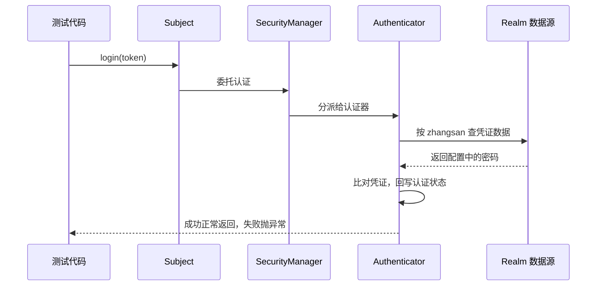
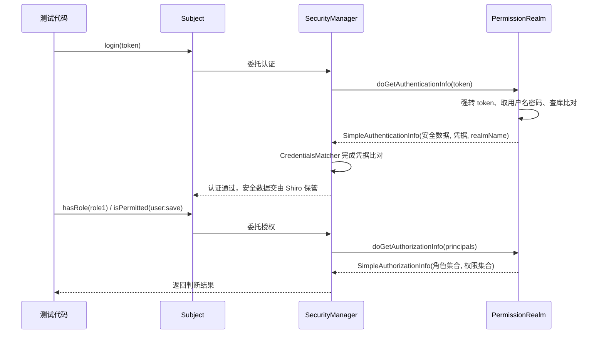
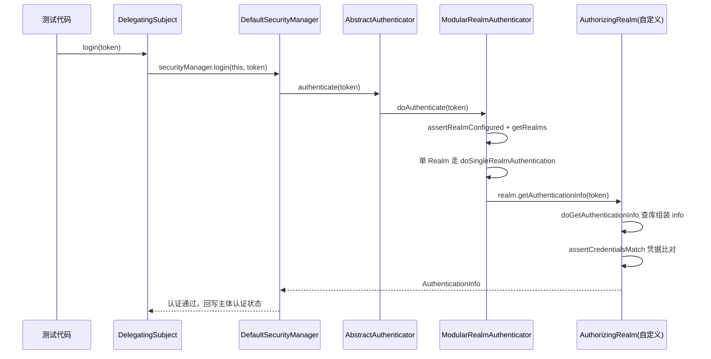

# Shiro 认证与授权：从 ini 最小环境到自定义 Realm 与源码执行链

> 🔒 安全提示：文中示例的口令/密钥均为课程教学环境演示口径，生产环境的安全要求见《安全与合规须知》。

## 先给结论

- 这个系列把 Shiro 的动手三步走完：先在脱离容器的最小环境里跑通认证授权，再把自定义 Realm 的两个方法补全，最后用断点把 subject.login 背后的源码委托链走一遍。
- 认证就是 subject.login(token)，授权就是 hasRole 与 isPermitted，授权必须建立在认证通过之上；ini 方式的调用链固定：建工厂、取 SecurityManager、绑定运行环境、取 Subject、构造 token、login、验证。
- ini 文件里 [users] 段声明用户与角色，[roles] 段声明角色与权限，权限点采用「资源：操作」的命名约定；认证失败抛 IncorrectCredentialsException，授权判断只返回布尔值。
- 自定义 Realm 继承 AuthorizingRealm：认证方法 doGetAuthenticationInfo 固定六步，查库比对后返回 SimpleAuthenticationInfo；授权方法 doGetAuthorizationInfo 用 getPrimaryPrincipal 取身份，查到的角色权限装进 SimpleAuthorizationInfo。
- 密码比对的归属要分清：Realm 只提供数据库那一半数据，最终凭据比对由框架的 CredentialsMatcher 完成。
- 源码链路的结论：login 先到 DelegatingSubject 转手，DefaultSecurityManager 委托给认证器 ModularRealmAuthenticator，单 Realm 走 doSingleRealmAuthentication，最终落到自定义 Realm 的方法。
- 授权是同一套委托模式：SecurityManager 交给 Authorizer 授权器，再由 Realm 的 doGetAuthorizationInfo 供给数据。
- 学习重心由此清晰：学会获取 Subject，学会自定义 Realm，其余环节框架已经替你接好。

## 第1部分：shiro认证与授权_基于ini的用户认证

体系结构图看完，轮到动手。这一课的目标是把第一个 Shiro 程序跑起来，亲眼看到认证和授权在框架里怎么流转。为了排除一切干扰，程序不带 Web 容器、不连数据库，用户数据直接写在 ini 配置文件里，一个纯 Maven 工程就能完成认证与授权的全流程；课程的收尾把自定义 Realm 的类骨架搭出来，为接入真实数据库做好准备。

### 一、搭一个脱离容器的最小环境

新建一个空的 Maven 工程，不搭父子模块，两个依赖就够了：

```xml
<dependencies>
    <dependency>
        <groupId>org.apache.shiro</groupId>
        <artifactId>shiro-core</artifactId>
        <version>1.3.2</version>
    </dependency>
    <dependency>
        <groupId>junit</groupId>
        <artifactId>junit</artifactId>
        <version>4.12</version>
        <scope>test</scope>
    </dependency>
</dependencies>
```

`shiro-core` 是框架本体，junit 用来写认证授权的单元测试。因为案例的目的是看清内部执行流程，连数据库这一步也省掉，测试用户直接配置进 Shiro 的 ini 文件。

### 二、认证：七步走通第一次登录

ini 配置文件放在 `src/main/resources` 下，文件名随意，比如 `shiro-test-1.ini`。第一个版本只声明用户数据：

```ini
[users]
#模拟从数据库查询的用户
#数据格式：用户名=密码
zhangsan=123456
lisi=654321
```

中括号的 `[users]` 是 ini 的固定段落格式，一行一个用户。接下来是认证测试类，整段代码按步骤编号，每一步都有明确的身份：

```java
package com.example.shiro;

import org.apache.shiro.SecurityUtils;
import org.apache.shiro.authc.UsernamePasswordToken;
import org.apache.shiro.config.IniSecurityManagerFactory;
import org.apache.shiro.mgt.SecurityManager;
import org.apache.shiro.subject.Subject;
import org.apache.shiro.util.Factory;
import org.junit.Test;

public class ShiroTest01 {

    @Test
    public void testLogin() {
        //1.根据配置文件创建 SecurityManager 工厂
        Factory<SecurityManager> factory =
                new IniSecurityManagerFactory("classpath:shiro-test-1.ini");
        //2.通过工厂获取 SecurityManager
        SecurityManager securityManager = factory.getInstance();
        //3.将 SecurityManager 绑定到当前运行环境
        SecurityUtils.setSecurityManager(securityManager);
        //4.从当前运行环境中获取 Subject
        Subject subject = SecurityUtils.getSubject();
        //5.构造用户认证数据（模拟用户输入的用户名密码）
        String username = "zhangsan";
        String password = "123456";
        UsernamePasswordToken token = new UsernamePasswordToken(username, password);
        //6.主体登录
        subject.login(token);
        //7.验证登录是否成功，并获取登录数据
        System.out.println("用户登录是否成功：" + subject.isAuthenticated());
        System.out.println("当前登录用户：" + subject.getPrincipal());
    }
}
```

对照上一节的体系结构看这段代码：第 1 步的工厂负责读取 ini 并组装出 SecurityManager，第 2 步取出的就是框架的心脏；第 3 步把它绑定到当前运行环境，之后第 4 步才能凭空拿到 Subject，因为 Subject 由 SecurityManager 管理，环境里没有它就拿不到主体。第 5 步构造的 `UsernamePasswordToken` 是登录凭证的载体，构造参数就是模拟用户在登录页输入的用户名和密码；`login` 方法接收的正是这种 AuthenticationToken 类型的认证数据。第 7 步里，只要登录过，所有信息都能从 Subject 上取：`isAuthenticated()` 返回认证结果，`getPrincipal()` 返回登录成功后保存的安全数据，默认就是用户名。

执行结果两个都符合预期：登录成功打印 `true`， principal 打印 `zhangsan`。把密码故意改成错的再跑，控制台抛出异常，关键信息是 `IncorrectCredentialsException`，并附带一句凭证不匹配的描述，这正是 Shiro 表达「登录失败」的方式。

认证时内部的真实流转是这样的：



图里能看出 ini 文件在本例中扮演了 Realm 的角色：框架按配置内置了一个读 ini 的 Realm，认证器从中取数据比对。换成数据库，变的只是 Realm 的实现，流转路径不变。

### 三、授权：hasRole 与 isPermitted

认证解决「你是谁」，授权解决「你能干什么」。第二个案例换一份带角色与权限的配置，`shiro-test-2.ini`：

```ini
[users]
#数据格式：用户名=密码,角色1,角色2
zhangsan=123456,role1,role2
lisi=123456,role2

[roles]
#数据格式：角色=权限1,权限2
role1=user:save,user:update
role2=user:find
```

这是标准的 RBAC 写法：张三拥有 role1 与 role2 两个角色，李四只有 role2；role1 带有 `user:save` 和 `user:update` 两个权限点，role2 只有 `user:find`。`user:save` 里的冒号不是语法强制，而是 `资源:操作` 的通用命名约定，权限字符串的格式完全由使用方自己定义。

测试代码与认证案例的前六步完全一致，于是把公共部分抽到 `@Before` 方法里，每个测试执行前先完成工厂创建、获取 SecurityManager、绑定运行环境的初始化：

```java
package com.example.shiro;

import org.apache.shiro.SecurityUtils;
import org.apache.shiro.authc.UsernamePasswordToken;
import org.apache.shiro.config.IniSecurityManagerFactory;
import org.apache.shiro.mgt.SecurityManager;
import org.apache.shiro.subject.Subject;
import org.apache.shiro.util.Factory;
import org.junit.Before;
import org.junit.Test;

public class ShiroTest02 {

    @Before
    public void init() {
        //1.根据配置文件创建 SecurityManager 工厂
        Factory<SecurityManager> factory =
                new IniSecurityManagerFactory("classpath:shiro-test-2.ini");
        //2.通过工厂获取 SecurityManager
        SecurityManager securityManager = factory.getInstance();
        //3.将 SecurityManager 绑定到当前运行环境
        SecurityUtils.setSecurityManager(securityManager);
    }

    @Test
    public void testAuthorization() {
        //4.获取 Subject 并登录（授权之前必须先认证）
        Subject subject = SecurityUtils.getSubject();
        UsernamePasswordToken token = new UsernamePasswordToken("zhangsan", "123456");
        subject.login(token);

        //5.验证角色与权限
        System.out.println("是否拥有 role1 角色：" + subject.hasRole("role1"));
        System.out.println("是否拥有 user:save 权限：" + subject.isPermitted("user:save"));
    }
}
```

以张三登录，`hasRole("role1")` 返回 `true`，`isPermitted("user:save")` 也返回 `true`，因为配置文件里 role1 恰好带着 `user:save`。把用户名换成李四再跑，两个结果全部变成 `false`：李四只有 role2，而 role2 的权限列表里没有 `user:save`。同一份代码，换了登录人就得到不同结果，说明判断依据完全来自 Realm 提供的数据。

授权和认证的对比值得记牢：认证是 `login` 动作，失败抛异常；授权是 `hasRole`、`isPermitted` 这样的询问动作，返回布尔值，结果不对就返回 `false`，把「不让做」的决策留给调用方。

### 四、走向真实项目：自定义 Realm 的骨架

ini 案例把流程跑通了，但真实企业里没有人用配置文件存用户，用户、角色、权限都在数据库里，登录时要从库里查出来交给框架。这就回到了上一节说的那个词：Realm，安全数据的来源。数据从哪来，就要在 Realm 里和底层数据库交互。

先准备第三份配置文件 `shiro-test-3.ini`。这次不再写 `[users]` 数据段，而是用 `[main]` 段把自定义 Realm 声明出来（注册段的写法按 Shiro 主流方式补全）：

```ini
[main]
#声明自定义 Realm，全限定类名由自己决定
permissionRealm=com.example.shiro.PermissionRealm
#将 Realm 注册给 SecurityManager 统一管理
securityManager.realms=$permissionRealm
```

`[main]` 段是对象声明区，框架按全限定类名实例化对象，`$引用名` 则完成注入。这样 Shiro 就知道「我有一个自定义 Realm」。

然后是重头戏，自定义 Realm 类本身：

```java
package com.example.shiro;

import org.apache.shiro.authc.AuthenticationException;
import org.apache.shiro.authc.AuthenticationInfo;
import org.apache.shiro.authc.AuthenticationToken;
import org.apache.shiro.authz.AuthorizationInfo;
import org.apache.shiro.realm.AuthorizingRealm;
import org.apache.shiro.subject.PrincipalCollection;

//自定义 Realm 对象，继承 AuthorizingRealm
public class PermissionRealm extends AuthorizingRealm {

    //授权方法：获取用户的授权数据（角色、权限数据）
    @Override
    protected AuthorizationInfo doGetAuthorizationInfo(PrincipalCollection principalCollection) {
        return null;
    }

    //认证方法：根据用户名查凭证完成登录，将用户安全数据保存
    @Override
    protected AuthenticationInfo doGetAuthenticationInfo(AuthenticationToken authenticationToken)
            throws AuthenticationException {
        return null;
    }

    //重写 setName：框架内部按名称区分和路由 Realm
    @Override
    public void setName(String name) {
        super.setName(name);
    }
}
```

继承 `AuthorizingRealm` 后必须实现的抽象方法有两个，名字很长，含义却直白：`doGetAuthenticationInfo` 是认证方法，根据用户名查询凭证支撑登录，登录成功后把用户数据保存为安全数据；`doGetAuthorizationInfo` 是授权方法，获取用户的角色与权限数据，支撑 `hasRole` 与 `isPermitted` 的判断。方法体里现在还是 `return null`，查库、比对密码、组装返回值这些实现放在后续课程展开，本课先把类骨架和方法职责立起来。

`setName` 是一个容易被小看的细节。Shiro 里可以同时存在多个 Realm，框架靠名称来区分和路由它们，认证处理过程按名称进行。惯例是类叫什么名字，`setName` 就传什么，保持一致即可。

## 第2部分：shiro认证与授权_自定义realm-中

上一课把 `PermissionRealm` 的骨架立了起来，两个重写方法里还躺着 `return null`。方法不补全，登录永远走不通：认证方法返回 null，框架视同「查无此人」；授权方法返回 null，`hasRole` 与 `isPermitted` 只会安静地返回 false。这一课把两个方法从注释写成可运行的代码，顺带回答一个写代码时最容易糊的问题：密码比对到底是谁在做。

### 一、认证方法：把「登录」翻译成六步代码

认证的主要目的，就是比对用户名和密码是否与数据库中的一致；比对成功，把安全数据存入 Shiro 保管。`doGetAuthenticationInfo` 的参数类型是 `AuthenticationToken`，这是个接口，而登录时构造的是 `UsernamePasswordToken`，它正是这个接口的实现类。参数传进来时发生了向上转型，所以方法要做的第一件事就是转回来：

```java
//认证：比对用户名和密码是否与数据库中的一致，成功后将安全数据存入 Shiro 保管
@Override
protected AuthenticationInfo doGetAuthenticationInfo(AuthenticationToken authenticationToken)
        throws AuthenticationException {
    //1.构造 upToken：把接口参数强转回登录时构造的 UsernamePasswordToken
    UsernamePasswordToken upToken = (UsernamePasswordToken) authenticationToken;
    //2.获取用户输入的用户名密码
    String username = upToken.getUsername();
    String password = new String(upToken.getPassword());
    //3.根据用户名查询数据库（正式系统必做，案例从简省略）
    //4.比对密码和数据库中的密码是否一致（密码可能需要加密）
    //5.如果成功，向 Shiro 存入安全数据
    if ("123456".equals(password)) {
        SimpleAuthenticationInfo info =
                new SimpleAuthenticationInfo(username, password, getName());
        return info;
    }
    //6.失败，抛出异常或返回 null
    throw new RuntimeException("用户名或密码错误");
}
```

第 2 步有个小细节值得单独说：`getUsername()` 直接返回 String，`getPassword()` 返回的却是 `char[]`，这是框架有意为之，`new String(upToken.getPassword())` 是标准转法。

第 3、4 步在正式系统里是根据用户名查库、取出库中密码再比对，密码还可能要先加密。案例为了聚焦流程把这两步合并：假定合法密码就是 `123456`，直接与输入值比较，数据库交互留到有真实工程的时候再补。

第 5 步是方法的真正产出。`SimpleAuthenticationInfo` 的构造参数有三个，各管一件事：

- 参数一 principal，安全数据。存用户名就传字符串，存用户对象就传对象，它是登录成功后从 Subject 上能取回的那份数据。
- 参数二 credentials，密码。认证要用的凭据，案例里放输入的明文，正式系统放数据库里的那一半。
- 参数三 realmName，当前 Realm 的名称。传 `getName()`，上一课 `setName("permissionRealm")` 设置的名称在这里派上用场。

第 6 步的失败处理两种写法都可以：抛异常，或者直接返回 null。返回 null 时框架会抛 `UnknownAccountException`，语义是「没查到这个账号」；主动抛 `RuntimeException` 则由调用方 catch 后自行组织提示语。

### 二、凭据比对原理：Realm 提供数据，框架完成比对

很多初学者以为密码比对就写在 `doGetAuthenticationInfo` 里，其实上面代码里的 `if` 只是案例的简化。`AuthorizingRealm.getAuthenticationInfo(token)` 的真实逻辑分两段：先调用 `doGetAuthenticationInfo` 拿到 `AuthenticationInfo`，info 为 null 直接按账号不存在处理；info 不为 null，则进入 `assertCredentialsMatch(token, info)`，把比对工作交给 CredentialsMatcher。

默认的 `SimpleCredentialsMatcher` 会把两边凭据都转成字节数组再比对：一边是 token 里的凭据，来自用户登录输入；另一边是 info 里的 credentials，来自 Realm 返回的数据。两边一致，认证通过；不一致，抛 `IncorrectCredentialsException`。

按这个原理，认证成功必须同时满足两个条件：Realm 查到了用户（info 不为 null），并且两边凭据匹配。案例代码虽然手动比对了一次，matcher 随后还会再比一次，只是两边都是 `123456`，所以静默通过。正式系统的标准姿势是：Realm 里不写 if，只负责查库并把数据库里的密码装进 info，比对完全交给 matcher；密码加密之后，token 里装密文、数据库存密文，明文从头到尾不出现在比对环节（day06 的 `Md5Hash` 会展开这一段）。

### 三、授权方法：getPrimaryPrincipal 取身份，SimpleAuthorizationInfo 交答案

授权指的是登录成功之后，判断当前这个人是否具备操作某一个资源的权限。授权方法 `doGetAuthorizationInfo` 的主要目的就一句话：根据认证数据，查到用户的角色与权限信息。

它的参数是 `PrincipalCollection`，里面装着所有已认证的安全数据。登录成功时存进去的是用户名，所以从集合里必然能把它取出来：

```java
//授权：根据认证数据获取用户的角色、权限信息
@Override
protected AuthorizationInfo doGetAuthorizationInfo(PrincipalCollection principalCollection) {
    //1.获取安全数据（username 或 userId）
    String username = (String) principalCollection.getPrimaryPrincipal();
    //2.根据 id 或名称查询用户
    //3.查询该用户的角色和权限信息（案例用假数据代替查库）
    List<String> perms = new ArrayList<>();
    perms.add("user:save");
    perms.add("user:update");
    List<String> roles = new ArrayList<>();
    roles.add("role1");
    roles.add("role2");
    //4.构造返回
    SimpleAuthorizationInfo info = new SimpleAuthorizationInfo();
    info.addStringPermissions(perms);
    info.addRoles(roles);
    return info;
}
```

`getPrimaryPrincipal()` 取出的是「主要」安全数据。案例只存了一个 username，取到的就是唯一值，强制转回 String 即可；如果存的是用户对象，这里拿到的就是对象本身。拿到身份后，正常流程是查用户、再查角色和权限，案例不连数据库，用两个 List 模拟查询结果：角色 `role1`、`role2`，权限 `user:save`、`user:update`。

返回值 `AuthorizationInfo` 同样是接口，实现类要用 `Simple` 开头的 `SimpleAuthorizationInfo`。两个装配方法要记准：`addRoles` 装角色集合，`addStringPermissions` 装权限字符串集合，两者都是往集合里 add 而不是 set 覆盖。info 一返回，`hasRole` 与 `isPermitted` 的判断依据就有了。

### 四、跑一次完整测试：先认证，后授权

测试类从上一课的 `ShiroTest02` 复制一份叫 `ShiroTest03`，初始化换成 `shiro-test-3.ini`，也就是 `[main]` 段把自定义 Realm 注册进 SecurityManager 的那份配置：

```ini
[main]
permissionRealm=com.example.shiro.PermissionRealm
securityManager.realms=$permissionRealm
```

配置就绪后，SecurityManager 已经知道认证走哪个方法、授权走哪个方法。测试代码模拟 lisi 登录，再做两个授权判断：

```java
public class ShiroTest03 {

    public void init() {
        Factory<SecurityManager> factory =
                new IniSecurityManagerFactory("classpath:shiro-test-3.ini");
        SecurityManager securityManager = factory.getInstance();
        SecurityUtils.setSecurityManager(securityManager);
    }

    @Test
    public void testLogin() {
        Subject subject = SecurityUtils.getSubject();
        String username = "lisi";
        String password = "123456";
        UsernamePasswordToken token = new UsernamePasswordToken(username, password);
        //执行 login，触发 Realm 中的认证方法
        subject.login(token);
        //授权：检测当前登录用户是否具有某个角色、某个权限
        System.out.println(subject.hasRole("role1"));
        System.out.println(subject.isPermitted("user:save"));
    }
}
```

课堂上的第一次运行报了错，错误信息是 `No configured realms`（提示必须至少配置一个 Realm 才能执行认证）。原因是构造 SecurityManager 时用错了 ini，加载的是没有 `[main]` 段的旧配置，框架手里一个 Realm 都没有；换回 `shiro-test-3.ini` 后一切正常。今后见到这个报错，第一反应就是检查 Realm 有没有真正注册进安全管理器。

为了让两个回调的触发时机更直观，在两个方法里各加一句打印，输出顺序非常稳定：`login` 一执行先打出「执行认证方法」，`hasRole`、`isPermitted` 执行时打出「执行授权方法」。整条链路是这样的：



图的关键在于两条互不相同的触发线：认证方法由 `login` 触发一次，授权方法由每一个授权调用触发，谁问就为谁现查现组装。这也解释了授权数据为什么要做成方法返回值而不是构造参数，它是按需供给的。

## 第3部分：shiro认证与授权_执行流程分析

自定义 Realm 已经能跑通认证和授权，但 `subject.login(token)` 就一行代码，它怎么就调到了自己写的 `doGetAuthenticationInfo`？面试里被问「Shiro 认证流程」时只背出「Subject、SecurityManager、Realm 三个核心」是不够的，得能说出中间的委托链。这一课用断点跟着真实源码走一遍，把这条链上的每个类、每个方法名落实。

### 一、断点打在 login：两次转手就到安全管理器

测试代码回到上一课的 `ShiroTest03`，断点打在 `subject.login(token)` 这一行，以 Debug 方式启动：

```java
@Test
public void testLogin() {
    Subject subject = SecurityUtils.getSubject();
    String username = "zhangsan";
    String password = "123456";
    UsernamePasswordToken token = new UsernamePasswordToken(username, password);
    //执行 login，最终会走到 realm 中的认证方法
    subject.login(token);
    //授权：realm 中的授权方法
    System.out.println(subject.hasRole("role1"));
    System.out.println(subject.isPermitted("user:save"));
}
```

单步进入（F7）后先落在 `DelegatingSubject.login`。这是 Subject 接口的默认实现类，方法体里没有认证逻辑，核心一句是 `this.securityManager.login(this, token)`，把自己和 token 一起交给了安全管理器。

再进入就到了 `DefaultSecurityManager`。调试窗口能看到，工程里默认的安全管理器实际类型就是它。它的 `login` 方法把认证动作进一步转成 `this.authenticate(token)`，而 `authenticate` 内部干的事是 `return this.authenticator.authenticate(token)`。authenticator 这个词看着眼熟，正是体系结构图里 SecurityManager 内部的那个认证器。

两次转手，调用权就从「拿 token 的人」交到了「管认证的人」手里。

### 二、认证器登场：多 Realm 的调度策略

进入认证器，源码的阵容慢慢展开。`AbstractAuthenticator.authenticate` 是个模板方法，做了空值检查和异常包装后，真正的活儿交给 `doAuthenticate`。它的实现类是 `ModularRealmAuthenticator`，源码不长：

```java
protected AuthenticationInfo doAuthenticate(AuthenticationToken authenticationToken) throws AuthenticationException {
    this.assertRealmConfigured();
    Collection<Realm> realms = this.getRealms();
    if (realms.size() == 1) {
        return this.doSingleRealmAuthentication(realms.iterator().next(), authenticationToken);
    } else {
        return this.doMultiRealmAuthentication(realms, authenticationToken);
    }
}
```

第一行 `assertRealmConfigured` 就是上一课那个报错的源头：一个 Realm 都没注册，这里直接抛 `No configured realms`。往下 `getRealms()` 拿到 Realm 集合，调试时把集合展开，里面的元素只有一个，正是自定义的 `PermissionRealm`，因为 ini 的 `[main]` 段只注册了它。

集合大小决定走哪条分支，这两条分支对应讲义里提到的认证策略：

- 只有一个 Realm：`doSingleRealmAuthentication`，不做策略汇总，成败就由它决定。
- 两个及以上：`doMultiRealmAuthentication`，按 AuthenticationStrategy 汇总多个 Realm 的结果，常见策略如「至少一个成功即通过」「全部成功才通过」。

单 Realm 分支的源码把认证失败的两个经典异常都点出来了：

```java
protected AuthenticationInfo doSingleRealmAuthentication(Realm realm, AuthenticationToken token) {
    if (!realm.supports(token)) {
        throw new UnsupportedTokenException("Realm [" + realm + "] does not support authentication token ...");
    }
    AuthenticationInfo info = realm.getAuthenticationInfo(token);
    if (info == null) {
        throw new UnknownAccountException("Realm [" + realm + "] was unable to find account ...");
    }
    return info;
}
```

`supports` 检查这个 Realm 认不认这种 token 类型；`getAuthenticationInfo` 往下再进一层，执行的就是自定义 Realm 里写的 `doGetAuthenticationInfo`，返回 null 的后果也在这里被升级成 `UnknownAccountException`。之前写「失败返回 null 也行」时框架兜底的位置，现在有了准确坐标。

### 三、完整时序图：从一行 login 到自定义 Realm

把断点走过的每一站串起来，认证的完整调用链是这样：



图里最值得记的一环是最后两行都在 `AuthorizingRealm` 内部：`getAuthenticationInfo` 先调自定义的 `doGetAuthenticationInfo` 拿数据，再 `assertCredentialsMatch` 用 CredentialsMatcher 比对凭据。Realm 自身的方法只负责「提供数据」，比对与异常判定都是框架父类的事，这与上一课的结论完全对上了。

### 四、授权链路：换个组件，同一套模式

认证走通了，授权不必再逐帧调试，结构上它就是同一套委托模式的镜像。讲义把两张流程图并排给出：认证流程里 SecurityManager 委托的是 Authenticator，授权流程里委托的换成了 Authorizer，终点都是 Pluggable Realms。


对照代码：`subject.hasRole("role1")` 与 `subject.isPermitted("user:save")` 都由 SecurityManager 转给授权器，授权器调用 Realm 的 `doGetAuthorizationInfo` 拿到 `SimpleAuthorizationInfo`，再判断集合里有没有目标角色、目标权限串。把 `zhangsan` 登录后这两行跑起来，输出 `true` 与 `true`，与 ini 里 `role1=user:save,user:update` 的配置吻合。

到这一步，day05 的入门案例就完整了。回顾整条链，写 Shiro 代码真正要操心的只有两件事：怎么拿到 Subject，怎么自定义 Realm 并在其中组装认证与授权数据。中间的 SecurityManager、认证器、授权器都是固定管线，理解即可，不必改动。

## 常见误区

- **忘记绑定 SecurityManager**：跳过 `SecurityUtils.setSecurityManager` 直接 `getSubject`，运行环境里没有安全管理器，直接抛 `UnavailableSecurityManagerException`。第 2、3 步一步都不能少。
- **SecurityManager 导错包**：JDK 自带的 `java.lang.SecurityManager` 与 Shiro 的 `org.apache.shiro.mgt.SecurityManager` 同名，IDE 自动补全常常引成前者，类型对不上满屏报错。认准 Shiro 包路径。
- **ini 文件路径写错**：文件必须放在 classpath 下（`src/main/resources`），工厂参数带 `classpath:` 前缀，写成磁盘绝对路径或放错目录都会找不到文件。
- **授权前没有登录**：`hasRole` 与 `isPermitted` 依赖当前主体的认证状态和数据，未登录状态下结果不可信，授权代码必须排在 `login` 之后。
- **权限字符串两边不一致**：代码里问的是 `user:save`，配置里写的是 `user_save` 或 `save:user`，`isPermitted` 只会安静地返回 `false`，不报任何错，排查全靠比对拼写。
- **强转的 token 类型和登录构造的不一致**：登录传的是 `UsernamePasswordToken`，Realm 里就强转成它；登录换了别的 token 实现，这里强转会直接抛 `ClassCastException`。类型要成对出现。
- **对 `char[]` 直接 toString**：`upToken.getPassword().toString()` 拿到的是数组地址串，不是密码。必须 `new String(upToken.getPassword())`。
- **info 里的凭据和 token 里的凭据对不上**：手动 if 比对通过，返回的 `SimpleAuthenticationInfo` 第二个参数却塞了别的值，matcher 依然会抛 `IncorrectCredentialsException`。存进 info 的必须是「数据库那一半」。
- **授权方法返回 null 或忘记 add**：`doGetAuthorizationInfo` 返回 null，所有 `hasRole`、`isPermitted` 一律 false；构造了 info 却漏调 `addRoles`、`addStringPermissions`，结果同样是空。
- **配置文件没注册 Realm**：`[main]` 段缺失或 `$permissionRealm` 引用写错，运行直接报 `No configured realms`，与代码写得多正确无关。
- **以为比对密码的代码写在 login 里**：`login` 一路只做委托，比对发生在 `AuthorizingRealm.assertCredentialsMatch`，自定义 Realm 只负责把数据库凭据装进 info。
- **Realm 集合为空还怪代码**：`No configured realms` 抛在 `assertRealmConfigured`，说明安全管理器里一个 Realm 都没有，检查注册配置而不是去改认证逻辑。
- **单 Realm 与多 Realm 行为混为一谈**：多个 Realm 时结果由认证策略汇总，某个 Realm 失败不一定整体失败；只配一个 Realm 时成败一锤定音，两种场景的语义不同。
- **把 `UnknownAccountException` 归咎于自己没抛**：info 为 null 时这个异常由框架在 `doSingleRealmAuthentication` 里自动抛出，自定义代码里可以不写任何 throw。

## 面试可能被问到的问题

1. 面试官追问：「基于 ini 的 Shiro 认证，代码步骤是怎样的？」
   答：用 `IniSecurityManagerFactory` 加载 ini 创建工厂，`getInstance` 取出 SecurityManager，`SecurityUtils.setSecurityManager` 绑定到运行环境，`getSubject` 获取主体，构造 `UsernamePasswordToken` 装用户名密码，调用 `subject.login(token)` 完成登录，最后用 `isAuthenticated` 验证、`getPrincipal` 取身份。

2. 面试官追问：「Shiro 登录失败会抛什么异常，怎么区分用户不存在和密码错误？」
   答：账号不存在抛 `UnknownAccountException`，账号存在但凭证不匹配抛 `IncorrectCredentialsException`，两者都是 AuthenticationException 的子类。实践中通常合并成统一的「用户名或密码错误」提示，避免向外部暴露账号是否存在。

3. 面试官追问：「hasRole 和 isPermitted 有什么区别？」
   答：`hasRole` 判断主体是否拥有某个角色，`isPermitted` 判断是否拥有某个具体权限点。角色是权限的集合，粗粒度控制用角色，精细到「能不能做某件事」用权限点，权限字符串格式由项目自己约定，常见的是 `资源:操作`。

4. 面试官追问：「自定义 Realm 为什么要继承 AuthorizingRealm，两个重写方法各干什么？」
   答：AuthorizingRealm 同时具备认证与授权能力，是自定义 Realm 的常用父类。`doGetAuthenticationInfo` 负责认证，按用户名查库返回凭证信息供框架比对；`doGetAuthorizationInfo` 负责授权，返回用户的角色与权限集合供 hasRole、isPermitted 判断。

5. 面试官追问：「SecurityUtils.setSecurityManager 这一步为什么必须做？」
   答：Subject 由 SecurityManager 管理并调度，绑定操作把安全管理器挂到当前运行环境，后续 getSubject 才有依托。独立应用必须手动绑定，与 Spring 集成时这一步由容器配置代劳。

6. 面试官追问：「多个 Realm 共存时，Shiro 怎么处理认证结果？」
   答：SecurityManager 会按顺序让多个 Realm 尝试认证，结果按认证策略（AuthenticationStrategy）汇总，常见的有至少一个成功即通过、全部成功才通过、第一个成功即通过。授权数据同理可以由多个 Realm 合并提供。
7. 面试官追问：「自定义 Realm 的认证方法什么时候被触发，参数是什么？」
   答：调用 `subject.login(token)` 时由 SecurityManager 委托触发，参数是登录时构造的 `AuthenticationToken` 实例，通常是 `UsernamePasswordToken`。方法内部把它强转回实现类，取出用户名密码，查库比对后返回 `SimpleAuthenticationInfo` 或抛异常。

8. 面试官追问：「SimpleAuthenticationInfo 的三个构造参数分别是什么含义？」
   答：第一个是 principal，安全数据，登录成功后可从 Subject 取回，可以是用户名或用户对象；第二个是 credentials，数据库侧的凭据，供框架比对；第三个是 realmName，当前 Realm 的名称，多 Realm 场景下用来区分数据来源。

9. 面试官追问：「密码比对是在 doGetAuthenticationInfo 里完成的吗？」
   答：不完全是。Realm 只负责按用户名取回数据库侧的凭据并装入 info，真正的比对发生在 `AuthorizingRealm` 的 `assertCredentialsMatch` 中，由 CredentialsMatcher 完成，默认实现按字节数组比较。Realm 也可以注入自定义 matcher 来支持加密比对。

10. 面试官追问：「认证方法返回 null 和抛异常有什么区别？」
   答：返回 null 时框架按账号不存在处理，抛出 `UnknownAccountException`；抛 `IncorrectCredentialsException` 则表示账号存在但密码不匹配。生产环境通常在调用方统一 catch 成「用户名或密码错误」，避免暴露账号是否存在。

11. 面试官追问：「doGetAuthorizationInfo 返回 null 会怎样？」
   答：框架认为该用户没有任何角色和权限，`hasRole` 与 `isPermitted` 全部返回 false，基于权限的访问控制会把人挡在门外。排查权限全为 false 的问题时，先确认这个方法有没有返回装好数据的 info。

12. 面试官追问：「PrincipalCollection 里的 primary principal 指什么？」
   答：认证成功时存入的安全数据可能有多个（用户名、用户 ID、用户对象），primary principal 是其中的主要身份标识，也就是构造 `SimpleAuthenticationInfo` 时传的第一个参数。`getPrimaryPrincipal()` 取的就是它，用前要按实际存入的类型强转。
13. 面试官追问：「subject.login 之后到自定义 Realm 之前，经过了哪些组件？」
   答：`DelegatingSubject.login` 先把请求转给 SecurityManager（默认 `DefaultSecurityManager`），SecurityManager 调 `authenticate` 委托给认证器 `ModularRealmAuthenticator`，认证器根据 Realm 数量选择单 Realm 或多 Realm 认证方法，最终调用 Realm 的 `getAuthenticationInfo`，也就是自定义的 `doGetAuthenticationInfo`。

14. 面试官追问：「多个 Realm 时认证结果怎么判定？」
   答：由 `ModularRealmAuthenticator` 按 AuthenticationStrategy 汇总。常见策略有 AtLeastOneSuccessful（一个成功即通过）、AllSuccessful（全部成功才通过）、FirstSuccessful（第一个成功即通过），默认是 AtLeastOneSuccessful，策略可以在 SecurityManager 上配置。

15. 面试官追问：「认证流程和授权流程有什么异同？」
   答：相同点都是从 Subject 发起、由 SecurityManager 统一委托、最终数据都来自 Realm。不同点在于中间组件与触发方式：认证走 Authenticator，由 login 主动触发且失败抛异常；授权走 Authorizer，由 hasRole、isPermitted 这类询问触发，返回布尔值不抛异常。

16. 面试官追问：「UnknownAccountException 是在哪里抛出来的？」
   答：单 Realm 认证时抛在 `ModularRealmAuthenticator.doSingleRealmAuthentication` 中，条件是 `realm.getAuthenticationInfo(token)` 返回 null。所以自定义 Realm 的认证方法返回 null 等价于「账号不存在」，框架会替你抛出这个异常。

17. 面试官追问：「为什么不直接在 Controller 里写登录逻辑，要绕这么大一圈？」
   答：委托链换来的解耦：认证逻辑集中在 Realm 一处，数据源可插拔（ini、数据库、LDAP 都只是换个 Realm），多个 Realm 与认证策略、缓存、会话管理都由框架在这条链上统一处理，业务代码只面对 Subject 一个门面。

## 配套资料

- 本课资料包无 Shiro 源码工程，仅有通用代码：`materials/code/02/day05 JWT的权限控制与Shiro入门/JWT的权限控制与Shiro入门/资源/通用代码/SystemConfig.java`、同目录 `SystemApplication.java`。
- 文中 pom 依赖、两份 ini 配置、测试类与自定义 Realm 骨架均按本课屏幕代码整理，课堂原包名已统一改写为 `com.example`；`[main]` 段的 Realm 注册写法为按 Shiro 主流方式补全。
- 可对照运行的是下一课资料包的 Shiro 案例：`materials/code/02/day06 Shiro高级 及SaaS-HRM的认证授权/Shiro高级 及SaaS-HRM的认证授权/资源/shiro案例代码/shiro_springboot/`
- 本课为纯 Java 案例课，day05 资料包未含 Shiro 案例源码工程，文中 `PermissionRealm` 与测试类按课堂屏幕代码整理，包名已统一改写为 `com.example`；六步注释与假数据与课堂实现一致。
- 资料包通用代码：`materials/code/02/day05 JWT的权限控制与Shiro入门/JWT的权限控制与Shiro入门/资源/通用代码/SystemApplication.java`、同目录 `SystemConfig.java`（可对照同一项目里 JWT 方式的工程配置）。
- 可运行的对照工程在下一课资料包：`materials/code/02/day06 Shiro高级 及SaaS-HRM的认证授权/Shiro高级 及SaaS-HRM的认证授权/资源/shiro案例代码/shiro_springboot/`。
- 本课为源码调试课，调试对象是 Shiro 1.3.2 依赖包中的类（`DelegatingSubject`、`DefaultSecurityManager`、`ModularRealmAuthenticator` 等），资料包未单独提供 Shiro 源码文件，文中源码片段按课堂调试画面整理，与依赖包源码一致。
- 依赖坐标可对照：`materials/code/02/day06 Shiro高级 及SaaS-HRM的认证授权/Shiro高级 及SaaS-HRM的认证授权/资源/shiro案例代码/shiro_springboot/pom.xml`（`shiro-core` 与 `shiro-spring` 均为 1.3.2）。
- 课堂测试代码的完整工程化版本：同目录 `shiro案例代码/shiro_springboot/`。
