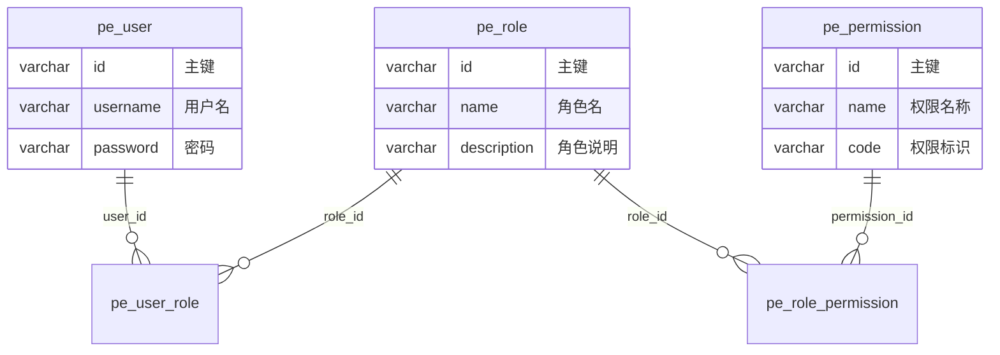
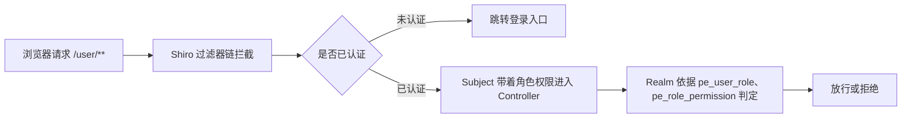

# 把 Shiro 从 ini 搬进 Spring Boot：day06 的案例工程长什么样

> 🔒 安全提示：文中示例的口令/密钥均为课程教学环境演示口径，生产环境的安全要求见《安全与合规须知》。

day05 的 Shiro 全部跑在纯 Java 环境里：ini 文件当数据源，main 方法当入口，认证授权都通了，可那不是一个真实工程的样子。真实项目里用户在数据库、请求走 Controller、容器由 Spring Boot 管理。day06 要做三件事：把 Shiro 整合进 Spring Boot 工程、认识 Shiro 的会话管理、最终用 Shiro 给 SaaS-HRM 实现第二种认证方式，之前用 JWT 做过的登录鉴权，这次换成 Shiro 再做一遍。这一课先看清楚要用的案例：一张 RBAC 数据库脚本，和一个只差权限控制的后端工程。

## 先给结论

- day06 的三块内容是递进关系：先在 Spring Boot 里整合 Shiro 跑通权限控制，再学 Shiro 的会话管理，最后把这套能力移植进 SaaS-HRM 系统替代 JWT 方案。
- 案例数据库 `shiro_db` 是标准 RBAC 五张表：用户表、角色表、权限表，加用户角色、角色权限两张中间表，全部多对多。
- 基础数据设计得很适合演示：系统管理员角色带全部四个权限点，普通员工只带查询权限，用户 zhangsan 挂在系统管理员角色下。
- 基本工程已备好 domain、dao、service、controller 四层，实体用 JPA 注解把多对多关系映射好，Realm 查权限时能顺着对象图一次取全。
- Controller 只留了方法骨架和返回字符串，增删改查与登录的业务逻辑都空着，这一课的任务就是在这个工程上补 Shiro，给这些接口加上权限控制。

## 一、从 SE 案例到 Web 工程，差的是哪几步

day05 的结论可以浓缩成一句话：认证授权的数据都出自自定义 Realm，框架负责调度。但 ini 案例里有三件事被刻意回避了：数据不在数据库而在配置文件；工程不是 Web 应用，没有请求和响应；SecurityManager 靠 `SecurityUtils.setSecurityManager` 手动绑定。真实工程里这三件事都要换个做法：Realm 里注入 Service 查库，请求经过过滤器进入 Shiro，绑定工作交给 Spring 容器的配置类代劳。

day06 的内容安排正好对应这三步。第一块是 Shiro 与 Spring Boot 的整合，用一个独立小案例把整合依赖、自定义 Realm、登录改造、过滤器配置全部走一遍；第二块是 Shiro 的会话管理，它不只为 Java Web 提供会话，Java SE 环境同样支持，会话放在哪里、由谁管理，对系统架构有直接影响，这也是后面分布式场景的伏笔；第三块是综合运用，把前两块的能力装进 SaaS-HRM，与已有的 JWT 方案形成对照。案例先行，最后移植，这条路线和学 JWT 时一模一样。

## 二、案例的数据模型：五张表的 RBAC

案例数据来自资料包里的 `shiro_db.sql`，是权限系统最经典的 RBAC 模型。所谓 RBAC，就是「用户不直接挂权限，用户关联角色、角色关联权限」，判断权限时按用户查角色、再按角色查权限。五张表的关系如下：



中间两张表只有外键列，是纯粹的关系表。脚本里的基础数据量不大，信息量却够：

```sql
INSERT INTO `pe_permission` VALUES ('1', '添加用户', 'user-add', null);
INSERT INTO `pe_permission` VALUES ('2', '查询用户', 'user-find', null);
INSERT INTO `pe_permission` VALUES ('3', '更新用户', 'user-update', null);
INSERT INTO `pe_permission` VALUES ('4', '删除用户', 'user-delete', null);

INSERT INTO `pe_role` VALUES ('1', '系统管理员', '系统日常维护');
INSERT INTO `pe_role` VALUES ('2', '普通员工', '普通操作权限');

INSERT INTO `pe_role_permission` VALUES ('1', '1');
INSERT INTO `pe_role_permission` VALUES ('1', '2');
INSERT INTO `pe_role_permission` VALUES ('2', '2');
INSERT INTO `pe_role_permission` VALUES ('1', '3');
INSERT INTO `pe_role_permission` VALUES ('1', '4');

INSERT INTO `pe_user` VALUES ('1', 'zhangsan', '123456');
INSERT INTO `pe_user` VALUES ('2', 'lisi', '123456');
INSERT INTO `pe_user` VALUES ('3', 'wangwu', '123456');

INSERT INTO `pe_user_role` VALUES ('1', '1');
```

读出来的语义是：权限点用 `user-add`、`user-find` 这类 `资源-操作` 风格的编码标识；系统管理员拥有全部四个权限，普通员工只有查询用户一个权限；三个用户中只有 zhangsan 被分配了系统管理员角色。这套数据天生就是给权限测试准备的，后面用 lisi 或 wangwu 登录去调删除接口，结果必然是被拦下。它与 SaaS-HRM 系统里的权限模型基本一致，差别只在权限表少了三个一对一关联的字段（菜单、URL 之类，在 HRM 里权限既要控制接口也要控制页面）。

## 三、基本工程：已经备好的四层骨架

案例工程 `shiro_springboot` 与数据库配套，工程里没有一行 Shiro 代码，它提供的是权限控制要作用的对象。四层从下往上先看数据侧。

domain 层三个实体与表一一对应，多对多关系用 JPA 注解映射。`User` 实体的关键片段：

```java
@Entity
@Table(name = "pe_user")
@Getter
@Setter
public class User implements Serializable {
    @Id
    private String id;
    private String username;
    private String password;

    //用户与角色 多对多
    @ManyToMany(fetch = FetchType.EAGER)
    @JoinTable(name = "pe_user_role",
            joinColumns = {@JoinColumn(name = "user_id", referencedColumnName = "id")},
            inverseJoinColumns = {@JoinColumn(name = "role_id", referencedColumnName = "id")})
    private Set<Role> roles = new HashSet<>();
}
```

`@JoinTable` 指定中间表为 `pe_user_role`，并写明两侧外键列名。`Role` 实体里同理映射了 `pe_role_permission`，指向 `Set<Permission>`。这里 `fetch = FetchType.EAGER` 是有意为之：权限判断发生在登录之后，Realm 拿到用户就要立刻能顺着对象图取到角色和权限，EAGER 加载让这一次查询把关联数据一并带回，省去懒加载在无会话环境里报错的麻烦。

dao 层只有一个接口，靠 Spring Data JPA 的方法名推导生成查询：

```java
public interface UserDao extends JpaRepository<User, String>, JpaSpecificationExecutor<User> {
    User findByUsername(String name);
}
```

service 层的 `UserService` 包着 `findByName` 与 `findAll` 两个方法，供认证时按用户名查人。controller 层的 `UserController` 是 Restful 风格的接口骨架：

```java
@RestController
public class UserController {
    @Autowired
    private UserService userService;

    //添加
    @RequestMapping(value = "/user", method = RequestMethod.POST)
    public String add() { return "添加用户成功"; }

    //查询
    @RequestMapping(value = "/user", method = RequestMethod.GET)
    public String find() { return "查询用户成功"; }

    //更新
    @RequestMapping(value = "/user/{id}", method = RequestMethod.PUT)
    public String update(String id) { return "更新用户成功"; }

    //删除
    @RequestMapping(value = "/user/{id}", method = RequestMethod.DELETE)
    public String delete() { return "删除用户成功"; }

    //用户登录
    @RequestMapping(value = "/user/login", method = RequestMethod.POST)
    public String login(String username, String password) {
        System.out.println("用户登录");
        return "登录成功";
    }
}
```

方法体全是返回字符串，业务逻辑一概没写，这不是偷懒，恰恰是本案例的重点：要控制的接口先就位，权限控制才是主角。登录方法也只留了轮廓，下一课就把它改造成 `subject.login` 的写法。启动类 `ShiroApplication` 用 `@SpringBootApplication` 与 `@EntityScan` 圈定扫描范围，再加一个 `OpenEntityManagerInViewFilter` 保证 JPA 会话在请求期间可用。

整合完成后的访问控制大致是这条链：



工程、数据、目标三者齐了：给这套没有防护的接口装上 Shiro 的认证与授权，让 zhangsan 能增删改查、普通账号只能查，就是 day06 案例的全部任务。

## 常见误区

- **把 RBAC 理解成用户直接挂权限**：本案例中权限只挂在角色上，用户只关联角色。判断「zhangsan 能否删除用户」要走用户、角色、权限两级中间表，任何一级断了权限都查不出来。
- **以为业务没实现就不能做权限控制**：恰恰相反，权限控制作用在请求入口，接口返回什么都无所谓。先搭骨架再加防护，是练权限功能的合理顺序。
- **忽略 EAGER 与 LAZY 的差别**：多对多默认惰性加载，而权限判断往往发生在事务之外，改成 LAZY 容易出现 `LazyInitializationException`，案例用 EAGER 换取 Realm 里一次取全。
- **把 JWT 方案与 Shiro 方案对立**：两种方式解决同一类问题。JWT 把用户状态编码进 token 由拦截器校验，Shiro 把安全逻辑收敛到 Realm 由框架调度，day06 之后两者可以互相印证。

## 面试可能被问到的问题

1. 面试官追问：「RBAC 模型的核心思想是什么，为什么用五张表？」
   答：核心是「权限不直接授予用户，而是授予角色，用户通过角色获得权限」。用户与角色、角色与权限都是多对多，多对多必须各用一张中间表维护关系，于是形成用户表、角色表、权限表加两张中间表的五表结构。它的好处是权限调整只动角色与权限的关联，不必逐个用户修改。

2. 面试官追问：「Shiro 与 JWT 做认证授权有什么区别？」
   答：JWT 是无状态方案，用户信息编码在 token 里，服务端不存会话，靠拦截器解析校验；Shiro 是有完整体系的安全框架，Subject、SecurityManager、Realm 分工明确，天然依赖会话管理，数据由 Realm 按需提供。前者适合分布式无状态接口，后者适合传统的会话型 Web 应用，也可以组合使用。

3. 面试官追问：「实体关联为什么配置成 EAGER 加载？」
   答：本案例中认证成功后马上要读取用户的角色和权限做授权判断，如果用默认的 LAZY，访问关联集合时会再发查询，而在无事务上下文时已关闭的会话无法支撑，容易抛 `LazyInitializationException`。EAGER 让查用户时一并带出角色权限，配合权限判断的场景更直接。

4. 面试官追问：「Spring Data JPA 的 findByUsername 是怎么实现查询的？」
   答：JPA 支持方法名推导，解析方法名里的属性关键字后自动生成 `select * from pe_user where username = ?` 这样的查询，无需手写 SQL。属性名要与实体字段严格对应，写错会在启动时校验失败。

5. 面试官追问：「为什么说这个案例工程是为权限控制量身准备的？」
   答：它的 Controller 完整保留了增删改查与登录的入口、方法体留空，数据库预置了「一个管理员角色带全权限、一个普通角色只带查询权限」的对照数据，任何一个账号登录后立刻能验证不同角色看到不同结果，测试权限控制不需要任何额外准备。

## 配套资料

- 案例数据库脚本：`materials/code/02/day06 Shiro高级 及SaaS-HRM的认证授权/Shiro高级 及SaaS-HRM的认证授权/资源/shiro_db.sql`（五张 RBAC 表结构与全部基础数据，文中 SQL 即出自该文件）。
- 案例工程：`materials/code/02/day06 Shiro高级 及SaaS-HRM的认证授权/Shiro高级 及SaaS-HRM的认证授权/资源/shiro案例代码/shiro_springboot/`（含 `pom.xml`、`ShiroApplication.java`、`domain/User.java`、`dao/UserDao.java`、`service/UserService.java`、`controller/UserController.java`、`resources/application.yml`，文中包名已统一改写为 `com.example`）。
