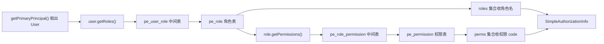
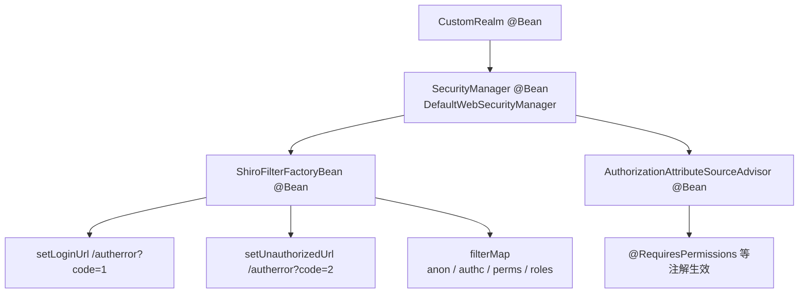

# Realm 双方法落库与 ShiroConfiguration 装配：认证、授权、过滤器链一次配齐

> 🔒 安全提示：文中示例的口令/密钥均为课程教学环境演示口径，生产环境的安全要求见《安全与合规须知》。

上一课把「查用户、比密文、查角色权限」的步骤拆完了，这一课全是落码：认证方法把 token 里的用户名翻译成一次数据库查询，授权方法把安全数据翻译成两个字符串集合，再把 `ShiroConfiguration` 的四个 Bean 逐个装配，工程从此具备完整的认证授权能力。配置类的内容看着长，其实是四件固定的事：注册 Realm、创建安全管理器、配置过滤器工厂、开启注解支持。

## 先给结论

- 认证方法固定套路：强转 `UsernamePasswordToken`、取用户名密码、`findByName` 查库、用户存在且密码一致则返回 `SimpleAuthenticationInfo`，否则返回 null。
- `getPassword()` 返回 `char[]`，要 `new String(...)` 转成字符串；比对发生在两份加盐 MD5 密文之间，token 端在登录时已经散列过。
- 授权方法从 `getPrimaryPrincipal()` 取出认证时存入的用户对象，借助 JPA 的多对多级联加载直接 `getRoles()`、`getPermissions()`，角色名与权限码分别收进两个 Set，装进 `SimpleAuthorizationInfo`。
- 配置类四个 Bean 各管一段：`CustomRealm` 是数据源，`DefaultWebSecurityManager` 是心脏，`ShiroFilterFactoryBean` 是 Web 入口的门卫，`AuthorizationAttributeSourceAdvisor` 打开注解鉴权的开关。
- 过滤器链是 `LinkedHashMap`：key 是拦截的 URL（支持通配符），value 是过滤器类型，常用的就四个 `anon`、`authc`、`perms`、`roles`。
- 未登录跳 `setLoginUrl` 指定的地址，无权限跳 `setUnauthorizedUrl` 指定的地址，课程里都指向同一个 `/autherror` 接口，靠 code 参数区分。

## 一、认证方法：把五步注释翻译成十几行代码

```java
/**
 * 认证方法：参数就是登录时传递的用户名密码
 */
protected AuthenticationInfo doGetAuthenticationInfo(AuthenticationToken authenticationToken)
        throws AuthenticationException {
    //1.构造 upToken：把接口参数强转回登录时构造的 UsernamePasswordToken
    UsernamePasswordToken upToken = (UsernamePasswordToken) authenticationToken;
    //2.获取用户名与密码
    String username = upToken.getUsername();
    String password = new String(upToken.getPassword());
    //3.根据用户名查询用户
    User user = userService.findByName(username);
    //4.判断用户是否存在或者密码是否一致
    if (user != null && user.getPassword().equals(password)) {
        //5.一致，返回安全数据
        SimpleAuthenticationInfo info =
                new SimpleAuthenticationInfo(user, user.getPassword(), this.getName());
        return info;
    }
    //不一致，返回 null（框架抛出异常）
    return null;
}
```

**第一行强转有原因。** 方法签名收的是 `AuthenticationToken` 接口，登录时构造的 `UsernamePasswordToken` 是它的实现类，参数传进来发生了向上转型，取用户名密码前要先转回去。取的方式也有细节：`getUsername()` 直接返回 String，`getPassword()` 返回的是 `char[]`，`new String(upToken.getPassword())` 是标准转法。

**比对为什么能直接 equals。** 工程登录方法在构造 token 时就做了 `new Md5Hash(password, username, 3).toString()`，数据库 `pe_user` 表的密码列存的也是同一算法散列出的密文，所以 `user.getPassword().equals(password)` 比的是两份密文。密文一致，构造 `SimpleAuthenticationInfo` 返回，三个参数分别是安全数据、数据库侧密码、Realm 名称。

**安全数据放 user 对象是关键设计。** principal 位置存完整的 User，登录成功后 `subject.getPrincipal()` 拿到的就是它，下一节授权方法也从这里取角色权限。存字符串用户名也能跑通认证，但授权时就得再查一次库，把对象存进去是为授权省一趟查询。

## 二、授权方法：从安全数据挖出角色与权限

```java
/**
 * 授权方法：查询当前已认证用户的角色与权限
 */
protected AuthorizationInfo doGetAuthorizationInfo(PrincipalCollection principalCollection) {
    //1.获取已认证的用户数据（安全数据）
    User user = (User) principalCollection.getPrimaryPrincipal();
    //2.获取用户的角色与权限信息
    Set<String> roles = new HashSet<>();
    Set<String> perms = new HashSet<>();
    for (Role role : user.getRoles()) {
        roles.add(role.getName());
        for (Permission perm : role.getPermissions()) {
            perms.add(perm.getCode());
        }
    }
    //3.构造返回值
    SimpleAuthorizationInfo info = new SimpleAuthorizationInfo();
    info.setRoles(roles);
    info.setStringPermissions(perms);
    return info;
}
```

方法第一行值得盯着看几秒。`getPrimaryPrincipal()` 取出的正是认证方法里存进 principal 的那个 User，强转回实体类型即可。既然能直接 `getRoles()`，说明角色数据已经在内存里：实体上 User 与 Role 声明了 `@ManyToMany(fetch = FetchType.EAGER)`，Role 与 Permission 同样是 EAGER 多对多，JPA 在查询用户时就把角色、权限一起装好了，授权方法里一句 SQL 都不用写。

两个 Set 的分工要分清：`roles` 收的是角色的 `name`，对应 `roles[系统管理员]` 这类按角色判断；`perms` 收的是权限的 `code`，对应 `perms[user-find]` 这类按权限判断，`code` 正是权限表里 `user-add`、`user-find` 这样的标志位。返回值类型选 `SimpleAuthorizationInfo`，Shiro 里认证、授权的返回值都是接口，实现类统一以 Simple 开头，认准这个前缀就不会拿错。

整条数据通路画出来是这样：



认证与授权两个方法合起来，Realm 的全部职责就交代了：认证回答「你是谁」，授权回答「你能干什么」，数据都从这五张表里来。

## 三、ShiroConfiguration：四个 Bean 装出安全骨架

Shiro 在 Spring Boot 里没有自动配置可吃，全靠一个 `@Configuration` 类手动装配。类与启动类放在一起即可，四个 Bean 按依赖顺序写：

```java
@Configuration
public class ShiroConfiguration {

    //1.配置自定义的 Realm
    @Bean
    public CustomRealm getRealm() {
        return new CustomRealm();
    }

    //2.配置安全管理器
    @Bean
    public SecurityManager securityManager(CustomRealm realm) {
        //使用默认的 Web 安全管理器
        DefaultWebSecurityManager securityManager = new DefaultWebSecurityManager(realm);
        //将自定义的 realm 交给安全管理器统一调度管理
        securityManager.setRealm(realm);
        return securityManager;
    }

    //3.Filter 工厂，设置对应的过滤条件和跳转条件
    @Bean
    public ShiroFilterFactoryBean shiroFilter(SecurityManager securityManager) {
        //1.创建 shiro 过滤器工厂
        ShiroFilterFactoryBean filterFactory = new ShiroFilterFactoryBean();
        //2.设置安全管理器
        filterFactory.setSecurityManager(securityManager);
        //3.通用配置：未登录与未授权的跳转地址
        filterFactory.setLoginUrl("/autherror?code=1");
        filterFactory.setUnauthorizedUrl("/autherror?code=2");
        //4.配置过滤器集合：key 拦截的 url（支持通配符），value 过滤器类型
        Map<String, String> filterMap = new LinkedHashMap<>();
        filterMap.put("/user/home", "anon");    //匿名访问，所有人可用
        filterMap.put("/user/**", "authc");     //认证之后访问，登录后可用
        //5.设置过滤器
        filterFactory.setFilterChainDefinitionMap(filterMap);
        return filterFactory;
    }

    //4.开启对 shiro 注解的支持
    @Bean
    public AuthorizationAttributeSourceAdvisor authorizationAttributeSourceAdvisor(SecurityManager securityManager) {
        AuthorizationAttributeSourceAdvisor advisor = new AuthorizationAttributeSourceAdvisor();
        advisor.setSecurityManager(securityManager);
        return advisor;
    }
}
```

**Realm 与安全管理器是父子关系。** `DefaultWebSecurityManager` 是 Web 程序的默认安全管理器实现，构造方法传入 Realm 就完成了绑定，不习惯构造方式也可以用 `securityManager.setRealm(realm)`，效果一样。安全管理器必须知道自己管辖哪些 Realm，因为认证授权的数据全靠 Realm 供给。

**过滤器工厂是 Web 环境的总闸。** Shiro 在 Web 程序里的权限控制全部靠一组过滤器完成，过滤器拦截到请求后，下一步动作（认证、鉴权）都发生在 SecurityManager 内部，所以工厂必须先拿到 SecurityManager 的引用。跳转配置把两种失败分开了：未登录访问受保护资源走 `setLoginUrl` 指定的 `/autherror?code=1`，登录了但没权限走 `setUnauthorizedUrl` 指定的 `/autherror?code=2`。接收端是 UserController 里的一个接口，按课堂实现补全如下：

```java
//认证授权失败统一跳转：code=1 未登录，code=2 未授权
@RequestMapping(value = "/autherror", method = RequestMethod.GET)
public String autherror(Integer code) {
    if (code == 1) {
        return "未登录";
    }
    return "未授权";
}
```

**filterMap 的写法是 key 到 value 的逐条登记。** 登记顺序就是匹配顺序，`/user/home` 这条精确路径排在 `/user/**` 之前，主页才能享受匿名待遇。Shiro 内置的过滤器远不止两个，讲义里的清单如下，常用的就是加粗的四个：

| 过滤器 | 参数 | 含义 |
|---|---|---|
| `anon` | 无参 | 匿名访问，游客可用 |
| `authc` | 无参 | 必须认证（登录）后访问 |
| `perms` | 可多个 | 需要指定权限，如 `perms[user-find]`，多参数须全部具备 |
| `roles` | 可多个 | 需要指定角色，如 `roles[系统管理员]`，多参数须全部具备 |
| `logout` | 无参 | 注销，执行后跳转到 `setLoginUrl` 设置的地址 |
| `authcBasic` | 无参 | HTTP Basic 认证 |
| `user` | 无参 | 必须存在用户，已登录即可 |
| `ssl` | 无参 | 要求 HTTPS 协议 |
| `rest` | 有参 | 按请求方式映射，相当于 `perms[user:get]` |
| `port` | 有参 | 端口不符时跳转到主机的指定端口 |

**注解支持是第四个 Bean。** `AuthorizationAttributeSourceAdvisor` 注册后，`@RequiresPermissions` 这类注解才会被 Spring 的 AOP 代理拦截执行；不配这个 Bean，注解打上去也不生效。四个 Bean 的装配关系收拢成一张图：



请求进来先过过滤器工厂这一关，过滤器按 filterMap 匹配路径决定放行还是拦截；需要查库判断时，SecurityManager 调 Realm；方法内的注解校验则由 AOP 代理接手。四件套各守一段，谁缺谁补位。

## 常见误区

- **SecurityManager 导包选错**：IDE 补全时会弹出多个同名类型，必须选 `org.apache.shiro.mgt.SecurityManager`，选成 JDK 或 Spring 的同名接口，后面的 `DefaultWebSecurityManager` 全部标红。
- **filterMap 用 HashMap**：匹配按登记顺序进行，HashMap 无序，`/user/**` 可能排在 `/user/home` 前面，把本该匿名的路径也拦成需要认证，必须用 `LinkedHashMap` 并把精确路径放在通配路径之前。
- **忘记把 Realm 交给安全管理器**：Realm 声明了 Bean 但 SecurityManager 没接收，认证时框架找不到数据源，`subject.login` 直接抛异常，两个 Bean 之间的引用一个都不能少。
- **只配注解不配 Advisor**：`@RequiresPermissions` 打在方法上毫无反应，多半是 `AuthorizationAttributeSourceAdvisor` 这个 Bean 没写，注解依赖它生成代理。
- **授权方法里 NPE 想不通**：`getPrimaryPrincipal()` 返回 null 多数是调用链没走认证就触发了授权判断，授权依赖认证存入的 principal，测试时要先登录再触发鉴权。

## 面试可能被问到的问题

1. 面试官追问：「自定义 Realm 的认证方法里，为什么要把 token 强转成 UsernamePasswordToken？」
   答：方法签名声明的是 `AuthenticationToken` 接口，Shiro 支持多种令牌类型，登录时构造的 `UsernamePasswordToken` 只是其中一种。方法内部需要取用户名与密码，这两个方法定义在实现类上，所以先强转再取值，强转失败说明调用方传的不是账号密码令牌。

2. 面试官追问：「SimpleAuthenticationInfo 的三个参数各是什么含义？」
   答：参数一是 principal 安全数据，存用户对象，授权方法与后续业务都从它取用户；参数二是 credentials，放数据库侧的密码密文，供 CredentialsMatcher 与 token 比对；参数三是 realmName，当前 Realm 的名称，用 `getName()` 取。

3. 面试官追问：「授权方法为什么不写任何查询语句？」
   答：认证时存入的 principal 是完整的 User 对象，实体上 User 与 Role、Role 与 Permission 都声明了 EAGER 的多对多关联，查询用户时 JPA 已经把角色与权限级联加载完毕，`getRoles()`、`getPermissions()` 直接遍历即可。代价是认证查询会多带两张中间表，换取授权时零查询。

4. 面试官追问：「ShiroFilterFactoryBean 的配置有哪些要点？」
   答：要设置 SecurityManager、`setLoginUrl` 与 `setUnauthorizedUrl` 两个跳转地址，再用 `LinkedHashMap` 登记 filterMap，key 是支持通配符的 URL，value 是过滤器类型，常用 `anon`、`authc`、`perms`、`roles`，最后 `setFilterChainDefinitionMap` 生效。登记顺序决定匹配顺序，精确路径必须排在通配路径之前。

5. 面试官追问：「AuthorizationAttributeSourceAdvisor 是干什么的，不配会怎样？」
   答：它是开启 Shiro 注解鉴权的 AOP 切面 advisor，注册后 Spring 会为带 `@RequiresPermissions`、`@RequiresRoles` 注解的 Bean 生成代理，方法调用前先校验权限。不配的话注解形同虚设，方法照常执行，权限控制完全失效。

6. 面试官追问：「未登录与未授权在 Shiro 里分别怎么表现？」
   答：未登录访问 `authc` 保护的资源，过滤器跳转 `setLoginUrl` 指定的地址；已登录但权限不满足 `perms`、`roles` 要求，跳转 `setUnauthorizedUrl` 指定的地址。课程把两者都指到 `/autherror`，用 code=1、code=2 区分，前后端分离场景也可改成返回 JSON。

## 配套资料

- 案例工程 shiro_springboot：`materials/code/02/day06 Shiro高级 及SaaS-HRM的认证授权/Shiro高级 及SaaS-HRM的认证授权/资源/shiro案例代码/shiro_springboot/`（含 `UserController`、`UserService`、`UserDao` 与 `domain` 三实体；`CustomRealm` 未随资料包归档，正文按视频实现补全；`autherror` 接口按课堂口述补全；包名统一改为 `com.example`）。
- 配置类完整参考：`materials/code/02/day06 Shiro高级 及SaaS-HRM的认证授权/Shiro高级 及SaaS-HRM的认证授权/资源/基本配置/ShiroConfiguration.java`（正文节选其四个基础 Bean，工程版还含 Redis 会话管理与缓存管理的配置方法，属于后续课程内容）。
- 数据库脚本：`materials/code/02/day06 Shiro高级 及SaaS-HRM的认证授权/Shiro高级 及SaaS-HRM的认证授权/资源/shiro_db.sql`（五张表的建表语句与角色权限初始数据）。
