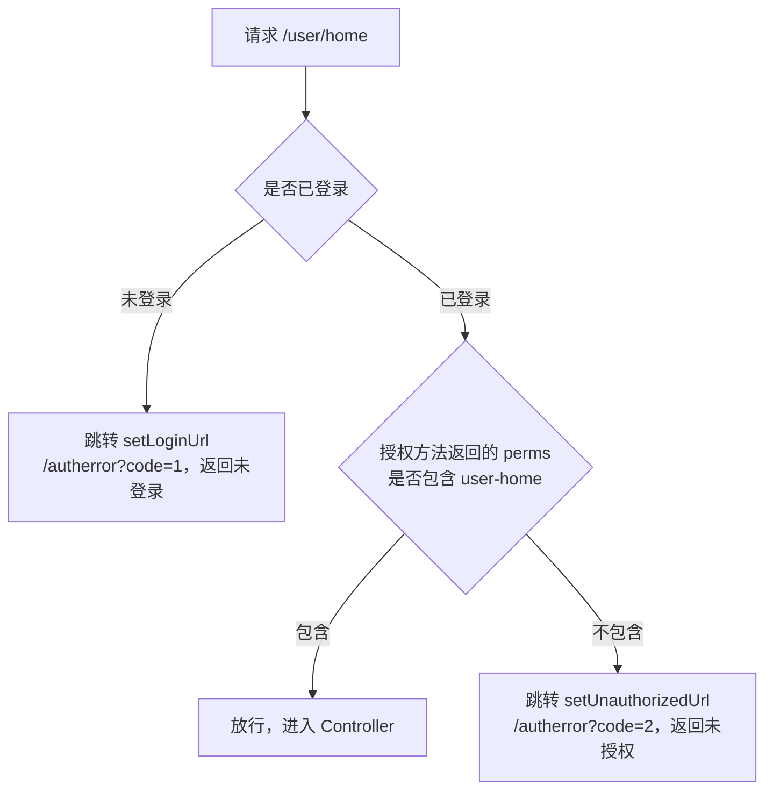
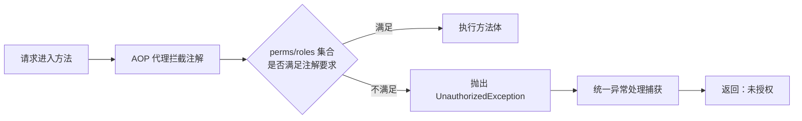

# Shiro 鉴权双通道：过滤器管 URL，注解管方法

> 🔒 安全提示：文中示例的口令/密钥均为课程教学环境演示口径，生产环境的安全要求见《安全与合规须知》。

登录解决了「你是谁」，鉴权解决「你能干什么」。Shiro 给了两条路把权限判断挂进请求链：一条是过滤器，在配置类里按 URL 登记规则，不匹配就跳转到指定地址；一条是注解，把 `@RequiresPermissions`、`@RequiresRoles` 直接写在 Controller 方法上，不匹配就抛异常。两条路的判断数据同源，失败表现却完全不同，这一课把两种都配一遍、测一遍，各自的适用边界也就清楚了。

## 先给结论

- 过滤器鉴权在 filterMap 里登记：`perms[user-home]` 要求具备指定权限，`roles[系统管理员]` 要求具备指定角色，多个参数逗号分隔且必须全部具备。
- 过滤器鉴权失败不抛异常：未登录先跳 `setLoginUrl`，已登录但无权限跳 `setUnauthorizedUrl`，课程里统一指向 `/autherror?code=2`，返回「未授权」。
- 注解鉴权写在 Controller 方法上：`@RequiresPermissions("user-home")`、`@RequiresRoles("系统管理员")`，前提是配置类里注册过 `AuthorizationAttributeSourceAdvisor`。
- 注解鉴权失败抛 `UnauthorizedException`，表现形式是 500，必须配统一异常处理收口成友好提示。
- 鉴权数据全部来自授权方法返回的两个 Set：角色名集合支撑 `roles` 判断，权限 code 集合支撑 `perms` 判断。
- 两种方式粒度不同：过滤器管一整片 URL，注解管单个方法，工程里常配合使用。

## 一、先摆好数据：谁有权限，谁什么都没有

鉴权测试的前提是库里的角色权限数据明确。案例五张表里已经埋好了对照组：

- 用户 zhangsan 被分配了「系统管理员」角色，该角色拥有权限表里的全部权限，测试前又补充了一条 code 为 `user-home` 的权限也分配给它；
- 用户 lisi、wangwu 没有任何角色，自然也没有任何权限。

一句话概括：zhangsan 全都有，lisi 和 wangwu 全都没有。对照表如下：

| 用户 | 角色 | 权限 | 预期表现 |
|---|---|---|---|
| zhangsan | 系统管理员 | user-home 等全部 | 鉴权通过 |
| lisi | 无 | 无 | 未授权 |

授权方法把 User 的角色名收进 `roles` 集合、权限 code 收进 `perms` 集合，过滤器和注解的一切判断都发生在这两个集合与配置规则的比对上。数据不明确，测试结论就不可信。

## 二、过滤器鉴权：把权限规则写进 URL

过滤器方式不动 Controller，只改配置类里的 filterMap。原先 `/user/home` 登记的是 `anon`，现在注释掉，换成按权限拦截：

```java
Map<String, String> filterMap = new LinkedHashMap<>();
//匿名访问（注释掉，换成按权限判断）
//filterMap.put("/user/home", "anon");
//具有指定权限才能访问，不具备则跳转 setUnauthorizedUrl 指定的地址
filterMap.put("/user/home", "perms[user-home]");
//认证之后访问
filterMap.put("/user/**", "authc");
filterFactory.setFilterChainDefinitionMap(filterMap);
```

`perms[user-home]` 的含义是：当前请求地址要求主体具备 `user-home` 这个权限标志，方括号里可以写多个参数，逗号分隔，全部具备才算通过。规则生效后整条判断链是这样的：



图里有一个容易被忽略的分支：未登录用户访问被 `perms` 拦截的路径，得到的是「未登录」而不是「未授权」。Shiro 的授权类过滤器先看主体是否存在，不存在直接引导去登录；存在才做权限比对。Postman 实测顺序与结果完全对得上：

- 未登录直接访问 `/user/home`，返回「未登录」，先走 `/login?username=lisi&password=123456` 登录；
- 换 lisi 登录后访问 `/user/home`，返回「未授权」，因为 lisi 的 perms 集合是空的，比对不通过，跳向 `code=2`；
- 换 zhangsan 登录后访问 `/user/home`，返回「访问个人主页成功」，他的集合里有 `user-home`，放行。

角色判断只是换个过滤器的事：

```java
//具有指定角色才能访问
filterMap.put("/user/home", "roles[系统管理员]");
```

`roles[系统管理员]` 对比的是授权方法返回的 roles 集合与角色全名，同样把三个用户的请求各跑一遍：zhangsan 通过，lisi 未授权，未登录仍然引导登录。另有个测试工具层面的观察：每次重新登录服务端都会分配新的 session id，Postman 的多个标签页共享 cookie，所以在不同标签页里切换账号测试，行为与同一浏览器先登出再登录完全一致。

## 三、注解鉴权：把权限写在方法上

注解方式换一个挂载点：filterMap 里 `/user/home` 恢复成不配权限规则，只保留 `authc`，权限判断下沉到方法签名上。

```java
import org.apache.shiro.authz.annotation.RequiresPermissions;

//访问此方法必须具备的权限
@RequiresPermissions("user-home")
@RequestMapping(value = "/user/home")
public String home() {
    return "访问个人主页成功";
}
```

常用注解就两个：`@RequiresPermissions` 声明访问方法必须具备的权限，`@RequiresRoles` 声明必须具备的角色，参数同样支持多值。注解能生效靠的是配置类里的第四个 Bean，`AuthorizationAttributeSourceAdvisor` 注册后 Spring 会为打了注解的 Bean 生成代理，方法调用前先做权限校验。

再拿 lisi 和 zhangsan 各测一遍，现象与过滤器方式截然不同：zhangsan 照常通过；lisi 登录后访问 `/user/home`，收到的不是「未授权」文案，而是一个 500 错误，异常信息正是 `UnauthorizedException`。注解的失败不走跳转，走异常，谁来接？统一异常处理：

```java
@ControllerAdvice
public class ExceptionCatch {

    //捕获注解鉴权抛出的未授权异常，统一返回「未授权」
    @ExceptionHandler(value = UnauthorizedException.class)
    @ResponseBody
    public String unauthorized(UnauthorizedException e) {
        return "未授权";
    }
}
```

工程里此前就配好了统一异常处理类，把 `UnauthorizedException` 单独加一段处理器即可。加上之后重启，lisi 再访问 `/user/home`，得到的就是统一的「未授权」。整条链路收口成图：



两种方式摆在一起看，差异就三条，各有各的用武之地：

| 维度 | 过滤器鉴权 | 注解鉴权 |
|---|---|---|
| 配置位置 | 配置类 filterMap，按 URL 登记 | Controller 方法上 |
| 拦截粒度 | 一整片路径（支持通配符） | 单个方法 |
| 失败表现 | 跳转到 `setUnauthorizedUrl` 指定地址 | 抛 `UnauthorizedException`，靠异常处理收口 |
| 典型场景 | 入口级粗筛：哪些路径要登录、要什么角色 | 方法级细控：具体接口要什么权限 |

工程实践里两层常同时存在：过滤器先按路径把大方向拦住（整个 `/user/**` 要登录），注解再在方法上做精细控制（这个接口要 `user-delete` 权限）。粗筛挡掉绝大多数无效请求，细控保证每个动作名实相符。

## 常见误区

- **权限串和库里数据对不上**：`perms[user-home]` 比对的是权限表 `code` 字段的精确值，`roles[系统管理员]` 比对的是角色 `name` 的全名，写错一个字符就永远「未授权」，排查时先核对库里的标志位再怀疑框架。
- **以为注解失败也会跳转页面**：注解鉴权失败抛异常不认 `setUnauthorizedUrl`，前端看到的是 500。统一异常处理里必须有 `UnauthorizedException` 的处理器，否则友好性全无。
- **注解加了却毫无反应**：方法打上 `@RequiresPermissions` 后谁都访问得了，多半是配置类里漏了 `AuthorizationAttributeSourceAdvisor`，没有这个 Bean，Spring 不会生成校验代理，注解只是个摆设。
- **filterMap 里精确路径被通配路径吃掉**：`/user/home` 的权限规则必须登记在 `/user/**` 之前，顺序颠倒后首页权限规则永远轮不到匹配，用 `LinkedHashMap` 并把精确写在前面。

## 面试可能被问到的问题

1. 面试官追问：「Shiro 有哪几种鉴权方式，失败时表现有什么不同？」
   答：两种。过滤器鉴权在配置类按 URL 登记 `perms`、`roles` 规则，失败不抛异常，未登录跳 `setLoginUrl`，无权限跳 `setUnauthorizedUrl`；注解鉴权在方法上写 `@RequiresPermissions`、`@RequiresRoles`，失败抛 `UnauthorizedException`，需要统一异常处理兜住，否则表现为 500。

2. 面试官追问：「perms[user-add] 与 roles[系统管理员] 分别拿什么做比对？」
   答：都来自自定义 Realm 授权方法返回的 `SimpleAuthorizationInfo`。`perms` 拿的是权限表 code 字段构成的字符串集合，`roles` 拿的是角色表 name 构成的字符串集合，方括号内可写多个参数，必须全部具备才放行。

3. 面试官追问：「未登录用户访问被 perms 拦截的路径，为什么返回的是未登录？」
   答：Shiro 的授权类过滤器先判断主体身份，principal 为空时直接引导到登录地址；已认证才进入权限比对，比对不过才跳未授权地址或抛异常。所以未登录与无权限是两个分支、两种提示。

4. 面试官追问：「@RequiresPermissions 注解的生效原理是什么？」
   答：`AuthorizationAttributeSourceAdvisor` 是一个 AOP 切面 advisor，注册后 Spring 为携带注解的 Bean 创建代理，方法调用前由切面调用 SecurityManager 的权限校验，不满足则抛 `UnauthorizedException`。没有这个 advisor，注解不会被解析，方法照常执行。

5. 面试官追问：「工程里过滤器鉴权和注解鉴权怎么取舍？」
   答：按粒度分工。URL 级的粗粒度控制放过滤器，比如整组接口要求登录或某角色；方法级的细粒度控制放注解，比如单个接口要求某个操作权限。两者叠加不冲突，过滤器先拦，注解后查，层次分明也便于维护。

6. 面试官追问：「授权数据是每次请求都查库吗？」
   答：取决于缓存配置。默认每次授权判断都会触发 Realm 的授权方法；给 SecurityManager 配置 CacheManager 后，授权结果会按 principal 缓存，角色权限变更时需要清理缓存才生效。本课案例未配缓存，每次判断都走授权方法，数据实时但开销略高。

## 配套资料

- 案例工程 shiro_springboot：`materials/code/02/day06 Shiro高级 及SaaS-HRM的认证授权/Shiro高级 及SaaS-HRM的认证授权/资源/shiro案例代码/shiro_springboot/`（含 `UserController`、`UserService`、`UserDao`；过滤器鉴权与注解鉴权的配置、`ExceptionCatch` 的 Shiro 异常段按课堂实现补全，包名统一改为 `com.example`）。
- 配置类完整参考：`materials/code/02/day06 Shiro高级 及SaaS-HRM的认证授权/Shiro高级 及SaaS-HRM的认证授权/资源/基本配置/ShiroConfiguration.java`（filterMap 中 `perms[user-find]`、`roles[系统管理员]` 的登记写法与 `AuthorizationAttributeSourceAdvisor` 注册）。
- 数据库脚本：`materials/code/02/day06 Shiro高级 及SaaS-HRM的认证授权/Shiro高级 及SaaS-HRM的认证授权/资源/shiro_db.sql`（`pe_permission` 的 code 字段、`pe_role` 的角色名与两张中间表数据；测试用 `user-home` 权限为课堂现场补充）。
