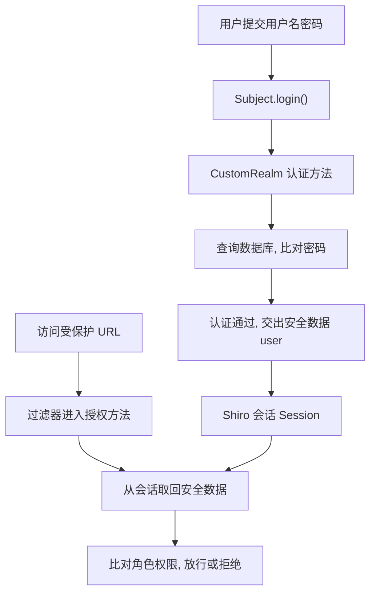
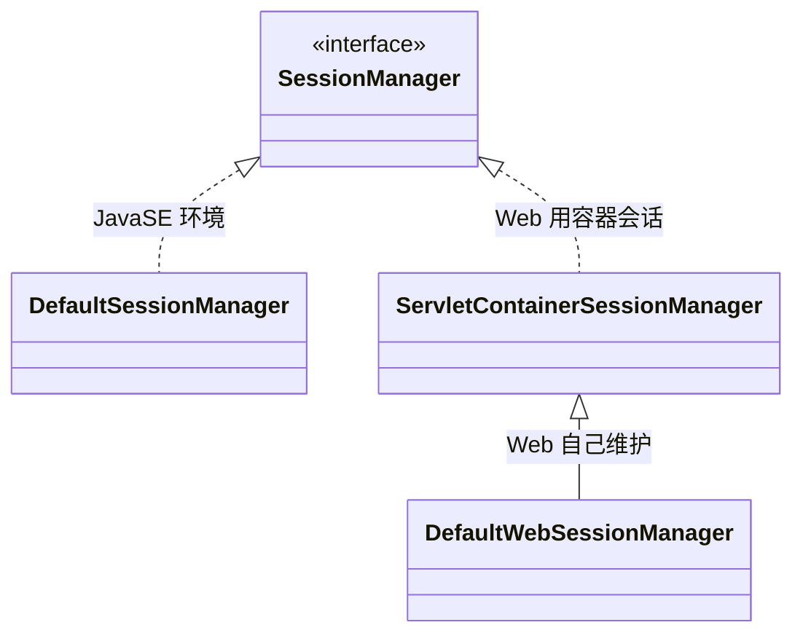

# 登录之后的安全数据存在哪：Shiro 会话管理入门

> 🔒 安全提示：文中示例的口令/密钥均为课程教学环境演示口径，生产环境的安全要求见《安全与合规须知》。

认证和授权的代码都跑通了，有一个问题却很容易被放过：自定义 Realm 的认证方法里，user 对象作为安全数据交给了 Shiro；到了授权方法里，又能把这份安全数据原样取出来做角色与权限的比对。整个工程没有一行代码写过 session，这份数据中间到底待在哪？

把这个疑问想清楚，就引出了 Shiro 体系的第二大块内容：会话管理。它决定登录态放在哪、活多久、下次请求怎么找回，也是后面把会话搬进 Redis、支撑集群部署的全部基础。

## 先给结论

- Shiro 内置了一套自己的会话机制，认证通过后的安全数据默认就存在它管理的会话里，授权时再从同一个会话取回。
- 会话管理器 `SessionManager` 是顶层组件，本质是一个接口，由 `SecurityManager` 统一持有，负责会话的创建、维护、删除。
- Shiro 的会话不依赖任何底层容器，普通 Java 程序和 Web 程序都能用，能完成 `HttpSession` 那套逻辑即可。
- Web 环境下什么都不配，默认实现是 `ServletContainerSessionManager`，会话直接落在 Servlet 容器的 `HttpSession` 里。
- 想把会话挪到 Redis、数据库这些地方，用的是 `DefaultWebSessionManager`，它自己维护会话，存储位置可替换。

## 一、疑问从哪来：安全数据的存与取

先把认证和授权的既有代码摆在一条线上。登录接口拿到用户名密码，加密后封装成 token，交给 Subject 执行 `login`：

```java
@RequestMapping(value = "/login")
public String login(String username, String password) {
    try {
        //密码加盐迭代 3 次做 MD5，再封装 token
        password = new Md5Hash(password, username, 3).toString();
        UsernamePasswordToken upToken = new UsernamePasswordToken(username, password);
        Subject subject = SecurityUtils.getSubject();
        subject.login(upToken);
        return "登录成功";
    } catch (Exception e) {
        e.printStackTrace();
        return "用户名或密码错误";
    }
}
```

`login` 一路传导到自定义 Realm 的认证方法，跟数据库比对密码，通过后构造 `SimpleAuthenticationInfo`，把 user 对象作为 principal 交回 Shiro。此后用户访问受保护的 URL，过滤器把请求引到授权方法，授权方法取安全数据、做权限比对。

存和取发生在两次独立的请求里，中间那根线就是会话。一张图把两条链路汇到一起：



图里上下两条链路都汇聚到同一个「Shiro 会话」上：认证时写入，授权时读出。要回答的问题就是，这个会话由谁管、放在哪。

## 二、Shiro 的会话不等于 HttpSession

**第一，Shiro 自带一整套会话管理。** 对 Web 程序来说，登录后的数据天然适合放 session，但代码里连一句 `request.getSession()` 都没有，会话却真实存在，这就是 Shiro 的会话管理在背后工作：Shiro 提供了自己的 Session 类型和管理机制，全程由 Shiro 控制。

**第二，这套会话不依赖容器。** 它既能在 Java SE 环境用，也能在 Java EE 环境用。普通 Java 程序里同样可以创建 session 对象，只要能完成 `HttpSession` 那套逻辑，按 key 存值、按 key 取值、记住自己的 session id，就够了。

**第三，会话管理器是顶层组件。** `SessionManager` 是一个接口，管理 Subject 的 session 的创建、维护、删除这一系列工作，它自己由 `SecurityManager` 负责调度，换句话说 `SecurityManager` 要对 `SessionManager` 负责。装配关系记成一句话：SecurityManager 管 SessionManager，SessionManager 管 session。

## 三、三个默认实现，对应三种存放策略

`SessionManager` 接口提供了三个默认实现，覆盖三种典型场景：

| 实现 | 适用环境 | 会话存放 |
|---|---|---|
| `DefaultSessionManager` | Java SE | 需要自己实现会话逻辑 |
| `ServletContainerSessionManager` | Web | 直接使用 Servlet 容器的会话，即 `HttpSession` |
| `DefaultWebSessionManager` | Web | 自己维护会话，存储位置可自定义 |

三者的继承与实现关系：



重点在后两个。`ServletContainerSessionManager` 什么都不自己干，会话就是 Tomcat 给的 `HttpSession`；`DefaultWebSessionManager` 把会话的控制权拿回自己手里，存 Redis、存数据库都从它改起。要自定义会话，选的就是它。

## 四、动手验证：默认会话就是 HttpSession

Web 应用什么都不配置，Shiro 用的是哪个实现？验证方法很直接：登录成功后把 session 里的内容全部打印出来。在 `UserController` 里补一个 `show` 方法：

```java
@RequestMapping(value = "/show")
public String show(HttpSession session) {
    //获取 session 中所有的键
    Enumeration<?> enumeration = session.getAttributeNames();
    //遍历, 根据键取值并打印
    while (enumeration.hasMoreElements()) {
        String name = enumeration.nextElement().toString();
        Object value = session.getAttribute(name);
        System.out.println("<b>" + name + "</b>" + value + "<br/>");
    }
    return "查看session成功";
}
```

方法参数里直接注入 `HttpSession`，遍历它的全部属性并打印。启动工程，用 Postman 先发 `/login?username=lisi&password=123456` 登录，同一会话下再请求 `/show`，控制台打出了一批条目，其中就有以 `org.apache.shiro.subject.support.DefaultSubjectContext_` 开头的内部键，它对应的 value 正是认证方法里交给 Shiro 的那个 user 对象。

结论水落石出：没写任何配置，Shiro 在 Web 环境默认用的是 `ServletContainerSessionManager`，安全数据被放进了 `HttpSession`。代码里看不到 session 的痕迹，是因为这件事由 Shiro 的会话管理代劳了。

## 常见误区

- **以为要自己调 `request.getSession()` 才有会话**：`subject.login()` 内部就会创建 Shiro 会话并写入安全数据，会话的创建和维护全程由 Shiro 代办。
- **把 Shiro 会话和 `HttpSession` 划等号**：Web 默认实现恰好借用容器会话而已，换成 `DefaultWebSessionManager` 之后两者就是两套东西，`request.getSession()` 与 `subject.getSession()` 会拿到不一致的结果。
- **以为会话管理只在 Web 里有意义**：`DefaultSessionManager` 面向 Java SE 环境，脱离 Servlet 容器 Shiro 照样有会话。
- **授权拿不到安全数据先怀疑 Realm**：多数情况是请求没把 session id 带回来，会话找不到了，而不是授权方法写错。

## 面试可能被问到的问题

1. 面试官追问：「Shiro 的会话和 HttpSession 是什么关系？」
   答：Shiro 有自己独立的会话机制，不依赖底层容器，Java SE 和 Web 环境都能用。Web 环境下默认实现 `ServletContainerSessionManager` 会直接借用容器的 `HttpSession` 做存储，这是借用而不是绑定，换成 `DefaultWebSessionManager` 后就与容器会话无关了。

2. 面试官追问：「SessionManager 的三个默认实现分别用在什么场景？」
   答：`DefaultSessionManager` 用于 Java SE 环境，需要自己实现会话逻辑；`ServletContainerSessionManager` 用于 Web 环境，直接使用容器的 `HttpSession`；`DefaultWebSessionManager` 也用于 Web 环境，但会话由 Shiro 自己维护，可以自定义存储位置比如 Redis，是做分布式会话的入口。

3. 面试官追问：「登录成功后没写任何 session 代码，安全数据是怎么保留下来的？」
   答：`Subject.login()` 认证通过后，Shiro 把 Realm 返回的 principal 作为安全数据写进当前 Subject 关联的会话，这套动作由 `SecurityManager` 旗下的 `SessionManager` 完成。Web 默认实现把它落到 `HttpSession`，授权时再从同一个会话取回。

4. 面试官追问：「SecurityManager 和 SessionManager 是什么关系？」
   答：`SessionManager` 是 Shiro 体系里的顶层组件之一，是一个接口，负责会话的创建、维护、删除；它作为 `SecurityManager` 的内部组件被持有和调度。装配时通过 `securityManager.setSessionManager(...)` 可以替换默认实现。

5. 面试官追问：「怎么验证 Shiro 默认把会话放在了 HttpSession？」
   答：登录成功后写一个接口注入 `HttpSession`，遍历 `getAttributeNames()` 打印全部属性，能看到 Shiro 写入的内部键和认证时的 user 对象。全程没有手动操作过 session，可以反推是 Shiro 的会话管理在做这件事。

## 配套资料

- 代码：`materials/code/02/day06 Shiro高级 及SaaS-HRM的认证授权/Shiro高级 及SaaS-HRM的认证授权/资源/shiro案例代码/shiro_springboot/`（含 `UserController.java`、`User.java`、`pom.xml`、`application.yml`，包名已统一改为 `com.example`）
- 配置类：`materials/code/02/day06 Shiro高级 及SaaS-HRM的认证授权/Shiro高级 及SaaS-HRM的认证授权/资源/基本配置/ShiroConfiguration.java`
