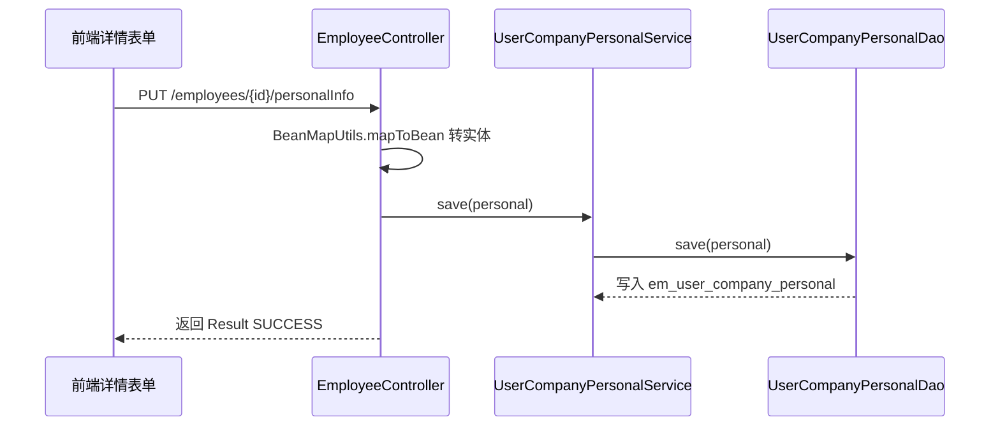

# 员工微服务代码骨架：一个 Controller 扛下全部员工接口

转正、调岗、离职、详细信息，看着功能不少，落到代码上全是对数据库的增删改查。逐行敲一遍意义不大，课程直接提供了完整的前后端代码和 SQL，重点变成看懂工程怎么组织：六个实体、六个 Dao、六个 Service 怎么摆，一个 Controller 怎么承接所有员工接口，接口之间有什么固定套路。看懂这套骨架，后面每个功能都是同构的复制。

## 先给结论

- 员工管理拆成独立微服务 `hrm-employee`，只装员工相关代码，与之前的企业、系统微服务并列。
- 六张员工表对应六个实体、六个 Dao、六个 Service，写法与企业微服务、部门微服务完全同构。
- Controller 只有一个 `EmployeeController`，路径统一挂在 `/employees` 下，接口成对出现：GET 查表单回显，PUT 保存提交。
- 前端表单用 `Map` 接收，再经 `BeanMapUtils.mapToBean` 转成实体；查询为空时返回一个只填了 `userId` 的空对象，前端永远拿得到完整结构。
- 实体类不在本服务内，放在公共实体模块的 `com.example.domain.employee` 包下，启动类要用 `@EntityScan` 单独指定。

## 一、工程结构与依赖

新建 Maven 模块 `hrm-employee`，依赖四样东西：JPA 起步依赖、MySQL 驱动、本项目的公共模块、以及微服务注册要用的 Eureka 客户端（这是本天后半段的内容，先放进依赖清单）。课程资料里的 pom 声明如下：

```xml
<dependencies>
    <dependency>
        <groupId>org.springframework.boot</groupId>
        <artifactId>spring-boot-starter-data-jpa</artifactId>
    </dependency>
    <dependency>
        <groupId>mysql</groupId>
        <artifactId>mysql-connector-java</artifactId>
    </dependency>
    <dependency>
        <groupId>com.example</groupId>
        <artifactId>hrm-common</artifactId>
        <version>1.0-SNAPSHOT</version>
    </dependency>
    <dependency>
        <groupId>org.springframework.cloud</groupId>
        <artifactId>spring-cloud-starter-netflix-eureka-client</artifactId>
    </dependency>
</dependencies>
```

`hrm-common` 里装的是跨服务共用的工具和基础设施：统一返回体 `Result`、雪花算法主键生成器 `IdWorker`、JWT 工具、BaseController 等。员工微服务引了它，才能和其它服务保持同一套返回格式。

## 二、启动类：两个注解、两个 Bean

```java
package com.example.employee;

import com.example.common.utils.IdWorker;
import com.example.common.utils.JwtUtil;
import org.springframework.boot.SpringApplication;
import org.springframework.boot.autoconfigure.SpringBootApplication;
import org.springframework.boot.autoconfigure.domain.EntityScan;
import org.springframework.context.annotation.Bean;

@SpringBootApplication(scanBasePackages = "com.example")
@EntityScan("com.example.domain.employee")
public class EmployeeApplication {

    public static void main(String[] args) {
        SpringApplication.run(EmployeeApplication.class, args);
    }

    @Bean
    public IdWorker idWorker() {
        return new IdWorker(1, 1);
    }

    @Bean
    public JwtUtil jwtUtil() {
        return new JwtUtil();
    }
}
```

**`@EntityScan` 是这里最容易漏的东西。** 组件扫描默认只扫启动类所在包的下面，而员工实体放在公共实体模块的 `com.example.domain.employee` 包里，JPA 默认发现不了它们，启动时会报找不到托管类型。`@EntityScan` 明确告诉 JPA 去哪个包找 `@Entity` 注解的类，两个包不在同一条扫描路径上，就必须显式声明。

两个 `@Bean` 是把公共工具注册成容器单例：`IdWorker` 负责生成分布式唯一主键，`JwtUtil` 负责解析请求头里的令牌。任何微服务都有这两样，写法完全一致。

## 三、实体与 Dao：照表生成，照名起查

六个实体对应六张表，字段就是表字段的驼峰映射。以转正实体为例：

```java
package com.example.domain.employee;

import lombok.AllArgsConstructor;
import lombok.Data;
import lombok.NoArgsConstructor;

import javax.persistence.Entity;
import javax.persistence.Id;
import javax.persistence.Table;
import java.io.Serializable;
import java.util.Date;

@Entity
@Table(name = "em_positive")
@Data
@AllArgsConstructor
@NoArgsConstructor
public class EmployeePositive implements Serializable {

    @Id
    private String userId;               // 员工ID，同时是主键

    private Date dateOfCorrection;       // 转正日期
    private String correctionEvaluation; // 转正评价
    private String enclosure;            // 附件
    private Integer estatus;             // 单据状态 1 未执行 2 已执行
    private Date createTime;             // 创建时间
}
```

Dao 层连方法体都没有，一个接口继承两个父接口就完事：

```java
package com.example.employee.dao;

import com.example.domain.employee.UserCompanyJobs;
import org.springframework.data.jpa.repository.JpaRepository;
import org.springframework.data.jpa.repository.JpaSpecificationExecutor;

public interface UserCompanyJobsDao extends JpaRepository<UserCompanyJobs, String>,
        JpaSpecificationExecutor<UserCompanyJobs> {

    UserCompanyJobs findByUserId(String userId);
}
```

`findByUserId` 没有实现也没有 SQL，Spring Data JPA 按方法名解析出「按 userId 等值查询」，启动时自动生成。这是标准成例：简单的按属性查询用方法名派生，复杂组合条件才走 `JpaSpecificationExecutor` 的动态查询。Service 层同样没有花样，`save` 和 `findById` 直接透传给 Dao：

```java
@Service
public class UserCompanyPersonalService {

    @Autowired
    private UserCompanyPersonalDao userCompanyPersonalDao;

    public void save(UserCompanyPersonal personalInfo) {
        userCompanyPersonalDao.save(personalInfo);
    }

    public UserCompanyPersonal findById(String userId) {
        return userCompanyPersonalDao.findByUserId(userId);
    }
}
```

## 四、Controller：所有接口的一个骨架

员工管理的全部接口都收在 `EmployeeController` 里，类上 `@RequestMapping("/employees")` 统一前缀。个人信息这一对接口最有代表性：

```java
// 员工个人信息保存：前端表单整包传 Map，转成实体后落库
@RequestMapping(value = "/{id}/personalInfo", method = RequestMethod.PUT)
public Result savePersonalInfo(@PathVariable(name = "id") String uid, @RequestBody Map map) throws Exception {
    UserCompanyPersonal sourceInfo = BeanMapUtils.mapToBean(map, UserCompanyPersonal.class);
    if (sourceInfo == null) {
        sourceInfo = new UserCompanyPersonal();
    }
    sourceInfo.setUserId(uid);
    sourceInfo.setCompanyId(super.companyId);
    userCompanyPersonalService.save(sourceInfo);
    return new Result(ResultCode.SUCCESS);
}

// 员工个人信息读取：查不到就给一个只带 userId 的空对象
@RequestMapping(value = "/{id}/personalInfo", method = RequestMethod.GET)
public Result findPersonalInfo(@PathVariable(name = "id") String uid) throws Exception {
    UserCompanyPersonal info = userCompanyPersonalService.findById(uid);
    if (info == null) {
        info = new UserCompanyPersonal();
        info.setUserId(uid);
    }
    return new Result(ResultCode.SUCCESS, info);
}
```

这两段代码把全模块的套路都演示完了。**保存端：** 用 `Map` 接请求体是因为详细信息表单字段太多，转成实体后补上路径里的 `userId` 和从父类 `BaseController` 拿到的 `companyId`，直接落库。**查询端：** 员工刚入职还没有详细信息时返回 `null` 会让前端到处判空，这里统一兜底成空对象，前端拿到固定结构直接渲染表单。

剩下的岗位信息、转正、调岗、离职四组接口全是同一个模板的重复，比如离职这一对：

```java
// 离职表单保存
@RequestMapping(value = "/{id}/leave", method = RequestMethod.PUT)
public Result saveLeave(@PathVariable(name = "id") String uid, @RequestBody EmployeeResignation resignation) throws Exception {
    resignation.setUserId(uid);
    resignationService.save(resignation);
    return new Result(ResultCode.SUCCESS);
}

// 离职表单读取
@RequestMapping(value = "/{id}/leave", method = RequestMethod.GET)
public Result findLeave(@PathVariable(name = "id") String uid) throws Exception {
    EmployeeResignation resignation = resignationService.findById(uid);
    if (resignation == null) {
        resignation = new EmployeeResignation();
        resignation.setUserId(uid);
    }
    return new Result(ResultCode.SUCCESS, resignation);
}
```

以个人信息保存为例，一次请求的完整路径是：



图中没有任何一步是员工模块特有的，换一张表、换一个实体，这四层照样成立。另外，详情页基础信息区预留了员工照片字段，暂时只是占位：后续导出 PDF 报表要带照片，刷脸登录也要用，数据结构先留好。

## 常见误区

- **漏写 `@EntityScan`。** 实体在公共模块的 `com.example.domain.employee` 包，不在启动类扫描路径内，JPA 扫不到实体，注入 Dao 时直接报「Not a managed type」。实体一旦跨模块存放，启动类就必须显式指定实体包。
- **保存时忘了补 `userId` 和 `companyId`。** 前端只传表单字段，这两个键值来自路径和父类上下文；漏掉会导致数据落了库却查不回来，因为所有查询都按 `userId` 走。
- **查询为空时返回 null。** 前端表单要按固定结构渲染，null 会引发一串空指针式的判断。统一返回空对象，接口语义是「这张表单现在是空的」而不是「出错了」。
- **把接口拆散写。** 每个业务都是「GET 回显 + PUT 保存」一对出现，只写保存不写回显，页面第二次打开就填不了已提交的内容。

## 面试可能被问到的问题

1. 面试官追问：「实体类为什么放在公共模块，而不是员工服务内部？」
   答：企业、员工这些实体几乎每个微服务都要引用，系统微服务鉴权时要读用户实体，员工微服务读员工实体。放在公共模块统一维护一份定义，避免多个服务各自复制实体后字段不一致。

2. 面试官追问：「Dao 里只有方法声明，没有 SQL，查询是怎么实现的？」
   答：Spring Data JPA 的方法名派生查询。启动时解析方法名 `findByUserId`，按属性 userId 等值匹配自动生成查询；继承 `JpaSpecificationExecutor` 还能接收动态 Specification 条件，应付组合查询。

3. 面试官追问：「Controller 用 Map 接收请求体再转实体，有什么利弊？」
   答：好处是前端传多少字段都接得住，表单字段频繁增减时后端不用反复改参数类型；代价是丢掉了编译期类型检查，字段名写错只能在运行时发现，而且要靠 `BeanMapUtils` 这类工具保证转换正确。字段稳定的接口更推荐直接声明实体参数。

4. 面试官追问：「查询接口为什么返回空对象而不是 null？」
   答：返回固定结构让前端不用判空，直接渲染表单。空对象的 userId 已经填好，前端提交保存时能带上这个标识，语义上是「待填写的表单」而不是「资源不存在」。

5. 面试官追问：「`@EntityScan` 和组件扫描是什么关系？」
   答：`@SpringBootApplication` 的组件扫描只负责发现 Spring Bean，默认不覆盖 JPA 实体；`@EntityScan` 是 JPA 专用的实体发现入口，两者扫描机制独立。实体在启动类扫描范围之外时，必须用 `@EntityScan` 单独指定实体所在的包。

## 配套资料

- 员工微服务工程：`materials/code/02/day07 员工管理及POI入门/员工管理及POI入门/资源/后端/ihrm_employee/`（含 `EmployeeApplication.java`、`EmployeeController.java`、六个 Dao 与 Service、`application.yml`，文中模块名已改为 `hrm-employee`、包名统一改为 `com.example`）
- 员工实体类目录：`materials/code/02/day07 员工管理及POI入门/员工管理及POI入门/资源/后端/实体类/employee/`（六个实体与报表响应类，对应公共实体模块中的定义）
