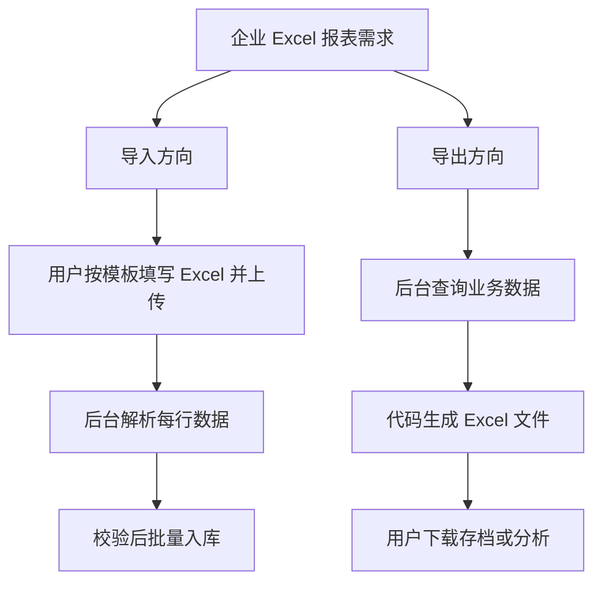

# 报表需求进门前先认清两种 Excel：xls 与 xlsx 的结构差异

业务系统的增删改查做完一轮之后，几乎每个项目都会被报表需求找上门。报表这个说法很宽，落到企业开发里最常见的载体就是 Excel：运营要一份员工花名册存档，HR 想把一百个新员工的信息填在表格里一次性导入系统。这些需求全都绕不开同一个前提，先把 Excel 这个文件格式本身看清楚。

## 先给结论

- 企业里的 Excel 报表需求只有两个方向：上传 Excel 批量导入数据，以及用代码把系统数据导出成 Excel 供下载。
- Excel 分两代：Excel 2003 及之前用 `.xls` 后缀，Excel 2007 及之后用 `.xlsx` 后缀，两代内部结构完全不同，技术处理上必须区别对待。
- 2003 版是二进制的复合文档结构，单个 sheet 最多 65535 行、256 列；2007 版是 XML 结构，单个 sheet 最多 1048576 行、16384 列。
- 2007 版基于 XML 压缩存储，占用的磁盘空间更小，是现在的主流选择。
- 验证结构差异的办法很朴素：把 `.xlsx` 改后缀成 `.zip` 解压，看到的全是 XML 文件；`.xls` 同样解压，打开全是二进制，肉眼不可读。

## 一、报表需求的两个方向

企业开发里对 Excel 的处理，归纳起来就是两类动作。

**第一类是导入。** 用户在现成的 Excel 模板里把数据填好，上传到系统，后台解析每一行数据，保存进数据库或者触发后续业务。典型场景是员工入职：给 HR 一个模板，一百个人的信息一次传上来，不用在页面里逐个录入一百次。

**第二类是导出。** 后台代码把系统里的数据查出来，按需求生成 Excel 提供下载。典型场景是人事系统的员工信息：全部员工数据可以下载下来做存档、做分析。



图里两个方向的箭头是相反的：导入是 Excel 变成数据库记录，导出是数据库记录变成 Excel。方向相反，但底层用的都是同一套操作 Excel 文件的工具，这正是后面几篇要展开的 Apache POI。

## 二、Excel 的两代格式，差别是天级别的

别看 `.xls` 和 `.xlsx` 只差一个字母，它们是两套完全不同的文件体系。课程讲义里给了一组对照：

| | Excel 2003 | Excel 2007 |
|---|---|---|
| 后缀 | `.xls` | `.xlsx` |
| 结构 | 二进制格式，核心是复合文档类型结构 | XML 类型结构 |
| 单 sheet 数据量 | 行 65535，列 256 | 行 1048576，列 16384 |
| 特点 | 存储容量有限 | 基于 XML 压缩，占用空间小 |

**第一，结构不同。** 2003 版把数据按二进制形式保存在一个复合文档里，可以理解成一个文件内部还分了很多「小仓库」，程序必须按它的二进制规范去读。2007 版换成了 XML 方案，整个文件本质上是一个 zip 压缩包，里面装着若干 XML 文档，数据、样式、文档属性各自独立成文件。

**第二，容量不同。** 65535 正好是 16 位二进制能表达的上限附近，256 是 2 的 8 次方；到 2007 版，行数放大到 1048576，也就是 2 的 20 次方，列数放大到 16384，即 2 的 14 次方。这不是随便定的数字，背后是两代格式给行号、列号分配的寻址空间不同。业务里数据量一旦上万行，2003 格式就可能顶到天花板，2007 版则宽裕得多。

**第三，存储效率不同。** 2007 版的 XML 是压缩后存储的，同样一份报表，`.xlsx` 通常比 `.xls` 更省空间，加上结构开放，处理起来效率也更高。这也是如今 `.xlsx` 越用越多的原因。

## 三、亲手拆一个 xlsx 验证结构

口说无凭，十秒钟就能验证。拿一个 `.xlsx` 文件复制一份，把后缀改成 `.zip`，直接解压，能看到这样的目录：

```text
2018-03人员信息（解压后）
├── _rels
├── docProps
│   ├── app.xml
│   └── core.xml
├── [Content_Types].xml
└── xl
    ├── DocumentSummaryInformation
    ├── SummaryInformation
    └── Workbook
```

`[Content_Types].xml` 声明这个包里都有什么类型的部件，`docProps` 下的 `app.xml` 和 `core.xml` 记录文档属性，比如标题、作者、创建时间，全部是可读的 XML；`xl` 目录里则是工作簿的主体内容。随手打开其中任何一个，都是规规矩矩的 XML 标签。

用同样手法处理 `.xls`，解压之后随便打开一个文件，看到的是无法辨认的二进制乱码。两代格式的差异到此眼见为实：一个是开放的 XML 包，一个是封闭的二进制容器。

这个改后缀的手法只是学习阶段用来理解结构的验证手段，正式代码里不会有人手动解压 Excel，解析工作交给操作 Excel 的类库完成。

## 四、格式差异为什么影响技术选型

**第一，选工具要先看格式。** Java 世界里操作 Excel 的类库对两代格式的支持参差不齐，只支持 2003 的老工具读不了 `.xlsx`。选型时第一个问题就是：要处理哪种后缀。本项目两类都要支持，所以后面选择的工具必须同时兼容两代格式，这个工具就是 Apache POI，下一篇展开。

**第二，大数据量要提前规划。** 即便 2007 版单 sheet 能装 1048576 行，把几十万行数据一次性加载进内存去读写，程序也很容易内存溢出。报表导出量级大的系统，要么分批查询分批写，要么用流式写出的方式边查边写，这些手段在后续讲 POI 实战时落地。

**第三，导入侧要盯模板和校验。** 上传导入的风险不在文件格式而在数据本身：列错位、必填为空、类型不对。批量解析之前先按模板校验结构，解析时逐行校验数据，出错行收集起来反馈给用户，是导入功能的标准姿势。

## 常见误区

- **把 `.xlsx` 当二进制文件解析。** 用处理 2003 格式的老类库或者手写字节流逻辑去读 xlsx，要么直接报错，要么读出乱码。xlsx 是 zip 加 XML 的组合，必须交给支持它的类库。
- **忽略单 sheet 的行数上限。** 数据量十几万行还按 2003 格式导出，65535 行一到就写不下了。大数据量一律选 2007 格式，必要时分 sheet。
- **以为改后缀能转换格式。** 把 `.xls` 改名成 `.xlsx` 文件本身没有任何变化，内部还是二进制复合文档。格式转换必须通过程序或 Office 另存完成。
- **把改后缀解压当成正式解析手段。** 手动解压只是理解结构的演示，生产代码里这样解析 Excel 等于自己重写一个解析器，得不偿失。

## 面试可能被问到的问题

1. 面试官追问：「`.xls` 和 `.xlsx` 有什么区别？」
   答：xls 是 Excel 2003 及之前版本的格式，二进制复合文档结构，单 sheet 上限 65535 行、256 列，存储容量有限；xlsx 是 Excel 2007 及之后的格式，本质是 zip 压缩包内的 XML 文档集合，单 sheet 上限 1048576 行、16384 列，基于 XML 压缩存储，占用空间小。

2. 面试官追问：「企业系统里的 Excel 报表需求一般分哪几类？」
   答：两个方向。一是导入，用户按模板填写 Excel 上传，后台解析校验后批量入库；二是导出，后台查询业务数据用代码生成 Excel 供下载存档。两类需求方向相反，底层都依赖操作 Excel 的类库。

3. 面试官追问：「要导出几十万行数据，你会怎么设计？」
   答：选用 xlsx 格式避开 xls 的行数上限；查询分批进行，写文件时用流式写出的方式，避免把所有数据同时压在内存里；必要时按数据量拆分多个 sheet；导出任务异步化，完成后提供下载链接，避免长时间占用请求线程。

4. 面试官追问：「批量导入 Excel 时要注意什么？」
   答：先校验模板结构，列数、表头不对直接拒绝；再逐行校验数据类型和必填项，收集错误行统一反馈；解析与入库控制好批量提交的大小；整个过程考虑事务边界，部分失败时明确告知用户哪些行成功哪些行失败。

5. 面试官追问：「为什么说 xlsx 占用空间小？」
   答：xlsx 是基于 XML 的存储方案，整个文件是一个 zip 压缩包，内容在写入时经过压缩，重复的结构信息也以 XML 复用方式组织。相比之下 xls 的二进制复合文档没有这层压缩机制，同等数据量下体积更大。

## 配套资料

- 报表导出的数据载体（员工报表响应实体，字段即报表列）：`materials/code/02/day07 员工管理及POI入门/员工管理及POI入门/资源/后端/实体类/employee/response/EmployeeReportResult.java`
- 后续实战用的导出与导入工具类：`materials/code/02/day08 POI高级/POI高级/资源/代码/工具类/ExcelExportUtil.java`、同目录 `ExcelImportUtil.java`
- 课程工程引入 POI 的真实依赖坐标：`materials/code/02/day10-用户档案PDF报表/day10-用户档案PDF报表/代码/jasper-springboot/pom.xml`
- 本课为概述内容，无独立源码工程，目录结构示意取自课程资源演示，示例均按本课写法补全
