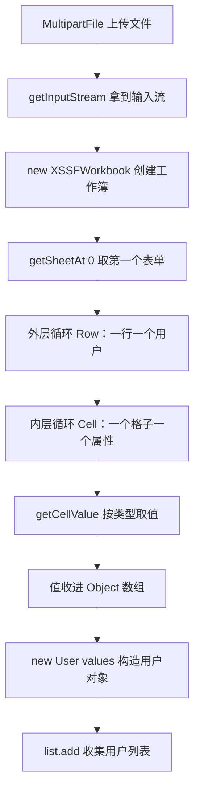

# 解析上传的 Excel：从 MultipartFile 输入流到用户对象列表

`importUser` 的接口骨架立好了，方法体还是空的。这一步要做的事其实就两件：把上传来的 Excel 解析开，再把里面的每一行变成一个用户对象。之前练 POI 时写的解析代码大多能搬过来，但有一处本质不同：数据源从磁盘上的文件路径变成了上传流，`Workbook` 的创建方式必须跟着变。

## 先给结论

- 方法体是固定三段：解析 Excel 创建工作簿、循环行列构造用户列表、批量保存，这一步完成前两段。
- 上传场景下 `Workbook` 从流里来：`new XSSFWorkbook(file.getInputStream())`，`XSSFWorkbook` 有专门接收 `InputStream` 的构造器。
- 两层循环有两处索引偏移：行从 1 开始，第 1 行是表头；列从 1 开始，模板的 A 列是预留空列，数据从 B 列起。
- 每行先把六个格子的值收进 `Object[]` 数组，再用 `User` 的有参构造一次性转成对象，类型转换全部集中在构造器里做。
- POI 读到的数值格子一律是 double：工号会带 `.0`，手机号可能变科学计数法，转换时必须处理。

## 一、方法体的三段骨架

先把整体结构立起来，注释把三段划分清楚，代码一段一段填：

```java
@RequestMapping(value = "/user/import", method = RequestMethod.POST)
public Result importUser(@RequestParam(name = "file") MultipartFile file) throws Exception {
    //1.解析Excel文件创建工作簿
    Workbook wb = new XSSFWorkbook(file.getInputStream());
    //1.2.获取Sheet
    Sheet sheet = wb.getSheetAt(0); //获取第一个Sheet
    //2.获取用户数据列表
    List<User> list = new ArrayList<>();
    // 循环组装，见下文
    //3.批量保存用户
    return new Result(ResultCode.SUCCESS);
}
```

整个数据流的形状是这样的：



这张图讲的是从文件到对象列表的流水线。关键分支在 G：同一个格子可能是文本、数字、日期或公式，取值方法必须先判断类型再读值，否则数字格子读出来全是 double。

POI 的核心类型 `Cell`、`Row`、`Sheet` 都在 `org.apache.poi.ss.usermodel` 包下，导入时别选错。

## 二、解析 Excel：工作簿从流里来

之前写解析 demo，构造 `XSSFWorkbook` 传的是磁盘文件路径。上传场景里根本没有路径，文件内容随请求体一起进了服务端，躺在 `MultipartFile` 对象里。它同时封装了文件名和文件的全部字节流，所以构造时直接调 `file.getInputStream()`：

```java
Workbook wb = new XSSFWorkbook(file.getInputStream());
```

`XSSFWorkbook` 的构造方法有很多个重载，其中就有接收 `InputStream` 的版本，这一行等价于把请求体里的 Excel 完整读进内存构建工作簿。文件流由框架管理，读文件可能抛 `IOException`，方法签名上直接 `throws Exception` 交出去，由全局异常处理统一兜底。

拿到工作簿后取表单。模板只有一个表单，`wb.getSheetAt(0)` 拿第一个 `Sheet`，和文件打开后看到的第一页一一对应。

## 三、逐行取值：两个索引和一个取值工具

**行循环从 1 开始。** 模板的第一行是表头（用户名、手机号……），没有数据，数据从第二行开始。行索引从 0 数起，第二行的索引是 1，所以外层循环写作 `rowNum = 1` 起步：

```java
Object[] values = null;
for (int rowNum = 1; rowNum < sheet.getLastRowNum(); rowNum++) {
    Row row = sheet.getRow(rowNum);
    // 数组长度取这行的格子总数
    values = new Object[row.getLastCellNum()];
    for (int cellNum = 1; cellNum < row.getLastCellNum(); cellNum++) {
        Cell cell = row.getCell(cellNum);
        Object value = getCellValue(cell);
        values[cellNum] = value;
    }
    User user = new User(values);
    list.add(user);
}
```

**列循环也从 1 开始。** 这是模板的另一个细节：A 列是预留空列，用户名从 B 列才开始填。格子索引同样从 0 数起，B 列的索引是 1，所以内层循环 `cellNum = 1` 起步。数组长度用 `row.getLastCellNum()`，它返回的是格子数量，循环里的值正好填满下标 1 到 6 的位置。

**取值必须分类型。** `getCellValue` 是之前 demo 里写过的工具方法，按格子的 `CellType` 分支取值：

```java
public static Object getCellValue(Cell cell) {
    //获取单元格属性类型
    CellType cellType = cell.getCellType();
    Object value = null;
    switch (cellType) {
        case STRING:
            value = cell.getStringCellValue();
            break;
        case BOOLEAN:
            value = cell.getBooleanCellValue();
            break;
        case NUMERIC:
            value = cell.getNumericCellValue();
            break;
        case FORMULA:
            value = cell.getCellFormula();
            break;
        case BLANK:
            value = "";
            break;
        case ERROR:
            value = cell.getErrorCellValue();
            break;
    }
    return value;
}
```

这个方法决定了后面构造器里拿到的对象是什么类型：文本格子给 `String`，数值格子给 `Double`，日期格子也是 `NUMERIC` 分支，读出来同样是 double。构造器里的类型转换就是围绕这个现实设计的。

## 四、构造用户对象：有参构造里集中做类型转换

一行六个值已经按顺序躺在 `Object[]` 里：下标 1 是用户名、2 是手机号、3 是工号、4 是聘用形式、5 是入职时间、6 是部门编码。把转换逻辑写进 `User` 的有参构造，循环体里一行 `new User(values)` 就完成拼装，代码比逐个 set 干净得多：

```java
public User(Object[] values) {
    //用户名
    this.username = values[1].toString();
    //手机号
    this.mobile = values[2].toString();
    //工号
    this.workNumber = values[3].toString();
    //聘用形式
    this.formOfEmployment = ((Double) values[4]).intValue() + "";
    //入职时间
    this.timeOfEntry = (Date) values[5];
    //部门编码：先临时存进 departmentId，后面再换算
    this.departmentId = values[6].toString();
}
```

逐个看这几行转换的讲究：

**第一，下标从 1 开始而不是 0。** 数组下标与格子索引是对齐的，0 号位置是空的 A 列。如果按习惯写 `values[0]`，拿到的只能是空串。

**第二，聘用形式要做 double 转整数。** Excel 里填的 1，POI 读出来是 `Double` 类型的 1.0，调用 `intValue()` 转成整数再转字符串。

**第三，入职时间直接强转 `Date`。** Excel 的日期格子经 POI 读出来就是 `Date` 类型，实体字段 `timeOfEntry` 声明为 `Date`，一句强转完事。

**第四，工号和手机号的问题此刻还没解决。** 工号 2001 读出来是 `Double`，`toString()` 之后就是 `2001.0`；手机号 13800000001 这类 11 位数字，`Double.toString()` 会变成科学计数法 `1.3800000001E10`。这两个坑在保存实测时会原样暴露，到时用 `DecimalFormat` 统一处理。

**第五，`departmentId` 里暂时存的是编码。** 部门编码显然不是部门 ID，但为了让代码先跑通，构造器先把它存进 `departmentId` 字段占位，等批量保存那一环再通过跨服务查询换成真正的部门 ID 和名称。

到这里第二段完成：`list` 里装着与 Excel 行数对应的用户对象，每个对象的属性都来自对应格子。剩下的第三段「批量保存」，连同上面埋的两个数值坑，留给下一篇展开。

## 常见误区

- **行循环从 0 开始。** 表头被当成数据读进来，多出一条用户名字段为「用户名」的脏数据。数据行从索引 1 开始。
- **列循环从 0 开始。** 把预留的空 A 列读进数组后，所有属性集体错位一位，用户名拿到空串、手机号拿到用户名，而且这种错误不报异常，只会让数据悄悄变错。
- **对数值格子直接 `toString()`。** `Double.toString()` 对大整数给科学计数法、对小数值带 `.0`，手机号和工号是重灾区，需要在转换环节统一格式化。
- **取值不分类型，一律 `getStringCellValue()`。** 数值格子会直接抛 `IllegalStateException`，`getCellValue` 的类型分支一个都不能省。

## 面试可能被问到的问题

1. 面试官追问：「上传的 Excel 没有 filePath，工作簿怎么创建？」
   答：`XSSFWorkbook` 有接收 `InputStream` 的构造器，`MultipartFile.getInputStream()` 拿到请求体里的文件流直接传入即可。文件内容会整个读入内存构建工作簿，这也决定了 POI 用户模型不适合超大文件。

2. 面试官追问：「POI 怎么处理单元格的多种数据类型？」
   答：先调 `getCellType()` 拿到 `CellType` 枚举，再按 STRING、NUMERIC、BOOLEAN、FORMULA、BLANK、ERROR 分支调用对应的 `getXxxCellValue`。日期在 Excel 底层也是数值，可用 `DateUtil.isCellDateFormatted` 判断后用 `DateUtil.getJavaDate` 转换。

3. 面试官追问：「为什么手机号从 Excel 读出来会变成科学计数法？」
   答：Excel 的数值格子统一按 double 存储，`Double.toString()` 对超出一定长度的数值采用科学计数法表示。解决方式是用 `DecimalFormat` 按整数模式格式化，或用 `BigDecimal.toPlainString()` 输出不带指数的完整数字。

4. 面试官追问：「模板解析时行列索引为什么不是从 0 开始？」
   答：索引起点由模板结构决定：第一行是表头行要跳过，A 列是预留空列，数据从 B 列开始。所以行、列的循环起点都是 1，数组下标也和格子索引保持对齐，避免错位。

5. 面试官追问：「大 Excel 导入用 POI 用户模型会有什么问题？怎么破？」
   答：`XSSFWorkbook` 把整个文件加载进内存，几十万行的表格容易 OOM。可以改用事件模型的 SAX 方式逐行读取，或用 EasyExcel 这类基于 SAX 封装的库，边读边处理、分批入库，内存占用只与批大小相关。

## 配套资料

- 课程后一课的通用导入工具类（`getValue` 是正文类型分支的成熟版：`BigDecimal.toPlainString()` 处理科学计数法、去掉 `.0`，`DateUtil` 处理日期）：`materials/code/02/day08 POI高级/POI高级/资源/代码/工具类/ExcelImportUtil.java`
- 注解驱动的列映射（`ExcelAttribute` 的 `sort` 对应列序号，替代手写下标）：`materials/code/02/day08 POI高级/POI高级/资源/代码/工具类/ExcelAttribute.java`
- POI 三件套依赖与解析 demo 工程：`materials/code/02/day07 员工管理及POI入门/员工管理及POI入门/资源/后端/ihrm_employee/pom.xml`
- 系统微服务的 `UserController.importUser`、`User` 实体与有参构造为课堂代码，资料包中没有独立源码目录，文中代码按课程视频画面还原，包名已改为 `com.example`
