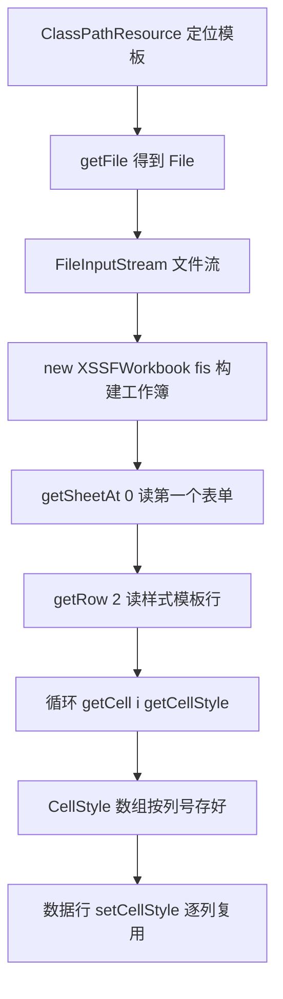

# 模板打印落地：加载模板工作簿与抽取公共样式数组

思路在概述里已经定了：模板管样式，代码管数据。落到实现，第一刀切在哪里？把上一篇纯代码绘制的导出方法整体注释掉，同一个接口换一种实现：先把模板放进工程，再从 classpath 加载出带完整格式的工作簿，最后把样式模板行的格式逐列抽成数组。这两步做完，填数据只是水到渠成的收尾。

## 先给结论

- 模板放进 `src/main/resources/excel-template/`，resources 下的文件随 jar 一起打包，运行时按 classpath 路径加载。
- 加载分三行：`ClassPathResource` 定位模板、`getFile()` 转 `FileInputStream`、`new XSSFWorkbook(fis)` 得到带格式的工作簿。
- 读取一律用 get 系方法：`getSheetAt(0)` 取表单、`getRow(2)` 取样式行，与 create 系的「造新」语义相反。
- 公共样式抽成 `CellStyle[]`，数组长度取 `row.getLastCellNum()`，下标与列号一一对应。
- 填数据时 `cell.setCellStyle(styles[i])` 一句套用，这套逻辑沉淀下来就是 `ExcelExportUtil.getTemplateStyles` 的成例。

## 一、把模板放进工程

模板文件 `hr-demo.xlsx` 拷进工程的 resources 目录，单独建一个目录存放：

```bash
hrm_employee/src/main/resources/excel-template/hr-demo.xlsx
```

模板的结构在概述里已经拆过：第一行跨列大标题，第二行列头，第三行是带完整格式的示例数据行，也就是程序的样式来源。放进 resources 意味着它走 classpath，与代码一起版本管理，打包发布时不会掉队。

## 二、加载模板：从 classpath 到工作簿

加载资源用 Spring 提供的 `Resource` 抽象。`Resource` 是接口，`ClassPathResource` 是它面向 classpath 的实现，构造参数就是模板在 classpath 下的相对路径：

```java
//1.构造报表数据
List<EmployeeReportResult> list = userCompanyPersonalService.findByReport(companyId, month + "%");
//2.加载模板，得到带格式的工作簿
Resource resource = new ClassPathResource("excel-template/hr-demo.xlsx");
FileInputStream fis = new FileInputStream(resource.getFile());
Workbook wb = new XSSFWorkbook(fis);
```

与上一篇的唯一区别在创建工作簿这一行：`new XSSFWorkbook()` 空构造拿到的是一张白纸，`new XSSFWorkbook(fis)` 从模板流构建，标题、列头、格式全部随流装入。工作簿到手，模板里做好的东西就都是你的了。

## 三、读取工作表与样式行

读表单和读行都用 get 系方法，语义与 create 系严格分开：

```java
//3.读取工作表（模板的第一个表单）
Sheet sheet = wb.getSheetAt(0);
//4.读取样式模板行：第 0 行大标题，第 1 行列头，第 2 行是带格式的示例行
Row row = sheet.getRow(2);
```

`getSheetAt(0)` 取第一个表单，之前解析上传文件时用的是同一招；区别是那时读的是用户传上来的数据，现在读的是随工程发布的模板。`getRow(2)` 拿第三行，这一行的十三个格子各自带着调好的字体、边框、对齐方式，接下来把它们逐个抄走。

## 四、抽取公共样式数组

抄样式就是循环取每个格子的 `CellStyle`，按下标存进数组：

```java
//5.抽取公共样式，与列号一一对应
CellStyle[] styles = new CellStyle[row.getLastCellNum()];
for (int i = 0; i < row.getLastCellNum(); i++) {
    Cell cell = row.getCell(i);
    styles[i] = cell.getCellStyle();
}
```

三处细节值得嚼一下：

**第一，数组长度用 `getLastCellNum()`。** 它返回的是格子数量，十三列返回 13，恰好当数组长度；当成下标用就会越界，因为合法下标只到 12。

**第二，数组下标即列号。** `styles[0]` 是编号列的样式，`styles[1]` 是姓名列的样式，往后以此类推。之后填任何一行数据，第 i 列直接套 `styles[i]`，列与样式永远不会错位，这是把格式对齐问题一次解决掉的设计。

**第三，存的是样式对象引用，不是拷贝。** 数组里十三个人共用工作簿内部的十三个样式对象，新数据行 `setCellStyle` 只是挂引用，内存里不会膨胀出成千上万份样式。反过来也提醒一句：拿到样式数组后不要再改这些对象的属性，改一处，全表跟着变。

整个加载与抽取流程串起来是：



这张图讲的是模板进入内存再到样式的完整路径。前四步解决「模板从哪来」，中间三步解决「样式怎么抄」，最后一步是后面填数据环节的伏笔。

## 五、这套逻辑的沉淀成例

手写一遍之后看课程给出的工具类，思路完全同构。`ExcelExportUtil` 构造时收三个参数：数据行起始下标 `rowIndex`、样式行下标 `styleIndex`、实体类型；导出方法里两段核心代码，先抽样式，再循环填数据：

```java
public class ExcelExportUtil<T> {

    private int rowIndex;
    private int styleIndex;
    private Class clazz;
    private Field fields[];

    public ExcelExportUtil(Class clazz, int rowIndex, int styleIndex) {
        this.clazz = clazz;
        this.rowIndex = rowIndex;
        this.styleIndex = styleIndex;
        fields = clazz.getDeclaredFields();
    }

    /**
     * 基于注解导出
     */
    public void export(HttpServletResponse response, InputStream is, List<T> objs, String fileName) throws Exception {
        XSSFWorkbook workbook = new XSSFWorkbook(is);
        Sheet sheet = workbook.getSheetAt(0);

        CellStyle[] styles = getTemplateStyles(sheet.getRow(styleIndex));

        AtomicInteger datasAi = new AtomicInteger(rowIndex);
        for (T t : objs) {
            Row row = sheet.createRow(datasAi.getAndIncrement());
            for (int i = 0; i < styles.length; i++) {
                Cell cell = row.createCell(i);
                cell.setCellStyle(styles[i]);
                for (Field field : fields) {
                    if (field.isAnnotationPresent(ExcelAttribute.class)) {
                        field.setAccessible(true);
                        ExcelAttribute ea = field.getAnnotation(ExcelAttribute.class);
                        if (i == ea.sort()) {
                            cell.setCellValue(field.get(t).toString());
                        }
                    }
                }
            }
        }
        fileName = URLEncoder.encode(fileName, "UTF-8");
        response.setContentType("application/octet-stream");
        response.setHeader("content-disposition", "attachment;filename=" + new String(fileName.getBytes("ISO8859-1")));
        response.setHeader("filename", fileName);
        workbook.write(response.getOutputStream());
    }

    public CellStyle[] getTemplateStyles(Row row) {
        CellStyle[] styles = new CellStyle[row.getLastCellNum()];
        for (int i = 0; i < row.getLastCellNum(); i++) {
            styles[i] = row.getCell(i).getCellStyle();
        }
        return styles;
    }
}
```

`getTemplateStyles` 与上一节手写的抽取循环逐字对应，只是样式行下标被参数化了，模板怎么改版都不用动代码。`export` 里更能看出这套设计的完整性：`cell.setCellStyle(styles[i])` 套样式，`field.get(t)` 按注解的 `sort` 匹配列号填值，反射加注解把「写十三个 createCell」的体力活也消掉了。样式抽取是模板打印的地基，地基打到这里，后面的数据填充只剩薄薄一层。

## 常见误区

- **get 系与 create 系混用。** 对模板工作簿调 `createSheet` 会凭空多出一个空表单，对样式行调 `createCell` 会把调好的格式换成空白。读取已存在的东西用 `getSheetAt`、`getRow`、`getCell`，只有造新行新格子才用 create。
- **把 `getLastCellNum()` 当下标用。** 它返回格子数量，比最大下标大 1，当循环上界恰好、当下标访问必越界。与之相对的 `getPhysicalNumberOfCells()` 返回非空格子数，遇到中间有空格子时两者不相等，取样式应以前者为准。
- **给每个格子 `createCellStyle`。** XSSF 的样式数量有上限，六万多个，千行报表逐格新建很快耗尽并抛异常。模板方案天然复用样式对象，这也是它的隐性优势。
- **部署成 jar 后 `getFile()` 失效。** fat jar 里的资源不是独立文件，`resource.getFile()` 会抛 `FileNotFoundException`。通吃两种运行方式的写法是 `new XSSFWorkbook(resource.getInputStream())`，直接把资源流转给工作簿。

## 面试可能被问到的问题

1. 面试官追问：「`new XSSFWorkbook(InputStream)` 和空构造有什么区别？」
   答：空构造创建一个空白工作簿，样式、表单全部自己画；传输入流的构造会解析流内容构建出带全部已有结构的工作簿，模板打印正是利用这一点，把模板文件流传入，得到现成的标题、列头与格式。

2. 面试官追问：「为什么要抽成样式数组，而不是填数据时逐格取样式？」
   答：样式模板行只有一行，抽成数组后样式与列号固定映射，填多少行都是查表套用，时间开销 O(列数)；逐格临时取要么再读一遍模板行，要么容易取错行。数组还让代码里样式对齐这件事显式化，下标即列号，出错好排查。

3. 面试官追问：「`getLastCellNum()` 和 `getPhysicalNumberOfCells()` 有什么区别？」
   答：前者返回列数，按最后一格的列号加一计算，中间有空格子也照算；后者返回实际非空格子数。样式抽取要求数组下标与列号严格对应，必须用前者。后者适合统计「这行到底填了几个格子」。

4. 面试官追问：「模板文件放 resources 里，打成 jar 之后还能用 `getFile()` 读吗？」
   答：不能。jar 内资源嵌在压缩包里，不是文件系统上的独立文件，`getFile()` 会抛 `FileNotFoundException`。用 `resource.getInputStream()` 拿输入流直接交给 `XSSFWorkbook` 构造器，IDE 运行与 jar 运行都适用。

5. 面试官追问：「POI 的样式对象为什么不能大量创建？」
   答：`CellStyle` 挂在工作簿上，XSSF 对单个工作簿的样式数量有硬上限，大约六万四。逐格新建样式在报表行数大时触发上限异常。正确姿势是像模板方案一样，少量样式对象被所有数据行共享复用。

## 配套资料

- 样式抽取与模板导出的工具成例（正文第五节代码即出自此文件，包名已改为 `com.example`）：`materials/code/02/day08 POI高级/POI高级/资源/代码/工具类/ExcelExportUtil.java`
- 注解驱动的列映射成例：`materials/code/02/day08 POI高级/POI高级/资源/代码/工具类/ExcelAttribute.java`
- 下载工具类：`materials/code/02/day08 POI高级/POI高级/资源/工具类/DownloadUtils.java`
- 模板文件 `hr-demo.xlsx` 与课堂 Controller 改造代码未随资料包提供，加载与抽取写法按课程视频画面还原，示例为按本课写法补全
