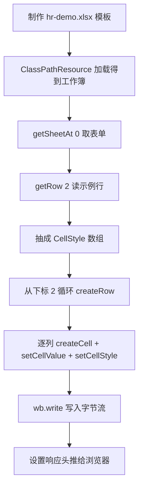

# 模板打印收官：数据行填充、下载响应与整套方案复盘

样式数组已经抽好，模板打印还剩两步：把查询出来的报表数据逐行写进工作簿，再把写好的工作簿推给浏览器下载。写完这两步，整套「模板管样式、代码管数据」的方案就能跑通，顺手把 day08 的模板打印思路做一个收束。

## 先给结论

- 数据写入从下标 2（第三行）开始：第 0 行是大标题、第 1 行是列头，第 2 行是模板里那条示例数据，它只贡献样式，最终会被第一条真实数据替换。
- 每个数据行的写法固定三连：`createCell` 造格子、`setCellValue` 填值、`setCellStyle(styles[i])` 套上抽好的样式。
- 下载复用之前的 `DownloadUtils`：工作簿先写进 `ByteArrayOutputStream`，再设置响应头写到响应流。
- 模板打印五步曲：制作模板、加载工作簿、抽取公共样式、循环填数据、下载输出。
- 代码本身不难，值钱的是思想：样式复杂时不要在 Java 里逐格手搓格式，把格式交给美工在 Excel 里画，程序只负责灌数据。

## 一、数据从第三行开始写

写数据之前先定起始行号。模板的三行各有用途：

| 行下标 | 内容 | 程序怎么处理 |
|---|---|---|
| 0 | 跨列大标题 | 不动 |
| 1 | 列头 | 不动 |
| 2 | 带完整格式的示例数据 | 只抽样式，写入时被覆盖 |

`sheet.getRow(2)` 抽完样式之后，这条示例行的使命就结束了。真实数据要写的位置同样是下标 2：

```java
//4.填充数据：从下标 2 开始写，第一条真实数据会替换模板示例行
int rowIndex = 2;
Cell cell = null;
```

POI 对 `createRow` 的处理是覆盖式的：目标位置已有行时，旧行会被移除再建新行。所以从 2 开始写不会留下那条假数据，模板示例行的遗产只剩抽走的样式数组。

## 二、逐列填充：三连写满十三列

拿到了 `List<EmployeeReportResult>`，剩下的就是体力活。每行数据循环一次，行内逐列执行「造格子、填值、套样式」：

```java
for (EmployeeReportResult employeeReportResult : list) {
    row = sheet.createRow(rowIndex++);
    //编号
    cell = row.createCell(0);
    cell.setCellValue(employeeReportResult.getUserId());
    cell.setCellStyle(styles[0]);
    //姓名
    cell = row.createCell(1);
    cell.setCellValue(employeeReportResult.getUsername());
    cell.setCellStyle(styles[1]);
    //手机
    cell = row.createCell(2);
    cell.setCellValue(employeeReportResult.getMobile());
    cell.setCellStyle(styles[2]);
    //最高学历
    cell = row.createCell(3);
    cell.setCellValue(employeeReportResult.getTheHighestDegreeOfEducation());
    cell.setCellStyle(styles[3]);
    //国家地区
    cell = row.createCell(4);
    cell.setCellValue(employeeReportResult.getNationalArea());
    cell.setCellStyle(styles[4]);
    //护照号
    cell = row.createCell(5);
    cell.setCellValue(employeeReportResult.getPassportNo());
    cell.setCellStyle(styles[5]);
    //籍贯
    cell = row.createCell(6);
    cell.setCellValue(employeeReportResult.getNativePlace());
    cell.setCellStyle(styles[6]);
    //生日
    cell = row.createCell(7);
    cell.setCellValue(employeeReportResult.getBirthday());
    cell.setCellStyle(styles[7]);
    //属相
    cell = row.createCell(8);
    cell.setCellValue(employeeReportResult.getZodiac());
    cell.setCellStyle(styles[8]);
    //入职时间
    cell = row.createCell(9);
    cell.setCellValue(employeeReportResult.getTimeOfEntry());
    cell.setCellStyle(styles[9]);
    //离职类型
    cell = row.createCell(10);
    cell.setCellValue(employeeReportResult.getTypeOfTurnover());
    cell.setCellStyle(styles[10]);
    //离职原因
    cell = row.createCell(11);
    cell.setCellValue(employeeReportResult.getReasonsForLeaving());
    cell.setCellStyle(styles[11]);
    //离职时间
    cell = row.createCell(12);
    cell.setCellValue(employeeReportResult.getResignationTime());
    cell.setCellStyle(styles[12]);
}
```

套路完全一致：第 i 列取实体第 i 个报表字段，套 `styles[i]`。样式数组的下标与列号一一对应，就是上一篇抽取时定下的映射，这里直接查表套用，任何一行的格式都和模板行分毫不差。

十三列写下来代码确实啰嗦，而且换一张报表就得照抄一遍。这个啰嗦不是白写的，它正是下一篇工具类要消灭的对象。

## 三、下载：响应头决定浏览器行为

数据写完，工作簿还在内存里，最后一步是把它变成浏览器收到的文件。下载逻辑与之前手写报表时完全一致：

```java
//5.下载
ByteArrayOutputStream os = new ByteArrayOutputStream();
wb.write(os);
new DownloadUtils().download(os, response, returnName + "人事报表.xlsx");
```

`DownloadUtils` 内部做的就是把字节数组挂到响应上，核心几行是：

```java
response.setContentType("application/octet-stream");
response.addHeader("Content-Disposition", "attachment;filename=total.xls");
response.setContentLength(byteArrayOutputStream.size());
ServletOutputStream outputstream = response.getOutputStream();
byteArrayOutputStream.writeTo(outputstream);
byteArrayOutputStream.close();
outputstream.flush();
```

两处响应头决定了浏览器的行为：`Content-Type` 声明这是二进制流而不是网页，浏览器不做渲染；`Content-Disposition: attachment` 触发下载对话框并携带文件名。中文文件名需要编码处理，否则不同浏览器下会出现乱码，工具类成例里的做法是 `URLEncoder.encode` 编码后再拼进响应头。

## 四、整套方案的流程复盘

从模板文件到浏览器下载，完整链路如下：



关键路径在中间的分叉：示例行被拆成了两份遗产，样式进数组供所有数据行复用，行位置让给第一条真实数据。前半段（做模板、加载、抽样式）上一篇已经完成，这里补上后半段（填数据、下载），方案闭环。

模板打印的操作步骤可以固化成五步，之后每张复杂报表都按这个清单走：

1. 在 Excel 里制作模板：标题、列头、一条调好格式的示例数据行。
2. 根据模板文件得到工作簿：`ClassPathResource` 加 `XSSFWorkbook`。
3. 读取样式行，把每列的 `CellStyle` 抽成公共样式数组。
4. 从样式行下标开始循环填充数据，逐列套用样式。
5. 写出并下载，与普通导出一致。

思想比代码重要：报表样式千变万化，用 Java 代码一个格子一个格子地造边框、字体、对齐，既费劲又难以和美工协作。生成一份带数据的样式报表当模板，程序提取样式再复制，格式工作全部前移到 Excel 里完成，代码只保留数据灌入这一个职责。

## 常见误区

- **起始行号从 1 开始写。** 下标 1 是列头行，从这里写会把列头覆盖掉，导出的报表光秃秃没有表头。数据行起始下标必须等于样式行的下标（本例是 2）。
- **样式数组与列错位。** 中途在模板里插了一列，样式数组跟着变长，但填充代码还是老的下标，从错位那列起数据全串列。改模板时必须同步核对列号与 `sort` 映射。
- **写完数据忘记 `wb.write`。** 只调了 `createRow`、`setCellValue` 不算落盘，工作簿必须写进输出流（内存流或响应流）浏览器才能收到文件，否则响应是空的。
- **中文文件名直接拼进响应头。** `Content-Disposition` 里的中文未编码时，部分浏览器显示乱码或丢弃文件名。用 `URLEncoder.encode(fileName, "UTF-8")` 编码后再设置。

## 面试可能被问到的问题

1. 面试官追问：「模板打印和纯代码绘制导出相比，优势在哪里？」
   答：样式复杂时优势明显。纯代码绘制要在 Java 里逐格设置字体、边框、对齐，代码量大且美工无法参与；模板打印把这些格式前移到 Excel 文件里制作，程序只负责提取样式数组和填充数据，格式调整不用改代码。

2. 面试官追问：「数据写入为什么从下标 2 开始？」
   答：模板第 0 行是大标题、第 1 行是列头，下标 2 是带完整格式的示例数据行。程序先从这一行抽取公共样式，随后写入数据时 `createRow` 覆盖该行，示例行只贡献样式不进入最终报表。

3. 面试官追问：「`createRow` 遇到已存在的行会怎样？」
   答：POI 的行为是覆盖：移除目标下标上的旧行，新建一个空行返回。所以从示例行下标开始写数据不会残留假数据，但也意味着对已有内容调 `createRow` 要谨慎，一不小心就把不该删的行清掉了。

4. 面试官追问：「下载接口的响应头要设置哪些？」
   答：`Content-Type` 设为 `application/octet-stream` 表示二进制流；`Content-Disposition` 设为 `attachment;filename=文件名` 触发下载并指定文件名；再给 `Content-Length` 便于浏览器显示进度。中文文件名要做 URL 编码。

5. 面试官追问：「工作簿写进 `ByteArrayOutputStream` 再转一遍，为什么不直接写响应流？」
   答：先写内存流可以把「生成」和「输出」解耦：拿到完整字节后能统一设置 `Content-Length`，也能在同一份代码里支持保存到文件、发邮件等不同出口。直接写响应流也可以，只是响应头要在写出前设置完毕。

## 配套资料

- 模板导出工具类成例（正文提到的样式复用与响应头编码即出自此文件，包名已改为 `com.example`）：`materials/code/02/day08 POI高级/POI高级/资源/代码/工具类/ExcelExportUtil.java`
- 下载工具类（第三节响应头代码出自此文件）：`materials/code/02/day08 POI高级/POI高级/资源/工具类/DownloadUtils.java`
- 列映射注解：`materials/code/02/day08 POI高级/POI高级/资源/代码/工具类/ExcelAttribute.java`
- 模板文件 `hr-demo.xlsx` 与课堂 Controller 代码未随资料包提供，填充与下载写法按课程视频画面还原，示例为按本课写法补全
