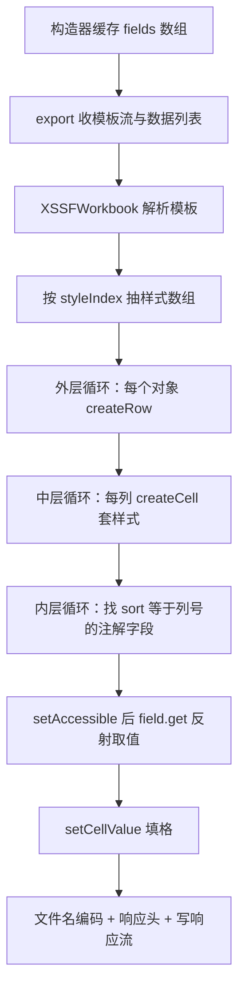

# 自定义注解式导出工具类：@ExcelAttribute 加反射，替掉十三列手写填充

模板打印跑通之后回头看代码：加载模板、抽取样式、填充、下载，整套动作明天再导一张别的报表还得原样照抄一遍。差异只在实体类型和那十三个 `createCell`。把雷同的部分沉淀成工具类，把「第几列放哪个字段」这个个性化信息改成声明式的注解，目标是让任何实体的 Excel 导出收敛到几行调用：一个 `@ExcelAttribute` 注解加反射，全部搞定。

## 先给结论

- 手写导出里只有「填充」这一步是个性的，其余步骤全部雷同；工具类的突破口就是把填充的「列号与字段的对应」从代码搬进注解。
- `@ExcelAttribute` 标在字段上，`sort` 声明该字段对应第几列；`@Retention(RUNTIME)` 是反射读得到它的前提，`@Target(FIELD)` 限定只能标字段。
- `ExcelExportUtil` 构造时收 `clazz`、`rowIndex`、`styleIndex` 三参，并缓存 `clazz.getDeclaredFields()`；导出时列号 i 与注解 `sort` 匹配，`field.get(t)` 反射取值。
- Controller 侧收敛为三行：查数据、拿模板流、`new ExcelExportUtil<>(EmployeeReportResult.class, 2, 2).export(...)`。
- 测试验证过：注解版与手写版导出的文件内容、样式完全一致。

## 一、对手写版做一次账目分析

把模板打印的完整方法拆开盘点，每一步换个报表后的命运如下：

| 步骤 | 换一张报表时 |
|---|---|
| 加载模板、建工作簿 | 只改模板路径，逻辑不变 |
| 抽取公共样式 | 只改样式行下标，逻辑不变 |
| 逐列填充 | 列数、getter、列号全变 |
| 下载 | 只改文件名，逻辑不变 |

雷同的占四分之三，可封装性看起来很好，难点集中在填充段。再往深处看一层：填充段其实也能循环化。模板示例行有几个格子，报表就有几列，列数是已知的：

```java
int rowIndex = 2;
for (EmployeeReportResult r : list) {
    Row row = sheet.createRow(rowIndex++);
    for (int i = 0; i < styles.length; i++) {
        Cell cell = row.createCell(i);
        cell.setCellStyle(styles[i]);
        // 卡点：cell 应该填对象的哪个字段？
    }
}
```

造格子、套样式都能自动生成，卡点只剩注释那一行：循环到 i 时程序怎么知道该调 `getUserId` 还是 `getUsername`？现在靠的是人肉对号。要让工具类替人对号，需要解决两件事：

**第一，单元格位置与属性的挂钩。** 第 i 列对应实体哪个字段，这个关系得让程序读到。注解正好干这个：在字段上声明列号。

**第二，动态使用对象属性。** 拿到字段之后要取值，取什么类型的对象、哪个对象的值，运行时才知道，这正是反射的主场。

两项技术都是 Java 基础，组合起来威力立刻显现。

## 二、@ExcelAttribute：把列号声明在字段上

自定义注解的完整定义：

```java
package com.example.domain.poi;

import java.lang.annotation.ElementType;
import java.lang.annotation.Retention;
import java.lang.annotation.RetentionPolicy;
import java.lang.annotation.Target;

@Retention(RetentionPolicy.RUNTIME)
@Target(ElementType.FIELD)
public @interface ExcelAttribute {
    /** 对应的列名称 */
    String name() default "";

    /** 列序号 */
    int sort();

    /** 字段类型对应的格式 */
    String format() default "";
}
```

三个元注解与三个属性各自的作用：

**`@Retention(RetentionPolicy.RUNTIME)` 是生死线。** 注解的保留策略默认是 `CLASS`：写进 class 文件，但运行期不加载进内存，反射读不到。这个工具类全靠运行期反射读注解，保留策略必须显式升到 `RUNTIME`，漏写就是全表列号匹配失败。

**`@Target(ElementType.FIELD)` 限定作用面。** 编译器强制注解只能标在字段上，标到方法或类上直接编译报错，防止误用。

**`sort()` 不给默认值。** `name`、`format` 都有 `default ""`，唯独列序号强制声明，漏写列号编译期就报错，把最常见的配置错误挡在最前面。`name` 与 `format` 本课导出暂未用到，它们分别对应表头名称与日期格式，是留给导入工具类和更复杂场景的扩展位。

注解本身只是元数据，不会干活。谁来读它、读了怎么用，是接下来这个工具类的职责。

## 三、ExcelExportUtil：注解加反射的执行者

工具类分两半看，先看骨架与构造器：

```java
public class ExcelExportUtil<T> {

    private int rowIndex;   // 写入数据的起始行下标
    private int styleIndex; // 抽取样式的行下标
    private Class clazz;    // 配置了注解的实体字节码
    private Field fields[]; // 实体的全部字段，构造时一次缓存

    public ExcelExportUtil(Class clazz, int rowIndex, int styleIndex) {
        this.clazz = clazz;
        this.rowIndex = rowIndex;
        this.styleIndex = styleIndex;
        fields = clazz.getDeclaredFields();
    }
```

三个构造参数对应模板方案的三个自由度：往哪行开始写数据、从哪行抽样式、按哪个实体取值。`getDeclaredFields()` 取的是本类声明的全部字段（含私有、不含继承）；报表实体字段几乎全是 private，用只认 public 的 `getFields()` 会拿不到东西，这是两个方法最容易混的点。字段数组在构造器里缓存一次，之后每次导出不必重复反射扫描。

导出的核心循环，就是手写版卡点的正解：

```java
public void export(HttpServletResponse response, InputStream is, List<T> objs, String fileName) throws Exception {
    XSSFWorkbook workbook = new XSSFWorkbook(is);
    Sheet sheet = workbook.getSheetAt(0);
    CellStyle[] styles = getTemplateStyles(sheet.getRow(styleIndex));

    AtomicInteger datasAi = new AtomicInteger(rowIndex);
    for (T t : objs) {
        Row row = sheet.createRow(datasAi.getAndIncrement());
        for (int i = 0; i < styles.length; i++) {
            Cell cell = row.createCell(i);
            cell.setCellStyle(styles[i]);
            for (Field field : fields) {
                if (field.isAnnotationPresent(ExcelAttribute.class)) {
                    field.setAccessible(true);
                    ExcelAttribute ea = field.getAnnotation(ExcelAttribute.class);
                    if (i == ea.sort()) {
                        cell.setCellValue(field.get(t).toString());
                    }
                }
            }
        }
    }
    fileName = URLEncoder.encode(fileName, "UTF-8");
    response.setContentType("application/octet-stream");
    response.setHeader("content-disposition", "attachment;filename=" + new String(fileName.getBytes("ISO8859-1")));
    response.setHeader("filename", fileName);
    workbook.write(response.getOutputStream());
}
```

几处关键细节值得逐个点名：

**三层循环是「行、列、字段」。** 外层按数据造行，中层按列号造格、套样式，内层拿全部字段找 `sort == i` 的那一个，命中就反射取值。手写版里人肉维护的「第 i 列调第 i 个 getter」，被 `i == ea.sort()` 一行判断接管。

**`field.setAccessible(true)` 越过访问检查。** 字段是 private 的，不打开访问开关，`field.get(t)` 会抛 `IllegalAccessException`。

**`AtomicInteger` 只是个行号自增器。** `getAndIncrement()` 等价于 `rowIndex++`，语义与手写版的 `int rowIndex = 2` 完全一致，把它收敛成对象只是为了方法内传递方便，别被「并发类」吓到。

**响应头收尾与模板方案对齐。** 文件名先 `URLEncoder.encode` 编码防中文乱码，`content-disposition` 声明附件下载，最后 `workbook.write(response.getOutputStream())` 直接写响应流，这里没有经过 `ByteArrayOutputStream` 中转，属于同一件事的两种写法。

整个执行链路如下：



图里 G 到 I 是整套设计的灵魂：注解负责「谁在哪一列」，反射负责「从对象里把值拿出来」，工具类把两件事在运行时对上号。

## 四、实体改造成声明式

工具类就位后，实体的角色从「被动填充」变成「自带说明书」。报表实体标注解后的样子（字段做了节选，类本身出自课程资料包）：

```java
@Getter
@Setter
@NoArgsConstructor
@ToString
public class EmployeeReportResult {

    @ExcelAttribute(sort = 0)
    private String userId;
    @ExcelAttribute(sort = 1)
    private String username;
    @ExcelAttribute(sort = 2)
    private String mobile;
    @ExcelAttribute(sort = 3)
    private String theHighestDegreeOfEducation;
    @ExcelAttribute(sort = 4)
    private String nationalArea;
    @ExcelAttribute(sort = 5)
    private String passportNo;
    @ExcelAttribute(sort = 6)
    private String nativePlace;
    @ExcelAttribute(sort = 7)
    private String birthday;
    @ExcelAttribute(sort = 8)
    private String zodiac;
    @ExcelAttribute(sort = 9)
    private String timeOfEntry;
    @ExcelAttribute(sort = 10)
    private String typeOfTurnover;
    @ExcelAttribute(sort = 11)
    private String reasonsForLeaving;
    @ExcelAttribute(sort = 12)
    private String resignationTime;

    // 未标注解的字段不会出现在导出结果里，例如部门、性别等内部属性
    private String departmentName;
    private String companyId;
}
```

把这段声明与上篇那三十九行填充代码对照：信息完全等价，都是从 0 到 12 列各取哪个字段，只是载体从命令式代码换成了字段上的标记。新增或调整列，改的是注解的 `sort` 数字，不再动工具类一行。

## 五、Controller 换装与测试验证

改造 Controller：手写的抽取、填充、下载整段注释，数据查询与模板加载保留，因为工具类同样需要它们：

```java
@RequestMapping(value = "/export/{month}", method = RequestMethod.GET)
public void export(@PathVariable String month) throws Exception {
    //1.查询报表数据
    List<EmployeeReportResult> list = userCompanyPersonalService.findByReport(companyId, month + "%");
    //2.加载模板文件流
    Resource resource = new ClassPathResource("excel-template/hr-demo.xlsx");
    FileInputStream fis = new FileInputStream(resource.getFile());
    //3.工具类导出：实体字节码、数据起始行 2、样式抽取行 2
    new ExcelExportUtil<>(EmployeeReportResult.class, 2, 2)
            .export(response, fis, list, returnName + "人事报表.xlsx");
}
```

构造参数里的两个 2 来源不同，别混着记：模板下标 0 是大标题、1 是列头，2 是带格式的示例行。写数据要从示例行的位置开始覆盖，所以 `rowIndex` 传 2；抽样式也从示例行抽，所以 `styleIndex` 传 2。模板结构一变（比如列头下多加一行说明），这两个数字要分别调整。

重启员工微服务，页面点导出，下载到文件后打开验证：十三列数据齐全，边框、字体、对齐与模板一模一样，与手写版产物肉眼无差别。至此导出能力完成封装：以后任何一张基于模板的报表导出，工作量只剩「实体标注定解、Controller 调一行 export」。

## 常见误区

- **漏写 `@Retention(RetentionPolicy.RUNTIME)`。** 保留策略默认 `CLASS`，运行期反射读不到注解，`isAnnotationPresent` 恒为 false，导出结果只有样式没有值。反射场景的注解必须显式声明 RUNTIME。
- **`sort` 与模板列号对不上。** 注解声明的是「字段放第几列」，模板列头一动而注解没跟着改，数据从错位那列起整体串行。调整模板后逐列核对 `sort` 与列头的对应关系。
- **值为 null 的字段直接 `field.get(t).toString()`。** 成例没有判空，字段为 null 时抛 `NullPointerException`，整次导出失败。真实项目应在填值前判空，空值写空字符串。
- **把两个 2 当成一个概念。** `rowIndex` 是写入起始行，`styleIndex` 是样式抽取行，本课恰好都是 2 纯属模板结构使然，语义毫无关系，改模板时必须分开判断。

## 面试可能被问到的问题

1. 面试官追问：「自定义注解上常用的元注解有哪些？」
   答：`@Retention` 控制保留策略（SOURCE、CLASS、RUNTIME），`@Target` 限定可标注位置（FIELD、METHOD、TYPE 等），还有 `@Documented`、`@Inherited`。需要反射读取的注解必须用 RUNTIME，本课的 `@ExcelAttribute` 就是 `RUNTIME` 加 `FIELD` 的组合。

2. 面试官追问：「`getDeclaredFields()` 和 `getFields()` 有什么区别？」
   答：前者返回本类声明的所有字段，含 private 但不含继承来的；后者只返回 public 字段，包含继承的。业务实体字段多为 private，注解式导出必须用 `getDeclaredFields()` 并配合 `setAccessible(true)`。

3. 面试官追问：「`setAccessible(true)` 的作用和代价是什么？」
   答：作用是绕过 Java 语言访问检查，让反射能读写 private 成员；代价是失去了编译器的访问控制保护，且在高版本 JDK 的模块系统下可能受限制。工具类缓存字段后只在导出时打开一次，开销可控。

4. 面试官追问：「反射性能差，这套工具类会不会有性能问题？」
   答：字段数组在构造器缓存，运行期每格只做一次注解匹配加一次取值，属低频操作；报表导出通常按月按需触发，反射开销远小于 Excel 生成本身。真要优化可缓存「列号到 Field 的映射」，省掉内层循环，或改用 `MethodHandle`。

5. 面试官追问：「这个工具类怎么扩展出表头名称和日期格式支持？」
   答：注解里的 `name` 与 `format` 就是预留位：导出时校验模板表头与 `name` 一致防错位；遇到 `Date` 类型字段按 `format` 走 `SimpleDateFormat` 格式化后再填。配套的导入工具类已经用 `format` 处理日期解析，两个工具类共用同一个注解。

6. 面试官追问：「`AtomicInteger` 在这里是不是为了并发安全？」
   答：不是为了并发，这里只有单线程循环。它只是把行号自增封装成对象，`getAndIncrement` 语义等价于 `rowIndex++`，写成 int 局部变量效果相同，属于代码风格选择。

## 配套资料

- 导出工具类成例（第三节代码出自此文件，包名已改为 `com.example`）：`materials/code/02/day08 POI高级/POI高级/资源/代码/工具类/ExcelExportUtil.java`
- 列映射注解成例（第二节代码出自此文件）：`materials/code/02/day08 POI高级/POI高级/资源/代码/工具类/ExcelAttribute.java`
- 报表实体（资料包版本已在 `userId`、`username` 字段标注 `@ExcelAttribute`，其余列的注解为课堂演示补齐）：`materials/code/02/day07 员工管理及POI入门/员工管理及POI入门/资源/后端/实体类/employee/response/EmployeeReportResult.java`
- Controller 改造与模板文件 `hr-demo.xlsx` 未随资料包提供，使用写法按课程视频画面还原
