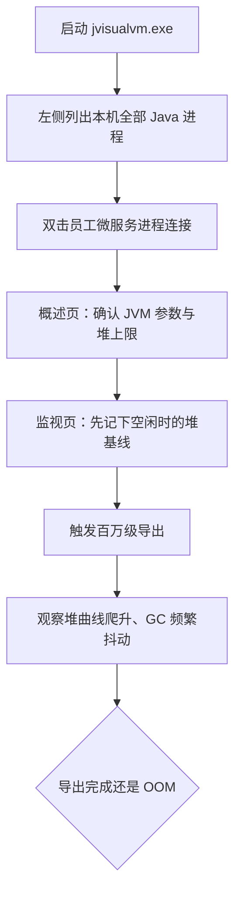

# 百万级 Excel 导出开篇：版本上限、XSSF 内存账单与 JVisualVM 观测准备

前面几篇的导出、导入代码，处理几百几千行都安然无恙。可当业务方甩来一句「把全年一百万条记录导成 Excel」，同一套代码点下导出按钮，服务先是卡死，然后大概率抛 `OutOfMemoryError`。问题出在哪、怎么亲眼看到问题发生，这是百万数据报表单元的第一课：先认清版本上限与内存去向，再备好观测工具。

## 先给结论

- Excel 两个版本两张天花板：2003 的 HSSF 上限 65536 行 256 列，与百万级无关；百万级只能走 2007 的 XSSF，上限 1048576 行 16384 列。
- XSSF 的麻烦不在功能在内存：它是全量对象模型，工作簿未写出前，百万行的 Row、Cell 全部驻留在堆里。
- 观测工具 JDK 自带 JVisualVM，在 `%JAVA_HOME%\bin\jvisualvm.exe`，双击即用，无需安装。
- 双击目标进程连接后，「监视」页能看到 CPU、堆内存、线程数与 GC 活动的实时曲线。
- 出路已有预告：SXSSF 滑动窗口只把最近 N 行留在内存，其余刷进磁盘临时文件，细节留待后续实操。

## 一、两个版本，两张天花板

POI 对 Excel 两个时代各有一套实现，能力差异先摆上桌：

| 版本 | POI 实现 | 文件扩展名 | 行上限 | 列上限 |
|---|---|---|---|---|
| Excel 2003 | HSSF | .xls | 65536 | 256 |
| Excel 2007 | XSSF | .xlsx | 1048576 | 16384 |

2003 的 65536 行上限是写死在二进制格式里的硬顶，第六万五千五百三十七行直接写不进去，百万级数据与它彻底无缘。1048576 恰好是 2 的 20 次方，2007 的 xlsx 格式按百万级设计，百万数据报表单元的重心自然全落在 XSSF 上。前面 day08 的模板打印、工具类用的也都是 XSSF，这条线是延续的。

## 二、XSSF 的内存账单：写盘前全部在堆里

XSSF 采用文档对象模型的思路：整个工作簿解析成一棵对象树，`XSSFWorkbook` 挂 `XSSFSheet`，表单挂 `XSSFRow`，行挂 `XSSFCell`。xlsx 文件本质上是一包压缩的 XML，POI 把它完整展开成 Java 对象放进堆里，任何一行没写出文件，它的对象就一直在内存中。

按这个模型算一笔账。百万行、十三列的人事报表：

```java
Workbook wb = new XSSFWorkbook(); // 全量驻留内存的对象树
Sheet sheet = wb.createSheet();
for (int i = 0; i < 1_000_000; i++) {
    Row row = sheet.createRow(i);
    for (int j = 0; j < 13; j++) {
        row.createCell(j).setCellValue("data-" + i + "-" + j);
    }
}
wb.write(new FileOutputStream("report.xlsx")); // 写到这里之前，约 1300 万个 Cell 全在堆里
```

（示例为按本课写法补全。）一千万三百万个 `XSSFCell` 对象，外加一百万个 `XSSFRow`、字符串常量、样式引用，每个 Java 对象再带上对象头与引用开销，堆消耗轻松突破默认上限。垃圾回收器面对的是一片几乎全部存活的对象海洋，回收无用武之地，最后要么 `Java heap space`，要么 `GC overhead limit exceeded`。

回头看之前的优化也能对上账：模板打印把 `CellStyle` 抽成数组复用，省的是样式对象；十三列共享十几个样式，这部分确实救了场。但行和格子本身省不掉，行数一旦上百万，XSSF 的账单照样爆。问题不在代码写得糙，在模型本身。

## 三、JVisualVM：把内存账单画成曲线

口说无凭，观测走起。工具就用 JDK 自带的 JVisualVM，位置在 JDK 安装目录的 bin 下：

```bash
C:\Program Files\Java\jdk1.8.0_92\bin\jvisualvm.exe
```

双击启动，左侧应用列表会把本机所有 Java 进程列出来：监控工具自身、IDE（它同样跑在 JVM 上），以及正在运行的几个微服务。微服务本来就是一个个 JVM 进程，自然全部现形，其中就有员工管理服务的进程 `com.example.employee.EmployeeApplication`。对准它双击连接，即可进入监控界面。

监控界面最常用两个视图：

**概述页**：JVM 版本、启动参数、系统属性等静态信息，用于确认连的是哪个进程、堆上限配了多少。

**监视页**：动态曲线，运行时长、CPU 使用率、堆内存的已用量与上限、活跃线程数、GC 活动全在这里。这正是本单元要盯的仪表盘。

观测流程串起来是：



图里 E 到 G 是实验方法的核心：先记空闲基线，再触发导出看增量。没有基线，看到堆涨了也不知道涨了多少是正常波动；有了基线，导出期间堆的爬升速度、GC 的抖动频率、最终是完成还是崩溃，全都一目了然。这套「先观测、再下结论」的习惯比结论本身更值钱。

## 四、出路预告：SXSSF 滑动窗口

XSSF 全量驻留的病根明确后，解法方向也就明确了：别把一百万行都攒在内存里。POI 提供的答案叫 SXSSF，构造时指定一个窗口大小：

```java
Workbook wb = new SXSSFWorkbook(100); // 内存里只保留最近 100 行，其余刷入磁盘临时文件
```

超过窗口的行会被自动刷到磁盘上的临时 XML 文件，最终再组装成完整的 xlsx。内存占用从「与总行数成正比」变成「与窗口大小成正比」，百万行导出的堆曲线会平稳得多。代价也有：刷盘后的行不能再随机回读，个别依赖全量模型的功能受限。它的原理细节与实操验证，后续篇幅展开。

## 常见误区

- **以为 2003 版也能导百万行。** HSSF 的 65536 行是格式硬顶，写第六万五千五百三十七行直接抛异常。百万级必须换 XSSF 或 SXSSF，先看版本上限再动手。
- **把卡顿归因于数据库慢或 CPU 瓶颈。** 全量模型下的瓶颈是堆内存，症状是 GC 频繁、CPU 被 GC 线程占满，根因却是内存。先开 JVisualVM 的监视页确认曲线，再决定优化方向。
- **把 `-Xmx` 调大当作解决方案。** 堆翻倍只是把崩溃点推迟，而且大堆意味着更长的 GC 停顿，导出期间服务整体响应变差。内存模型不改，调参治标不治本。
- **在 JRE 目录里找 jvisualvm。** 它随 JDK 发布，位于 JDK 的 bin 目录，纯 JRE 安装里没有。环境里装的是 JDK 的话，`%JAVA_HOME%\bin` 下必然能找到。

## 面试可能被问到的问题

1. 面试官追问：「HSSF、XSSF、SXSSF 三者怎么选？」
   答：HSSF 对应 2003 的 xls，上限 65536 行，只适合老格式小报表；XSSF 对应 2007 的 xlsx，功能完整但全量驻留内存，适合中小数据量；SXSSF 是 XSSF 的流式变体，内存只保留滑动窗口内的行，适合大批量导出，代价是不支持回读已刷盘的行。

2. 面试官追问：「Excel 2003 和 2007 的容量上限各是多少？」
   答：2003 的 xls 上限 65536 行 256 列；2007 的 xlsx 上限 1048576 行 16384 列，即 2 的 20 次方行、2 的 14 次方列。选型时先核对业务数据量会不会撞顶。

3. 面试官追问：「用 XSSF 导百万行为什么会内存溢出？」
   答：XSSF 把整个工作簿解析成对象树，Row、Cell 全部对象化驻留堆中，写出文件前一个都不能释放。百万行乘十几列是上千万个对象，堆装不下就抛 `OutOfMemoryError`。这是模型层面的开销，靠样式复用等小优化救不回来。

4. 面试官追问：「SXSSF 的滑动窗口原理是什么？」
   答：构造 `SXSSFWorkbook` 时指定窗口行数，内存里只保留最近 N 行对象，更早的行自动序列化到磁盘临时文件，最终写出时再组装成完整 xlsx。内存占用与窗口大小相关而与总行数无关，代价是窗口外的行不可随机访问。

5. 面试官追问：「线上导出功能 OOM，你会怎么排查？」
   答：先用 JVisualVM 或 jstat 观察堆曲线确认是内存问题；再拿堆转储（jmap 或 OOM 参数自动导出）用 MAT 分析支配树，找出是哪类对象占大头；结合业务定位到代码路径后，按数据量级选择流式方案、分页导出或异步任务。观测先行，避免上来就改代码。

6. 面试官追问：「xlsx 文件本质是什么？」
   答：一个 ZIP 压缩包，里面装着一组 XML 与配置文件，工作表数据在 sheet 的 XML 里。理解了这一点，就明白为什么全量解析会吃内存（把 XML 展开成对象树），也明白流式方案为什么省内存（按顺序读 XML，读完即弃）。

## 配套资料

- 百万数据练习实体：`materials/code/02/day08 POI高级/POI高级/资源/百万数据报表/PoiEntity.java`
- 百万数据的 SXSSF 实操代码与监控实验在后续课程给出，文中 XSSF 与 SXSSF 对比示例为按本课写法补全
