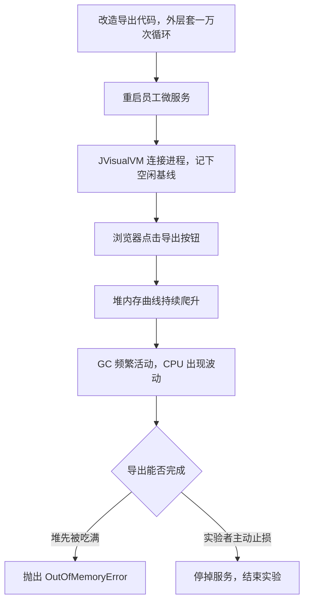

# 百万数据导出实测：96 万行报表把 XSSF 的堆吃穿

观测工具备齐了，这一节把 JVisualVM 对准真实业务接口：人事报表导出。数据库里的真实数据撑不起「百万」这个量级，实验就先把数据放大一万倍，再点下导出按钮，全程盯着 CPU 与堆内存两根曲线，看用户模式的 XSSF 会把一台服务逼到什么程度。

## 先给结论

- 实验数据靠造：三月报表在库里只有 90 多条，外层套一万次循环，报表膨胀到 96 万多行。
- 现象很直白：导出点下去浏览器转圈几分钟没有响应，服务端堆内存一路上扬、只涨不跌。
- 只涨不跌的根源：XSSF 是全量对象模型，`wb.write` 执行之前所有 Row、Cell 对象全程可达，GC 一个也收不走。
- CPU 的规律性波动不是业务计算，是垃圾回收在反复空转。
- 结局是必然的：堆被吃满那一刻抛出 `OutOfMemoryError`；导入百万行文件同理。

## 一、实验设计：把 90 条数据放大一万倍

百万数据报表要演示的是现象与对策，手里没有百万数据，实验照样成立。三月份的人事报表在数据库里有 90 多条，乘以一万倍就是 90 多万行，足以让用户模式现出原形。

`ExcelExportUtil` 工具类这次先放一边：它封装得太深，看不出对象是怎么一层层堆起来的，数据量也不方便改。回到模板导出的原始写法，在填充数据的位置动手脚，改造后的导出方法如下（包名统一为 `com.example`）：

```java
@RequestMapping(value = "/export/{month}", method = RequestMethod.GET)
public void export(@PathVariable String month) throws Exception {
    // 三月份的报表数据，库里真实只有 90 多条
    List<EmployeeReportResult> list = userCompanyPersonalService.findByReport(companyId, month);
    // 1.加载模板
    Resource resource = new ClassPathResource("excel-template/hr-demo.xlsx");
    FileInputStream fis = new FileInputStream(resource.getFile());
    // 2.通过模板创建工作簿：全量驻留内存的对象树
    Workbook wb = new XSSFWorkbook(fis);
    Sheet sheet = wb.getSheetAt(0);
    // 3.抽取模板数据行的公共样式，全表复用
    Row styleRow = sheet.getRow(2);
    CellStyle[] styles = new CellStyle[styleRow.getLastCellNum()];
    for (int i = 0; i < styleRow.getLastCellNum(); i++) {
        styles[i] = styleRow.getCell(i).getCellStyle();
    }
    // 4.填充单元格：外层一万次循环，把 90 多条放大成 96 万多行
    int rowIndex = 2;
    Cell cell = null;
    for (int i = 0; i < 10000; i++) {
        for (EmployeeReportResult report : list) {
            Row row = sheet.createRow(rowIndex++);
            cell = row.createCell(0);
            cell.setCellValue(report.getUserId());
            cell.setCellStyle(styles[0]);
            cell = row.createCell(1);
            cell.setCellValue(report.getUsername());
            cell.setCellStyle(styles[1]);
            // 第 2 到 12 列同理：手机、最高学历、国家地区、护照号、生日、
            // 入职时间、离职类型、离职原因、离职时间
        }
    }
    // 5.写出并下载：这一行执行之前，上面创建的所有对象都不可回收
    ByteArrayOutputStream os = new ByteArrayOutputStream();
    wb.write(os);
    new DownloadUtils().download(os, response, month + "人事报表.xlsx");
}
```

被放下的工具类写法长这样，问题一模一样，都是全量建好再统一写出：

```java
// ExcelExportUtil 内部：模板建工作簿，循环建行建格，最后才写出
XSSFWorkbook workbook = new XSSFWorkbook(is);
Sheet sheet = workbook.getSheetAt(0);
CellStyle[] styles = getTemplateStyles(sheet.getRow(styleIndex));
AtomicInteger datasAi = new AtomicInteger(rowIndex);
for (T t : objs) {
    Row row = sheet.createRow(datasAi.getAndIncrement()); // 每条数据一行对象
    // 逐列 setCellValue 与 setCellStyle，全挂在对象树上
}
workbook.write(response.getOutputStream()); // 写出之前，整棵树都在堆里
```

样式抽取那段值得多看一眼：十几个 `CellStyle` 抽出来全表复用，是模板打印一课的优化成果，实验里依然生效，只是对结局毫无帮助。省下的是样式对象，省不掉的是行和格子，而后者才是大头。

## 二、点下导出按钮：现象先于结论

重启员工微服务，登录系统，进入人事报表页面点导出，同时把 JVisualVM 连上 `EmployeeApplication` 进程。整个实验的时序如下：



点下去的二十多秒里页面没有任何返回，程序并没有卡死，它一直在执行，监视页给出的信息比浏览器的转圈具体得多。

**第一，堆内存一路上扬。** 空闲时服务占用两百多 MB，导出开始后蓝色曲线（当前已使用的堆内存）持续爬升，逼近 2 G 毫无停顿，两分多钟时已经冲到 4.5 GB 上下，涨势没有任何收敛的迹象。

**第二，CPU 出现规律性波动。** 业务代码只是循环创建对象，算不上计算密集，波动来自 GC：堆里对象数量达到阈值，垃圾回收器启动，扫一遍发现几乎全是活对象，空手而归，隔一会儿再来一次。CPU 时间就这么被回收动作消耗掉。

## 三、GC 明明在干活，内存为什么降不下来

曲线只涨不跌，不是 GC 偷懒，是它真的无活可干。对象能不能回收，看它是否还被引用：导出方法没执行完，局部变量 `wb` 引用着工作簿，工作簿挂着表单，表单挂着 96 万多行，每行挂着 13 个格子，整棵对象树从方法栈出发全部可达。GC 的可达性分析每次都得出同一个结论：全是活对象，一个都不能动。

能收走的只有循环里引用被覆盖的零星临时对象，相对整棵树九牛一毛。曲线的形态于是被注定了：创建一批对象涨一截，GC 启动收走一点碎屑，继续创建继续涨，一路平稳向上，直到堆的上限。上限一到，`OutOfMemoryError` 抛出，请求以失败收场。课堂演示中途就停掉了服务，不必真等它崩，机器的 CPU 已经被折腾得发烫。

## 四、这个实验说明的两件事

**第一，用户模式扛不住百万级。** 传统写法对机器性能的要求随数据量线性上涨，内存要够大，GC 要够快，数据量再上一个量级就彻底无解。问题不在代码写得糙，在 XSSF 全量模型本身。

**第二，导入同样中招。** 员工模块还有 Excel 导入功能，走的同样是用户模式解析。导入一个百万行的报表文件，后台一样会出现内存持续上涨直至溢出的过程，只是把「生成对象」换成了「解析对象」。

这类实验别随手复现：堆吃满、CPU 发烫对开发机并不友好，观测一遍拿到曲线形态即可。

## 常见误区

- **把堆上涨当成内存泄漏。** 泄漏是该回收的对象收不走，这里每个对象都还在被使用，属于模型性的合理驻留，只是量级失控。对策不是找泄漏点，是换内存模型。
- **以为样式复用没生效才爆内存。** 样式确实复用了，几十个样式对象九牛一毛，大头是 96 万行和一千多万个格子，这部分用户模式省不掉。
- **用浏览器转圈判断服务端状态。** 页面无响应只能说明请求没返回，服务端是慢、是假死还是快崩，要看监视数据，堆曲线与 GC 活动比转圈图标的信息量大得多。
- **在自己的开发机上反复跑这类实验。** 堆吃满、CPU 发烫，对机器和同机其他服务都不友好，看到结论就收手。

## 面试可能被问到的问题

1. 面试官追问：「导出接口越跑越慢，最后抛 OutOfMemoryError，怎么定位？」
   答：先看监控确认堆曲线形态与 GC 活动，确认是内存问题而不是死锁或慢 SQL；再用 jmap 取堆转储，MAT 看支配树找出占大头的对象类型；沿引用链定位到业务代码，按数据量级决定换流式方案还是拆分任务。

2. 面试官追问：「为什么 GC 一直在跑，堆内存却降不下来？」
   答：GC 只回收不可达对象。全量对象模型下，工作簿从方法栈到每行每格都在引用链上，全部可达，GC 只能收走极少量碎屑，表现为回收频繁但堆只涨不跌。

3. 面试官追问：「POI 用户模式导出百万行为什么必然失败？」
   答：XSSF 把工作簿建成完整对象树，写出文件之前每行每格都驻留在堆里。96 万行乘十几列是上千万个对象，堆容量怎么配都容易被打穿，这是模型层面的开销，小优化救不回来。

4. 面试官追问：「样式对象已经复用了，为什么内存还是爆？」
   答：复用省掉的只是 `CellStyle` 这一小部分，量级在几十个；行对象与单元格对象的数量由数据量决定，百万行级别的对象总量远超样式节省的部分，省小头救不了大头。

5. 面试官追问：「导入百万行的 Excel 会有什么问题？」
   答：用户模式解析同样把整棵对象树加载进堆，内存持续上涨直至溢出。读取方向应改用基于 SAX 的事件模式逐行解析，边读边处理边丢弃。

## 配套资料

- 导出方法所在的控制器（真实工程代码，课堂实验在其导出方法上放大数据量）：`materials/code/02/day07 员工管理及POI入门/员工管理及POI入门/资源/后端/ihrm_employee/src/main/java/com/ihrm/employee/controller/EmployeeController.java`
- 报表结果实体：`materials/code/02/day07 员工管理及POI入门/员工管理及POI入门/资源/后端/实体类/employee/response/EmployeeReportResult.java`
- 模板导出工具类：`materials/code/02/day08 POI高级/POI高级/资源/代码/工具类/ExcelExportUtil.java`
- 下载工具类：`materials/code/02/day08 POI高级/POI高级/资源/工具类/DownloadUtils.java`
- 外层一万次循环为课堂演示的实验性改造，完整方法体按本课写法补全
