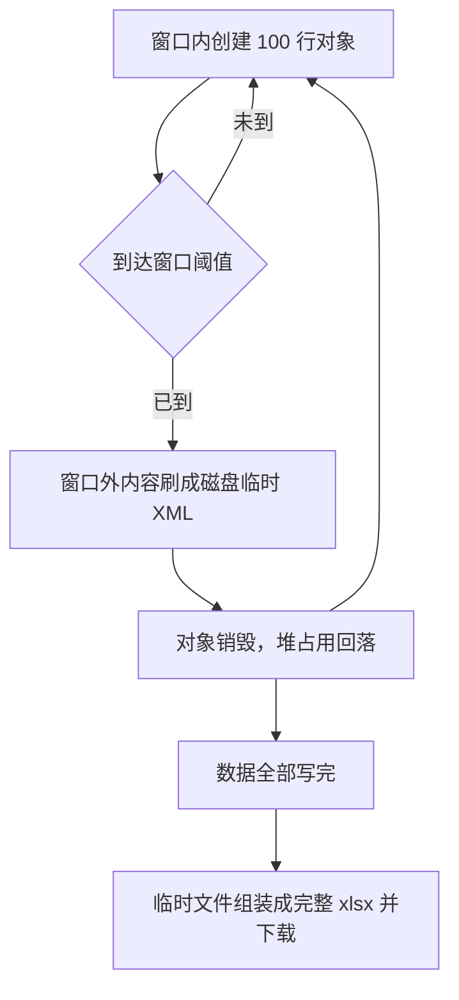

# SXSSFWorkbook 实战：换一个构造函数，96 万行导出稳稳落地

思路已经推演清楚：内存留窗口、窗口外落盘。这一节把它落成代码。改造量小到出乎意料，核心只有一个构造函数的替换，换完之后同样的 96 万行数据，导出顺利完成，堆内存曲线第一次出现了回落的锯齿。

## 先给结论

- 改造量极小：把 `new XSSFWorkbook()` 换成 `new SXSSFWorkbook(100)`，其余流程照旧。
- SXSSF 不支持模板打印，动手前先放弃模板方案，回到手动建表写表头的原始写法。
- 构造参数是滑动窗口行数，默认 100；达到阈值就把窗口外内容刷成磁盘临时文件并销毁对象。
- 样式与字体建议省略，少一批对象；确有需要再手动设置，只是写法比模板方案繁琐。
- 实测结果：堆曲线呈锯齿状回落，96 万行导出成功，文件 40 多 MB，内存占用全程平稳。

## 一、动手前的声明：SXSSF 不支持模板打印

之前的人事报表导出走的是模板打印：加载 `hr-demo.xlsx`，抽公共样式，往模板里填行。这套流程对 SXSSF 行不通，它无法对模板里已有的内容做随机修改，模板路线必须放弃。

替代方案就是最原始的写法：创建工作簿、创建表单、写表头、逐行逐格填充。表头用一个逗号分隔的字符串拆出来，十三列一次成型：

```java
// 1.创建工作簿与表单，手动写表头（原始写法，供 SXSSF 方案沿用）
Workbook wb = new XSSFWorkbook();
Sheet sheet = wb.createSheet();
Row headRow = sheet.createRow(0);
String[] titles = "编号,姓名,手机,最高学历,国家地区,护照号,籍贯,生日,属相,入职时间,离职类型,离职原因,离职时间".split(",");
int titleIndex = 0;
for (String title : titles) {
    Cell headCell = headRow.createCell(titleIndex++);
    headCell.setCellValue(title);
}
```

这一段里的 `XSSFWorkbook` 就是接下来唯一的替换点。

## 二、唯一的替换点：new SXSSFWorkbook(100)

```java
@RequestMapping(value = "/export/{month}", method = RequestMethod.GET)
public void export(@PathVariable String month) throws Exception {
    List<EmployeeReportResult> list = userCompanyPersonalService.findByReport(companyId, month);
    // 1.创建工作簿：换成 SXSSF，窗口 100，内存里最多保留最近 100 行
    SXSSFWorkbook wb = new SXSSFWorkbook(100);
    // 2.创建表单并写表头（SXSSF 不支持模板打印，走手动建表）
    Sheet sheet = wb.createSheet();
    String[] titles = "编号,姓名,手机,最高学历,国家地区,护照号,籍贯,生日,属相,入职时间,离职类型,离职原因,离职时间".split(",");
    Row headRow = sheet.createRow(0);
    int titleIndex = 0;
    for (String title : titles) {
        Cell headCell = headRow.createCell(titleIndex++);
        headCell.setCellValue(title);
    }
    // 3.填充数据：真实 90 多条，外层一万次循环，合计 96 万多行
    int rowIndex = 1;
    Cell cell = null;
    for (int i = 0; i < 10000; i++) {
        for (EmployeeReportResult report : list) {
            Row row = sheet.createRow(rowIndex++);
            cell = row.createCell(0);
            cell.setCellValue(report.getUserId());
            cell = row.createCell(1);
            cell.setCellValue(report.getUsername());
            cell = row.createCell(2);
            cell.setCellValue(report.getMobile());
            cell = row.createCell(3);
            cell.setCellValue(report.getTheHighestDegreeOfEducation());
            // 第 4 到 12 列同理：国家地区、护照号、籍贯、生日、属相、
            // 入职时间、离职类型、离职原因、离职时间
        }
    }
    // 4.写出并下载，结束后清理刷盘产生的临时文件
    ByteArrayOutputStream os = new ByteArrayOutputStream();
    wb.write(os);
    new DownloadUtils().download(os, response, month + "人事报表.xlsx");
    wb.dispose();
}
```

构造参数 100 就是上一节说的滑动窗口 `rowAccessWindowSize`：内存中对象数量的上限，达到这个值就把窗口外的行内容写入磁盘临时文件（XML 格式），再把对象从内存销毁，之后每达到一次就照此循环，直至导出完成。不传参数时默认就是 100，显式写出来是为了把意图亮在明面上。

注意变量声明类型是 `SXSSFWorkbook` 而不是 `Workbook`：最后的 `dispose()` 只定义在 SXSSF 自己身上，声明成接口类型会拿不到这个方法。

## 三、样式去哪了

对比模板方案，这段代码里没有任何 `CellStyle` 与 `Font`。这是刻意的：上一节推演过，减少对象产生救不了量级，但样式对象毕竟是一笔无谓的开销，在海量导出里能省则省，报表的可读性损失有限。

项目里确实需要样式时，可以在 SXSSF 下手动创建 `CellStyle` 再逐格 `setCellStyle`，写法与用户模式一致；麻烦在于没有模板可抄，样式要逐个代码定义，而且SXSSF 只保留窗口内的行，依赖全表内容的操作（比如自适应列宽）必须在行刷盘前完成。样式值多少、内存省多少，按业务需求自己权衡。

## 四、验证：从锯齿曲线到 96 万行文件

导出前先看空闲基线：服务占用两百多 MB，CPU 几乎没动静。这里有个小插曲：改完第一版直接点导出，瞬间就下完了，数据量不对，检查发现外层的万次循环忘了补上，补上循环重启服务再测才作数。



监视页上的曲线和上一节的实验截然不同：堆内存不再一路爬升，而是呈锯齿状起伏，涨到窗口容量附近就回落一段。原因就在循环体上：每生成一批行对象，堆涨一段；窗口满 100 行，这批内容被写进磁盘临时文件，对象销毁，堆降下来；接着再产生、再刷盘、再回落，周而复始。磁盘只进不出，内存有涨有跌，这就是「内存占用与总数据量脱钩」在曲线上的样子。

等待结束后文件正常下载，体积 40 多 MB，用 Excel 打开需要点耐心，拖到最后一行能看到 96 万多行数据。方案成立：百万量级的导出在可接受的内存占用下完整落地。

## 五、两个配套 API：flushRows 与 dispose

课程代码里窗口自动刷盘已经够用，SXSSF 另外提供两个手动控制的方法，补在示例里备查（示例为按本课写法补全）：

```java
SXSSFWorkbook wb = new SXSSFWorkbook(100);
// ... 循环建行建格 ...
wb.flushRows();  // 手动把窗口内尚未刷盘的行全部写入临时文件
wb.write(os);    // 组装最终 xlsx
wb.dispose();    // 删除导出过程中产生的磁盘临时文件
```

`flushRows` 可以带参数控制保留几行，适合导出收尾前主动清窗；`dispose` 负责删临时文件，导出结束后调用是好习惯，临时 XML 累积起来并不小。

## 常见误区

- **导出完不调 `dispose`。** 临时文件留在磁盘上，多次导出后垃圾越积越多，大文件导出场景尤其明显，收尾必须清理。
- **把窗口参数当成列数或字节数。** 它是行数，`new SXSSFWorkbook(100)` 指内存里保留最近 100 行，与列数、文件大小无关。
- **回头修改已刷盘的行。** 窗口外的行已被销毁，再对那一区段调用 `createRow` 会直接抛出 IllegalArgumentException，提示该范围已写入磁盘。需要回头改的数据要在进窗口前定稿。
- **用 `Workbook` 接口声明变量。** 接口上没有 `dispose`，收尾清理编译不过，声明成 `SXSSFWorkbook` 类型。

## 面试可能被问到的问题

1. 面试官追问：「SXSSFWorkbook 怎么用，内存是怎么控制的？」
   答：构造时传窗口行数，如 `new SXSSFWorkbook(100)`，内存只保留最近 100 行对象；窗口外的行自动序列化到磁盘临时文件并销毁对象，导出完成后组装成完整 xlsx，堆占用因此被窗口大小封顶。

2. 面试官追问：「为什么导出过程中堆内存曲线是锯齿状的？」
   答：行对象生成时堆上涨，窗口满触发刷盘时对象销毁、堆回落，循环往复形成锯齿。上涨幅度对应窗口容量，回落幅度对应每批被刷掉的行。

3. 面试官追问：「SXSSF 导出的临时文件是怎么回事？」
   答：窗口外的行被写成 XML 格式的临时文件，最终由 POI 组装压缩成完整 xlsx。临时文件占磁盘，用完要调 `dispose` 清理，也可用 `flushRows` 主动刷盘。

4. 面试官追问：「SXSSF 下想要单元格样式怎么办？」
   答：照常创建 `CellStyle`、逐格 `setCellStyle` 即可，但只能对未刷盘的窗口内行操作，没有模板可依赖；依赖全表内容的操作如自适应列宽，必须在行刷盘前完成。

5. 面试官追问：「SXSSF 有哪些限制，什么场景不能用？」
   答：仅向前写，窗口外的行不可访问不可修改，不支持模板打印与 Sheet 克隆。需要随机修改已有内容、复杂样式模板、回读校验的场景不适用，只适合一次性顺序写出的大报表。

6. 面试官追问：「改造时最容易被忽略的点是什么？」
   答：变量声明类型。习惯性声明成 `Workbook` 接口后，`dispose` 方法调用编译不过；另外忘记清理临时文件、回写已刷盘行导致运行时异常，都是上线后常见的坑。

## 配套资料

- 报表结果实体（导出方法的数据来源与 getter 名称）：`materials/code/02/day07 员工管理及POI入门/员工管理及POI入门/资源/后端/实体类/employee/response/EmployeeReportResult.java`
- 导出方法所在的控制器：`materials/code/02/day07 员工管理及POI入门/员工管理及POI入门/资源/后端/ihrm_employee/src/main/java/com/ihrm/employee/controller/EmployeeController.java`
- 下载工具类：`materials/code/02/day08 POI高级/POI高级/资源/工具类/DownloadUtils.java`
- 百万数据练习实体：`materials/code/02/day08 POI高级/POI高级/资源/百万数据报表/PoiEntity.java`
- 完整改造方法按本课写法补全；`flushRows` 与 `dispose` 为补充说明的示例代码
