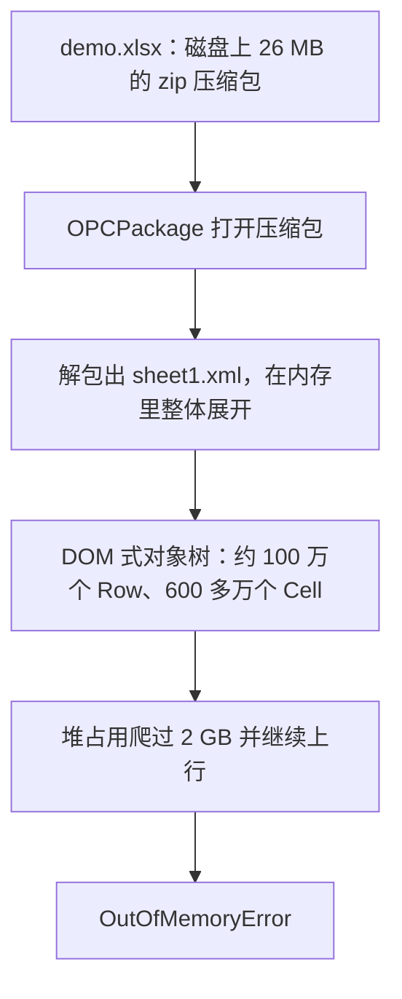

# 用户模式读取的极限实验：26 MB 的 xlsx 怎么把堆吃到 2 GB

导出侧收束了，读取侧还有一场硬仗。业务上要对大数据量报表做读取分析，几十万行已经常见，百万行也不稀奇；真拿用户模式那套 API 去读，文件才 26 MB，堆却能一路吃穿。这一节先把这个现象做实，再说清它为什么会发生。

## 先给结论

- 实验对象是一份顶到 xlsx 上限的报表：1,048,576 行（Excel 2007 单工作表的行上限），体积 26 MB 出头。
- 用户模式读取只需三行循环：`new XSSFWorkbook(path)` 加双层 `for`，但代价是把全表的行、单元格对象一次性装进堆。
- JVisualVM 实测：堆占用爬过 2 GB 还在继续上行，结局只有一个，`OutOfMemoryError`。
- 文件体积和内存开销不是一回事：zip 解包、XML 解析、对象化，层层放大之后开销是文件大小的上百倍。
- 出路不在调堆参数，在换读取模式：逐行读取并使用的事件模式，原理与实现放在后续内容展开。

## 一、需求边界与实验设计

案例场景是「对一份大数据量报表做读取，拿到每行的数据」。数据量不一定是整百万，几十万条同样会出问题，本质是量级越过某个门槛后，用户模式的读取路径开始失灵。

实验不用系统的员工导入功能来做，原因有两条：

**第一，前端对上传体积有限制。** 导入走的是 HTTP 上传，几十兆的文件在网关和前端配置那里就会被拦下，测试环境不一定放得开。

**第二，数据库灌不进一百万条测试数据。** 读取实验的目的是看内存表现，真往员工表里插 100 万行既污染环境又拖慢一切。

所以实验收敛成最纯净的形态：用 `main` 方法直接读磁盘上的 xlsx，把每一行的内容输出出来。测试文件在 day08 资源包的「百万数据报表」目录里，`demo.xlsx`，26 MB 多，六列（id、breast、adipocytes、negative、staining、supportive），共 1,048,576 行。

1,048,576 这个数字不是随手定的，它是 2 的 20 次方，即 Excel 2007 版本（xlsx）单工作表的硬上限。在 Excel 里试着再插一行，会直接弹窗：「无法插入新数据单元格，因为这些数据单元格的行或列超出了工作表的范围」。这份文件已经顶到天花板，读它的难度就是读取侧的极限难度。

## 二、用户模式读取：三行循环的事

用户模式就是前两天入门时写过的那套 API，代码没有丝毫特殊之处：

```java
package com.example.poi.test;

import org.apache.poi.ss.usermodel.*;
import org.apache.poi.xssf.usermodel.XSSFWorkbook;

public class PoiTest05 {

    public static void main(String[] args) throws Exception {
        String path = "D:/demo.xlsx";
        // 1.根据 Excel 文件创建工作簿
        Workbook wb = new XSSFWorkbook(path);
        // 2.获取第一个工作表
        Sheet sheet = wb.getSheetAt(0);
        // 3.逐行逐格读取并输出
        for (int rowNum = 0; rowNum <= sheet.getLastRowNum(); rowNum++) {
            Row row = sheet.getRow(rowNum);
            StringBuilder sb = new StringBuilder();
            for (int cellNum = 0; cellNum < row.getLastCellNum(); cellNum++) {
                Cell cell = row.getCell(cellNum);
                sb.append(cell.getStringCellValue()).append("\t");
            }
            System.out.println(sb);
        }
    }
}
```

这段代码按课堂演示整理（资料包内没有这个测试类）。逻辑上挑不出毛病：拿工作簿、拿工作表、按行号从 0 遍历到 `getLastRowNum()`，每行再按列号遍历取值。放在几万行的表上，它就是标准答案。

## 三、JVisualVM 实测：一条只上不下的曲线

跑起来之后打开 JVisualVM 盯着堆内存：



现象和导出侧 XSSF 的那次一模一样：曲线一路上扬，没有任何回落迹象，堆占用超过 2 GB 之后程序还在硬撑。这不是运行得慢，是正在走向灭亡，内存溢出只是时间问题。

原因在「还没开始取数，内存先满了」。用户模式的 `XSSFWorkbook` 是 DOM 式的全量加载：文件解压、XML 解析、逐节点建对象，全部完成之后才把工作簿交到你手里。循环里调用的 `getRow`、`getCell` 只是去已有的对象树上取，不是去磁盘上读。

## 四、读取侧的约束：账要按对象算

把这个实验沉淀成几条读取侧的硬约束。

**第一，开销按对象算，不按文件算。** 26 MB 是 zip 压缩后的磁盘体积；解包后的 XML 本身就翻了好几倍，再对象化成 100 万个 `Row`、600 多万个 `Cell`，每个格子还挂着字符串值和样式引用，堆里的账单是文件体积的百倍量级。「文件才几十 MB」这个直觉在 xlsx 读取上完全不成立。

**第二，堆上限是硬约束，GC 救不了。** 全表对象互相引用着构成一张大网，每个对象都在被引用状态，GC 一轮也回收不掉什么，曲线上自然看不到回落。这是导出侧那节讲过的同一机制：对象不肯释放，垃圾回收就在空转。

**第三，业务要的是值，对象树是代价。** 读取的真实诉求只是「每行每列的字符串」，为此却把整棵对象树造出来养在堆里。这个不对称正是事件模式的价值起点：有没有办法只留「值」，不留「树」？POI 给出的答案是事件驱动模式，基于 SAX 逐行解析，用完即弃，后面的内容专门讲它。

在切换模式之前，先把用户模式能碰的量级记住：它伺候得起几万行、十几万行的小表，到几十万行就要看机器脸色，百万行基本没有悬念，必然溢出。

## 常见误区

- **「文件 26 MB，内存顶多翻一倍。」** 解包加对象化之后是百倍量级的开销，磁盘体积和堆占用是两本账。
- **把 `-Xmx` 调大当解决方案。** 堆调到 8 G 也只是把 OOM 推迟到更大的文件出现，单机内存有上限，数据量没有。
- **边遍历边 `row = null` 想释放内存。** 行对象由 `Sheet` 统一持有，置空局部变量只是断开一个引用，对象树原封不动。
- **以为流式方案只跟导出有关。** SXSSF 解决的是写，读取侧的流式要靠完全不同的另一套机制（事件模式），两者互不通用。

## 面试可能被问到的问题

1. 面试官追问：「POI 用户模式读取大文件为什么会 OOM？」
   答：`XSSFWorkbook` 是 DOM 式全量加载，创建工作簿时就把所有行、单元格对象一次性建进堆里，内存占用随数据量线性增长且对象始终被引用、无法回收。数据量超过堆上限就直接溢出。

2. 面试官追问：「26 MB 的 xlsx 怎么能吃掉几个 G 内存？」
   答：xlsx 是 zip 压缩包，磁盘体积是压缩后的；解压成 XML 已经放大数倍，解析再对象化成上百万个 Row、Cell 对象，每个对象自带对象头、引用和字符串，堆开销是文件体积的百倍量级。

3. 面试官追问：「xlsx 单个工作表最多多少行？」
   答：1,048,576 行，即 2 的 20 次方，列上限 16384 列。测试大文件通常就顶到这个上限来构造。

4. 面试官追问：「怎样在不 OOM 的前提下读百万行报表？」
   答：放弃一次性加载的用户模式，改用基于 SAX 的事件模式：通过 `OPCPackage` 和 `XSSFReader` 流式读取工作表 XML，自定义 `SheetContentsHandler` 逐行接收回调，处理完一行释放一行，内存只保留当前行。

5. 面试官追问：「SXSSFWorkbook 能不能解决读取问题？」
   答：不能。SXSSF 是流式写方案，只管导出侧；读取侧的流式对应的是 eventusermodel 包下的 SAX 相关类，两个方向用的是完全不同的 API。

## 配套资料

- 用户模式读取的真实工具类（反射加逐行逐格 API，可作用户模式写法对照）：`materials/code/02/day08 POI高级/POI高级/资源/代码/工具类/ExcelImportUtil.java`
- 百万数据练习实体（与 `demo.xlsx` 六列对应）：`materials/code/02/day08 POI高级/POI高级/资源/百万数据报表/PoiEntity.java`
- `demo.xlsx` 与测试类 `PoiTest05` 为课堂演示文件，资料包内不含；文中读取代码按课堂代码整理
