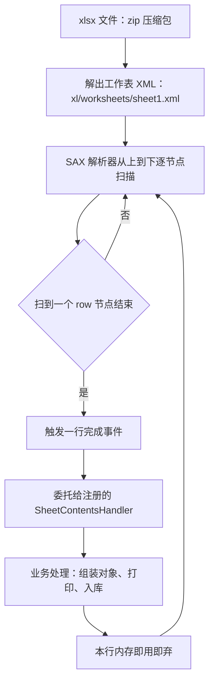

# 从一次性加载到逐行回调：POI 事件模式与 SAX 的原理

上一节的曲线只上不下，根因可以钉死成一句话：一次性读取所有 Excel 内容存入内存。这一节顺着这句话推解决方案，讲清 POI 的两种读取模式，以及事件驱动模式赖以工作的 SAX 到底是怎么运转的。

## 先给结论

- 用户模式的病根是全量加载，解决思路只有六个字：逐行读取并使用，读过的行用完即释放。
- POI 官方把 Excel 读取分为两种模式：用户模式与事件驱动模式，前者操作简单但占内存，后者基于 SAX，内存占用极小。
- xlsx 的本质是 OOXML：一个装着 XML 的 zip 压缩包，所以可以用解析 XML 的 SAX 方式来读 Excel。
- SAX 是事件驱动的 XML 解析方案：从上到下扫描节点，节点解析完成立即触发事件，委托给注册好的事件处理器。
- POI 把「一行数据」划成一个处理事件：一行回调一次、用完即弃，内存里永远只有当前一行；代价是单向不可逆，读过的行不能回头。

## 一、把问题钉死，再推解决思路

用户模式的读取链路是「先读取，再取数」：主线程把报表里的行、单元格、数据全部读出来，统一保存到内存之中，然后才能从里面拿业务要的数据。文件越大，读取阶段占的内存越多，往往还没开始取数，堆已经满了。

那么反过来想：能不能一行一行读，读一行就用一行，用过的内容立刻释放？这样一来，无论文件多大，内存里同一时刻只存在一行数据，始终留着大片空余。这个「逐行读取并使用」的思路，就是大数据量读取的终极答案，剩下的问题只是 POI 用什么机制把它实现出来。

## 二、POI 的两种读取模式

POI 对 Excel 读取给出了两种官方模式，摆在一起看差别一目了然：

| 维度 | 用户模式 | 事件驱动模式 |
|---|---|---|
| API 形态 | 一系列封装好的 API 直接操作 Excel | 基于 SAX 的读取方式 |
| 加载方式 | 一次性把所有数据加载进内存再解析 | 逐行扫描，一边扫描一边解析 |
| 内存占用 | 随数据量线性增长，大文件必 OOM | 只保留当前处理的一行 |
| 访问能力 | 随机访问，任意行任意格 | 只能顺序向后，不可回溯 |
| 适用量级 | 小到中数据量 | 大数据量、超大数据量 |

用户模式的优点是操作简单，`getRow`、`getCell` 直给对象；缺点是吃内存，因为它建立在一次性读取之上。事件驱动模式正相反：应用程序只在读取数据的那一刻检查数据，数据不会常驻内存，这正是它对大型文档解析的巨大优势。

## 三、事件驱动是什么：监听、注册、委托

「事件驱动」这个词值得单独拆开讲。它通常由三个角色组成：

**第一，做事件监听的主线程。** 它能预知流程中要发生的所有事件，比如「每月一号发工资」就是一个可预测的事件。

**第二，注册事件处理器。** 每类事件事先注册一个对应的处理器，比如「发工资」事件注册的处理器逻辑是「到手先消费一百块」。

**第三，事件发生时委托处理。** 到了一号工资到账，主线程不做业务，直接把这件事委托给注册好的处理器去执行。

SAX 就是把这套机制用在 XML 解析上的方案。XML 文档本质上是一串节点，SAX 从上到下逐个扫描：解析完 A 节点，立即触发 A 节点的解析完成事件，调用处理 A 的事件处理器；接着扫到 B 节点，同样触发并委托。文档再大，处理过程也是一个节点一个节点地过，一边读一边用，读过的内容不需要再留着。

## 四、套到 Excel 上：一行就是一个事件

Excel 2007 版本的底层实现是 OOXML，把 xlsx 后缀改成 zip 解开，里面就是一份份描述工作簿、工作表、样式的 XML。既然是 XML，SAX 那套就完全适用。POI 在事件模式里把「一行数据」划定为一个处理事件：

```xml
<row r="2">
  <c r="A2" t="inlineStr"><is><v>id_1</v></is></c>
  <c r="B2" t="inlineStr"><is><v>breast_1</v></is></c>
  <c r="C2" t="inlineStr"><is><v>adip_1</v></is></c>
</row>
```

`row` 节点从上到下排开，解析器扫到一个 `row` 结束，就把这一行算作一个完成的事件，交给处理器处理。整条链路是这样的：



第一行解析完成、业务用完、内存销毁，紧接着第二行、第三行，整个解析过程就这样平稳推进。落到代码上，处理器需要提供的回调轮廓如下（接口骨架示意，完整实现在下一节）：

```java
// 事件模式下业务方要实现的回调（org.apache.poi.xssf.eventusermodel 包）
public interface SheetContentsHandler {
    void startRow(int rowIndex);   // 一行开始解析
    void cell(String cellReference, String value, XSSFComment comment);  // 行内一个格子
    void endRow(int rowIndex);     // 一行解析完成，此时该做业务了
}
```

## 五、优点与代价

**第一，内存占用极少。** 一行处理完立即释放，内存不再积压任何临时数据，堆占用与文件大小彻底脱钩，百万行、千万行都只是「多回调很多次」而已。

**第二，用过即销毁，不可逆。** 读完一行的瞬间它就不在了，想回头再读、跳着读、边读边改，事件模式一概做不到，它是单向的一次性消费。另外回调给的是单个格子的值和坐标，把格子拼成一行业务对象的活儿要自己干，用户模式里 `getRow` 一步到位的便利不复存在。

选型因此很清晰：要随机访问、要改内容、量级不大，用用户模式；只要顺序读出数据、量级又大，事件模式是唯一能站稳的方案。

## 常见误区

- **以为事件模式是 POI 发明的。** SAX 是 XML 世界的通用解析方案，POI 只是把它应用到 OOXML 存储的 Excel 上，「一行一事件」是 POI 的封装。
- **以为事件模式可以替代所有读取。** 它只能顺序向前读且不可修改，需要跳行、回读、编辑的场景仍然要用用户模式。
- **以为事件模式零内存。** 单行对象、解析器缓冲依然存在，省的是「不随总量增长」这部分，不是什么都不占。
- **把事件驱动模式和 SXSSF 混为一谈。** SXSSF 管流式导出，事件模式管流式读取，一个写一个读，API 和原理互不通用。

## 面试可能被问到的问题

1. 面试官追问：「SAX 和 DOM 解析的区别是什么？」
   答：DOM 把整个文档加载进内存建成对象树，可以随机访问，内存开销随文档大小线性增长；SAX 逐节点顺序扫描、边扫边触发事件，不把文档常驻内存，只适合顺序读取，内存开销极小。

2. 面试官追问：「POI 事件模式为什么能省内存？」
   答：它基于 SAX 逐行解析工作表 XML，把一行数据划成一个事件，回调给业务方处理，处理完立即销毁。任意时刻内存里只有当前一行，堆占用与文件大小脱钩。

3. 面试官追问：「事件模式里的『事件』具体指什么？」
   答：指解析器扫描 XML 的过程中到达某个状态，最常用的是「一行解析完成」。业务方提前注册处理器，事件发生时解析器回调处理器，业务在回调里拿到这一行的数据做处理。

4. 面试官追问：「为什么 xlsx 能用 SAX 来读？」
   答：因为 Excel 2007 的底层存储是 OOXML，xlsx 本身就是 zip 压缩包，内部的工作表就是标准 XML 文件，对这份 XML 做 SAX 解析就等于在读 Excel 的数据。

5. 面试官追问：「事件模式读取有什么限制？」
   答：只能顺序向后读，读过的数据即被销毁，不支持随机访问和修改；回调给的是单元格级别的原始值，行对象的组装、类型转换、日期格式化都要业务自己完成。

6. 面试官追问：「用户模式和事件模式怎么选？」
   答：看量级和访问方式。几万行以内、需要随机访问或模板操作，用用户模式；几十万行以上、只需顺序读出数据，必须用事件模式，否则必然 OOM。

## 配套资料

- 用户模式读取的真实工具类（作两种模式的对照）：`materials/code/02/day08 POI高级/POI高级/资源/代码/工具类/ExcelImportUtil.java`
- 百万数据练习实体：`materials/code/02/day08 POI高级/POI高级/资源/百万数据报表/PoiEntity.java`
- 本课无事件模型源码包，文中接口轮廓与 XML 结构按课堂实录与 POI 标准结构整理
