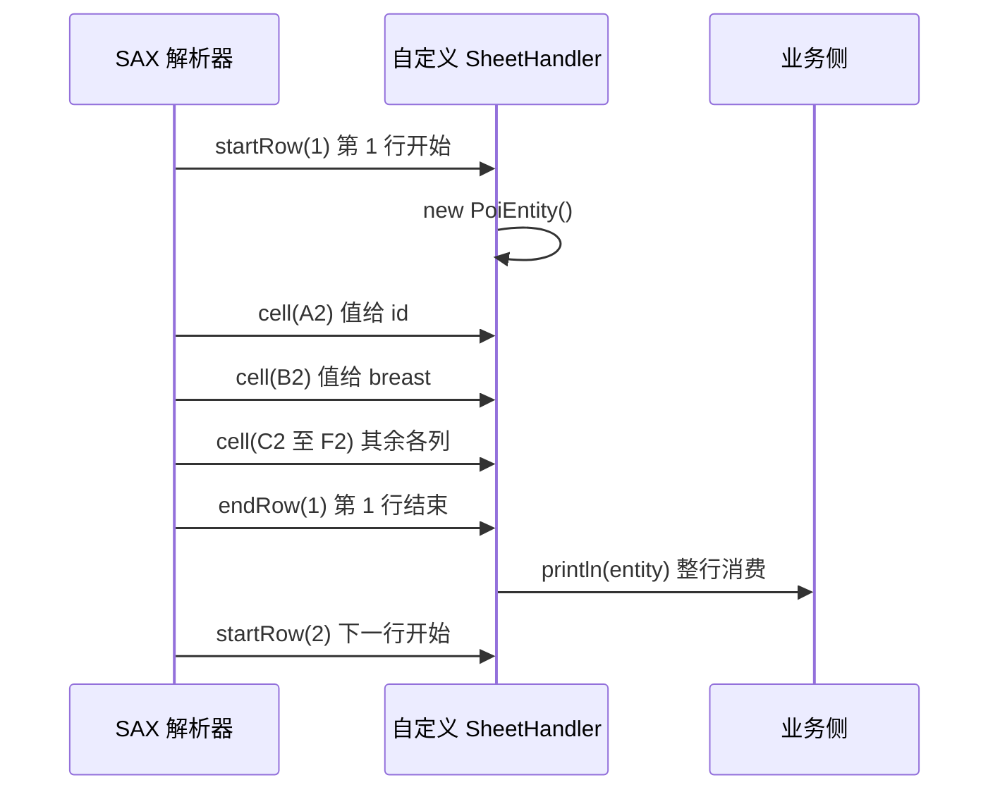

# 自己写 SheetHandler：POI 事件模式的步骤拆解与逐行回调

原理已经清楚：SAX 逐行扫描工作表 XML，一行一个事件，业务在回调里接数据。落到代码上要回答三个问题：POI 的事件模式怎么设置？回调接口长什么样？每一行的数据怎么拼成业务对象？这一节把步骤拆开，并把事件处理器完整写出来。

## 先给结论

- 步骤只有两大步：（1）设置 POI 的事件模式，拿文件流、建 `OPCPackage`、创建 `XSSFReader`；（2）SAX 解析，把处理器注册上去，逐行读取。
- 自定义处理器实现 `XSSFSheetXMLHandler.SheetContentsHandler` 接口，核心就三个回调：`startRow`、`cell`、`endRow`。
- 编程套路固定：`startRow` 里建行对象（标题行跳过），`cell` 里按列字母给字段赋值，`endRow` 里消费整行。
- 列定位靠 `cellReference`（形如 `A2`、`B2` 的单元格坐标）截出列字母，再 `switch` 分发到对应字段。
- 日期值拿不到现成格式：靠注册处理器时传入的 `DataFormatter` 依样式表翻译，翻译不了就在处理器里手动转。

## 一、步骤分析：两大步，六个动作

按照课堂的步骤分析，事件模式读取分成两大步。

第一步，设置 POI 的事件模式。意思是向 POI 声明：解析 Excel 不再用封装好的用户模式 API，改走事件模型。要做的动作有三个，代码骨架如下：

```java
// 第一步：设置 POI 的事件模式（骨架，驱动细节在下一篇的完整实现里展开）
OPCPackage pkg = OPCPackage.open(new File(path), PackageAccess.READ); // 以只读方式打开压缩包
XSSFReader reader = new XSSFReader(pkg);                              // 事件模式读取压缩包的入口
SharedStringsTable sst = reader.getSharedStringsTable();              // 共享字符串表
StylesTable styles = reader.getStylesTable();                         // 样式表

// 第二步：SAX 解析
// 1.自定义 Sheet 处理器（实现 SheetContentsHandler，见下文）
// 2.把处理器包进 XSSFSheetXMLHandler，注册到基于 SAX 的 XMLReader 上
// 3.逐行读取：解析器扫描工作表 XML，触发回调
```

xlsx 是 zip 压缩包，所以打开它的姿势是 `OPCPackage.open`，以只读方式把整包解开；`XSSFReader` 是事件模式下读取压缩包内容的入口。`SharedStringsTable` 与 `StylesTable` 这两个对象平时直接用得少，它们是注册处理器时要传的基础参数：前者负责把共享字符串索引翻译成真实字符串，后者负责样式信息。

第二步，SAX 解析。其中需要自己动手的，就是写一个基于 sheet 的处理器：解析器每处理完一行，就通过这个处理器把数据交出来，业务逻辑全写在处理器里。处理器写好后包进 POI 提供的 `XSSFSheetXMLHandler`，注册到 SAX 的 `XMLReader` 上开始逐行读取，这部分注册代码在下一篇的完整实现里给全。

## 二、先备好数据模型：PoiEntity

演示文件 `demo.xlsx` 有六列：id、breast、adipocytes、negative、staining、supportive。按事件模式把每行封装成实体，实体类来自 day08 资料包的「百万数据报表」目录（包名已改为中性包名）：

```java
package com.example.poi.entity;

public class PoiEntity {
    private String id;
    private String breast;
    private String adipocytes;
    private String negative;
    private String staining;
    private String supportive;

    // 各字段的 getter、setter 省略
    @Override
    public String toString() {
        return "PoiEntity{" +
                "id='" + id + '\'' +
                ", breast='" + breast + '\'' +
                ", adipocytes='" + adipocytes + '\'' +
                ", negative='" + negative + '\'' +
                ", staining='" + staining + '\'' +
                ", supportive='" + supportive + '\'' +
                '}';
    }
}
```

实体没有多余的设计，六个字段全是字符串，与六个标题列一一对应。

## 三、自定义 SheetHandler：三个回调管一行

处理器就是一个普通类，实现 `XSSFSheetXMLHandler.SheetContentsHandler` 接口。注意导包，`XSSFSheetXMLHandler` 必须取自 `org.apache.poi.xssf.eventusermodel` 包，eventusermodel 就是「事件用户模型」的字面意思，导到 usermodel 包下编译直接过不了。

接口的方法很多，真正要用的是这三个：

```java
public class SheetHandler implements XSSFSheetXMLHandler.SheetContentsHandler {

    private PoiEntity entity;

    /**
     * 当开始解析某一行的时候触发
     */
    @Override
    public void startRow(int i) {

    }

    /**
     * 当结束解析某一行的时候触发
     */
    @Override
    public void endRow(int i) {

    }

    /**
     * 对行中的每一个单元格进行处理
     */
    @Override
    public void cell(String cellReference, String value, XSSFComment xssfComment) {

    }
}
```

三个方法把一行切成了三段：`startRow(int i)` 在一行开始解析时触发，参数 `i` 是行索引；`cell` 在行内每解析到一个格子时触发，`cellReference` 是单元格坐标（如 `A2`），`value` 是单元格内容，第三个参数 `XSSFComment` 是批注，平时用不上；`endRow(int i)` 在一行解析完成时触发。一行从左到右，先 `startRow`，然后 `cell` 被连续调用 A、B、C 一直到 F，最后 `endRow` 收尾。

## 四、把业务填进回调

套路跟着回调时序走：开始解析这一行时实例化对象，逐格赋值，行结束时消费对象。

**第一，`startRow` 里建对象，标题行要跳过。** 真正的数据从第 1 行开始（第 0 行是标题），所以用 `i > 0` 做判断，只有数据行才 `new PoiEntity()`：

```java
@Override
public void startRow(int i) {
    if (i > 0) {
        entity = new PoiEntity();
    }
}

@Override
public void endRow(int i) {
    // 一行组装完成：打印、入库，按业务需要处理
    System.out.println(entity);
}
```

**第二，`cell` 里按列字母分发赋值。** 从 `cellReference` 截出第一个字母（`substring(0, 1)`，拿到 A、B、C……），再 `switch` 决定这个值该 `set` 给哪个字段：

```java
@Override
public void cell(String cellReference, String value, XSSFComment xssfComment) {
    if (entity != null) {
        // 截出列字母，按列分发
        String px = cellReference.substring(0, 1);
        switch (px) {
            case "A":
                entity.setId(value);
                break;
            case "B":
                entity.setBreast(value);
                break;
            case "C":
                entity.setAdipocytes(value);
                break;
            case "D":
                entity.setNegative(value);
                break;
            case "E":
                entity.setStaining(value);
                break;
            case "F":
                entity.setSupportive(value);
                break;
            default:
                break;
        }
    }
}
```

`entity != null` 的判断承担着排除标题行的职责：标题行没建对象，格子回调直接短路，程序不报错。这一段的完整逻辑按课堂实录整理（资料包内没有事件模型测试类），一个回调没几行代码，把用户模式里 `getRow`、`getCell` 的活儿全部转成了「事件驱动、自己组装」。

一行数据的完整旅程用时序图看最直观：



## 五、日期值怎么办：DataFormatter 与手动兜底

事件模式里没有 `Cell` 对象，也就没有 `getDateCellValue` 这类现成方法。单元格里真正的日期，在 XML 中是 1900 日期系统下的一个序列号（比如 `43101`），解析器要结合样式表里该格的格式定义，才能知道它是日期。

翻译工作由注册处理器时传入的 `DataFormatter` 完成：`XSSFSheetXMLHandler` 内部拿着 `StylesTable` 与 `DataFormatter`，把数值按单元格样式翻译成显示字符串，多数标准日期格式能直接翻成人话。样式缺失、或者用了自定义格式导致翻译结果不合预期时，在处理器里手动兜底，示例为按本课写法补全：

```java
// 示例：日期列的兜底转换，接在 F 列的分发逻辑里
case "F":
    if (value != null && value.matches("\\d+")) {
        // 拿到的是纯数字序列号，转回日期再格式化
        Date date = DateUtil.getJavaDate(Double.parseDouble(value));
        entity.setSupportive(new SimpleDateFormat("yyyy-MM-dd").format(date));
    } else {
        entity.setSupportive(value);
    }
    break;
```

判断依据是「该列业务上是日期」加「值是纯数字」，两者同时成立才做转换，避免把普通数字列误判成日期。

## 常见误区

- **导错包。** `SheetContentsHandler` 是 `XSSFSheetXMLHandler` 的内部接口，必须从 `org.apache.poi.xssf.eventusermodel` 引入，引成 `xssf.usermodel` 下的同名类名会直接编译失败。
- **只截一位列字母。** `substring(0, 1)` 对 A 到 F 没问题，超过 Z 列的坐标是 `AA1`、`AB1` 这样的双字母，截一位拿到的是 `A`，列会错位；通用场景要先去掉坐标里的数字再取整段字母。
- **标题行不排除。** 第 0 行是标题，不建对象也不判空的话，格子回调里对 `entity` 赋值直接空指针。
- **按回调顺序当列顺序。** 行内空缺格的回调行为与 POI 版本有关，可靠的定位依据始终是 `cellReference` 的列字母，不是「第几次收到回调」。

## 面试可能被问到的问题

1. 面试官追问：「SheetContentsHandler 的三个回调分别在什么时机触发？」
   答：`startRow` 在一行开始解析时触发，参数是行索引；`cell` 在行内每解析到一个单元格时触发，带单元格坐标和值；`endRow` 在一行解析完成时触发，此时整行数据齐了，适合做业务处理。

2. 面试官追问：「回调里怎么知道值属于哪一列？」
   答：靠 `cellReference`，它是形如 `A2`、`B3` 的单元格坐标，截掉数字留下字母就是列号，再按字母 switch 分发到实体字段。

3. 面试官追问：「标题行是怎么被排除的？」
   答：`startRow` 里判断行索引大于 0 才创建行对象，标题行不建对象；`cell` 回调里再判对象非空，双重保证标题行不参与组装。

4. 面试官追问：「事件模式下日期列读到的是什么，怎么处理？」
   答：读到的是 1900 日期系统的序列号字符串。注册处理器时传入的 `DataFormatter` 会结合样式表把它翻译成显示字符串；样式不完整或格式自定义时，在处理器里用 `DateUtil.getJavaDate` 把序列号转回 `Date` 再自行格式化。

5. 面试官追问：「事件模式的处理器和用户模式的 Row、Cell 是什么对应关系？」
   答：`startRow` 对应用户模式拿到一个 `Row`，`cell` 对应遍历一个 `Cell`，`endRow` 对应这一行遍历完毕。区别是前者是流式回调、用完即弃，后者是全量对象树、可随机访问。

6. 面试官追问：「处理器写好了，怎么让它跑起来？」
   答：把它作为 `SheetContentsHandler` 参数构造 POI 提供的 `XSSFSheetXMLHandler`，再注册到基于 SAX 的 `XMLReader` 上，解析器扫描工作表 XML 时就会触发回调；注册所需的共享字符串表、样式表由 `XSSFReader` 提供。

## 配套资料

- 百万数据练习实体（文中 `PoiEntity` 的真实源码，包名已改写）：`materials/code/02/day08 POI高级/POI高级/资源/百万数据报表/PoiEntity.java`
- 用户模式读取工具类（两种模式的写法对照）：`materials/code/02/day08 POI高级/POI高级/资源/代码/工具类/ExcelImportUtil.java`
- `SheetHandler` 与步骤骨架代码按课堂实录整理，资料包内无事件模型测试类；日期兜底转换为按本课写法补全的示例
