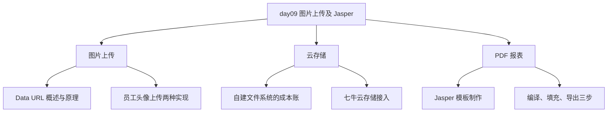

# 员工照片怎么存：图片上传的需求分析与 day09 知识地图

员工详情页右下角那一块「员工照片」，从员工管理模块上线起就只是个摆设，选了图也存不下来。day09 的工作就是把它补齐，同时把一个更通用的问题铺开：前端传来的文件，后端到底该以什么形态保存。一天的内容还捎带着文件存储的选型账和 PDF 报表的开篇。

## 先给结论

- day09 只有三大块：图片上传（技术支点是 Data URL）、云存储（以七牛云为代表替代自建文件系统）、PDF 报表（Jasper 模板打印，连讲三节）。
- 需求一句话：员工详情表单里实现员工照片上传，照片既能保存到本地，也能保存到七牛云。
- 保存一张图片有两条技术路线：Data URL 方式把文件 Base64 编码后直接存库；真文件方式把图片存到云或硬盘，数据库只存访问地址。
- 自建分布式文件系统能力强但搭建与运维成本高，云厂商把这套事做成了按量付费的服务，中小系统多数直接选后者。
- 前端上传是标准件：Element 的 `el-upload` 卡片组件加认证请求头，后端按 id 定位员工落库。

## 一、day09 的知识地图



这张图在讲本日的知识结构：图片上传是引子，Data URL 是它的技术支点；云存储是文件落地的第二选择；PDF 报表是重头戏。关键路径在 B 线，头像上传会分别走 Data URL 与云存储两条方案，本日与后续几节逐一展开。

## 二、需求：员工照片那一栏

需求来自员工详情的「个人详情」记录：表单字段很常规，工号、姓名、手机、部门、聘用形式，页面右下角多出「员工照片」区域，要求实现照片上传。上传后的去向课程给了两个选项：保存到七牛云，或者保存到本地。这也是在为后续内容打底，头像、附件这类资源上传在管理系统里无处不在，方案想清楚了到处能复用。

前端上传卡片在课程资料里是现成组件，`imgUpload.vue` 用 Element 的 `el-upload` 实现，节选如下：

```html
<el-upload :action="'/api/sys/user/upload/' + uid"
           :headers="myheader"
           :on-success="uploadSuccess"
           list-type="picture-card">
  <span>{{ textTip }}</span>
  <i class="el-icon-plus avatar-uploader-icon"></i>
</el-upload>
```

三个属性值得留意。`action` 是提交地址，这里直接拼上员工 id，后端凭它知道给谁存头像；`headers` 里带 `Authorization: Bearer <token>`，上传接口同样要走认证；`on-success` 是上传完成的回调，拿响应更新页面。`list-type="picture-card"` 让照片区域天然就是缩略图卡片形态，配合 `v-if` 在「无图显示上传框、有图显示预览加删除」两个状态间切换。

## 三、图片落地的两条路线

**方案一，Data URL。** 前端把图片读成一段形如 `data:image/png;base64,...` 的字符串，整串交给后端直接存进数据库。图片跟着记录走，不需要独立的文件服务器，代价是数据体积膨胀，适合头像、图标这类小图。

**方案二，真文件存储。** 图片实实在在写到磁盘或云上，数据库只存一个访问地址。存哪里？早年自建 FastDFS 这类分布式文件系统是标准答案，但课程算了一笔现实账：自己搭建、自己部署、自己运维，真要上线运营成本不小。如今云厂商把存储做成了服务，资费也低，课程选的代表产品是七牛云，用它替换掉自建文件系统。

七牛云的上传工具类资料里也是现成的（密钥已打码，包名已改写）：

```java
package com.example.system.utils;

public class QiniuUploadUtil {
    private static final String accessKey = "****";   // 密钥已打码
    private static final String secretKey = "****";
    private static final String bucket = "ihrm-bucket";
    private static final String prix = "http://pkbivgfrm.bkt.clouddn.com/";
    private UploadManager manager;

    public QiniuUploadUtil() {
        // 初始化基本配置：区域 + 上传管理器
        Configuration cfg = new Configuration(Zone.zone0());
        manager = new UploadManager(cfg);
    }

    // 文件名作 key，文件内容是 byte 数组
    public String upload(String imgName, byte[] bytes) {
        Auth auth = Auth.create(accessKey, secretKey);
        // 构造覆盖上传 token：同名文件重复上传会覆盖旧图
        String upToken = auth.uploadToken(bucket, imgName);
        try {
            Response response = manager.put(bytes, imgName, upToken);
            DefaultPutRet putRet = new Gson().fromJson(response.bodyString(), DefaultPutRet.class);
            // 返回图片访问地址，拼时间戳规避缓存
            return prix + putRet.key + "?t=" + new Date().getTime();
        } catch (Exception ex) {
            ex.printStackTrace();
        }
        return null;
    }
}
```

调用方只要把文件名和字节数组递进去，拿回来的就是能在浏览器直接打开的 URL。构造器里完成配置初始化，上传走覆盖模式，头像同名覆盖旧图，行为正好合适；返回地址拼时间戳，是为了让浏览器别拿缓存的旧图糊弄人。

## 四、PDF 报表预告

day09 的第三块是 Jasper 报表，讲怎么用模板产出 PDF。资料里的生命周期测试类已经把主流程露了脸：`JasperCompileManager.compileReportToFile` 把 `.jrxml` 模板编译成 `.jasper`，`JasperFillManager.fillReportToFile` 用数据源填充成 `.jrprint`，`JasperViewer.viewReport` 预览结果。编译、填充、展示三步是所有 Jasper 操作的地基，后面几节从模板制作开始展开。

## 常见误区

- **小头像也架文件服务器。** 一张几十 KB 的头像走上传、存储、地址拼接一整套链路，成本大于收益；小图优先考虑 Data URL 方案，大文件才上对象存储。
- **密钥写死在代码里。** 工具类示例为了演示把 accessKey、secretKey 写成常量，生产环境必须挪到配置中心或环境变量，密钥泄漏等于把整个存储空间送人。
- **上传接口裸奔。** 前端组件特意带 Authorization 请求头，自己写上传页时漏了这个头，接口返回 401 还以为是文件太大被拒。

## 面试可能被问到的问题

1. 面试官追问：「图片存数据库还是存文件系统，怎么选？」
   答：看尺寸与访问模式。小图标、小头像可以 Base64 编码后随记录入库，链路简单；大文件或访问频繁的图片应存对象存储或文件系统，数据库只存地址，避免库体积膨胀、备份变慢。

2. 面试官追问：「为什么很多企业用云存储替代自建 FastDFS？」
   答：自建要自己管机器、扩容、容灾与带宽，运维成本固定存在；云存储按量付费、天然多副本、通常还带 CDN 加速，中小团队用它把存储运维整体外包，总成本更低。

3. 面试官追问：「前端上传组件为什么要单独配请求头？」
   答：上传接口和普通接口一样处于认证体系内，请求头必须带 token，例如 Authorization: Bearer xxx，否则网关或拦截器直接拒绝。文件上传只是请求体格式特殊，认证流程不变。

4. 面试官追问：「七牛云上传方法为什么收 byte 数组而不是文件路径？」
   答：字节数组与来源解耦，无论数据来自前端 multipart 转存、网络流还是本地文件，读成字节后都能走同一个上传方法，工具类的适用面更宽。

## 配套资料

- 前端上传卡片组件（真实源码，`el-upload` 用法）：`materials/code/02/day09 图片上传及Jasper/图片上传及Jasper/资源/前端工具代码/module-employees/components/imgUpload.vue`
- 七牛云上传工具类（真实源码，包名已改写、密钥已打码）：`materials/code/02/day09 图片上传及Jasper/图片上传及Jasper/资源/后端工具代码/QiniuUploadUtil.java`
- Jasper 生命周期测试类（真实源码，包名已改写）：`materials/code/02/day09 图片上传及Jasper/图片上传及Jasper/资源/资源/生命周期测试/PDFTest.java`
