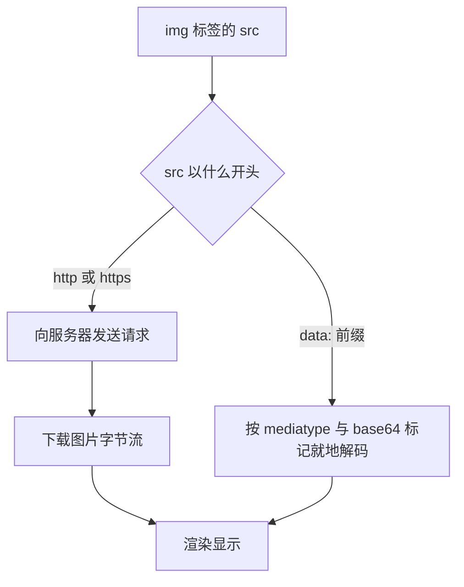

# 一串字符就是一张图：Data URL 的概念与语法

前端代码里见过这样的 `src` 值：不是 http 开头，而是 `data:image/png;base64,iVBORw0KG...` 一长串。它不指向任何服务器，把整串复制进浏览器地址栏回车，图片却真切地显示出来了。这串东西叫 Data URL，是头像上传方案一的地基，本节把它的来历、构成和用法讲透。

## 先给结论

- Data URL 是 RFC 2397 定义的 `data` 类型 URL，目的是让「小」的数据直接嵌入网页，而不必从外部文件载入。
- 完整语法：`data:[mediatype][;base64],<数据>`；mediatype 描述数据的 MIME 类型，`;base64` 是可选的编码标记。
- 逗号前是「说明书」，说明数据是什么类型、按什么编码；逗号后才是数据本体。
- 图片这类二进制数据必须带上 mediatype，浏览器才知道把字符串还原成什么再输出。
- 后端开发里 Data URL 九成以上的用途是构造图片，后面讲原理都以图片为例。

## 一、先玩一把：字符串就是图

课程资料里备了一个 `dataurl.txt`，用文本编辑器打开只有一行：`data:image/png;base64,iVBORw0KGgoAAAANSUhEUg...`，前缀后面跟着几千个字符，直观上就是一个普通字符串。把这一行整体复制进浏览器地址栏回车，页面上出现一张完整的 logo 图片。字符串没有任何指向，图片数据就长在字符串里。

文本也能这么玩。地址栏输入 `data:,very good` 回车，页面显示 very good；写成 `data:text/plain,very good` 效果一样，逗号后面的内容被当作纯文本直接渲染出来。

## 二、语法拆解：逗号前是说明书

data 类型的 URL 常见形态罗列如下：

```text
data:,<文本数据>
data:text/plain,<文本数据>
data:text/html,<html代码>
data:text/html;base64,<base64编码的html代码>
data:text/css,<css代码>
data:text/css;base64,<base64编码的css代码>
data:text/javascript,<javascript代码>
data:text/javascript;base64,<base64编码的javascript代码>
data:image/gif;base64,<base64编码的gif图片数据>
data:image/png;base64,<base64编码的png图片数据>
data:image/jpeg;base64,<base64编码的jpeg图片数据>
data:image/x-icon;base64,<base64编码的icon数据>
```

**第一，`data:` 前缀。** Data URL 之所以还叫 URL，就因为它有协议前缀，只是协议不是 http 而是 data，含义从「去哪里取数据」变成了「数据在这里」。

**第二，mediatype 就是 MIME 类型。** 它向浏览器声明数据是什么：`text/html` 是网页片段、`text/css` 是样式、`image/png` 是 PNG 图片。这套类型体系与下载文件时见到的 Content-Type 同源。

**第三，`;base64` 与逗号。** base64 标记可选，逗号之后是数据本体。mediatype 与 base64 都能省略，`data:,文本` 就是极简形态；但图片场景两者基本都要带，浏览器全靠 mediatype 决定把字符串还原成什么，靠 base64 标记决定怎么解码，缺了任何一个图片都渲染不出来。Base64 的编码结果比原数据大约三分之一，这是它换来通用性的成本：二进制字节映射成 64 个可打印字符，可以安全地放进 URL、JSON、HTML 属性这类只吃文本的位置。也因此 Data URL 适合小图，几 KB 的图标、头像正合适，几 MB 的大图编出来的字符串会让页面源码和数据库字段一起臃肿。

## 三、放进网页与用代码生成

网页里的用法与普通图片完全一致，把 Data URL 直接写进 `img` 标签的 `src`（资料包演示页的节选，普通 URL 一侧的域名已换成中性示例地址）：

```html
<p>
  <h4>普通URL</h4>
  <image src="http://www.example.com/2018czgw/images/logo.png">
</p>
<p>
  <h4>Data URL</h4>
  <image src="data:image/png;base64,iVBORw0KGgoAAAANSUhEUgAAALwAAAA5CAYAAACM...">
</p>
```

Java 侧生成一个 Data URL 的写法（资料包内无对应类，示例为按本课写法补全）：

```java
byte[] bytes = Files.readAllBytes(Paths.get("logo.png"));
String dataUrl = "data:image/png;base64,"
        + Base64.getEncoder().encodeToString(bytes);
```

JDK 自带的 `Base64.getEncoder()` 把图片字节编码成字符串，拼上协议前缀就是完整的 Data URL。后端把这个字符串返回给前端，前端塞进 `src` 即可显示，头像上传方案一的后端部分本质就是这段代码的变体。

浏览器拿到 `src` 后的处理路径分岔如下：



这张图对比两条渲染路径：普通 URL 要多走一次网络往返，Data URL 直接本地解码，两者在渲染处汇合。关键差异在分支判断上，这也埋下了下一篇讨论请求量与缓存问题的伏笔。再补一个观察角度：Data URL 没有独立的缓存生命周期，字符串嵌在哪个页面或哪个接口响应里，就跟着它一起被缓存与失效；普通 URL 的图片可以单独设置缓存头，被浏览器长期复用。小图内联省一次请求是赚，大图内联让每次页面请求都重复搬运同样的长字符串是亏，这个权衡正是下一篇要展开的主题。

## 常见误区

- **漏写 mediatype。** 图片数据省掉 `image/png`，浏览器不知道按什么类型处理，地址栏只会看到一串乱码或提示下载，而不是图片。
- **把 Base64 当加密。** Base64 是编码不是加密，任何拿到字符串的人都能原样还原，用「编码」来保护敏感数据是自欺欺人。
- **忘掉逗号。** `;base64` 之后必须紧跟一个英文逗号再接数据，逗号缺失整个 URL 解析失败，这是手写 Data URL 最常见的低级错。

## 面试可能被问到的问题

1. 面试官追问：「Data URL 是什么，由哪几部分构成？」
   答：RFC 2397 定义的 data 类型 URL，让小数据直接嵌入网页而不是从外部文件载入。构成是 `data:[mediatype][;base64],<数据>`，前缀加 MIME 类型、可选的 base64 编码标记，逗号后是数据本体。

2. 面试官追问：「浏览器怎么处理 data: 开头的 src？」
   答：不再发起网络请求，直接按 mediatype 与 base64 标记就地解码渲染。文本、HTML、CSS、JavaScript、图片都能以这种方式内联。

3. 面试官追问：「为什么图片场景 mediatype 和 base64 标记一般都要带？」
   答：图片是二进制数据，必须先经 Base64 转成可放进 URL 的字符串，base64 标记声明了这一点；mediatype 则告诉浏览器数据还原后是哪种图片格式，两者缺一渲染就会失败。

4. 面试官追问：「后端开发里 Data URL 最常见的用途是什么？」
   答：构造图片。把小图片的字节流 Base64 编码后拼成 `data:image/...` 字符串返回给前端或直接入库，典型场景是用户头像、小图标的上传与展示。

5. 面试官追问：「Data URL 和普通 URL 最本质的区别是什么？」
   答：普通 URL 是数据的地址，本身不含数据，使用时要再发请求获取；Data URL 自身就承载了数据，地址即数据，不需要外部请求。这个区别带来的请求量与缓存差异是选型的核心依据。

## 配套资料

- 普通 URL 与 Data URL 对照演示页（真实源码，普通 URL 域名已改为中性示例）：`materials/code/02/day09 图片上传及Jasper/图片上传及Jasper/讲义/test.html`
- 课堂演示用的 `dataurl.txt` 未随代码包归档，文中样例字符串按课堂实录摘录；Java 生成示例为按本课写法补全
