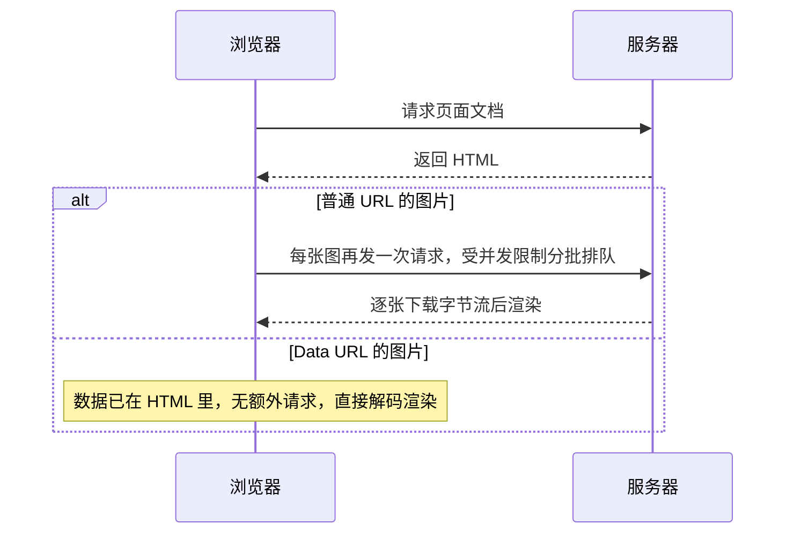

# 省下请求，付出体积：Data URL 的实现原理与优劣

演示页里两张图并排，上面一张 `src` 是普通网址，下面一张 `src` 是 `data:image/png;base64` 开头的长串，浏览器渲染出来肉眼没有任何区别。效果一样，性质完全不同：一张要多发一次请求才能到手，另一张的数据天生就在页面里。本节拆开 Data URL 的原理，把优缺点和适用边界摆上桌面。

## 先给结论

- 原理一句话：把图片的字节流以 Base64 编码成字符串存进 URL，数据随文档一起到达浏览器，不再有独立的资源请求。
- 代价明确：Base64 编码让体积膨胀约三分之一，10 兆的图编码后要 13 兆以上，大文件不适合。
- 收益明确：省一次 HTTP 请求；页面小图多、受浏览器并发请求数限制时，收益非常明显。
- 适用边界：小图标、小图片；老版本浏览器（IE 6/7 级别）支持不全，用之前先看用户群。
- 头像上传方案一就是它的落地：前端把文件编码入库，后续几节写实现。

## 一、图片的本质与两种「给法」

浏览器显示一张图，显示的其实是这张图对应的流数据、二进制字节数组。普通 URL 与 Data URL 的差别，只在这份数据怎么交付。

普通 URL 方式，标签里只有一个地址：

```html

```

`src` 指向远程服务器上的资源。页面加载时，浏览器要对每个外部资源再发一次拉取请求，把字节流下载回来才能渲染，占用网络资源。页面上外部资源越多，这些请求对加载延迟的影响越明显。

Data URL 方式，数据直接躺在标签里：图片被转换成 Base64 编码的字符串形式存储在 URL 中，冠以 MIME 类型，与 HTML 文档成为一体。`src` 的值本身就是数据，拿到文档即拿到图片。

## 二、Base64 编码：换件衣服，体积变大

**编码不是加密。** Base64 把二进制数据映射成由可打印字符组成的字符串，目的是让二进制能安全地在 HTML、URL 这类文本载体里传输，它是一种「格式转换」，谈不上保密，任何拿到字符串的人都能原样还原。理解成「数据换了一件适合文本世界的衣服」即可。

**膨胀三分之一。** Base64 以 3 个字节为一组映射成 4 个字符，长度变成原来的 4/3，也就是比原文件大三分之一。1K 的小图编码后约 1.33K；10 兆的图编码后就是 13 兆甚至更多。文件越大，膨胀的绝对量越惊人，HTML 文档也会被 Base64 字符串撑大，传输和解析都受拖累。这就是 Data URL 只适合小数据的根本原因。

两种给法在加载时序上的分岔：



这张图把两种给法的分岔画在加载时序上：普通 URL 在文档到手后还要为每一次图片往返，Data URL 从文档返回那一刻数据就齐了。图里省掉的下半段，正是 Data URL 全部收益的来源。

## 三、收益的账本：并发请求数才是关键

多数浏览器对同一页面的并发请求数有限制，通常不超过 4 个。页面上有 100 张小图时，即便并发拉满，也要分 25 轮才能全部下载完，图片越碎，排队等待越明显。

换成 Data URL，这 100 次请求全部归零：图片数据跟着 HTML 一次到位，浏览器逐个就地解码渲染。图片数量越多、单张越小，省下的请求轮次越多，这正是「小图内联」的经典场景。

**浏览器支持面。** 主流现代浏览器全部支持 Data URL，Chrome、Firefox、Safari、Opera 都没有问题；IE 也支持，但 IE 6、IE 7 这类老版本支持不完整。系统若要兼容老 IE，这条方案要慎选。

**额外的好处。** 数据自包含，单个 HTML 文件就是完整页面，HTML 邮件、离线文档这类不方便携带外部资源的场合，Data URL 几乎是唯一顺手的选择。

## 四、代价与不适用场景

**体积膨胀三分之一**已经说过，落实到工程上还有两条隐性代价。

**第一，失去独立缓存。** 外部图片 URL 可以被浏览器单独缓存，第二次访问页面时图片直接走本地；Data URL 的数据长在文档里，文档不变图片就无法独立缓存，文档一变整段 Base64 跟着重新下载。变化频繁、体积又大的资源千万别内联。

**第二，文档可读性与维护性下降。** 几千字符的 Base64 串混在 HTML 里，diff 巨大且无法按资源单独替换。工程上通常由构建工具在打包阶段完成内联，源码里仍维护独立文件。

所以选型口诀是：小图标、小数据用 Data URL；大图、需要缓存的资源走传统 URL 加对象存储。

## 五、落回需求：Data URL 实现头像上传

课程讲义给出的头像上传方案一，就是把上面的原理变成步骤：

- 修改用户实体类，数据库表添加用户头像字段；
- 上传的实质是前端把文件以 Base64 编码，交给后端保存到数据库；
- 用户 Controller 添加上传方法；
- 用户 Service 添加文件处理方法，对文件做 Base64 编码后入库。

前端把文件读成 Data URL 的标准姿势（示例为按本课写法补全，完整后端实现在后续课时展开）：

```javascript
const reader = new FileReader()
reader.onload = e => {
  // e.target.result 即 data:image/png;base64,... 形态的字符串
  this.imgDataUrl = e.target.result
}
reader.readAsDataURL(file)
```

`FileReader.readAsDataURL` 读出的字符串天然就是 Data URL 格式，直接提交给 Controller 入库。整条链路没有文件服务器也没有第二存储，一个字符串字段扛下全部；它成立的条件是图小且少，代价与边界就是前文分析的那几条。

## 常见误区

- **拿 Base64 当加密。** 编码可逆且无需密钥，机密数据这样处理等于明文存储。
- **所有图片一律内联。** 大图内联让文档膨胀、缓存失效，加载反而更慢；内联只服务小图与自包含场景。
- **忽略收益的前提条件。** 省请求的前提是图片多、受并发限制；页面只有两三张大图时，传统 URL 配合缓存是更优解。

## 面试可能被问到的问题

1. 面试官追问：「Data URL 为什么能省请求？」
   答：数据经 Base64 编码后直接嵌在 URL 与文档里，浏览器拿到 HTML 时数据已经到手，不需要对每个资源再发独立请求；普通 URL 只是地址，必须额外下载。

2. 面试官追问：「Base64 编码后体积怎么变化，为什么？」
   答：变大约三分之一。Base64 以 3 字节为一组映射成 4 个字符，长度是原来的 4/3，10 兆文件编码后约 13 兆。

3. 面试官追问：「什么场景适合 Data URL，什么场景不适合？」
   答：小图标、小图片以及必须自包含的 HTML 邮件、离线页面适合；大文件、需要独立缓存的资源不适合，编码膨胀与缓存缺失会让代价超过收益。

4. 面试官追问：「Data URL 的图片会被浏览器缓存吗？」
   答：不会独立缓存。数据是文档的一部分，浏览器缓存的是文档本身；外部图片 URL 才能作为独立资源被缓存复用，这是两种方案的重要差异。

5. 面试官追问：「Data URL 对浏览器兼容性有什么要求？」
   答：Chrome、Firefox、Safari、Opera 等主流现代浏览器全部支持；IE 支持但 IE 6、IE 7 等老版本不完整，面向这类用户群时改用传统引用或做降级处理。

## 配套资料

- 普通 URL 与 Data URL 对照演示页（真实源码，普通 URL 域名已改为中性示例）：`materials/code/02/day09 图片上传及Jasper/图片上传及Jasper/讲义/test.html`
- 头像上传的实体类与 Controller、Service 代码属于后续课时，资料包内暂无对应类，文中步骤按讲义整理，`FileReader` 片段为按本课写法补全的示例
