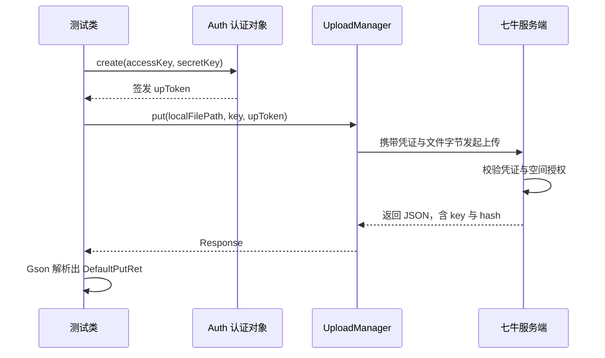

# 照着官方 SDK 填三个空：Java 服务端直传图片到七牛云

> 🔒 安全提示：文中示例的口令/密钥均为课程教学环境演示口径，生产环境的安全要求见《安全与合规须知》。

账号开好了、空间建好了、密钥也拿到了，卡在最后一步的往往不是技术，而是「从哪行代码开始写」。这个问题不需要自己发明，服务商早就把答案写进了文档：进入官方文档中心，找到对象存储，再找 Java SDK，服务端直传的示例代码整段现成。这一节做的就是把它拷进工程、填上自己的三个参数、跑通第一张图片的上传。

## 先给结论

- Maven 坐标是 `com.qiniu:qiniu-java-sdk`，课程实战用的版本 `7.2.1`，配套 JUnit 做测试。
- 上传主流程五个部件：`Configuration` 指定存储区域 → `UploadManager` 上传管理器 → `Auth` 生成上传凭证 → `uploadManager.put` 执行上传 → `Gson` 解析返回的 `DefaultPutRet`。
- 真正要自己填的只有三个值：AccessKey、SecretKey、空间名，代码结构原样照抄官方示例。
- `key` 是文件存进空间后的名字，不指定时服务端按文件内容的 hash 值命名。
- 这段样板封装一层就是项目里要用的工具类，课程资料的 `QiniuUploadUtil` 正是它的工程化版本。

## 一、先拿 SDK，再建工程

官方文档把 SDK 定义为「把访问接口的脏活都封装好」的一层：签名、序列化、域名选择都不用自己碰。Java SDK 属于服务端 SDK，找到 Maven 安装方式，坐标直接拷走。新建一个独立的 Maven 模块练手，加入两个依赖：

```xml
<dependencies>
    <!-- 七牛云 Java SDK -->
    <dependency>
        <groupId>com.qiniu</groupId>
        <artifactId>qiniu-java-sdk</artifactId>
        <version>7.2.1</version>
    </dependency>
    <!-- 测试用 -->
    <dependency>
        <groupId>junit</groupId>
        <artifactId>junit</artifactId>
        <version>4.12</version>
        <scope>test</scope>
    </dependency>
</dependencies>
```

SDK 依赖会传递引入 Gson 等工具包，解析上传结果时直接用即可。工程里建一个测试类，把文档上的「文件上传」示例整段复制过来，接下来逐行替换成自己的参数。

## 二、示例代码逐段拆

整理后的测试方法如下（包名改为 `com.example`，密钥与路径均为示例值，替换为自己的）：

```java
package com.example.qiniu;

import com.google.gson.Gson;
import com.qiniu.common.Zone;
import com.qiniu.common.QiniuException;
import com.qiniu.http.Response;
import com.qiniu.storage.Configuration;
import com.qiniu.storage.UploadManager;
import com.qiniu.storage.model.DefaultPutRet;
import com.qiniu.util.Auth;
import org.junit.Test;

public class QiniuDemo {

    @Test
    public void testUpload01() {
        // 1.创建配置对象：Zone 要与创建空间时选择的区域对应，zone0 代表华东
        Configuration cfg = new Configuration(Zone.zone0());
        // 2.创建上传管理器
        UploadManager uploadManager = new UploadManager(cfg);
        // 3.生成上传凭证所需的三个参数（密钥已打码，替换为自己的）
        String accessKey = "example-ak";
        String secretKey = "example-sk";
        String bucket = "ihrm-bucket";
        // 4.存入空间后的文件名；不指定时以文件内容 hash 值作为文件名
        String key = "test";
        // 5.待上传的本地图片路径
        String localFilePath = "C:\\demo\\资源\\001.png";
        // 6.用密钥对构造认证对象，再签发上传凭证
        Auth auth = Auth.create(accessKey, secretKey);
        String upToken = auth.uploadToken(bucket);
        try {
            // 7.执行上传：本地路径 + 目标文件名 + 凭证
            Response response = uploadManager.put(localFilePath, key, upToken);
            // 8.解析响应体 JSON，得到 key 与 hash
            DefaultPutRet putRet = new Gson().fromJson(response.bodyString(), DefaultPutRet.class);
            System.out.println(putRet.key);
            System.out.println(putRet.hash);
        } catch (QiniuException ex) {
            Response r = ex.response;
            System.err.println(r.toString());
        }
    }
}
```

**`Configuration` 与 `Zone` 负责连哪儿。** 创建空间时选的存储区域在这里对上号：`Zone.zone0()` 对应华东，华北、华南各有对应常量，北美和东南亚另有专用 Zone。区域对不上，上传会连到错误的机房地址，轻则慢重则失败。`Configuration` 源码里还有连接超时、读写超时、连接池等默认值，学习阶段全部用默认即可。

**`UploadManager` 负责怎么传。** 它由 `cfg` 构造出来，`put` 方法有多个重载：本地文件路径、字节数组、输入流都能传，覆盖了从测试到生产的不同输入来源。

**`Auth` 与 `upToken` 负责你是谁。** `Auth.create` 用密钥对构造认证对象，`uploadToken(bucket)` 签发上传凭证，凭证里带上了「允许传到哪个空间」的授权范围。上传凭证本质是服务端签发的一次性授权，空间写错、密钥不对都会在凭证校验阶段被拒绝。

**`key` 与 `DefaultPutRet` 负责结果。** `key` 是文件在空间里的最终名字，本地文件叫 `001.png`，传上去叫 `test`，改名权在你手上；不传 `key` 时服务端拿文件内容的 hash 值当名字，同名文件天然不冲突。上传成功的响应体是一段 JSON，用 Gson 反序列化成 `DefaultPutRet`，打印出来的就是 `key` 和 `hash`。

整次调用的时序如下：



图里的「校验凭证与空间授权」是服务端安全设计的落点：凭证由密钥签名、绑定空间，没有凭证的字节包根本进不了空间。

## 三、运行验证

跑这个测试方法，控制台先打印出 `key` 与 `hash`，说明客户端流程走完。回到浏览器打开控制台，进入空间 `ihrm-bucket` 的内容管理页，刷新后能看到一个名为 `test` 的文件，点预览就是刚才那张本地图片。至此「本地图片进空间」的闭环完整跑通。

## 四、从示例到工具类

课堂演示到此为止，项目里不能每个业务都复制一遍样板。资料包里给好的工具类把这层壳剥掉了：构造函数里初始化 `Configuration` 和 `UploadManager`，对外只留一个「文件名加字节数组」的上传方法（节选自课程资料，密钥与外链域名已打码）：

```java
public String upload(String imgName, byte[] bytes) {
    Auth auth = Auth.create(accessKey, secretKey);
    // 构造覆盖上传 token
    String upToken = auth.uploadToken(bucket, imgName);
    try {
        Response response = manager.put(bytes, imgName, upToken);
        DefaultPutRet putRet = new Gson().fromJson(response.bodyString(), DefaultPutRet.class);
        // 返回请求地址
        return prix + putRet.key;
    } catch (Exception ex) {
        ex.printStackTrace();
    }
    return null;
}
```

和测试代码对比，多了两处工程化改动：入参从本地路径换成 `byte[]`，适配 Web 场景里 `MultipartFile` 转出来的字节数组；`uploadToken` 多传了第二个参数，变成覆盖上传凭证，解决「同名文件重复上传」的问题，这两点正是下一节的主角。

## 常见误区

- **Zone 与空间区域不匹配**：空间建在华北，代码写 `Zone.zone0()`，请求连到华东机房，上传失败或极慢。建空间选的区域要与 Zone 常量一一对应。
- **凭证与空间不匹配**：`uploadToken` 传错 bucket 名，服务端校验直接返回错误，提示里带着 HTTP 状态码，先看 `ex.response` 的内容再猜。
- **密钥写死并提交仓库**：示例代码里的 `your access key` 占位符要替换，替换后的真实密钥绝不能跟着工程进版本库，泄露后空间等于对外开发。
- **响应体不解析**：只打印 `response` 看个状态码就结束，真正有用的 `key` 与 `hash` 在 `bodyString()` 里，解析成 `DefaultPutRet` 才拿到结果。
- **key 随手乱起**：不同文件共用一个 `key` 会在服务端报文件已存在，普通凭证不允许覆盖，key 的设计策略在下一节展开。

## 面试可能被问到的问题

1. 面试官追问：「上传凭证 upToken 是什么？为什么不能拿密钥直接上传？」
   答：upToken 是用 SecretKey 对上传策略签名后生成的一次性授权字符串，里面绑定了允许操作的空间和有效期。客户端拿凭证上传，密钥始终留在服务端，既完成了身份认证，又避免把长期有效的密钥暴露给调用方。

2. 面试官追问：「`put` 方法里的 key 和返回的 hash 分别是什么？」
   答：key 是文件在空间里的唯一文件名，由调用方指定，用于后续访问与覆盖；hash 是服务端根据文件内容算出的指纹，内容相同的文件 hash 相同，可以用来校验文件是否完整上传。

3. 面试官追问：「`Configuration` 里为什么要指定 Zone？不指定会怎样？」
   答：Zone 对应存储空间所在的机房区域，SDK 据此选择上传域名。不指定或指定错误，请求可能被路由到错误区域，轻则上传延迟明显，重则直接失败。区域必须与创建空间时的选择一致。

4. 面试官追问：「SDK 的 `put` 有哪些重载？分别适合什么场景？」
   答：常见三种：本地文件路径适合服务端磁盘上的文件；`byte[]` 适合已经读入内存的数据，比如 Web 层 `MultipartFile.getBytes()` 的结果；`InputStream` 适合边读边传的大文件流场景。三者最终都走同一套凭证校验与分片逻辑。

## 配套资料

- 课程工具类 `QiniuUploadUtil`（`Configuration`、`UploadManager`、覆盖上传凭证与字节数组上传的真实成例）：`materials/code/02/day09 图片上传及Jasper/图片上传及Jasper/资源/后端工具代码/QiniuUploadUtil.java`
- 七牛云对象存储使用指南（SDK 安装与入门流程）：`materials/docs/10/七牛云对象存储使用指南.md`
- `qiniu-demo` 测试类为按官方 Java SDK 文档示例结合课堂演示补全的可运行代码，密钥与本地路径均为示例值
