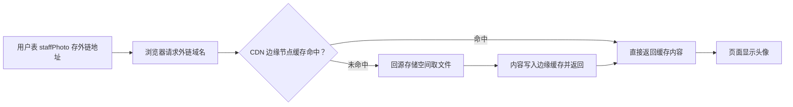

# 头像更新后还是旧图？覆盖上传与 CDN 缓存的两个关键动作

一张图片传上了七牛云，项目里真正的麻烦才刚开始。头像是要换的：用户换了一版照片再传，服务端直接甩回一个「文件已存在」的错误；改成传到新文件名，垃圾文件越堆越多。头像也是要看的：拿到外链地址放进页面，覆盖更新之后刷新，显示的居然还是旧图。更新与访问这两个问题各藏着一个机制点，拆开看就明白怎么应对了。

## 先给结论

- `key` 是文件在空间里的名字，业务上应该一个用户对应一个固定 key，用用户 ID 做最自然，百个用户不会互相踩。
- 普通上传凭证不允许覆盖，同名再传报 `file exist`；生成凭证时把 key 作为第二参数传给 `uploadToken`，就是「指定覆盖上传」。
- 访问图片的 URL = 空间外链域名 + 文件名，域名由七牛云随空间自动分配，也可以绑定自有域名。
- 同名覆盖之后，外链没变，CDN 与浏览器缓存可能继续回旧图；URL 后面拼一个时间戳或随机参数即可拿到最新文件。
- 上传成功后把外链 URL 存进用户表的 `staffPhoto` 字段，页面直接用 HTTP 地址展示，不再走 Base64 入库。

## 一、key 的设计：一个用户一个名字

`key` 在上传代码里只是一个字符串参数，设计对了却决定了整个文件的更新策略。一百个用户上传头像，不能都叫 `test`，否则要么互相覆盖别人的图，要么一直被「文件已存在」拦住。用户的 ID 天然唯一，拿它当 key，文件名与用户一一对应：这个用户传几次图，空间里始终只有一个属于他的文件。

```java
// 用户 ID 作为存储空间内的文件名，天然唯一
String key = id;
```

文件名固定，更新才有明确目标：改头像就是「向同一个 key 传新内容」，不存在旧文件清理问题。

## 二、覆盖上传：凭证里多带一个参数

用上一节的普通凭证再传同名文件，服务端返回的错误信息很有辨识度：`file exist`。这是七牛云的安全机制，默认凭证只允许新增，不允许覆盖，防止调用方误操作把已有文件冲掉。

覆盖的开关在凭证上。对比看一眼就懂：

```java
// 普通上传：只授权往空间里新增文件，key 已存在会被拒绝
String upToken = auth.uploadToken(bucket);
// 指定覆盖上传：授权覆盖指定的 key，同名文件允许被新内容替换
String upToken = auth.uploadToken(bucket, key);
```

`uploadToken` 的第二个参数就是允许被覆盖的目标文件名。完整跑一遍更新流程（密钥已打码，替换为自己的）：

```java
Auth auth = Auth.create(accessKey, secretKey);
// 指定覆盖上传：第二个参数是允许被覆盖的文件名
String upToken = auth.uploadToken(bucket, key);
// 上传：key 不变，内容换成新文件
Response response = uploadManager.put(localFilePath, key, upToken);
DefaultPutRet putRet = new Gson().fromJson(response.bodyString(), DefaultPutRet.class);
System.out.println(putRet.key);
System.out.println(putRet.hash);
```

课堂验证的现象值得复述一遍：先传 `001.png` 到 key `test`，成功；本地文件换成 `002.png`，普通凭证再传，报 `file exist`；凭证改成 `uploadToken(bucket, key)` 之后再传，成功，内容管理里 key 还是 `test`，预览图已经变成 `002` 的内容。更新问题到此解决，凭证机制本身还顺手体现了一个设计原则：授权范围由服务端签发时决定，凭证里没授权的操作，客户端传了也无效。

## 三、外链访问：域名加文件名

文件进空间之后，怎么被浏览器访问到？七牛云为每个存储空间绑定一个外链域名，空间创建完成时自动分配，不想用自动域名也可以绑定自己的域名再 CNAME 过去。访问地址的构成非常朴素：

```text
外链域名 + / + 文件名(key)
例如：http://example-hrm.bkt.clouddn.com/test     （域名已打码，以控制台分配的为准）
```

内容管理页里每张图的预览链接就是这个构成。拿到外链地址后，业务表的角色变了：`staffPhoto` 字段不再存十几万字符的 Base64 串，改存这个短短的 URL，页面 `img` 标签直接指向它，图片流量全走存储服务的 CDN，不占用应用服务器。



图里出现的「CDN 边缘节点缓存」是理解下一个问题的关键：为了访问快，服务在离用户近的节点上缓存了文件内容，代价就是内容变了它不一定马上知道。

## 四、缓存坑：覆盖成功，页面还是旧图

课堂里演示了这个最迷惑的现象：把 `002` 的内容覆盖上传成 `001` 的内容，操作全部成功，回到浏览器刷新页面，显示的依然是覆盖前的 `002` 那张图。文件明明换了，URL 一个字符没变，CDN 按「完整 URL」做缓存键，URL 不变就继续把旧内容还给你，浏览器本地缓存还会再加一层。

解法顺着机制来：让每次请求的 URL 看起来都不一样。在链接后面拼一个随机字符或时间戳参数，缓存键变了，请求绕开旧缓存、回源拿到新内容：

```text
http://example-hrm.bkt.clouddn.com/test?t=1234
```

课程工具类 `QiniuUploadUtil` 已经把这个解法写进了返回值（节选自课程资料，外链域名已打码）：

```java
public String upload(String imgName, byte[] bytes) {
    Auth auth = Auth.create(accessKey, secretKey);
    // 构造覆盖上传 token
    String upToken = auth.uploadToken(bucket, imgName);
    try {
        Response response = manager.put(bytes, imgName, upToken);
        DefaultPutRet putRet = new Gson().fromJson(response.bodyString(), DefaultPutRet.class);
        // 返回请求地址：拼上时间戳，覆盖更新后避免命中旧缓存
        return prix + putRet.key + "?t=" + new Date().getTime();
    } catch (Exception ex) {
        ex.printStackTrace();
    }
    return null;
}
```

三个细节拼起来正是这一节的全部内容：`prix` 是空间的外链域名，注意结尾自带斜杠；`putRet.key` 是文件名；`?t=` 加当前时间戳，让每次上传后生成的地址都不同，覆盖更新的图片一存即生效。

## 五、接回业务：头像保存的最后一块拼图

把七牛云上传接入头像流程，Service 里的改动就是「编码入库」换成「上传拿地址」（示例为按本课写法补全，资料包未含系统微服务完整源码）：

```java
public String uploadImage(String id, MultipartFile file) {
    // 根据 ID 查询用户
    User user = userDao.findById(id).get();
    try {
        // 文件转字节数组，用户 ID 作为 key 覆盖上传
        byte[] bytes = file.getBytes();
        String imageUrl = new QiniuUploadUtil().upload(id, bytes);
        // staffPhoto 存的是外链地址，不再是 Base64 字符串
        user.setStaffPhoto(imageUrl);
        userDao.save(user);
        // 返回地址给前端回显
        return imageUrl;
    } catch (IOException e) {
        e.printStackTrace();
        return null;
    }
}
```

与 Data URL 方案对比，Controller 一行没变，返回值语义也没变，变的只是「地址从哪来」。数据库里存的是几十个字符的 URL，页面取图走 CDN，这一版就是生产里最常见的头像方案。

## 常见误区

- **普通凭证去覆盖同名文件**：`uploadToken(bucket)` 签发的凭证只许新增，重传同名文件报 `file exist`，改用 `uploadToken(bucket, key)` 即可。
- **每次更新都换新 key**：旧文件永远留在空间里占容量、继续产生流量费，用户还可能引用到失效地址。固定 key 加覆盖上传才是正解。
- **覆盖后不拼随机参数就排查「为什么没传上」**：上传其实成功了，是 CDN 和浏览器按 URL 缓存了旧内容。URL 加 `?t=` 时间戳立刻见效。
- **外链域名拼接出错**：域名结尾少了斜杠会拼出 `...clouddn.comtest` 这种地址，直接 404。工具类里 `prix` 常量结尾自带 `/`，拼文件名前先确认域名格式。

## 面试可能被问到的问题

1. 面试官追问：「为什么覆盖上传要在生成凭证时指定 key？这体现了什么设计？」
   答：覆盖是高危操作，可能把已有文件冲掉，所以七牛云把它收敛到凭证签发环节：凭证由服务端密钥签名，签发时绑定允许覆盖的 key，客户端持有越权凭证也通不过校验。本质是最小授权，操作范围在发凭证时就锁定。

2. 面试官追问：「同名覆盖之后为什么页面还是旧图？怎么解决？」
   答：外链 URL 不变，CDN 边缘节点与浏览器都按 URL 缓存内容，命中的还是旧缓存。让 URL 变化即可，最简单的是拼时间戳或随机参数；更规范的做法是文件名里带内容版本号，或对绑定的自定义域名发起缓存刷新。

3. 面试官追问：「用户头像这类文件的 key 应该怎么设计？」
   答：用业务上的唯一标识，用户 ID 是最自然的选择，一个用户一个固定 key，更新即覆盖，不产生垃圾文件。如果业务上还要保留历史头像，可以再加日期或版本段，比如 `userId_20260101`，在唯一性与可追溯之间取平衡。

4. 面试官追问：「Data URL 入库和对象存储外链入库，各自适合什么数据？」
   答：Data URL 适合几 KB 到十几 KB、随记录一起展示的小图标，省请求但撑大记录；对象存储外链适合照片、附件等大文件，数据库只存 URL，存储与流量交给 CDN，应用服务器只承担轻量业务请求。

## 配套资料

- 课程工具类 `QiniuUploadUtil`（覆盖上传凭证、外链域名与时间戳防缓存的真实成例）：`materials/code/02/day09 图片上传及Jasper/图片上传及Jasper/资源/后端工具代码/QiniuUploadUtil.java`
- 前端上传组件（上传成功后拿地址回显的入口）：`materials/code/02/day09 图片上传及Jasper/图片上传及Jasper/资源/前端工具代码/module-employees/components/imgUpload.vue`
- 七牛云对象存储使用指南：`materials/docs/10/七牛云对象存储使用指南.md`
- 接入 `UserService` 的 `uploadImage` 示例为按本课写法补全，资料包未含系统微服务完整工程；外链域名在文中均已打码
