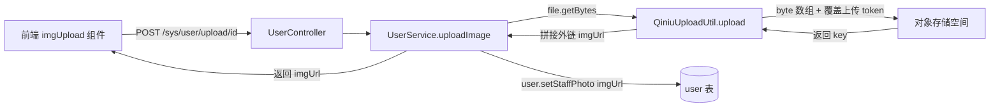

# 员工头像保存改造：从 DataURL 硬塞数据库到对象存储外链

员工管理模块早就做完了头像上传：前端把图片交给 `/sys/user/upload/{id}` 接口，后端把图片转成 DataURL 存进 `user` 表的 `staff_photo` 字段。功能是通的，但一条头像记录动辄几万到几十万个字符，列表查询、数据备份、接口响应全被这一列拖着走。图片一多，这张业务表就成了数据库里最重的表。

对象存储正好治这个病：图片本体放到云存储里，业务表只存一个请求地址。这节课就是把 `UserService.uploadImage` 从 DataURL 方案切换到七牛云对象存储，同时把上传逻辑封装成一个可复用的工具类。

## 先给结论

- DataURL 是把图片 byte 数组做 Base64 编码、拼成 `data:image/png;base64,...` 形式的字符串，本质是伪装成 URL 的二进制文本，存进数据库代价很高。
- 新方案：图片上传到对象存储，`staff_photo` 里只存一条形如 `http://域名/key?t=时间戳` 的外链，字段从几十万字符缩到几十个。
- 上传封装在 `QiniuUploadUtil` 里，两个参数：文件名 `imgName` 与图片 byte 数组；文件名直接用用户 id，一个用户固定一个 key。
- 用覆盖上传凭证 `auth.uploadToken(bucket, imgName)`：同一用户重复换头像，同名覆盖，云存储里不会堆积历史文件。
- 返回地址拼上 `?t=当前毫秒值`，URL 每次变化就能绕开浏览器和 CDN 的旧缓存，换头像立刻生效。

## 一、DataURL 方案到底差在哪

先把两种方案并排放在一起看：

| 维度 | DataURL 方案 | 对象存储方案 |
|---|---|---|
| 数据库里存什么 | 完整 Base64 字符串 | 一个短 URL |
| 一张 100 KB 图片的入库体积 | 约 13 万字符 | 几十字符 |
| 图片流量 | 走应用服务器与数据库 | 走存储服务自身的下载域名 |
| 换头像 | 整个字段重写一遍大字符串 | 同名覆盖，字段只更新 URL |
| 前端渲染 | 字符串直接赋给 `img src` | 普通图片地址，可被缓存 |

**第一，行体积失控。** Base64 会把二进制体积放大约三分之一，100 KB 的图片编码后 13 万字符起步，一张几 MB 的照片就是上百万字符。`user` 表被这一列撑出超长行，查询列表时哪怕页面根本不展示头像，整段字符串也被一起读出来、序列化、传到前端。

**第二，数据库被当成文件服务器。** 图片的写入频率不高，但体积远超普通字段，缓冲池、备份、主从复制都在为它买单。这类数据天然属于对象存储，数据库只该存「图片在哪」。

**第三，没有缓存层可用。** DataURL 每次请求都要把完整字符串拉一遍；外链形式的图片可以直接享受浏览器缓存和 CDN 边缘节点，这也是后面要加时间戳参数的原因。

## 二、封装上传工具类 QiniuUploadUtil

课程资料里提供了一个现成的工具类，落在系统的 `common` 模块 `utils` 包下（包名已改为中性的 `com.example`，密钥换成占位示例）：

```java
package com.example.system.utils;

import com.google.gson.Gson;
import com.qiniu.common.Zone;
import com.qiniu.http.Response;
import com.qiniu.storage.Configuration;
import com.qiniu.storage.UploadManager;
import com.qiniu.storage.model.DefaultPutRet;
import com.qiniu.util.Auth;

import java.util.Date;

public class QiniuUploadUtil {

    private static final String accessKey = "your-access-key";
    private static final String secretKey = "your-secret-key";
    private static final String bucket = "ihrm-bucket";
    //存储空间分配的下载域名
    private static final String prix = "http://xxxx.bkt.clouddn.com/";
    private UploadManager manager;

    public QiniuUploadUtil() {
        //初始化基本配置
        Configuration cfg = new Configuration(Zone.zone0());
        //创建上传管理器
        manager = new UploadManager(cfg);
    }

    //文件名即 key
    public String upload(String imgName, byte[] bytes) {
        Auth auth = Auth.create(accessKey, secretKey);
        //构造覆盖上传 token
        String upToken = auth.uploadToken(bucket, imgName);
        try {
            Response response = manager.put(bytes, imgName, upToken);
            DefaultPutRet putRet = new Gson().fromJson(response.bodyString(), DefaultPutRet.class);
            //返回请求地址：下载域名 + key + 时间戳
            return prix + putRet.key + "?t=" + new Date().getTime();
        } catch (Exception ex) {
            ex.printStackTrace();
        }
        return null;
    }
}
```

这个类有三个值得留意的点。**其一，上传入口是 byte 数组而不是本地文件路径。** 上传头像时图片在 `MultipartFile` 里，还没有落盘，`manager.put(bytes, imgName, upToken)` 正好接收字节数组，省去临时文件。**其二，用的是覆盖上传 token。** `auth.uploadToken(bucket, imgName)` 把凭证和文件名绑死，上传同一个 key 就是替换原文件，这与普通上传的 `uploadToken(bucket)` 不同。**其三，返回值是拼好的完整 URL。** 下载域名接上服务端返回的 key，再补一个 `?t=` 加当前毫秒值，把缓存穿透也一并处理了。

工程要跑起来，还需要在父工程的 pom 里补上七牛云的坐标：

```xml
<dependency>
    <groupId>com.qiniu</groupId>
    <artifactId>qiniu-java-sdk</artifactId>
    <version>7.2.25</version>
</dependency>
```

## 三、改造 UserService.uploadImage

原来基于 DataURL 的实现是这样的：

```java
public String uploadImage(String id, MultipartFile file) throws IOException {
    //1.根据 id 查询用户
    User user = userDao.findById(id).get();
    //2.使用 DataUrl 格式存储图片（将图片 byte 数组进行 base64 编码）
    String encode = "data:image/png;base64," + Base64.encode(file.getBytes());
    //3.更新用户头像地址
    user.setStaffPhoto(encode);
    //4.返回
    userDao.save(user);
    return encode;
}
```

切换到对象存储，四步结构不变，只把第 2 步换成调用工具类：

```java
public String uploadImage(String id, MultipartFile file) throws IOException {
    //1.根据 id 查询用户
    User user = userDao.findById(id).get();
    //2.将图片上传到云存储：文件名用用户 id，一个用户唯一对应一个 key
    QiniuUploadUtil util = new QiniuUploadUtil();
    String imgUrl = util.upload(user.getId(), file.getBytes());
    //3.更新用户头像地址
    user.setStaffPhoto(imgUrl);
    //4.返回
    userDao.save(user);
    return imgUrl;
}
```

Controller、前端上传组件都不用动，前端拿到的返回值从 DataURL 字符串换成了图片 URL，`img src` 两种形式都认。改造完成的验证路径也很直白：重启系统微服务，登录后在员工详情页上传一张图片，云存储控制台里立刻出现对应的文件，可以在线预览；回到数据库看 `user` 表，`staff_photo` 字段已经是一条 `http://...?t=...` 形式的请求地址。



这张图把数据流走了一遍：图片字节只在应用内存里短暂停留，落地的位置是对象存储，数据库里沉淀的只有那条短 URL。

## 常见误区

- **用普通 token 去做覆盖上传。** `uploadToken(bucket)` 生成的凭证没有绑定文件名，同名上传不会替换已有文件。覆盖上传必须用 `uploadToken(bucket, imgName)` 这种把 key 绑进凭证的形式。
- **返回 URL 时漏掉时间戳参数。** 换头像后文件名没变，浏览器或 CDN 会继续用缓存的旧图，用户以为上传失败。`?t=` 让每次更新的 URL 都不同，旧缓存自然失效。
- **文件名用随机串或时间戳。** 那样每个用户每换一次头像就在云存储里多一个文件，历史文件越堆越多。用用户 id 做 key，覆盖上传天然保证一人一份。
- **把 DataURL 一棍子打死。** 几 KB 的小图标以内嵌 DataURL 减少 HTTP 请求是合理的；上百 KB 的用户照片走外链才是正确归宿，分界线在体积和数量级。

## 面试可能被问到的问题

1. 面试官追问：「为什么头像要存 URL 而不是 Base64 直接入库？」
   答：Base64 让体积膨胀约三分之一，业务表出现超长字段，查询、备份、主从复制都受拖累，图片流量还会全压在应用服务器上。存外链后数据库只存几十个字符的地址，图片本体由对象存储分发，还可以利用浏览器与 CDN 缓存。

2. 面试官追问：「覆盖上传的凭证和普通上传凭证有什么区别？」
   答：普通凭证 `uploadToken(bucket)` 只指定空间，key 由客户端随意带，重复上传会生成新文件；覆盖上传凭证 `uploadToken(bucket, imgName)` 把目标 key 绑定进凭证，服务端校验通过后才允许替换该 key 对应的文件，实现了同名覆盖。

3. 面试官追问：「用户换了头像，页面显示的还是旧图，你怎么排查？」
   答：大概率是缓存。先看数据库里存的是不是新 URL，再确认返回的 URL 是否带了变化的时间戳参数；没有参数的话浏览器和 CDN 会命中旧资源。修复方式就是更新头像时同步更新 URL 的查询参数，让缓存键变化。

4. 面试官追问：「上传文件名为什么用用户 id 而不是 UUID？」
   答：头像的业务语义是「一个用户一张当前头像」，用 id 做 key 语义清晰、数量可控，配合覆盖上传，重复上传直接替换，不会在存储空间里累积历史文件。UUID 更适合海量的、彼此独立的附件场景。

5. 面试官追问：「DataURL 的适用场景是什么？」
   答：体积很小的图标、占位图这类资源，内嵌进 HTML 或 CSS 可以减少一次网络请求，是合理用法。它的边界在于体积，一旦到了几百 KB 以上，编码膨胀、传输与存储成本就会压过减少请求数带来的收益。

## 配套资料

- 上传工具类：`materials/code/02/day09 图片上传及Jasper/图片上传及Jasper/资源/后端工具代码/QiniuUploadUtil.java`
  （文中包名已改为 `com.example.system.utils`，密钥已打码）
- 前端上传组件：`materials/code/02/day09 图片上传及Jasper/图片上传及Jasper/资源/前端工具代码/module-employees/components/imgUpload.vue`
- 七牛云对象存储使用指南：`materials/docs/10/七牛云对象存储使用指南.md`
