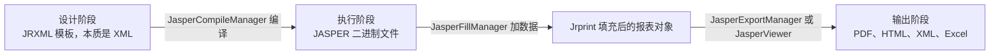

# 用 JasperReports 生成 PDF 报表：概述与三段式生命周期

HRM 系统还差最后一块功能：把员工档案、部门统计打印成 PDF 报表。Excel 报表之前用 POI 做过，可现实业务里 PDF 的出场率一点不低：医院的无纸化办公把体检结果、病例做成 PDF；电商网站把订单详情生成 PDF 发进邮箱；人事系统里的员工简历、用户详细信息也常以 PDF 形式归档和下载。报表生成与报表打印在企业应用里是绕不开的一环，PDF 就是其中最主流的一种载体。

Java 世界里生成 PDF 的路子不多，这节课先把几条路线摆出来比较，说清楚为什么主流选择是 JasperReports，再把它的生命周期和内部原理拆开看，为后面动手做模板打好底子。

## 先给结论

- Java 生成 PDF 的三种常见方式：iText 直接调 API 拼样式太费劲；OpenOffice 要先做 Word 或 Excel 再转 PDF，链路长且不灵活；推荐的是 JasperReports。
- JasperReports 是纯 Java 编写的开源报表引擎，引入 jar 包即可使用，同一份模板能输出 PDF、HTML、XML、Excel 等多种格式。
- 生命周期三个阶段：设计（产出 JRXML 模板）、执行（编译成 .jasper 二进制再填充数据得 .jrprint）、输出（按格式导出或预览）。
- 四个关键产物要分清：JRXML 是 XML 模板，Jasper 是编译后的二进制文件，Jrprint 是填充完数据的打印对象，Exporter 决定输出格式。
- 生命周期这套代码日常不需要手写，Jaspersoft Studio 会把编译和预览代劳，开发只关注模板、数据、填充三件事。

## 一、三种生成方式，为什么选 JasperReports

| 方案 | 工作方式 | 短板 |
|---|---|---|
| iText | Java API 逐段描述 PDF 内容 | 页眉、页脚、表格样式全靠代码堆，单独使用太麻烦 |
| OpenOffice | 先生成 Word 或 Excel，再转 PDF | 多一道转换工序，方式原始、不灵活 |
| JasperReports | 模板加数据填充，一次设计多格式输出 | 需要先学会模板设计，上手成本略高 |

**第一，iText 更适合当底层引擎。** 它是著名的开源项目，既能直接生成 PDF，也能把 XML、HTML 文件转成 PDF。可它的粒度太细：一个 PDF 的头部样式、尾部样式、中间内容区，全要用 Java 代码一行行摆出来，报表一复杂代码就膨胀得没法维护。所以实际工程里很少有人单独拿 iText 写报表，它更多是作为底层库被其他框架封装。

**第二，OpenOffice 是曲线救国。** 它本身不能直接生成 PDF 报表，得先把数据写进 Word 或 Excel，再转成 PDF。步骤多、依赖外部软件、灵活性差，这种原始的方式如今很少用。

**第三，JasperReports 是主流答案。** 去搜一下 Java 生成 PDF 的资料，推荐 JasperReports 的占了大半。它是一个功能强大、灵活的报表生成工具：支持十字交叉报表、统计报表、图形报表；支持多格式输出，常见的有 PDF、HTML、XML、CSV、XHTML、DOCX、XLS 等；对填充数据的数据源也极其宽容，可以是 JDBC 连接、XML 文件、CSV 文件、JavaBean、Map、Java 集合，甚至 Hibernate 的 HQL 查询结果。用得好，完全可以替代一些收费的商业报表工具。

模板加填充是它和前两者最本质的区别：报表长什么样在设计阶段就确定了，数据来了往里灌，输出格式随选。这个思路直接体现在它的生命周期里。

## 二、生命周期：设计、执行、输出

有人把这三个阶段叫生命周期，有人叫开发阶段，说的是同一件事。生成一个 PDF 并不是点一下按钮那么简单，PDF 只是完整生命周期的最后一个产物：



**第一，设计阶段产出模板。** 一个 PDF 报表有自己的表头、结尾、中间的数据填充区，设计阶段就是把这份布局定下来，产物叫 JRXML。它的本质就是一个 XML 文件，里面声明了报表的每个区域：页头 `pageHeader`、页脚 `footer`、详情区 `detail`，以及各区域里用什么字体输出什么内容。

**第二，执行阶段编译并填充。** JRXML 是给人看和编辑的，引擎真正执行前要把它编译成 `.jasper` 文件，一个二进制文件，此时 PDF 的雏形已经成型，只是没有任何数据。接着把数据灌进去，填充之后得到的产物叫 `.jrprint`，报表的全部内容（布局加数据）到这一步才凑齐。

**第三，输出阶段决定格式。** 有了 Jrprint，剩下的只是「以什么形式展示」：用 `JasperViewer` 弹窗预览，用导出管理器写成 PDF 文件，或者直接往浏览器响应流里输出。同一份 Jrprint 可以按需导出成多种格式。

## 三、最小工程：三个方法对应三个阶段

课程用一个独立模块演示这套生命周期。工程坐标引入 JasperReports 相关依赖（取自课程资料里的真实 pom）：

```xml
<dependency>
    <groupId>net.sf.jasperreports</groupId>
    <artifactId>jasperreports</artifactId>
    <version>6.5.0</version>
</dependency>
<dependency>
    <groupId>com.lowagie</groupId>
    <artifactId>itext</artifactId>
    <version>2.1.7</version>
</dependency>
<dependency>
    <groupId>org.olap4j</groupId>
    <artifactId>olap4j</artifactId>
    <version>1.2.0</version>
</dependency>
```

`jasperreports` 是主坐标；`itext` 是它依赖的 PDF 底层引擎，印证了前面说的「iText 适合当底层」；`olap4j` 是 JasperReports 部分功能需要的传递依赖。核心演示代码如下（包名改为 `com.example.jr`，路径改成中性写法）：

```java
package com.example.jr;

import net.sf.jasperreports.engine.JREmptyDataSource;
import net.sf.jasperreports.engine.JasperCompileManager;
import net.sf.jasperreports.engine.JasperFillManager;
import net.sf.jasperreports.view.JasperViewer;

import java.util.HashMap;

public class PDFTest {

    public static void main(String[] args) {
        createJasper();
    }

    //1.将 jrxml 模板编译为 jasper 文件
    public static void createJasper(){
        try{
            String path = "D:/data/test01.jrxml";
            JasperCompileManager.compileReportToFile(path);
        }catch(Exception e){
            e.printStackTrace();
        }
    }

    //2.将 jasper 文件与数据填充，获取 jrprint
    public static void createJrprint(){
        try{
            String path = "D:/data/test01.jasper";
            //通过空参数和空数据源进行填充
            JasperFillManager.fillReportToFile(path,new HashMap(),new JREmptyDataSource());
        }catch(Exception e){
            e.printStackTrace();
        }
    }

    //3.预览
    public static void showPdf(){
        try{
            String path = "D:/data/test01.jrprint";
            JasperViewer.viewReport(path,false);
        }catch(Exception e){
            e.printStackTrace();
        }
    }
}
```

三个方法严格对应三个阶段：`createJasper` 把模板编译成 `.jasper`；`createJrprint` 调 `JasperFillManager.fillReportToFile`，传入空参数 Map 和 `JREmptyDataSource` 空数据源（演示阶段还没有业务数据），得到 `.jrprint`；`showPdf` 用 `JasperViewer.viewReport` 弹窗预览。执行完能在磁盘上依次看到 `.jrxml`、`.jasper`、`.jrprint` 三个文件，后两个打开都是二进制内容，表面上长得差不多，代表的却是不同阶段的产物。

## 四、JRXML 模板长什么样

资料包里没有收录这份模板文件，按本课的写法补一个最小的可编译示例，感受一下 JRXML 的结构：

```xml
<?xml version="1.0" encoding="UTF-8"?>
<jasperReport xmlns="http://jasperreports.sourceforge.net/jasperreports"
              xmlns:xsi="http://www.w3.org/2001/XMLSchema-instance"
              xsi:schemaLocation="http://jasperreports.sourceforge.net/jasperreports
                                  http://jasperreports.sourceforge.net/jasperreports.xsd"
              name="test01" pageWidth="595" pageHeight="842" columnWidth="555"
              leftMargin="20" rightMargin="20" topMargin="20" bottomMargin="20">
    <!-- 页头：一张图片加一行标题 -->
    <pageHeader>
        <band height="80">
            <image>
                <reportElement x="0" y="0" width="60" height="60"/>
                <imageExpression><![CDATA["logo.png"]]></imageExpression>
            </image>
            <staticText>
                <reportElement x="80" y="0" width="475" height="60"/>
                <textElement>
                    <font fontName="华文宋体" size="20"/>
                </textElement>
                <text><![CDATA[员工档案报表]]></text>
            </staticText>
        </band>
    </pageHeader>
    <!-- 页脚：每页底部输出一句话 -->
    <pageFooter>
        <band height="40">
            <staticText>
                <reportElement x="0" y="0" width="555" height="20"/>
                <textElement>
                    <font fontName="华文宋体" size="10"/>
                </textElement>
                <text><![CDATA[这是报表页脚]]></text>
            </staticText>
        </band>
    </pageFooter>
</jasperReport>
```

结构一眼可辨：根节点 `jasperReport` 声明页面尺寸与边距，`pageHeader` 里放图片和标题，`pageFooter` 里放页脚文字，字体指定为华文宋体。布局信息全部固化在 XML 里，这正是「设计阶段」的产出物，也是后面用 Jaspersoft Studio 图形化工具编辑的对象。

## 常见误区

- **把 iText 和 JasperReports 当成二选一的同类。** iText 是底层 PDF 引擎，JasperReports 的 PDF 输出能力正是建立在它之上；比较的对象应该是「用 iText 手写样式」还是「用 JasperReports 模板填充」，而不是两个互斥的产品。
- **以为 PDF 一步生成。** PDF 只是生命周期的终点，中间必有模板、编译、填充三步。跳过编译直接拿 `.jrxml` 去填充会失败，`fillReportToFile` 要的是 `.jasper` 文件。
- **混淆 Jasper 和 Jrprint。** Jasper 是编译后的模板，只有布局没有数据；Jrprint 是填充完数据的完整报表，只有它能直接输出。前者是「骨架」，后者才是「血肉」。
- **忽略中文字体问题。** 模板里指定华文宋体，运行时报中文显示空白或方块，原因是没有注册字体扩展，需要字体文件加扩展配置一起引入，这一点资料包里有专门的示例目录。

## 面试可能被问到的问题

1. 面试官追问：「JasperReports 的生命周期分哪几个阶段？」
   答：三个阶段。设计阶段产出 JRXML 模板，描述报表布局；执行阶段先用编译器把 JRXML 编译成二进制的 Jasper 文件，再结合数据填充得到 Jrprint 对象；输出阶段由导出器把 Jrprint 按需输出成 PDF、HTML、Excel 等格式。

2. 面试官追问：「JRXML、Jasper、Jrprint 分别是什么？」
   答：JRXML 是本质为 XML 的报表填充模板，封装了整个布局；Jasper 是由 JRXML 编译生成的二进制文件，供代码级填充使用；Jrprint 是数据填充完 Jasper 后生成的对象，已经包含报表的全部内容，直接用于输出。

3. 面试官追问：「为什么要把 XML 模板编译成二进制文件？」
   答：编译一次完成解析和校验，把人可读的 XML 转成引擎高效的内部结构，填充时不再重复解析 XML；同时二进制模板是固化产物，运行时被误改的风险更小，也便于随代码一起发布。

4. 面试官追问：「JasperReports 支持哪些数据源？」
   答：它的数据源指的是填充内容的来源，不是数据库连接池。支持 JDBC 连接或 SQL 查询结果、JavaBean 集合、Map、XML 文件、CSV 文件、HQL 查询结果等，甚至提供 JREmptyDataSource 用于无数据的演示场景，接入业务数据时按数据形态选择对应实现。

5. 面试官追问：「既然有了 iText，为什么还要用 JasperReports？」
   答：iText 的粒度是文档元素，页眉页脚表格全要用代码拼，样式复杂后不可维护；JasperReports 用模板把布局和代码解耦，一次设计就能多格式输出，还内置交叉表、统计图等高级报表能力。实际工程中 JasperReports 常常正是把 iText 当作 PDF 输出的底层。

6. 面试官追问：「日常开发要手写这套生命周期代码吗？」
   答：不用。编译和预览由 Jaspersoft Studio 图形化工具代劳，模板也在工具里画，业务代码里真正常写的是加载数据和填充输出这两段。理解生命周期是为了看清每一步产物是什么，出了问题知道卡在哪个阶段。

## 配套资料

- 生命周期演示代码：`materials/code/02/day09 图片上传及Jasper/图片上传及Jasper/资源/资源/生命周期测试/PDFTest.java`
- 含完整坐标的报表工程：`materials/code/02/day10-用户档案PDF报表/day10-用户档案PDF报表/代码/jasper-springboot/`
  （含 `pom.xml`、`JasperApplication.java`、`JasperController.java`，文中包名已改为 `com.example`）
- 中文字体扩展配置：`materials/code/02/day09 图片上传及Jasper/图片上传及Jasper/资源/资源/乱码问题/`
  （含 `jasperreports_extension.properties` 与华文宋体字体注册文件；`test01.jrxml` 未收录，文中为按本课写法补全的示例）
