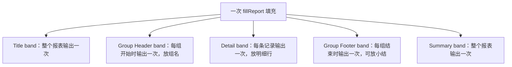

# 按企业分段打印：给报表模板加 Group 组头组尾

普通列表报表把所有记录一行接一行平铺，数据一多就糊成一片。SaaS 人力系统的典型诉求是「以企业为单位看用户」：云图科技的员工列在一起，标一个组名，接着是星河软件的员工，再标一个组名。同一份明细数据，按某个字段切成分段展示，这就是分组报表要解决的事，JasperReports 用 Group 机制原生支持。

## 先给结论

- 分组在模板侧声明：Outline 里选中模板根节点右键 Create Group，分组表达式选承载分组依据的 Field，示例是 `$F{company}`。
- 创建向导默认勾选 add group header 与 add group footer，确定后模板里多出两个 band。
- 组头放组名：把 `company` 字段拖进 Group Header，再补一段静态文字，表达式形如 `"以企业名称分组：" + $F{company}`。
- 填充时引擎靠「相邻记录分组字段值是否变化」来切组，数据源用 JavaBean 列表即可。
- 数据必须按分组字段有序，这是隐形前提，乱序数据会导致同组穿插，下一篇展开。

## 分组报表解决什么问题

数据填充的三种方式到这一步已经齐了：Map 传简单单值，Connection 让模板自带 SQL，Bean 列表承接业务侧组装的数据。展示形态上还有一个空白：明细行有了，段落的层次感没有。

分组报表补的就是这个空白。它不改变数据，只改变渲染顺序上的组织方式：分组字段值相同的一批记录归成一段，段前打组头，段后可打组尾。用途有两类，一是让版式更直观好看，二是天然支持「按维度分段查看」的业务形态，比如按企业、按部门、按月份。

一次填充过程中，各 band 的触发次数是这样的：



组头与组尾是分组报表独有的两个 band，它们的输出次数由数据里有几个分组决定，而不是像 Title 那样固定一次。

## 模板骨架：先按普通列表做

新建 A4 模板 `testGroup`，照旧删掉多余 band 只留 Title 与 Detail。Field 不用手建，从上一节的 Bean 版模板里把 `id`、`username`、`mobile`、`company`、`dept` 五个直接复制过来，Jaspersoft Studio 支持 Ctrl C 加 Ctrl V 搬 Field。拖进 Detail band，设字体（华文宋体 12 号）、居中、边框，Detail band 高度压到 30 像素，一套动作与普通列表版完全一致。Title 里放一个静态文本，写上「分组报表」。

到这一步它就是一张普通列表模板，真正让它变成分组报表的是下面这一步。

## Create Group：两步出组头组尾

在 Outline 面板选中模板根节点 `testGroup`，右键选 Create Group，向导里要做两个选择：

**第一，选分组依据。** 向导列出模板里所有 Field，分组依据是承载企业名称的 `company`，选中它，向导会自动生成分组表达式 `$F{company}`。创建完成后在组属性面板能看到这条对应关系：Group 名为 `Group1`，Expression 为 `$F{company}`。

**第二，决定要不要组头组尾。** 向导有两个复选框，add the group header 与 add the group footer，保持默认勾选即可。点 Finish 后设计区多出两个 band：Group Header 与 Group Footer。

组头是这次的重点。把 Fields 下的 `company` 拖进 Group Header band，它会显示当前组的分组值；再双击这个文本框补一段静态说明文字，表达式写成：

```java
"以企业名称分组：" + $F{company}
```

注意两点：静态字符串必须用英文双引号包起来，写程序的经验在这里通用；表达式用加号连接静态文字与 Field，与 Java 字符串拼接的写法一模一样。组尾暂时用不上内容，留着 50 像素的空 band 即可，需要小统计（比如每组人数）时再往里放元素。

对应的模板 XML 结构大致是下面这个样子（模板源文件未随资料包提供，片段为按本课操作还原的示例，band 内元素在 Studio 里拖拽生成）：

```xml
<group name="Group1">
    <groupExpression><![CDATA[$F{company}]]></groupExpression>
    <groupHeader>
        <band height="50">
            <!-- 静态文字与 $F{company} 组成的组名文本框 -->
        </band>
    </groupHeader>
    <groupFooter>
        <band height="50"/>
    </groupFooter>
</group>
```

分组声明落在 XML 里的就是这一个 `group` 元素，表达式是它的核心属性，引擎填充时反复求值的就是这个 `$F{company}`。

## 数据侧怎么接

填充代码不需要任何分组相关的 API，还是 Bean 数据源那套：

```java
//1.获取到对象的list集合
List<User> userList = getUserList();
//2.通过list集合创建javaBean的数据源对象
JRBeanCollectionDataSource ds = new JRBeanCollectionDataSource(userList);
```

分组完全是模板侧的声明，数据侧只管把列表递进来。引擎逐条读记录，发现 `company` 值变了，就先收上一组（走组尾），再开新组（走组头），中间的 detail 照常循环。这份取自资料包 `JasperController05` 的代码在下一篇会配完整数据跑出 PDF。

## 常见误区

- **分组表达式写错 Field 名**：表达式里的 `$F{}` 拼错或指向不存在的 Field，编译报错；指向了一个每行都不同的字段，则每条记录各成一组，整张报表碎成一行一段。分组依据必须是那个「同组记录取值相同」的字段。
- **表达式里的字符串用了中文引号**：静态文字没包英文双引号，或引号敲成全角，表达式编译失败。表达式里的语法符号一律半角。
- **以为加了 Group 就会自动排序**：Group 只做相邻值变化检测，不重排数据。数据源里记录的先后顺序直接决定分组成效，这是下一篇的核心话题。
- **组尾留着大高度不用**：勾了 footer 又不放元素也不压缩高度，每组之间会空出一大截。暂时不用就把 band 高度调小。

## 面试可能被问到的问题

1. 面试官追问：「JasperReports 的分组是怎么实现的？」
   答：模板里声明 group 元素，带一个分组表达式。填充时引擎对每条记录求值，与前一条比较，值变化即判定进入新分组，先输出上一组的 group footer，再输出新组的 group header，detail 按记录逐条渲染。它本质是相邻值变化检测，不做排序。

2. 面试官追问：「Group Header 和 Group Footer 分别能放什么？」
   答：组头放组标识，比如分组字段值加说明文字，让每段开头一眼可辨；组尾放段级汇总，比如组内记录条数、金额合计，配合变量按组累加求值。两者输出次数都等于数据里的分组个数。

3. 面试官追问：「如果想按企业和部门两级分组怎么办？」
   答：再执行一次 Create Group，表达式选 `dept` 字段即可。多个 group 按声明顺序形成层级，引擎按外层到内层依次检测切换；数据则要按企业、部门两级字段依次排序，保证高一级字段相邻时低一级字段也在相邻范围内。

4. 面试官追问：「报表分组和 SQL 的 GROUP BY 是一回事吗？」
   答：不是。GROUP BY 是聚合语义，把多行折叠成一行统计结果；报表分组是展示语义，明细行一条不少，只是按字段值切段并插入组头组尾。要「每段的明细加小计」，就是 SQL 查明细、模板做分组、组尾放聚合变量三者配合。

5. 面试官追问：「分组的依据可以是多个字段组合吗？」
   答：可以。分组表达式本身是任意合法表达式，可以写成 `$F{company} + $F{dept}` 这类拼接值，组合值相同即同组。更清晰的做法是多级分组各管一个字段，语义和排序都更好维护。

## 配套资料

- 代码：`materials/code/02/day10-用户档案PDF报表/day10-用户档案PDF报表/代码/jasper-springboot/src/main/java/` 下 controller 包内 `JasperController05.java`（分组报表填充代码，包名已改为 `com.example`）
- 工程配置：`materials/code/02/day10-用户档案PDF报表/day10-用户档案PDF报表/代码/jasper-springboot/pom.xml`、`src/main/resources/application.yml`
- 模板 `testGroup.jrxml` 未随资料包提供，Create Group 操作与组头表达式按课程操作还原，文中 XML 片段为按本课写法补全的示例
