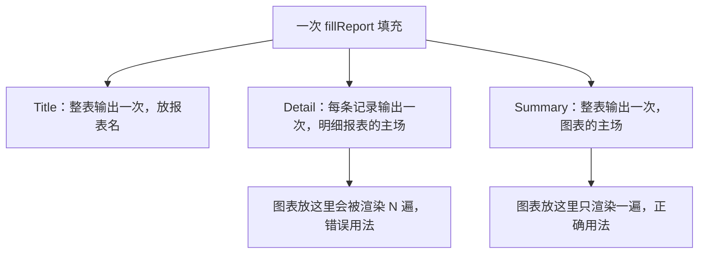
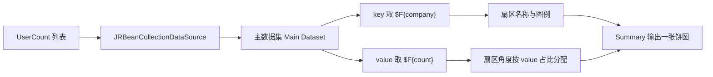

# PDF 里嵌图表：图表为什么只能放 Summary，不放 Detail

明细报表能打了，分组小计也有了，产品追过来一句：给张图，各公司人数占比要一眼看出来。表格是给人逐行读的，占比关系得肉眼扫两列数字再心算，不直观；PDF 里嵌一张饼图，谁大谁小一目了然。这一篇先做需求分析与方案拆解，动手画图留在下一篇。

## 先给结论

- 图形报表就是在 PDF 模板里嵌入 Chart 图表组件，数据仍来自填充数据集，图表自己完成「数值到图形」的映射。
- 模板要为图表腾位置：删掉多余 band，只留 Title 与 Summary，图表放 Summary。
- 图表绝不能放 Detail：Detail 按记录循环，一条记录画一张图，整份 PDF 会重复渲染 N 遍同一张图。
- 饼图数据由 key 与 value 构成：key 是扇区名称，value 是决定扇区大小的数值；本案例 key 取 `$F{company}`，value 取 `$F{count}`。
- 喂给图表的数据应是聚合后的结果集，一行一公司一人数，载体是 `UserCount` 实体。

## 图形报表解决什么问题

前两课的分组与变量解决的是「明细怎么摆」，图表解决的是「统计结果怎么看」。饼图、柱状图、折线图各有擅长：占比构成用饼图，数量对比用柱状图，趋势变化用折线。Studio 的 Palette 面板里 Chart 元素支持一大串类型：Area、Bar、Bar3D、Line、Pie、Bubble、Scatter、Thermometer、Meter、TimeSeries 等，向导里挑一个，剩下的配置套路是同构的。

对 SaaS 人力系统来说，典型场景就是本课案例：统计每个公司的员工数量，以饼图展示各公司在总人数中的份额。云图科技多少人、星河软件多少人、蓝湾数据多少人，扇区一转，答案就在眼前。

## 给图表腾 band：只留 Title 与 Summary

新建模板 `testCharts`，A4 版式，删 band 比以往都狠：Page Header、Column Header、Column Footer、Page Footer 全删，只留 Title 与 Summary，Summary 高度调到 200 像素左右给图形留空间。

Detail 必须删，这里藏着本课最重要的一条原理：**Detail band 的输出次数等于记录条数。** 明细数据放进 Detail，15 条记录打 15 行，这是列表报表要的效果；图表放进 Detail，15 条记录就把同一张图画 15 遍，PDF 直接废掉。Summary band 整份报表只输出一次，是图表唯一的合理归宿。



## 拖 Chart 三步走

Palette 面板找到 Chart 元素，左键拖进 Summary band，弹出 Chart Wizard，三步：

**第一步选类型。** 向导列出全部图表，饼图勾选 Pie Chart，点 Next。

**第二步配数据集。** Dataset 用默认的 Main Dataset，意思是图表与模板 fields 共用同一个主数据集，一条记录喂一个扇区，不需要额外建数据集。表单里 Series 是这张图的名称系列，Value 填份额数值表达式，Label 填扇区文字，另有 Min slice percentage、Other Section 等细节项，先不动。

**第三步 Finish 出图。** 图表元素落进 Summary，后续在 Properties 面板里调样式。

## 案例拆解：key 与 value 各是什么

把需求翻译成图表语言，是动手前必须想清的一步。一张饼图由若干扇区组成，每个扇区只有两个语义位：

- **key**：扇区的名字，也是图例上显示的文字，本例就是公司名称，云图科技、星河软件。
- **value**：决定扇区大小的数值，占比按它算，本例就是各公司的员工数量。

Label 与 key 语义相近（都管「显示成什么字」），一张图用一个就够。对照表如下：

| key（扇区名） | value（份额依据） |
|---|---|
| 云图科技 | 1000 |
| 星河软件 | 1000 |
| 蓝湾数据 | 1000 |

数据从哪来？工程里为这个需求建了专门的实体（取自资料包 domain 包，包名已改为 `com.example`）：

```java
public class UserCount {

    private String company;
    private Long count;

    public UserCount(String company, Long count) {
        this.company = company;
        this.count = count;
    }

    public String getCompany() {
        return company;
    }

    public Long getCount() {
        return count;
    }
    // set 方法省略
}
```

两个属性正好对应 key 与 value：`company` 承接扇区名，`count` 承接人数。真实项目里这份列表来自一条按公司分组的统计 SQL：

```sql
select company, count(*) as count
from bs_user
group by company
```

返回的每一行就是一个扇区，聚合在数据库层完成，模板只管画。

## 数据到扇区的映射链路



关键一段在主数据集到扇区：主数据集每条记录经过 keyExpression 与 valueExpression 求值，产出一个扇区；图表组件把所有 value 求和，按比例切角度。这条链路决定了喂图的粒度：一行一公司一汇总值，三个扇区干净利落；把未聚合的明细行（一行一员工）直接喂进来，扇区数量等于记录数，图碎成一地。聚合永远在数据侧做，图表只消费结果。

## 常见误区

- **图表拖进 Detail**：一条记录渲染一次图表元素，N 条记录 N 张一模一样的图。图表只放 Summary。
- **value 绑了名称字段**：valueExpression 指到 company 这类字符串字段，扇区大小无从算起，填充直接报错。value 必须是数字类型。
- **拿明细行当图表数据**：扇区数等于记录数，本该 3 个扇区变 15 个。先在 SQL 层 `GROUP BY` 或在应用侧组装聚合列表。
- **图表里的中文没配字体**：图内 title 与图例文字与正文同样吃字体设置，字体扩展（华文宋体注册）必须覆盖到图表元素，否则中文乱码照旧。

## 面试可能被问到的问题

1. 面试官追问：「图表为什么放 Summary 不放 Detail？」
   答：Detail 按记录循环输出，一条记录渲染一次图表元素，N 条记录会输出 N 张相同的图；Summary 整份报表只输出一次，图表天然只需要出现一次。

2. 面试官追问：「JasperReports 图表的数据从哪来？」
   答：来自模板的数据集，默认 Main Dataset 与 fields 共用；每条记录按 keyExpression 与 valueExpression 求值产出一个扇区或一根柱，图表呈现的粒度完全由喂进来的数据决定。

3. 面试官追问：「饼图的 key 和 value 分别承担什么？」
   答：key 是扇区标识与图例文字，value 是数值，扇区角度按 value 占总和的比例分配。key 用字符串字段，value 必须是 Number 类型。

4. 面试官追问：「PDF 里嵌图表与前端 ECharts 出图有什么差别？」
   答：JasperReports 图表在服务端随模板渲染成静态图形嵌进 PDF，适合打印、盖章、归档；ECharts 在浏览器交互，适合在线看板。要正式 PDF 报表用前者，要交互式分析用后者。

5. 面试官追问：「Chart Wizard 里 Dataset 选 Main Dataset 意味着什么？」
   答：图表复用模板主数据集，fields 可直接用于 key 与 value 表达式，不需要额外定义数据集；只有当图表需要独立的数据粒度时才创建子数据集。

## 配套资料

- 代码：`materials/code/02/day10-用户档案PDF报表/day10-用户档案PDF报表/代码/jasper-springboot/src/main/java/` 下 domain 包 `UserCount.java`（包名已改为 `com.example`）
- 填充代码参考：同工程 controller 包内 `JasperController06.java`（下一篇展开）
- 工程配置：`pom.xml`、`src/main/resources/application.yml`
- 模板 `testCharts.jrxml` 未随资料包提供，band 删减与 Chart Wizard 配置按课程操作还原
