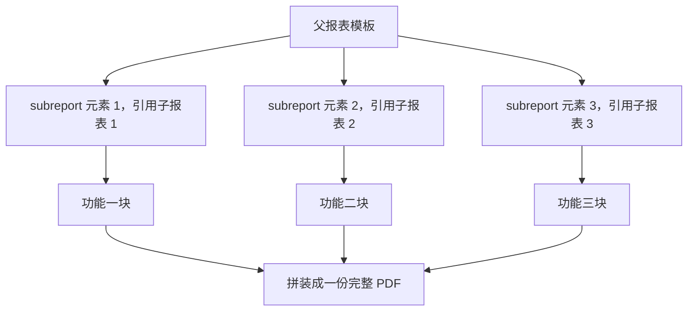
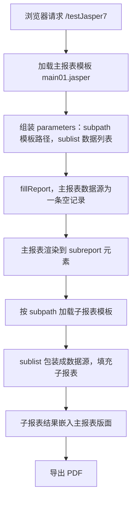

# 父子报表概述：subreport 拆解复杂 PDF 的两条路径

一个 PDF 模板里要塞几十上百个组件，全堆在一个文件里开发，改一处怕崩全篇；或者需求要「按部门分段，段头是部门名，段内再嵌一张该部门的用户小表」，Studio 的 Detail 只能一行行平铺，这种组内之表的版式根本画不出来。JasperReports 给出的答案是父子报表（subreport）：主报表里嵌子报表，大图拆成小块拼装。

## 先给结论

- 子报表是被主报表 subreport 元素引用的另一份模板，主报表填充到该元素时加载并填充子模板，输出结果当作一块内容嵌进主报表。
- 两大适用场景：一补 Studio 版式短板（组内嵌套明细表这类画不出的结构），二把超大报表按功能拆成多个子模板逐个开发。
- 主报表往子报表传东西全靠 parameters：一个参数传子报表模板路径，一个参数传子报表要的数据。
- 主报表自身可以不带业务数据，用 `JREmptyDataSource` 给一条空记录，让承载子报表的 band 恰好渲染一次。
- 子报表是独立模板，有独立的 fields 与数据源，主报表的数据不会自动渗透进去。

## 子报表是什么

类比理解：主报表像一个方法，subreport 元素像方法里的一次调用，子模板像被调用的方法，parameters 是实参，子报表渲染出的内容是返回值。讲义把这块拆成三个小节：4.1 概述、4.2 制作父报表、4.3 制作子报表，子报表的制作入口是 Palette 里的 Subreport 元素，把它拖到主报表工作区，再指明子模板与数据来源即可。

子模板本身仍是普通 jrxml：能编译、能单独填充、能单独预览。父子关系只在主模板被填充的那一刻才成立，引擎走到 subreport 元素，临时拉起一次子报表的完整填充，再把结果摆进主报表版面。



父报表与各子报表之间的连线，表达的就是这层引用与拼装关系。

## 场景一：补 Studio 版式的短板

回看此前的用户列表案例：企业 ID 固定，查出一批用户，模板逐行打 id、用户名、部门、手机。需求变了：按部门分段，段头是部门名，段内是该部门用户的紧凑小表，右侧原本的部门列删掉，等于做一次「列合并 + 分组嵌表」。

这个版式在 Studio 里画不出来：Detail 一行行平铺是它的骨架，部门名与用户小表的嵌套结构没有承载位。交给父子报表就顺了：主报表建组（分组表达式 `$F{dept}`），组头放部门名和一个 subreport 元素；子报表模板只负责画那张用户小表；数据由主报表按组切好递进去。版式难题拆成「主报表管分段、子报表管小表」两个各自能解的子问题，这正是子报表存在的第一价值：**Studio 画不出的地方，用嵌套模板补。**

## 场景二：大报表按功能拆分

另一类场景是内容太多。传统做法把所有组件塞进一个模板，有一百个组件就放一百个，开发与排错都是灾难，改一行文案也可能牵连整张版面。按功能切块：功能一、功能二、功能三各自一个小模板，主报表按顺序引用，每个子报表独立开发、独立测试。子报表一测通过再做子报表二，单元粒度小、混淆少，同一张小表还能被多个主报表复用。开发复杂报表的节奏由「一锅烩」变成流水线，这是子报表的第二价值：**大模板拆小，控制复杂度。**

## 主报表怎么把东西递给子报表

父子之间只有一条通道：主报表的 parameters。资料包工程的 `JasperController07` 是现成示例（包名已改为 `com.example`）：

```java
@RestController
public class JasperController07 {

    /** 父子报表 */
    @GetMapping("/testJasper7")
    public void createPdf(HttpServletRequest request, HttpServletResponse response) throws Exception {
        //1.引入jasper文件
        Resource resource = new ClassPathResource("templates/main01.jasper");
        FileInputStream fis = new FileInputStream(resource.getFile());

        //2.创建JasperPrint,向jasper文件中填充数据
        ServletOutputStream os = response.getOutputStream();
        try {
            Map parameters = new HashMap<>();
            //参数  子报表的路径   子报表需要的数据
            Resource subResout = new ClassPathResource("templates/testCharts.jasper");
            parameters.put("sublist", getUserCountList()); //子报表需要的数据
            parameters.put("subpath", subResout.getFile().getPath()); //子报表的路径

            JasperPrint print = JasperFillManager.fillReport(fis, parameters, new JREmptyDataSource());
            JasperExportManager.exportReportToPdfStream(print, os);
        } catch (JRException e) {
            e.printStackTrace();
        } finally {
            os.flush();
        }
    }

    public List<UserCount> getUserCountList() {
        List<UserCount> list = new ArrayList<>();
        UserCount uc1 = new UserCount("云图科技", 1000L);
        UserCount uc2 = new UserCount("星河软件", 1000L);
        UserCount uc3 = new UserCount("蓝湾数据", 1000L);
        list.add(uc1);
        list.add(uc2);
        list.add(uc3);
        return list;
    }
}
```

两个参数各司其职：

**subpath 传子报表模板路径。** `subResout.getFile().getPath()` 拿到的是磁盘绝对路径，主模板的 subreport 元素按它加载子模板文件。填充入口仍是 `main01.jasper`，也就是父报表。

**sublist 传子报表需要的数据。** 一个 `UserCount` 列表，原样放进 parameters，子报表填充时从主报表参数里取。

**主报表自己的数据源是 `new JREmptyDataSource()`。** 它只含一条空记录，作用是让承载 subreport 元素的 band 恰好输出一次；业务数据全部走参数，主报表不需要真实数据源。

主模板里 subreport 元素的核心声明（模板未随资料包提供，片段为按本课写法补全的示例）：

```xml
<subreport>
    <reportElement x="0" y="0" width="555" height="200"/>
    <dataSourceExpression><![CDATA[new net.sf.jasperreports.engine.data.JRBeanCollectionDataSource($P{sublist})]]></dataSourceExpression>
    <subreportExpression><![CDATA[$P{subpath}]]></subreportExpression>
</subreport>
```

`subreportExpression` 指向模板路径，`dataSourceExpression` 把 sublist 包装成 Bean 数据源。子报表模板里声明它自己的 fields（company、count），填充时从这份包装好的数据源取值，与一份普通报表无异。

数据流全景如下：



链路里最关键的一环是 C 到 G：父子之间不共享任何运行时状态，路径与数据都必须显式过 parameters 这座桥。

## 常见误区

- **以为子报表自动继承主报表数据**：子报表是独立的填充过程，主报表的 fields 它看不见，数据必须经 parameters 显式传递，或两边各自配数据源。
- **路径类型搞混**：`resource.getFile().getPath()` 给的是磁盘绝对路径，匹配按文件加载子模板的方式；模板打进 jar 包后 classpath 资源没有文件系统路径，`getFile()` 会抛异常，生产环境更稳的做法是走流。
- **子报表 fields 与传入数据对不上**：主报表传的列表元素是 `UserCount`，子报表 fields 却声明了别的属性名，填充报字段不存在。子报表按自己的 fields 从数据源取值，两边要事先约定。
- **主报表数据源为空或给了 null**：`JREmptyDataSource` 的意义是让 Detail 渲染一次；主报表数据源为空时，承载子报表的 band 一次都不输出，PDF 里子报表凭空消失。

## 面试可能被问到的问题

1. 面试官追问：「什么是父子报表，解决什么问题？」
   答：主报表通过 subreport 元素引用另一份模板，填充时引擎加载并填充子模板，结果嵌入主报表。它解决两类问题：Studio 画不出的嵌套版式，以及超大模板按功能拆分开发。

2. 面试官追问：「主报表怎么给子报表传数据？」
   答：经主报表 parameters，一个参数传子报表模板路径，一个参数传数据列表；模板里 subreportExpression 与 dataSourceExpression 分别引用这两个参数。子报表也可以配独立数据源。

3. 面试官追问：「主报表数据源为什么用 JREmptyDataSource？」
   答：它只含一条空记录，让承载 subreport 的 band 恰好输出一次；业务数据全走 parameters，主报表本身不需要真实数据。

4. 面试官追问：「子报表还能再嵌套子报表吗？」
   答：可以，subreport 引用的模板内部还可以再有 subreport，层层嵌套；嵌套过深会加重填充开销与排错成本，一般一到两层足够。

5. 面试官追问：「父子报表与分组报表怎么选？」
   答：普通的分段加小计用分组加变量即可，成本低；需要组内嵌独立小表、或整表庞大需要拆分复用时才上子报表，它灵活但引入多模板维护与传参成本。

6. 面试官追问：「模板打进 jar 后子报表路径用 getFile() 会怎样？」
   答：jar 内资源没有文件系统路径，ClassPathResource 的 getFile() 会抛 FileNotFoundException。应改用 getInputStream 获取流，子报表加载也按流处理。

## 配套资料

- 代码：`materials/code/02/day10-用户档案PDF报表/day10-用户档案PDF报表/代码/jasper-springboot/src/main/java/` 下 controller 包内 `JasperController07.java`（包名已改为 `com.example`）
- 数据载体：同工程 domain 包 `UserCount.java`
- 工程配置：`pom.xml`、`src/main/resources/application.yml`
- 模板 `main01.jasper` 与 `testCharts.jasper` 未随资料包提供，subreport 元素声明为按本课写法补全的示例
