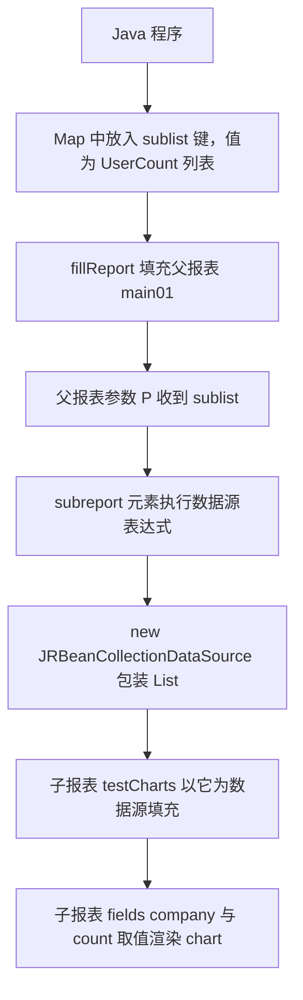

# 给子报表喂数据：父报表参数定义与数据源表达式

子报表单独渲染时一切正常，一旦拖进父报表、由 Java 程序填充，子报表的位置就空了。原因不复杂：Java 程序只填充父报表，数据先落在父报表手里，而子报表是父报表填充过程中才拉起的另一次独立填充，父子之间没有自动共享的状态。数据怎么从父报表递到子报表，就是这一篇要解决的问题。

## 先给结论

- 父子报表分两种形态：父报表不显示任何数据，纯粹当载体把子报表一块块拼进来；父报表显示一部分数据，另一部分难构造的内容交给子报表弥补。
- 父子之间传数据只有一条通道：父报表的 parameter。集合类型参数的 class 要选 `java.util.List`。
- 子报表组件的 Data Source Expression 里写 `new net.sf.jasperreports.engine.data.JRBeanCollectionDataSource($P{sublist})`，把参数里的 List 包装成引擎认得的数据源。
- field 干不了这件事：field 对应的是行数据的某个属性，往子报表传的是整个集合，必须走 parameter。
- 子报表组件的数据来源有三种：JavaBean 列表、数据库连接、空数据源，模板侧各对应一种表达式写法。

## 父报表的两种角色

按父报表有没有自己的数据，父子报表拆成两种做法。

**第一种，父报表纯当载体。** 它一个数据都不显示，Detail 里除了标题就是若干 subreport 元素，功能一块、功能二块各自对应一个子报表模板，填充父报表的过程就是把子报表一块块拼装进来的过程。整份 PDF 的版面由父报表定义，内容由子报表提供。

**第二种，父报表出一部分数据。** 表头、统计汇总这类父报表自己能构造的内容直接渲染，剩下的明细、图表交给子报表弥补。实际项目里第二种更常见，完全架空父报表反而浪费了它的 Detail 与分组能力。

接下来的案例是父报表 `main01` 里放一个标题和一个 subreport 元素，子报表复用图表课做好的 `testCharts` 模板，把那张按公司统计人数的 chart 图形嵌进来。操作路径：Studio 新建报表 `main01`，删掉 Page Header、Column Header 只留 Detail 与 Title，Title 放静态标题；再从 Palette 组件面板把 Subreport 组件拖进版面，向导问子报表从哪来时选 workspace 里现有的 `testCharts`。

## 参数怎么定义：List 类型的 parameter

`testCharts` 当初单独渲染时，吃的是 Java 程序里构造好的 `JRBeanCollectionDataSource`，数据是一个 `UserCount` 列表。现在填充入口换成父报表，这个列表必须先交到父报表手上。

先排除一条歧路：在父报表里定义 field 行不行？不行。field 是行数据的属性取值器，每次取一行里的一个字段，而要传给子报表的是一整个集合，粒度对不上。

正确的载体是 parameter。parameter 背后是一个 Map，既能放普通键值，也能放一个 List 集合，集合走 parameter 名正言顺。在父报表里创建参数，名字取 `sublist`，class 在类型选择框里搜索 `list`，选 `java.util.List`。落到 jrxml 上就是一行声明（模板片段为按本课写法补全的示例）：

```xml
<parameter name="sublist" class="java.util.List"/>
```

Java 程序那一侧，调用 `fillReport` 前往 Map 里放一个同名键，值就是子报表要的数据列表（资料包工程 `JasperController07` 的片段，包名已改为 `com.example`）：

```java
Map parameters = new HashMap<>();
//key 对应父报表的参数名 sublist，value 是子报表需要的集合
parameters.put("sublist", getUserCountList());
```

`UserCount` 是资料包工程里的数据载体类，两个字段正好对应图表的两个维度：

```java
public class UserCount {
    private String company; //公司名，图表的类别轴
    private Long count;     //人数，图表的数值

    public UserCount(String company, Long count) {
        this.company = company;
        this.count = count;
    }
    // getter/setter 省略
}
```

到这里父报表已经拿到了 List，剩下一件事：填充到 subreport 元素时，把这个 List 递给子报表。

## 数据源表达式：把 List 包装成数据源

子报表组件的属性面板里有一组 Subreport 相关配置，Connection Expression 那一栏是给数据库连接方式准备的，用不上，删掉；关键的一栏叫 Data Source Expression，含义是「子报表的数据从哪来」。

回忆单独渲染 chart 图形时 Java 代码里的那行 `new JRBeanCollectionDataSource(userList)`：引擎要的不是裸 List，而是包装过的数据源对象。当时这行代码写在 Java 程序里，现在它要搬进模板表达式里。点击 Data Source Expression 的编辑框，先在下方的 value class 里搜索 `JRBeanCollectionDataSource` 定位到类，再写构造表达式：

```xml
<dataSourceExpression>
    <![CDATA[new net.sf.jasperreports.engine.data.JRBeanCollectionDataSource($P{sublist})]]>
</dataSourceExpression>
```

`$P{sublist}` 就是刚定义的父报表参数，new 出来的数据源对象交给子报表当数据来源。表达式写完编辑器没有红叉，说明语法与类型对上了；有红叉基本是类名拼错或参数名不一致，逐项核对即可。

整条数据链画出来是这样：



链路里最值得盯的是 E 到 F 这一环：父报表只是中转站，自己不消费这个 List，真正把 List 变成可填充数据源的是模板里那个 new 表达式。

## 子报表数据源的三种来源

Data Source Expression 并不只有一种写法，与主报表填充支持的数据源一一对应：

| 来源 | 表达式写法 | 适用场景 |
|---|---|---|
| JavaBean 列表 | `new JRBeanCollectionDataSource($P{sublist})` | 数据在内存对象集合里，最常用 |
| 数据库连接 | 走 Connection Expression 传连接对象 | 子报表数据直接来自 SQL 查询 |
| 空数据源 | `new JREmptyDataSource()` | 子报表是纯静态版式，不需要行数据 |

三种来源可以混用：父报表里放多个 subreport 元素，一个吃列表、一个吃连接、一个纯静态，各自独立传参互不影响。案例里的 chart 子报表走的是第一种。

## 常见误区

- **在父报表里定义 field 想传集合**：field 只能按行取属性，装不下一个 List，集合必须走 `java.util.List` 类型的 parameter。
- **参数名两边对不上**：Java 程序里 `parameters.put("sublist", ...)`，模板里却写成 `$P{subList}`，填充时取到 null，子报表渲染成空白。parameter 名区分大小写，两处必须逐字符一致。
- **表达式里忘了写全限定类名**：模板表达式里只写 `new JRBeanCollectionDataSource(...)` 会因类找不到而报错，要用完整包名 `net.sf.jasperreports.engine.data.JRBeanCollectionDataSource`。
- **误用 Connection Expression 传列表**：那一栏是给数据库连接方式用的，列表数据要配在 Data Source Expression。

## 面试可能被问到的问题

1. 面试官追问：「父子报表之间怎么传数据？」
   答：全部经过父报表的 parameters。Java 程序往 Map 里放数据，父报表用 parameter 声明接住，subreport 元素再通过数据源表达式引用该参数，把 List 包装成 JRBeanCollectionDataSource 交给子报表。父子之间没有自动共享的状态。

2. 面试官追问：「为什么传集合用 parameter 而不是 field？」
   答：field 的语义是行数据的一个属性，按行逐条取值；要传给子报表的是完整集合，粒度不同。parameter 的背后是一个 Map，可以放任意对象包括 List，所以集合走 parameter。

3. 面试官追问：「subreport 元素的 Data Source Expression 和 Connection Expression 有什么区别？」
   答：Data Source Expression 指定子报表用哪个现成的数据源对象，比如包装好的 JRBeanCollectionDataSource；Connection Expression 用于把数据库连接传给子报表，让子报表内部按自己的 SQL 查询取数。两者按子报表取数方式二选一。

4. 面试官追问：「父报表不显示数据，数据源给什么？」
   答：给 `new JREmptyDataSource()`，它只含一条空记录，让承载 subreport 元素的 band 恰好渲染一次；业务数据全部走参数，父报表本身不需要真实数据源。

5. 面试官追问：「父报表能同时给多个子报表传不同的数据吗？」
   答：可以。每个 subreport 元素各自配数据源表达式，引用不同的参数即可，例如 `sublist1`、`sublist2`，Java 侧往 Map 里放对应键值，多个子报表互不干扰。

## 配套资料

- 代码：`materials/code/02/day10-用户档案PDF报表/day10-用户档案PDF报表/代码/jasper-springboot/src/main/java/` 下 controller 包 `JasperController07.java`（包名已改为 `com.example`）
- 数据载体：同工程 domain 包 `UserCount.java`（company、count 两字段）
- 对照参考：同目录 `JasperController06.java` 是 chart 子报表单独渲染时的写法，可对比出「包装数据源」这一步从 Java 代码搬进模板表达式的过程
- 父报表 `main01` 与参数声明、数据源表达式对应的 jrxml 片段未随资料包提供，按本课写法补全并已在文中注明
