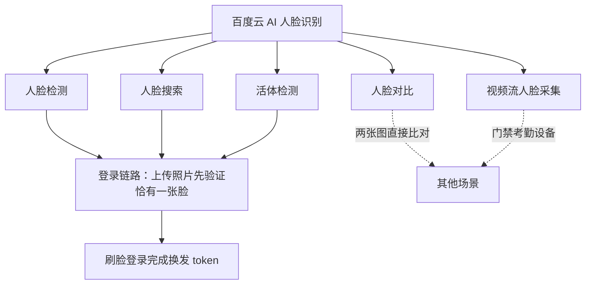

# 百度云 AI 人脸识别开放能力盘点：功能、鉴权与接入步骤

选型已定：刷脸登录的比对能力采购百度云 AI。动手编码之前，先把它的人脸识别产品摸一遍：开放了哪些功能点、每个功能在登录链路里站哪个位置、Java 工程用什么方式接入鉴权。这一课是后续所有刷脸编码的地图。

## 先给结论

- 百度云 AI 的人脸识别基于深度学习方案，开放五大能力：人脸检测、人脸对比、人脸搜索、活体检测、视频流人脸采集。
- 刷脸登录主要消费其中三个：人脸注册建档、人脸搜索比对、活体检测防作弊；对比接口用于两张图直接比较，本流程用得少。
- 接入鉴权靠三元组：控制台创建应用后拿到 AppID、API Key、Secret Key，Java SDK 用这三个值构造 `AipFace` 客户端；走 REST 时则用 API Key 与 Secret Key 换取 access_token。
- 密钥属于敏感凭证，配置里一律打码管理，不能硬编码进代码仓库。
- 开发四步：注册账号创建应用、搭建工程导入依赖、人脸注册、人脸识别。

## 平台与产品入口

百度云官网是 cloud.baidu.com，左侧产品线覆盖计算、网络、存储、安全等品类，其中人工智能板块是当前热度最高的一块，里面又细分语音识别、视频识别、图像识别等方向。本课程只取其中一个产品：人脸识别。它是基于深度学习的人脸识别方案，准确识别图片中的人脸信息，把能力以接口形式开放给开发者，无需关心模型训练。

## 五大人脸能力

讲义上列出的功能点，按「输入输出」来理解最清楚：

**第一，人脸检测。** 精准定位图中人脸，获得眼、口、鼻等 72 个关键点位置，并分析性别、年龄、表情等多种人脸属性。回答的问题是「这张图里有没有脸、脸在哪、长什么样」。

**第二，人脸对比。** 对比两张人脸的相似度，给出相似度评分，从而判断是否同一人。输入是两张图，输出是一个分数。

**第三，人脸搜索。** 针对一张人脸照片，在指定人脸集合（人脸库）中搜索，找出最相似的一张或多张人脸并给出相似度分值。人脸库是平台侧提供的存储空间，把用户照片与人脸档案提前注册进去，之后一图进、百图比，登录场景用的是它。

**第四，活体检测。** 提供离线与在线两种方式的活体检测能力，判断操作者是真人还是照片、视频、模具等作弊攻击。只做比对不验活体，拿一张照片怼到摄像头前就能冒名登录，这层防护在有安全要求的场景必须开。

**第五，视频流人脸采集。** 设备端离线实时监测视频流中的人脸，同时支持处理静态图片或视频流，输出人脸图片并进行图片质量控制，多用在门禁、考勤机这类设备侧场景。

这些能力与刷脸登录的对应关系如下：



实线是本课程登录链路实际消费的三项：检测做入口校验、搜索做身份比对、活体参数做防作弊；虚线两项在本需求中用不到，但选型盘点时要心里有数。

## 开发四步与鉴权三元组

平台的开发步骤就四步：注册账号创建应用，搭建工程导入依赖，人脸注册，人脸识别。创建应用是关键一步，控制台会为每个应用签发三个凭证：

- **AppID**：应用标识，标明调用来自哪个应用。
- **API Key**：接口公钥性质的访问键。
- **Secret Key**：接口私钥，与 API Key 配对使用，必须严格保密。

Java SDK 的鉴权方式就是拿三元组构造客户端；如果直接调 REST 接口，则用 API Key 与 Secret Key 向鉴权服务换取有效期为 30 天的 access_token，之后每次请求带上它。两种方式底层是同一套凭证体系，SDK 只是替开发者管了换 token 与续期的脏活。

凭证打进工程的标准做法是放进 `application.yml`，用占位符隔离敏感值（以下为打码示例，真实值从控制台获取）：

```yaml
ai:
  appId: 24041xxx          # AppID，打码示例
  apiKey: 8sQZx9xxxxxxx    # API Key，打码示例
  secretKey: 6GwYb2xxxxxxx # Secret Key，打码示例
  imageType: BASE64        # 提交给平台的图片形态
  groupId: example-face    # 自定义人脸库分组标识
```

工程里用一个工具类统一封装 SDK（来自课程资料，包名已改为 `com.example`）：

```java
@Component
public class BaiduAiUtil {

    @Value("${ai.appId}")
    private String APP_ID;
    @Value("${ai.apiKey}")
    private String API_KEY;
    @Value("${ai.secretKey}")
    private String SECRET_KEY;
    @Value("${ai.imageType}")
    private String IMAGE_TYPE;
    @Value("${ai.groupId}")
    private String groupId;

    private AipFace client;
    private HashMap<String, String> options = new HashMap<String, String>();

    public BaiduAiUtil() {
        options.put("quality_control", "NORMAL");  //图片质量控制
        options.put("liveness_control", "LOW");    //活体检测控制
    }

    @PostConstruct
    public void init() {
        client = new AipFace(APP_ID, API_KEY, SECRET_KEY);
    }
}
```

三个凭证经 `@Value` 从配置注入，容器启动后 `@PostConstruct` 里构造出 `AipFace` 客户端，之后所有接口调用共享这一个实例。`options` 里两个参数值得注意：`quality_control` 要求平台对上传图片做常规质量控制，糊图直接拒绝；`liveness_control` 把活体检测控制挂在注册与搜索动作上，LOW 档在体验与安全间取平衡，安全要求高的场景可以调高档位。

SDK 的 Maven 坐标是官方发布的 `java-sdk`（示例写法，引入后传递依赖会带上内部封装的 JSON 与 HTTP 组件）：

```xml
<dependency>
    <groupId>com.baidu.aip</groupId>
    <artifactId>java-sdk</artifactId>
    <version>4.16.18</version>
</dependency>
```

## 人脸库与两个核心动作

人脸库是理解搜索能力的前提。平台按 `groupId` 划分人脸组，组内每条档案是一个 `userId` 对应一张人脸照片。注册与搜索两个动作构成闭环：

```java
/**
 * 人脸注册：将用户照片存入人脸库中
 */
public Boolean faceRegister(String userId, String image) {
    JSONObject res = client.addUser(image, IMAGE_TYPE, groupId, userId, options);
    Integer errorCode = res.getInt("error_code");
    return errorCode == 0 ? true : false;
}

/**
 * 人脸查找：查找人脸库中最相似的人脸并返回数据
 */
public String faceSearch(String image) {
    JSONObject res = client.search(image, IMAGE_TYPE, groupId, options);
    //取出 user_list 中得分最高者，score 大于 80 即认定同一人，返回其 user_id
}
```

`faceRegister` 把照片挂到 `groupId` 组的 `userId` 档案下，员工入驻时调用一次；`faceSearch` 登录时调用，平台在整组人脸里算相似度，返回按分值排序的候选列表，业务侧用阈值过滤。配合前面 `faceCheck` 的检测入口校验，刷脸登录所需的全部云侧能力就绪，下一课开始把它们编排进登录流程。

## 常见误区

- **密钥硬编码或整段贴进仓库**：API Key 与 Secret Key 等同账号凭证，泄露即被人盗刷计费。应放配置文件占位符、环境变量或配置中心，仓库里只保留打码示例。
- **拿人脸对比当人脸搜索用**：对比接口只处理两张图一对一，登录场景是「一图对全库」，要用搜索接口；反过来说，只有两张固定照片要核验时，对比接口更直接。
- **忽略活体检测**：只调比对接口的刷脸登录，一张清晰照片即可绕过。注册与搜索时通过 `liveness_control` 参数把活体控制挂上，才有防照片与视频攻击的能力。
- **跳过质量控制直接入库**：模糊、多脸、遮挡图片注册进人脸库会拉低整库搜索质量，`quality_control` 参数应在注册阶段就开启，不合格图片入口拦截。

## 面试可能被问到的问题

1. 面试官追问：「百度云 AI 的鉴权是怎么做的？」
   答：控制台创建应用后签发 AppID、API Key、Secret Key 三元组。Java SDK 直接用三元组构造 AipFace 客户端；REST 调用则用 API Key 与 Secret Key 换取约 30 天有效期的 access_token，请求时携带。SDK 封装了换票与续期细节。

2. 面试官追问：「人脸库、groupId、userId 是什么关系？」
   答：人脸库按 groupId 分组隔离，组内以 userId 为档案标识挂人脸照片。注册时 addUser 指定图片、groupId 与 userId，搜索时 search 限定 groupId 在组内比对，命中结果返回 userId 与相似度评分，业务靠它定位到系统用户。

3. 面试官追问：「活体检测是必须的吗，它防什么？」
   答：做登录类功能必须有。没有活体校验的比对接口，用照片、录屏视频甚至 3D 模具都能骗过。活体检测通过判断成像特征区分真人与攻击介质，平台提供离线与在线方式，可经 liveness_control 参数挂到注册与搜索动作上。

4. 面试官追问：「人脸检测、对比、搜索三个接口分别什么时候用？」
   答：检测做入口校验，确认图里有一张可处理的人脸并拿到关键点；对比做一对一核验，两张固定照片比相似度；搜索做一对多识别，一张照片到人脸库里找最相似档案。刷脸登录是检测加搜索的组合。

5. 面试官追问：「相似度评分的阈值为什么定 80 分？」
   答：80 是课程采用的经验值，平衡了误识与通过。实际定阈值要拿真实样本测试不同分数线下的误识率与拒识率，安全敏感场景调高阈值宁可多拦，体验优先场景适当放宽，并配合活体档位一起调。

## 配套资料

- 工具类：`materials/code/02/day11-刷脸登录/day11-刷脸登录/资源/代码/工具类/BaiduAiUtil.java`（鉴权注入、options 参数、faceRegister 与 faceSearch 为原样引用，包名已改为 `com.example`）
- 二维码与登录实体：同目录 `实体类/QRCode.java`、`实体类/FaceLoginResult.java`
- 控制器与服务骨架：同目录 `controller/FaceLoginController.java`、`service/FaceLoginService.java`
- 百度云 AI 控制台创建应用与密钥获取、SDK Maven 坐标未随资料包提供，文中 `application.yml` 密钥为打码示例，依赖坐标按官方 SDK 补全
