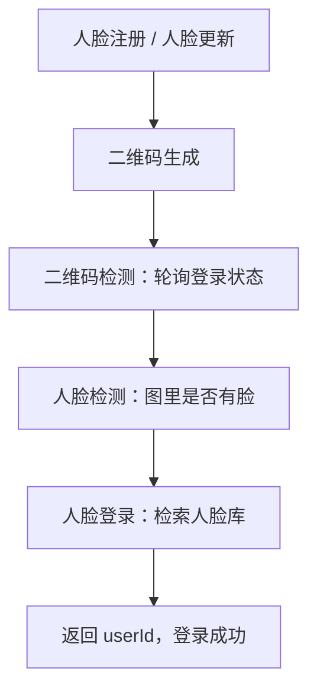
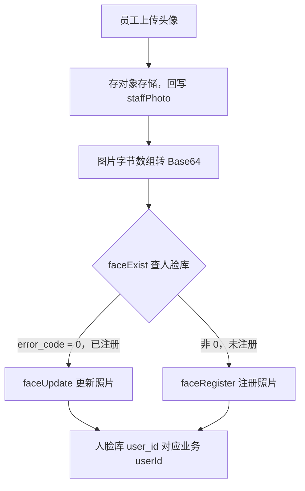

# 刷脸登录第一步：员工上传头像时，顺手把脸注册进人脸库

环境搭好了，开始填业务代码。刷脸登录要解决五件事：人脸注册与人脸更新、二维码生成、二维码检测、人脸检测、人脸登录。顺序不能乱，第一件是地基：人脸库里没有某个人的脸，后面扫码、拍照、检索全都无从谈起。这一课把「注册」和「更新」落到员工头像上传的流程里，并讲清人脸库中 code 与 userId 的关联设计。

## 先给结论

- 人脸注册不新开接口，挂在员工头像上传的 Service 方法里：照片存完对象存储，顺带把同一张图注册进人脸库。
- 注册还是更新由 `faceExist` 判断：`client.getUser(userId, groupId, options)` 返回 `error_code` 为 0 即已注册，已注册走 `faceUpdate`，未注册走 `faceRegister`。
- 人脸库以业务 userId 作 `user_id`、按 `groupId` 分组，刷脸检索命中后返回的 `user_id` 就是用户 ID，凭它可以查用户、发令牌，不需要额外的映射表。
- 注册与更新接口的第二个参数都是图片的 Base64 字符串，`imageType` 固定 `BASE64`。
- Controller 层不动，改动全部收在 Service 与工具类里，业务逻辑不下沉到接口层。

## 五件事的依赖关系

五个功能点不是并列的清单，而是一条链上的五环：



每一环都消费上一环的产物：没有注册，检索永远查不到人；没有二维码，手机端拿不到 code；没有检测，垃圾图片会白白消耗检索的调用量。本课只动第一环，其余四环在后续课程依次填充。

## 注册动作挂在哪里

打开系统页面走一遍员工管理：查看某个员工的详情，里面有「员工照片」接口，此前已经实现为把照片上传到对象存储，再把返回的地址写进 `staffPhoto` 字段。真正的业务诉求是：员工补充头像照片时，既要把照片存到对象存储，也要把这张照片注册进百度云 AI 的人脸库；两年后面部变了重新上传，则要对人脸库做更新。

功能落点因此选定在上传头像的 Service 方法，Controller 的接口签名、路由、返回值一概不变：

```java
public String uploadImage(String id, MultipartFile file) throws IOException {
    User user = userDao.findById(id).get();
    // 上传到对象存储
    String imgUrl = new QiniuUploadUtil().upload(user.getId(), file.getBytes());
    user.setStaffPhoto(imgUrl);
    userDao.save(user);
    // 上传之后，将图片注册或更新到人脸库（本课新增，见下节）
    return imgUrl;
}
```

前半段是既有逻辑：`QiniuUploadUtil` 用用户 ID 作文件名上传，拿到外链后回写员工表。人脸库操作插在保存之后、返回之前，方法体按课程实现补全，`QiniuUploadUtil` 工具类是资料包里的真实文件。

## 先判断，再决定注册还是更新

麻烦在于同一个上传入口承载两种语义：老员工换照片是人脸更新，新员工第一次传是人脸注册。判断依据不能靠业务表猜，直接问人脸库。给 `BaiduAiUtil` 补一个查询方法：

```java
/**
 * 判断用户是否已经注册了人脸信息
 */
public Boolean faceExist(String userId) {
    JSONObject res = client.getUser(userId, groupId, null);
    return res.getInt("error_code") == 0;
}
```

`getUser` 按用户 ID 和组 ID 查询人脸库，用户存在时返回 `error_code` 为 0，不存在时返回非 0 错误码。判断逻辑一行收尾，跟工具类里其他方法的风格保持一致。这个方法未包含在资料包的 `BaiduAiUtil.java` 中，为按本课视频写法补全。

Service 里注入工具类并做分支编排：

```java
@Autowired
private BaiduAiUtil baiduAiUtil;

public String uploadImage(String id, MultipartFile file) throws IOException {
    User user = userDao.findById(id).get();
    String imgUrl = new QiniuUploadUtil().upload(user.getId(), file.getBytes());
    user.setStaffPhoto(imgUrl);
    userDao.save(user);
    // 图片转 Base64 字符串
    String imgBase64 = Base64Utils.encodeToString(file.getBytes());
    // 判断是否已注册：已注册更新，未注册注册
    Boolean exist = baiduAiUtil.faceExist(id);
    if (exist) {
        baiduAiUtil.faceUpdate(id, imgBase64);
    } else {
        baiduAiUtil.faceRegister(id, imgBase64);
    }
    return imgUrl;
}
```

照片的原始字节数组 `file.getBytes()` 经 Base64 编码后传给工具类，`faceRegister` 与 `faceUpdate` 的第二个参数正是这串字符。整个编排只有一层 if，语义却完整覆盖了首次录入与照片变更两种场景。



## code 与 userId 的关联设计

人脸库的存储模型是「组 + 用户 + 照片」：`groupId` 划分命名空间，同一套应用往一个组里存；`user_id` 是用户在该组内的唯一标识。课程调用 `client.addUser(image, IMAGE_TYPE, groupId, userId, options)` 时，第四个参数直接传业务表的用户主键。

这个选择的收益在登录那一刻兑现：手机拍照上传后，`faceSearch` 在人脸库里跑全量比对，返回相似度最高候选的 `user_id`，它就是业务系统的 userId，后端拿它直接查用户、签发令牌，中间不需要任何「人脸 ID 到用户 ID」的翻译表。脸本身成了凭证，注册时埋下的 userId 就是解码钥匙。

落地页与二维码的关联也在同一套编号体系里：二维码内容携带的 code 是登录会话的唯一标志，与 userId 无关；userId 在刷脸检索命中后才登场，由后端写进 Redis 的登录结果里，登录页轮询拿到 token 与 userId 完成跳转。两条编号线各司其职，code 管「这一轮扫码」，userId 管「这个人是谁」。

## 验证一把

改动完成后重启系统微服务，从页面重新上传一张新照片。到云控制台的人脸库页面刷新：组里从空变成一条用户记录，照片就是刚传的那张；换一张照片再传一次，记录数量不变，点进详情能看到照片已被替换。注册与更新两条路径都在真实接口上走通了，增加的代码只是工具类里一个查询方法加 Service 里一层分支判断。

## 常见误区

- **每次上传都无脑调 `addUser`**：同一 `user_id` 在人脸库已存在时再注册会返回错误码，照片也换不掉。必须先 `faceExist` 探一下，已注册走 `faceUpdate`。
- **给百度接口传带头的 Base64**：前端展示要用 `data:image/png;base64,` 开头的完整 DataURL，调人脸接口却只收纯 Base64 字符串，带了头反而解析失败。两条链路的格式要求相反，别混用。
- **`user_id` 用手机号这类可变字段**：人脸库里的用户标识改起来麻烦，一旦业务侧变更就两边对不上。用不可变的业务主键最稳。
- **只注册不更新**：人脸会随时间变化，注册一次用五年的库，识别分数会逐年下滑。上传入口的更新分支就是给这个隐患兜底的。

## 面试可能被问到的问题

1. 面试官追问：「人脸注册为什么挂在头像上传里，而不是做一个独立接口？」
   答：上传头像的业务动作本身就带着「录入此人面部信息」的语义，顺路完成注册不需要用户额外操作，数据也天然一致：展示用的照片与人脸库里的照片是同一张。独立接口反而要处理用户只注册不传头像的中间态。

2. 面试官追问：「注册和更新怎么自动区分？」
   答：调人脸库的 `getUser` 查询该用户是否已存在，`error_code` 为 0 说明已注册，走 `faceUpdate` 覆盖旧照片；非 0 说明库里没这个人，走 `faceRegister` 新增。判断依据来自人脸库本身，不依赖业务表的状态字段。

3. 面试官追问：「人脸库的 user_id 为什么直接用业务 userId？」
   答：刷脸检索返回的就是命中的 `user_id`，用业务主键可以让登录流程零翻译：拿到检索结果直接查用户、发令牌。若另造一套人脸 ID，中间还得维护映射关系，多一层不一致风险。

4. 面试官追问：「传给人脸注册接口的图片参数是什么格式？」
   答：图片字节数组经 Base64 编码后的纯字符串，不带 DataURL 头，`imageType` 参数声明为 `BASE64`。注意与前端展示场景区分：`` 渲染才需要 `data:image/png;base64,` 前缀。

5. 面试官追问：「`getUser` 查询不存在时会抛异常吗，怎么判断？」
   答：不抛异常，返回结果里带非 0 的 `error_code` 表示用户不存在。百度云接口的错误约定是 `error_code` 为 0 才代表成功，业务侧统一按这个约定解析返回的 JSON，不做异常分支。

## 配套资料

- 百度 AI 工具类：`materials/code/02/day11-刷脸登录/day11-刷脸登录/资源/代码/工具类/BaiduAiUtil.java`（真实文件，含 faceRegister、faceUpdate、faceCheck、faceSearch；`faceExist` 方法为按本课视频写法补全）
- 对象存储工具类：`materials/code/02/day09 图片上传及Jasper/图片上传及Jasper/资源/后端工具代码/QiniuUploadUtil.java`（真实文件）
- UserService 中的 `uploadImage` 编排代码未随资料包提供，文中方法体为按本课写法补全的示例，工具类调用方式与资料包一致
