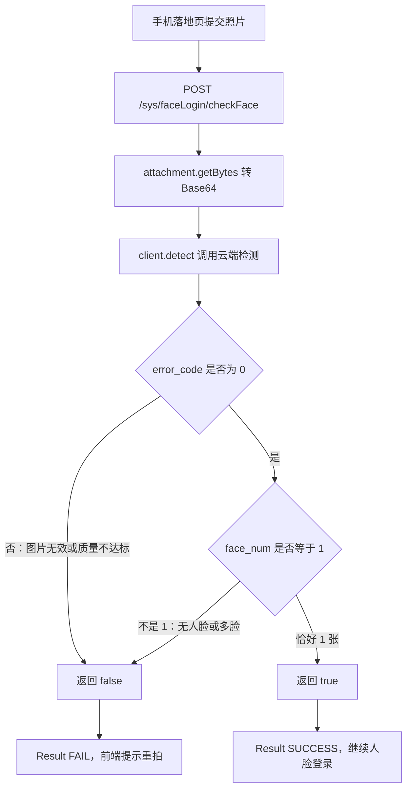

# 人脸检测接口：拍照上传之前，先回答「这张图里到底有没有一张脸」

刷脸登录链路里，手机落地页拿到摄像头照片后不能直接拿去人脸库检索，检索是按次计费的云服务调用，一张模糊的、没有人脸的、一次拍到好几个人的图提交上去，只会白白烧掉一次调用还注定失败。所以检索之前先做一道廉价的前置闸门：人脸检测。这一课实现 `POST /sys/faceLogin/checkFace`，后端用百度的 detect 接口判断图片里是否恰好有一张有效人脸，前端据此决定要不要继续走登录。

## 先给结论

- 接口形态是 `POST /sys/faceLogin/checkFace`，参数 `@RequestParam(name = "file") MultipartFile attachment`，后端视角里摄像头拍摄的照片就是一个上传文件。
- 图片转 Base64 只有两步：`Base64Utils.encode(attachment.getBytes())`，Spring 自带的 `Base64Utils` 足够，不必引第三方工具。
- 核心判断在 `BaiduAiUtil.faceCheck`：调 `client.detect(image, IMAGE_TYPE, options)`，`error_code == 0` 且 `face_num == 1` 才返回 true，其余一律 false。
- Controller 拿布尔结果二选一：true 返回 `ResultCode.SUCCESS`，false 返回 `ResultCode.FAIL`，前端只看 `success` 字段。
- 工具类构造时预置了 `quality_control` 与 `liveness_control` 两个选项，检测阶段就已经把图片质量与活体要求交给云端把关。

## 后端拿到的只是文件，摄像头的事前端自理

人脸检测接口的设计出发点很简单：前端不管用什么姿势调用摄像头，最终送到后端的都是一个标准的上传文件。后端既不关心 getUserMedia 怎么取流，也不关心照片是手动点击拍的还是定时器自动截的，`MultipartFile` 一律照单全收。Controller 层保持极薄：

```java
/**
 * 图像检测，判断图片中是否存在面部头像
 */
@RequestMapping(value = "/checkFace", method = RequestMethod.POST)
public Result checkFace(@RequestParam(name = "file") MultipartFile attachment) throws Exception {
    // 1. 文件转 Base64 字符串
    String image = Base64Utils.encode(attachment.getBytes());
    // 2. 调用工具类判断是否为有效人脸
    Boolean aBoolean = baiduAiUtil.faceCheck(image);
    if (aBoolean) {
        return new Result(ResultCode.SUCCESS);
    } else {
        return new Result(ResultCode.FAIL);
    }
}
```

文件转字符串用的是 Spring 的 `Base64Utils`，资料包里这个控制器文件的 import 列表里就有它。云端 SDK 的 detect 接口接收 BASE64 类型的图片数据，`@Value("${ai.imageType}")` 注入的 `IMAGE_TYPE` 常量在人脸注册那一课已定为 `BASE64`，两侧约定一致，转码之后直接透传。

## faceCheck：一次 detect 调用里的两道关卡

工具类的方法是这一课真正的业务内核，资料包里的 `BaiduAiUtil.java` 提供了完整实现：

```java
/**
 * 人脸检测：判断上传图片中是否具有面部头像
 */
public Boolean faceCheck(String image) {
    JSONObject res = client.detect(image, IMAGE_TYPE, options);
    if (res.has("error_code") && res.getInt("error_code") == 0) {
        JSONObject resultObject = res.getJSONObject("result");
        Integer faceNum = resultObject.getInt("face_num");
        return faceNum == 1 ? true : false;
    } else {
        return false;
    }
}
```

这段代码里藏着两道关卡。**第一道是调用是否成功。** 云端接口的应答里 `error_code` 不为 0 意味着调用本身出了问题：图片无法解析、格式不支持、质量分低于阈值被拒收，任何一种都到不了「数人脸」那一步，直接按 false 处理。**第二道是脸的数量。** `face_num == 1` 是刻意的严格判定：刷脸登录的场景里，一张照片里出现两张以上的脸，说明拍摄环境不可控，宁可让用户重拍也不能猜。很多人直觉上会写成 `faceNum > 0`，对登录场景而言这是把风险放进系统。

`options` 里预置的两个参数值得单独记一笔，它们在 `BaiduAiUtil` 的构造方法里初始化：

```java
public BaiduAiUtil() {
    options.put("quality_control", "NORMAL");
    options.put("liveness_control", "LOW");
}
```

`quality_control` 设为 NORMAL 表示对图片质量做常规校验，模糊图会被云端直接判为 error_code 非零；`liveness_control` 设为 LOW 表示启用初步的活体检测，纯屏幕翻拍的照片在这道关卡就有机会被拦下。这两个参数让 detect 的返回值同时携带了质量与活体信息，前置闸门的可靠性比裸调用高得多。

## 测试：一张有人脸的图和一张 logo 图

接口写完重启系统微服务，用 Postman 建一个 POST 请求到 `localhost:9002/sys/faceLogin/checkFace`，Body 选 `form-data`，key 填 `file`（必须与方法上 `@RequestParam(name = "file")` 的名字一致），类型选 File，选文件上传。测试素材用两张图对照：

- `logo` 图（无人脸）：返回 `success: false, code: 10004, message: 操作失败`，对应 faceCheck 判 false 走 FAIL 分支。
- `001` 图（标准人脸照）：返回操作成功，检测通过。

一张图判定结果的差异完全来自云端 detect 的应答，后端没有写任何本地图像处理代码。这条链路的意义也在这里：用一次成本很低的云端调用，把明显无效的照片挡在人脸库检索之前。



从入口到出口一共两次判定，任何一次不过都走 FAIL。图里最右侧的成功分支才是人脸登录的起点，下一课的人脸搜索只接受走完这条分支的照片。

## 常见误区

- **把判定写成 `faceNum > 0`**：多人合照也能通过检测，登录环节会拿一张「不确定是谁的脸」去检索。刷脸登录必须 `face_num == 1`，严格到恰好一张。
- **表单参数名对不上**：Postman 或前端 FormData 里的 key 写成 `image`、`photo`，与方法声明的 `name = "file"` 不一致，Spring 直接抛缺少参数的异常。表单 key 与注解名必须逐字符一致。
- **请求体没用 form-data**：上传二进制文件时选了 x-www-form-urlencoded 或 raw，后端拿到的 `MultipartFile` 为空。文件上传必须用 multipart/form-data，前端单独为这个接口封装了带 `multipart/form-data` 头的请求方法。
- **忽略 error_code 直接取 result**：图片质量太差时云端返回体里可能没有 `result` 字段，先 `res.has("error_code")` 判零再取数，避免 JSONException。质量把关已经由 quality_control 选项接管，返回 false 是正常业务结果而不是异常。

## 面试可能被问到的问题

1. 面试官追问：「人脸检测和人脸搜索在刷脸登录里各承担什么职责，为什么检测是必需的？」
   答：检测回答「图里是否恰好有一张有效人脸」，搜索回答「这张脸是人脸库里的谁」。检测在前做拦截，无效照片根本不进检索，节省按次计费的搜索调用量，也让失败提示更精确：是照片问题还是认不出人，两种失败可以分开处理。

2. 面试官追问：「`quality_control` 和 `liveness_control` 两个选项有什么用？」
   答：quality_control 控制云端对图片质量的校验等级，过低质量直接返回错误码；liveness_control 控制活体检测强度，能拦住照片翻拍这类攻击。刷脸登录里即便 LOW 级别也值得开启，配合业务侧的 face_num 判定，把假脸攻击的成本抬高。

3. 面试官追问：「为什么图片要转 Base64 传输，直接传字节流不行吗？」
   答：云端 SDK 的 detect 与 search 接口约定 image 参数为 Base64 字符串（imageType 为 BASE64），这是接口契约。Base64 编码后是纯文本，嵌入 JSON 请求体也方便，代价是体积增大约三分之一，对单张照片的场景完全可以接受。

4. 面试官追问：「checkFace 接口失败时为什么返回 FAIL 而不是抛异常？」
   答：检测不通过是正常业务分支，不是系统错误。照片里没有脸、图片模糊都是用户可理解、可纠正的情况，用统一的 Result 结构带业务码返回，前端据此提示重拍；抛异常则会被全局异常处理器兜底成服务器错误，语义不对。

5. 面试官追问：「检测通过的照片可以直接存进数据库吗？」
   答：checkFace 是一次性闸门，它返回的只有布尔结果，没有携带照片的存储信息。落地页提交的这张照片只用于检测与检索，用户的正式头像仍以员工上传到对象存储的照片为准，两者在业务上是两份独立的数据。

## 配套资料

- 控制器：`materials/code/02/day11-刷脸登录/day11-刷脸登录/资源/代码/controller/FaceLoginController.java`（真实文件，`checkFace` 方法签名、`/checkFace` 路由与 `Base64Utils` import 为资料包原样，方法体按本课视频补全）
- 人脸工具类：`materials/code/02/day11-刷脸登录/day11-刷脸登录/资源/代码/工具类/BaiduAiUtil.java`（真实文件，`faceCheck` 方法与 options 预置项均为资料包原样实现）
- 前端检测调用方：`materials/code/02/day11-刷脸登录/day11-刷脸登录/资源/代码/前端页面改造/facelogin.vue`（真实文件，canvas 截图后 FormData 提交 checkFace）
- 前端 API 封装：`materials/code/02/day11-刷脸登录/day11-刷脸登录/资源/代码/前端页面改造/api/base/faceLogin.js`（真实文件，checkFace 单独封装了 `multipart/form-data` 请求头）
