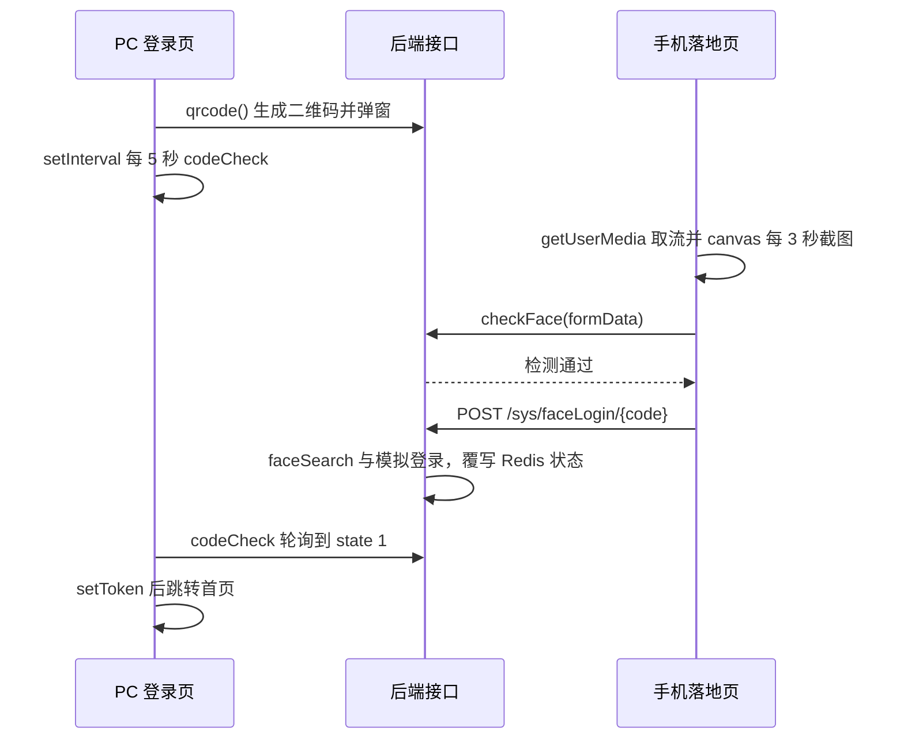

# 前端把刷脸登录串起来：摄像头取流、canvas 定时截图、轮询跳转

后端四个接口全部就绪：生成二维码、轮询状态、人脸检测、人脸登录，Postman 里用 002 图（与注册的 001 是同一人）能登录成功，换 003 图则失败且状态翻转为 0。剩下的工作是把前端工程拼起来：登录页放二维码并轮询、落地页开摄像头定时拍照、API 模块封好三个请求。这一课以资料包里的真实前端代码为底，走完拷贝、配置、联调三步，day11 的刷脸登录随之收束。

## 先给结论

- 前端要动四个位置：`src/router/index.js` 的白名单与路由表、`pages/login.vue` 登录页、`pages/facelogin.vue` 落地页、`src/api/base/faceLogin.js` 接口封装。
- 登录页的 `handlecode` 一口气做三件事：调 `qrcode()` 拿图并弹窗、`setInterval` 每 5 秒 `codeCheck` 轮询、state 为 1 时 `setToken` 跳首页，为 0 时关弹窗。
- 落地页 `facelogin.vue` 用 `getUserMedia` 把摄像头视频流绑到 video 元素，`mounted` 里 `setInterval(this.handleClick, 3000)`，每 3 秒用 canvas 截图、转 Blob、先 `checkFace` 再 `facelogin`。
- 落地页路由 `/facelogin` 必须加入白名单，手机扫码时用户尚未登录，被路由守卫拦截就到不了拍照页。
- 手机拿 code 的方式是读地址栏查询参数：`this.$route.query.code`，二维码内容里的 `落地页地址?code=xxx` 在这一步兑现。

## 四份代码各归其位

资料包把前端要拷的东西按目录准备好了，落位如下：

- 路由：`src/router/index.js`，先把最上方的白名单整体替换，再把 `/facelogin` 的路由配置插进 `constantRouterMap` 中段；
- 登录页：`login.vue` 放进仪表盘模块的 `pages` 目录，它是在原有登录页基础上的改造版，多了「刷脸登录」按钮与二维码弹层；
- 落地页：`facelogin.vue` 与 `login.vue` 放在同一目录，这是手机扫码后打开的页面；
- API：`faceLogin.js` 放进 `src/api/base`，与既有接口封装并列。

白名单替换后的内容一行就能看清：

```js
// 无需登录即可访问的路由，扫码后的落地页在此放行
const whitelist = ['/login', '/reg', '/authdirect', '/facelogin']
```

路由表里为落地页注册一条不挂登录校验的记录即可。这里配置的意义与后端 Shiro 的 anon 放行呼应：整条刷脸链路发生在登录之前，前后端各自的门卫都要为它开门，少配任何一边，流程在第一步就断。

## 登录页：弹二维码，然后每 5 秒问一次

登录页只多一个按钮，点击触发的方法是轮询的全部逻辑，`login.vue` 资料包原样：

```js
handlecode() {
  qrcode().then(res => {
    // 弹窗展示二维码
    this.param.qrcode = res.data.data.file
    this.centerDialogVisible = true
    // 启动轮询：每 5 秒携带 code 查询一次状态
    setInterval(() => {
      if (this.states == '-1') {
        codeCheck({ code: res.data.data.code }).then(res => {
          this.states = res.data.data.state
          this.token = res.data.data.token
          if (this.states == '1') {
            // 登录成功：写入 token 并跳转首页
            if (this.token && this.token != undefined) {
              setToken(this.token)
              this.$store.commit('SET_TOKEN', this.token)
              this.$router.push({ path: '/' })
            }
          }
          if (this.states == '0') {
            // 登录失败：关闭弹窗
            this.centerDialogVisible = false
          }
        })
      }
    }, 1000 * 5)
  })
}
```

外层 `if (this.states == '-1')` 是轮询的自停开关：一旦拿到 1 或 0，条件不再成立，定时器空转但不再发请求。state 为 1 时 token 才有值，`setToken` 把它写进本地存储，仓库同步 `SET_TOKEN`，路由跳首页，PC 端的登录动作到此完成。整套流程没有一个地方写状态，登录页是纯读方，与后端的读写分工严格对齐。

## 落地页：摄像头、canvas、3 秒一张自动拍

`facelogin.vue` 是这个功能里前端含量最高的文件，页面结构是两个元素：播放摄像头视频流的 `video`，和盖在上面的 200 乘 200 的 `canvas`。`created` 钩子里做设备兼容取流：

```js
// 访问用户媒体设备的兼容方法：标准 API 优先，旧内核逐级回退
function getUserMedia(constrains, success, error) {
  var video = _this.$refs['vd']
  if (navigator.mediaDevices.getUserMedia) {
    // 最新标准 API
    navigator.mediaDevices.getUserMedia(constrains)
      .then((stream) => {
        video.srcObject = stream
        video.play()
        _this.vdstate = true
      })
      .catch(error)
  } else if (navigator.webkitGetUserMedia) {
    // webkit 内核浏览器
    navigator.webkitGetUserMedia(constrains).then(success).catch(error)
  }
  // mozGetUserMedia、getUserMedia 旧版同理逐级回退
}
getUserMedia({ video: { width: 200, height: 200 } }, success, error)
```

视频流到手后，`mounted` 里挂上每 3 秒一次的自动拍照定时器，用户只需把正脸对准摄像头，截图交给机器：

```js
handleClick() {
  let _this = this
  if (!this.vdstate) return false
  if (!_this.states) {
    let video = this.$refs['vd']
    let canvas = this.$refs['cav']
    // 1. 把 video 当前帧绘制到 canvas
    let context = canvas.getContext('2d')
    context.drawImage(video, 0, 0, 200, 200)
    let base64Data = canvas.toDataURL('image/jpg')
    // 2. base64 转 Blob，封装表单
    let blob = this.dataURItoBlob(base64Data, 'camera.jpg')
    let formData = new FormData()
    formData.append('file', blob)
    // 3. 先做人脸检测，通过后再人脸登录
    checkFace(formData).then(res => {
      if (res.data.success) {
        axios({
          method: 'post',
          url: '/api/sys/faceLogin/' + this.$route.query.code,
          data: formData
        }).then(function(response) {
          _this.states = true
          _this.canvasShow = false
          response.data.success ? (_this.tipShow = true) : (_this.errorShow = true)
        })
      }
    })
  }
}
```

这条链路的妙处在「先检测后登录」的次序：canvas 截图质量参差，先花一次 detect 调用确认图里恰好有一张脸，再动用人脸库检索，失败时界面安静等待下一帧，3 秒后又是一张新照片，用户没有任何操作。`dataURItoBlob` 把 DataURL 逐段解析出 MIME 与字节流再包成 Blob，最后FormData 的 key 是 `file`，与后端 `@RequestParam(name = "file")` 严格对应。`this.$route.query.code` 取出二维码内容里带的唯一标志，拼在登录接口路径上，Redis 里那一轮会话就此被定位。

两端与后端的完整对话过程如下：



图里最关键的一对箭头是两条竖直的自环：PC 每 5 秒读，手机每 3 秒拍，两者互不感知，全部同步动作都发生在 Redis 的状态对象上。任何一端宕了，另一端也只是停在原地，等二维码 10 分钟过期自然作废。

## 联调与收束

四份代码落位、刷新页面，登录页出现「刷脸登录」按钮，点击弹出二维码；手机扫码进入落地页，摄像头亮起，对准面部数秒内自动完成检测与登录；PC 端下一轮轮询拿到 state 1，无感跳进首页。整个 day11 至此闭环：百度云 AI 侧注册好人脸库，后端五个方法（注册挂在员工上传、生成二维码、轮询状态、人脸检测、人脸登录）各司其职，前端两页一 API 把交互串成一条线。

回头看这个功能的骨架其实极简：一个 Redis key 上的状态机，三种状态值，两个轮询方，一次写方。所有看似复杂的摄像头、二维码、AI 检索，都是在为「什么时候把状态从 -1 改成 1」这一个赋值语句服务。

## 常见误区

- **摄像头打不开**：`getUserMedia` 只在安全上下文可用，localhost 或 https 环境正常，用 IP 直连 http 打开会直接进 error 回调。联调时优先用 localhost，或给站点配证书。
- **落地页路由没进白名单**：手机扫码后被路由守卫重定向到登录页，用户在手机上没有账号可登。`/facelogin` 必须与 `/login` 并列放进免登录名单。
- **FormData 的 key 与后端对不上**：写成 `image` 或 `attachment`，后端抛缺少参数异常。上传字段的 key 由后端 `@RequestParam(name = "file")` 决定，前端必须写 `file`。
- **定时器用完不清理**：登录页的 5 秒轮询与落地页的 3 秒截图都是 `setInterval` 裸挂，组件销毁后回调仍在执行。严谨做法是持有定时器句柄，在 `beforeDestroy` 里 `clearInterval`，本课为演示从简，生产代码应补齐。

## 面试可能被问到的问题

1. 面试官追问：「前端是怎么把摄像头画面变成一张可上传的照片的？」
   答：`getUserMedia` 拿到 MediaStream 绑定到 video 元素播放，`canvas.getContext('2d').drawImage(video, 0, 0, 200, 200)` 把当前帧绘制成静态位图，`canvas.toDataURL` 得到 base64 的 DataURL，再解析出 MIME 与字节流封装成 Blob，塞进 FormData 以 `file` 字段上传。本质是 video 到 canvas 的一次像素拷贝。

2. 面试官追问：「落地页为什么要定时自动截图，让用户手动点拍照不行吗？」
   答：可以，但体验差且成功率低，用户对不准、手抖、表情不自然都会产生废片。每 3 秒自动截一张配合先检测后登录的次序，等于连续采样，某一张不合格就等下一张，用户只要保持正脸即可。组件里保留了拍照按钮的注释代码，手动模式是预留的降级方案。

3. 面试官追问：「轮询与定时截图两个循环会不会互相干扰？」
   答：不会。两端运行在不同设备的不同页面，HTTP 请求各自独立，中间唯一的共享点是 Redis 里的状态对象，而它天然支持并发读写。真正的同步由状态值驱动：手机端写 0 或 1，PC 端读到即止，模式上就是最简单的生产者消费者。

4. 面试官追问：「二维码内容里的 code 是怎么一路传到登录接口的？」
   答：生成接口把 `落地页地址?code=xxx` 编进二维码图片，手机扫码打开这个 URL，落地页组件用 `this.$route.query.code` 从查询参数里取出，拼到人脸登录接口的路径上提交。code 全程只作为关联标识，把「哪一次扫码」与「哪一张照片」绑定起来。

5. 面试官追问：「前端拿到 state 1 之后做了什么，为什么 token 存本地而不放 URL？」
   答：`setToken` 写入本地存储，仓库提交 `SET_TOKEN` 同步状态，再 `$router.push` 跳首页，后续请求由统一的请求封装把 token 附到头里。token 放 URL 会被浏览器历史、服务端日志、分享链接记录，泄露面大；存储加请求头是常规做法。

6. 面试官追问：「这套刷脸登录如果要优化，你会先改哪里？」
   答：通信层换成长连接，WebSocket 或 SSE 推送状态，省掉 PC 端的无效轮询并降低跳转延迟；轮询与截图定时器补上清理逻辑；人脸库检索失败的提示精细化，区分「照片无效」与「人脸不匹配」；再把 score 阈值与活体检测等级做成配置项，按企业租户的安全等级分别设定。

## 配套资料

- 落地页（摄像头与截图核心）：`materials/code/02/day11-刷脸登录/day11-刷脸登录/资源/代码/前端页面改造/facelogin.vue`（真实文件，getUserMedia 兼容封装、3 秒定时截图、先检测后登录的次序均为资料包原样）
- 登录页（二维码与轮询）：`materials/code/02/day11-刷脸登录/day11-刷脸登录/资源/代码/前端页面改造/login.vue`（真实文件，`handlecode` 方法与 5 秒轮询、状态分支为资料包原样）
- API 封装：`materials/code/02/day11-刷脸登录/day11-刷脸登录/资源/代码/前端页面改造/api/base/faceLogin.js`（真实文件，`qrcode`、`codeCheck`、`checkFace` 三个导出与文中一致）
- 路由与白名单：资料包未附 `index.js` 全文，文中白名单写法按本课屏幕演示还原；`/facelogin` 路由为免登录配置，示例为按本课写法补全
