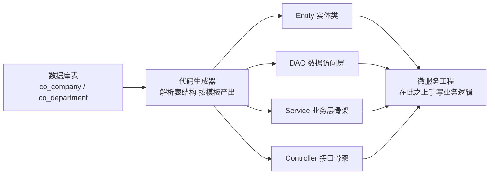

# 复制粘贴出来的 Company 和 Department：代码生成器到底要替你做什么

写完企业模块再写部门模块，写完部门再写角色，每换一个实体，实体类、DAO、Service、Controller 又要照着上一份抄一遍、替换一遍。这些代码不写跑不通，写多了毫无成长，全是对着已有文件改名字。这一课从人事系统里真实存在的两套模块入手，看清楚重复到底重复在哪，代码生成器因此在整个工程里站在什么位置，以及想自己动手写一个，需要先补齐哪些技术。

## 先给结论

- 四层代码高度同构：实体类字段对应表字段，DAO 继承两个接口几乎没有差异，Service 的增删改查方法体完全一样，差异只在类名与实体类型。
- 代码生成器的起点不是实体类，而是数据库表：表名推出类名，字段推出属性，这是整章分析的立足点。
- 生成器只负责共性骨架；下单、审批这类个性化业务逻辑它不可能生成，程序员的价值要落在这些地方。
- 自己实现一个生成器，需要补两块技术：模板引擎 FreeMarker 与数据库元数据，这也是后续两节的主题。

## 一、重复代码长什么样

人事系统的 `model` 包里躺着企业、部门、用户、角色一堆实体类。企业实体长这样：

```java
@Entity
@Table(name = "co_company")
@Data
@AllArgsConstructor
@NoArgsConstructor
public class Company implements Serializable {
    //ID
    private String id;
    //公司名称
    private String name;
    //企业登录账号ID
    private String managerId;
    //当前版本
    private String version;
    //创建时间
    private Date createTime;
}
```

部门实体几乎就是它的翻版，`@Table` 换成 `co_department`，字段换成 `pid`、`companyId`、`name`、`code`。往下看 DAO，重复感更直接：

```java
public interface CompanyDao extends JpaRepository<Company, String>,
        JpaSpecificationExecutor<Company> {
}
```

部门 DAO 与它唯一的区别是泛型里的 `Company` 换成 `Department`。再往上的 Service，增删改查的方法体也如出一辙：

```java
@Service
public class CompanyService {
    @Autowired
    private CompanyDao companyDao;
    @Autowired
    private IdWorker idWorker;

    public void add(Company company) {
        String id = idWorker.nextId() + "";
        company.setId(id);
        company.setAuditState("0"); //0:未审核，1:已审核
        company.setState(1); //0:未删除，1:已删除
        companyDao.save(company);
    }
}
```

查询列表时构造 `Specification` 按企业 ID 过滤、按 ID 删除、按 ID 查详情，这些代码在部门 Service 里同样存在，只是实体类型换了。开发第二套模块的过程，本质是复制第一套再逐个替换名字，每替换一次就多出一份代码副本。

## 二、生成的起点是数据库表，不是实体类

让计算机接手这件事，从哪开始生成？直觉的答案是实体类，但实体类本身也有出处：先有数据库表，再把表抽象成实体类，表里的字段一一映射为类的属性。也就是说，真正的源头是表：

| 层 | 企业模块 | 部门模块 | 写法差异 |
|---|---|---|---|
| 表 | `co_company` | `co_department` | 表名不同 |
| 实体类 | `Company` | `Department` | 字段不同 |
| DAO | `CompanyDao` | `DepartmentDao` | 泛型不同 |
| Service | `CompanyService` | `DepartmentService` | 实体类型不同 |
| Controller | `CompanyController` | `DepartmentController` | 路由与实体不同 |

把这张表竖着读，每一列的写法规律完全一致；横着读，同一层的两份代码只差名字。既然规律固定、重复性强，就可以把规则告诉生成器：表在那里，类名、属性、方法由它推出来，四层骨架一次产齐。

## 三、生成器在工程里的位置



生成器站在开发期：它是一个离线工具，产出的 `.java` 文件进入工程后与手写代码没有任何区别，照常编译、照常参与构建，生成器本身不部署到生产环境。它与运行时技术（反射、动态代理那些）是两回事，解决的是「代码从哪来」而不是「代码怎么跑」。

**第一，它消灭的是纯体力劳动。** 增删改查骨架、分页查询、统一返回结构，这些代码每个模块都要有，且写法唯一，交给机器生成的质量稳定且不会手滑写错。

**第二，它划清了人与机器的分工。** 明天来了一个电商下单需求，生成器给不出任何帮助，因为它没有规律可言。程序员的精力因此可以全部投向有业务含量的部分，效率提升正是从这条分界线上来的。

## 四、自己写一个，先补哪两块技术

把「根据表生成代码」拆开，会得到两个必须解决的问题。一是模板：四层代码的公共骨架要预先写成带占位符的文件，占位符在生成时被替换成真实类名与属性，Java 世界里做这件事最成熟的工具是 FreeMarker，需要系统过一遍它的语法。二是元数据：类名、属性名、属性类型都来自数据库的表名、字段名、字段类型，程序要能通过 JDBC 把这些结构信息读出来，这就是数据库元数据，另外还有参数元数据与结果集元数据两种同样常用。这两块补齐之后，动手写生成器就是水到渠成的组装工作。

## 常见误区

- **把生成器当成万能工具**：它能产出的是有规律的四层骨架，审批流、金额计算这类业务逻辑必须人写，指望生成器覆盖业务是方向性误解。
- **生成后直接覆盖手写文件**：如果某个 Service 里已经补过业务方法，重新生成会把它们抹掉。生成器适合在新模块起步时使用，或者明确指定覆盖范围。
- **表设计时不写字段备注，生成后再后悔**：注释是从表结构带过来的，建表时备注写得越完整，生成出的实体类可读性越好，反过来补注释等于返工。
- **以为生成器是运行时组件**：它只在开发期跑一次或有限几次，产物是静态源码文件，不存在线上性能开销，也不需要在生产环境引入任何依赖。

## 面试可能被问到的问题

1. 面试官追问：「代码生成器适合用在什么场景，边界在哪？」
   答：适合表结构驱动的重复性代码，实体、DAO、Service 与 Controller 的增删改查骨架都是典型对象。边界在个性化业务逻辑，凡是需要理解需求才能写的代码，生成器都给不出答案。

2. 面试官追问：「生成器为什么能从表名推出类名？」
   答：靠团队约定俗成的命名规则，比如去掉 `co_`、`bs_` 前缀再按下划线切分、首字母大写。规则一旦定下来，`co_company` 就能机械地映射成 `Company`，这也是很多项目表前缀规范存在的原因之一。

3. 面试官追问：「生成的 DAO 为什么一行方法都不写就能用？」
   答：因为继承了 Spring Data JPA 的 `JpaRepository` 与 `JpaSpecificationExecutor`，基础增删改查与条件查询由框架按方法名规则与约定在运行时实现，DAO 接口本身只需要声明实体类型与主键类型。

4. 面试官追问：「生成器与运行时的反射、动态代理有什么本质区别？」
   答：生成器是开发期工具，产出静态源码文件，产物进入版本管理后与手写代码无异；反射与代理是运行时机制，在程序执行期间动态创建或增强对象。一个解决代码从哪来，一个解决行为如何扩展。

5. 面试官追问：「团队里推广代码生成器，规范上要注意什么？」
   答：模板即规范。生成的代码统一了包结构、注解用法与返回体风格，但前提是表命名、字段类型映射有明确约定，否则规则无从落地。另外要约定生成目录与覆盖策略，避免误覆盖手写代码。

## 配套资料

- 生成器工程骨架：`materials/code/02/day12-代码生成器原理分析/day12-代码生成器原理分析/资源/工具代码/`（含 `ui/CodeUtil.java`、`ui/DatabaseUtil.java`、`entity/db/Table.java` 等真实文件，本课未展开实现，后续课程逐步补齐）
- 四层代码对照：`materials/code/02/day13-代码生成器实现/day13-代码生成器实现/资源/测试/生成代码路径/ihrm_company/src/main/java/com/ihrm/system/`（`pojo/Company.java`、`dao/CompanyDao.java`、`service/CompanyService.java` 为按模板生成的产物，结构与文中手写版本一致，包名已在文中改写为 `com.example`）
