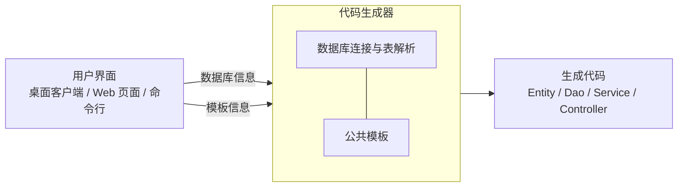

# 输入一张表，产出一套代码：把代码生成器的需求边界画清楚

上一节确定了方向：重复的四层骨架交给机器生成。动手之前得先回答一个问题，这个工具到底长什么样、吃进什么、吐出什么。课程资料里带了一个可运行的生成器界面，从它的操作流程倒推，正好把需求一条条摆清楚，这一节只谈需求，不写实现。

## 先给结论

- 生成器的输入只有两组信息：数据库连接信息（类型、IP、端口、库名、用户名、密码）与模板信息，外加一组工程描述参数（项目名、包名、作者等）。
- 界面形态不重要，桌面客户端、Web 页面、命令行窗口都只是传参方式，核心是那两组数据。
- 生成依据是「数据库表加模板」：表信息推出类名与属性，模板提供公共骨架，两者缺一不可。
- 传统开发里靠复制粘贴在 `user` 与 `role` 之间来回替换的过程，正是生成器要替你完成的部分。

## 一、从一次真实操作倒推需求

生成器的第一个窗口让我们选择数据库类型，填服务器 IP、用户名与密码，点击测试连接，连通后下拉框里列出服务器上所有的数据库，选中目标库进入下一步：

```java
// 测试连接：组装连接信息，列出所有数据库
String ip = jTextField3.getText();
String username = jTextField1.getText();
String password = jTextField2.getText();
String dbType = (String) jComboBox1.getSelectedItem();
DataBase db = new DataBase(dbType, ip, "3306", "");
db.setUserName(username);
db.setPassWord(password);
List<String> catalogs = DataBaseUtils.getSchemas(db);
```

第二个窗口要填的东西更多：下拉选择模板，指定代码生成路径，再填项目英文名、包名、项目中文名与作者，然后点击生成：

```java
// 生成代码：模板路径、输出路径与工程配置全部来自界面输入
String basePath = new File("").getAbsolutePath() + "\\模板\\" + jComboBox1.getSelectedItem();
String templetPath = basePath;
String outpath = jTextField5.getText();

String project = jTextField6.getText();
String pPackage = jTextField7.getText();
String projectComment = jTextField8.getText();
String author = jTextField9.getText();
Settings settings = new Settings(project, pPackage, projectComment, author);
generator(templetPath, outpath, settings, db);
```

把这两段输入归拢一下就是完整的需求清单：数据库类型、IP、端口、库名、用户名、密码是一组；模板、输出路径、项目名、包名、项目描述、作者是另一组。想填就填、不填走默认值的宽松态度说明，后一组只影响产物细节，前一组才决定能不能生成。

## 二、传统方式与生成器方式摆在一起

以用户表 `bs_user` 为例走一遍传统开发：建实体类 `User`，写 `UserDao`（继承两个 JPA 接口，外加 save、delete），写 `UserService`（`saveUser`、`deleteUser`），写 `UserController`。写完这套再做角色表 `pe_role`：建 `Role`、`RoleDao`、`RoleService`（`saveRole`、`deleteRole`）、`RoleController`。

第二套的做法几乎可以预测：把第一套的文件复制一份，把所有 `user` 替换成 `role`。这套「复制加替换」的手工动作有明确的规律，而规律正是机器的领地。生成器接手后的对比是这样的：

| | 传统方式 | 代码生成器 |
|---|---|---|
| 输入 | 上一套模块的代码 | 表名与模板 |
| 动作 | 复制、替换、核对 | 解析表结构，套模板输出 |
| `bs_user` 产出 | 手写四层代码 | 一次生成四层 |
| `pe_role` 产出 | 再复制替换一轮 | 换张表再点一次 |
| 出错点 | 替换遗漏、大小写错 | 规则定好后无手误 |

**第一，数据库表信息必须拿到。** 生成器要知道表叫什么、有哪些字段、字段什么类型、谁是主键，否则类名与属性无从推出。

**第二，必须有一套模板。** 生成的文件里要出现 `saveUser` 还是 `saveRole`，取决于传入的类名参数。模板里预先写好 `save${ClassName}` 这样的占位片段，传 `ClassName=User` 就拼出 `saveUser`，传 `Role` 就拼出 `saveRole`，本质上是一次带着规则的字符串替换。

## 三、需求边界：一张图说清输入与输出



界面是可替换的壳。桌面客户端适合本地使用，Web 页面方便团队共享，命令行窗口最容易接入持续集成，三者的区别只在传参体验，生成器内核完全不变。传进来的两股信息在内核里汇合：数据库信息负责「数据从哪来」，模板信息负责「代码长什么样」，输出永远是那套四层骨架文件。

包名这类参数还有一层用途：它决定生成文件写到哪个目录。包名 `com.example.demo` 拆开就是源码目录的三级路径，项目英文名则拼进工程目录名，所以 Settings 对象在构造时就把包名切好存起来，生成时直接取用。

## 四、把需求翻译成验收标准

这条需求可以列成一张清单，后续实现照着验收：给一组可连通的数据库信息，工具能列出库与表；选中一张表，能推出实体类名与属性清单；给定模板目录，能按模板逐个生成文件并写到指定路径；包名、项目名、作者参数能正确进入生成结果的 package 声明与注释。满足这四条，一个最小可用的代码生成器就成立了，多余的都不属于第一版需求。

## 常见误区

- **把界面当需求核心**：桌面客户端只是壳，换成命令行照样是同一个生成器。需求评审时盯着输入输出，不要被界面形式带偏。
- **漏掉模板这个输入**：只想着「读数据库生成代码」，却没意识到生成的代码长什么样由模板决定。没有模板，读再多表结构也拼不出一份可编译的文件。
- **要求生成器连业务逻辑一起生成**：`saveUser`、`deleteUser` 是共性内容可以进模板，下单扣库存这类逻辑没有通用规律，硬塞进模板只会做出一个谁也改不动的怪物。
- **忽略包名与路径的联动**：包名不是随便填的备注，它决定生成目录结构。填了 `com.example.demo` 却把输出路径指到别处，产物与 package 声明对不上，直接编译不过。

## 面试可能被问到的问题

1. 面试官追问：「代码生成器的需求里，为什么数据库信息和模板信息缺一不可？」
   答：表信息提供数据，决定生成什么类、什么属性、什么类型；模板提供形态，决定代码的组织结构与公共内容。只有前者没有骨架可套，只有后者没有内容可填，二者在生成环节汇合才能产出可编译文件。

2. 面试官追问：「生成器的输入为什么强调先测试连接？」
   答：连接信息错了后面全白做，先测试连接能立刻暴露 IP、账号、驱动问题，并把服务器上可选的库列出来让用户选择，避免用户手输库名带来拼写错误。

3. 面试官追问：「命令行形态的生成器还有什么价值？」
   答：它可以进版本库、进流水线，表结构变更后一条命令重新生成并比对差异，把代码生成纳入自动化流程，这是图形界面做不到的。

4. 面试官追问：「为什么说生成过程本质上是一次字符串替换？」
   答：模板文件里写着占位符，比如方法名写成 `save${ClassName}`，生成时把元数据里的类名、字段名填进占位符，得到最终文本。FreeMarker 这类模板引擎做的正是这件事，只是额外提供了循环、条件等控制能力。

5. 面试官追问：「包名参数在生成器内部是怎么被使用的？」
   答：一方面写进生成文件的 package 声明与 import，另一方面按点号切分后拼成源码目录路径，决定文件落盘位置。两处必须一致，否则生成的工程无法编译。

## 配套资料

- 生成器界面与入口逻辑：`materials/code/02/day12-代码生成器原理分析/day12-代码生成器原理分析/资源/工具代码/ui/DatabaseUtil.java`、`ui/CodeUtil.java`（测试连接、列出数据库、组装 `Settings` 的代码为资料包原样，包名已改写为 `com.example`）
- 工程参数对象：`materials/code/02/day12-代码生成器原理分析/day12-代码生成器原理分析/资源/工具代码/entity/Settings.java`（项目名、包名切分出三级路径的逻辑为原样实现）
- 数据库连接实体：`materials/code/02/day12-代码生成器原理分析/day12-代码生成器原理分析/资源/工具代码/entity/db/DataBase.java`（按数据库类型拼 JDBC URL 的规则为原样实现）
