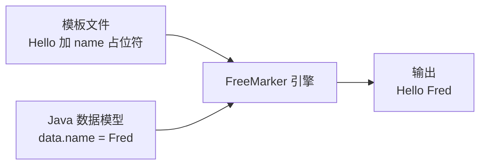
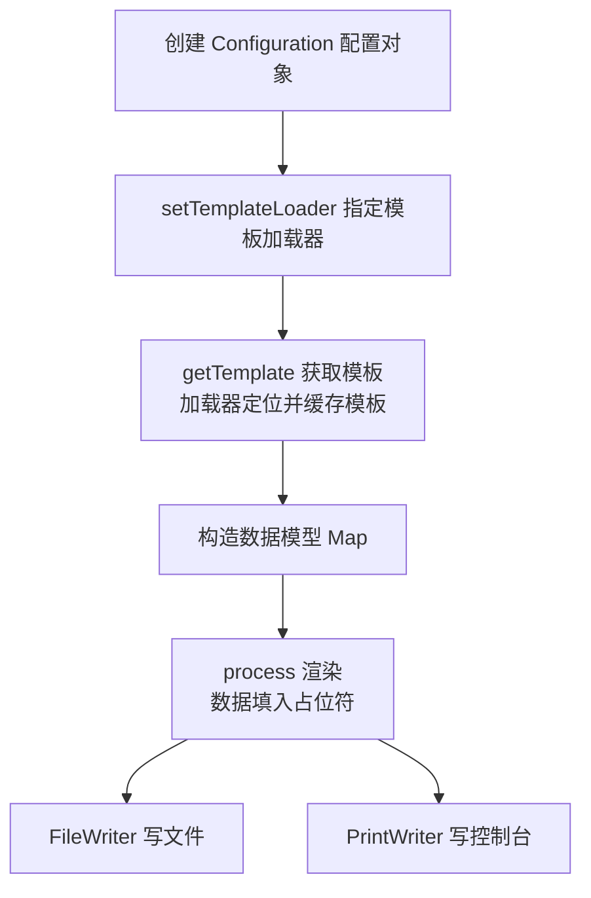
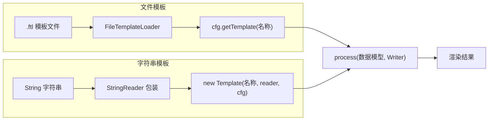
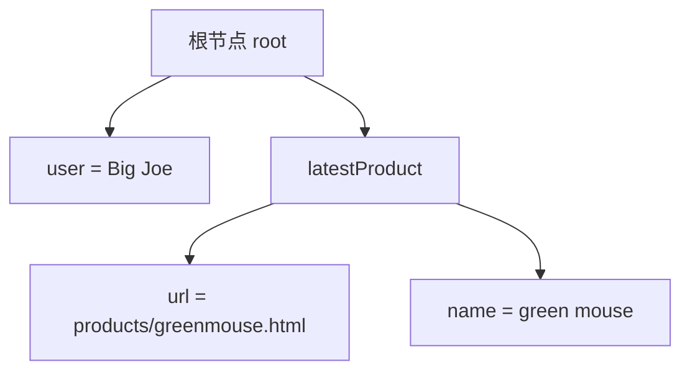
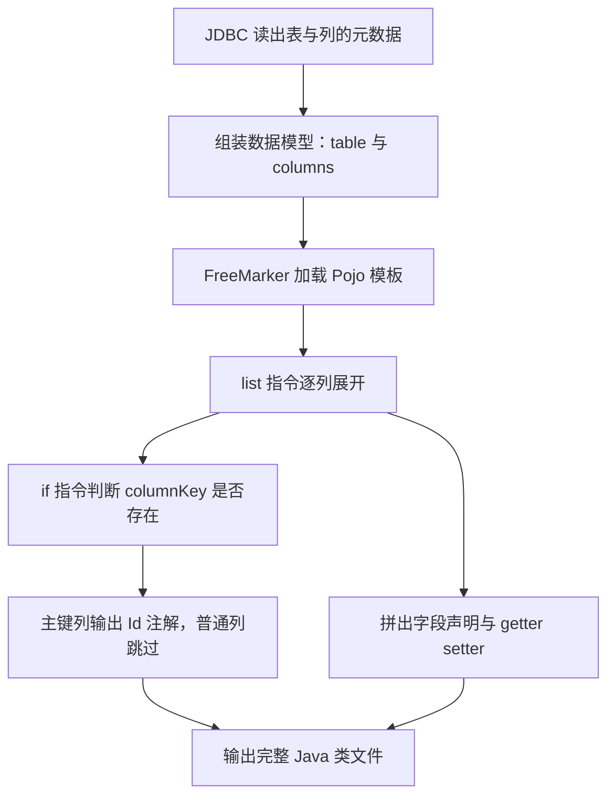
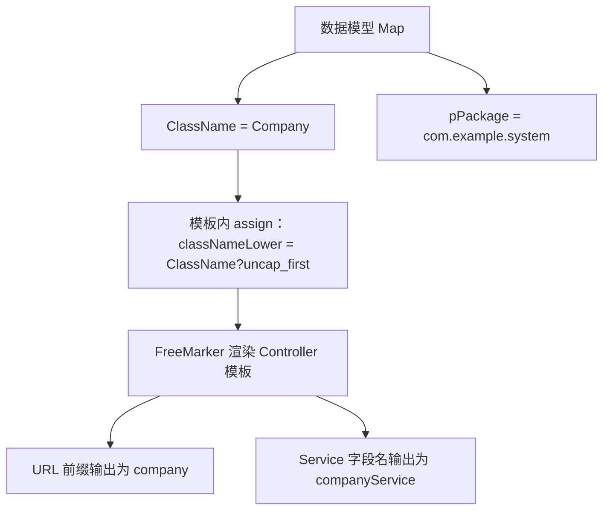

# FreeMarker 从入门到模板指令全解：概念、数据模型与 if、list、include、assign 实战

## 先给结论

FreeMarker 是一套模板加数据模型的文本生成器：模板定骨架，数据填空位，输出可以是 HTML、代码、配置或任意文本。全系列六个部分，从概念定位讲到五大指令，是后续代码生成器与页面静态化的地基。
概念层先立住三件事：模板与数据模型的两层结构、三大应用场景、与 Velocity、Thymeleaf 的选型差异。动手层分两条线：一条是程序线，五步渲染出第一个文件，再进阶到字符串模板与 StringTemplateLoader；另一条是模板线，把模板拆成五个组成部分，吃透数据模型的取值规则。
指令层是重点：if 负责分支，list 负责循环，include 负责模板复用，assign 负责模板内变量，内置函数用一个问号调用。
六个部分依次是：
- 概述：定位、模板加数据模型、三大场景与选型对比。
- 入门案例：五步跑通第一个程序，每一步各在干什么。
- 字符串模板：不落盘渲染，三个构造参数与现场内容场景。
- 模板概述与数据模型：五个组成部分、一棵树形模型、null 与缺失变量的预告。
- if 与 list 指令：分支判断、循环迭代与代码生成器模板实战。
- include 与 assign 指令：模板复用、模板内自定义变量与内置函数。

## 第1部分：FreeMarker 是什么：模板加数据模型，吐出任意文本

上一节把代码生成器压缩成一个公式：模板加数据模型等于输出。公式里「替换」这个动作交给谁？用 `String.replace` 手撸当然也能跑通一次演示，可一旦模板里出现「按字段循环生成属性」「是主键就补注解」这类要求，拼接代码会迅速失控。模板引擎就是为这件事准备的现成工具，本阶段选的是 FreeMarker。这一节先把它是什么、能干什么、在同类产品里处在什么位置说清楚，下一节直接上手写程序。

### 一、定位：不挑输出格式的文本生成器

**第一，它是一款模板引擎。** 模板引擎干的事一句话说清：把内容里不变的部分固定在模板文件里，把变化的部分写成占位符，运行时用真实数据替换占位符，得到最终文本。替换出来的可以是 HTML 页面、Java 源码、邮件正文、配置文件，一切基于文本的东西它都产得出来。

**第二，它出身 Web，但不限于 Web。** FreeMarker 最早就是为生成 HTML 网页设计的，在 MVC 架构里可以充当视图层角色；同时它在纯后端程序里照样能跑。官方文档有一句很明确的定位：FreeMarker 不是 Web 应用框架，而是适合作为 Web 应用框架中的一个组件使用。把这句话与代码生成器的需求对照着看就通了：生成源码时没有请求、没有浏览器，照样用得起来。

**第三，官方倡导的用法是让模板保持笨。** 官方介绍里专门提了一句：FreeMarker 具有一定的编程能力，但不推荐在模板里使用这些编程功能。它的期望是 Java 程序把数据准备好，模板只负责把数据摆到正确的位置上。数据加工在 Java，版式呈现靠模板，两边各干各的，模板才能被非开发人员读懂、被工具反复套用。官方还给 FreeMarker 贴过一串标签：强大的模板语言、多用途且轻量、通用的数据模型、智能的国际化，这些属于锦上添花，记住定位与公式就够用了。

### 二、模板 + 数据模型 = 输出

官方手册里那张流传最广的图，画的正是它的工作方式：



模板文件里写的是 `Hello ${name}`，`${name}` 是一枚占位符，意思是这个位置最终要填上真实数据。真实数据在 Java 程序里声明：给 name 赋值 Fred。FreeMarker 拿到模板与数据，自动把 Fred 替换到占位符的位置，输出 `Hello Fred`。使用者只需要关心两件事：模板怎么写，数据怎么构造。至于怎么匹配、怎么替换、结果怎么流出，框架全包了。

Java 侧传过去的那份数据，官方称之为数据模型（Data Model）。这个名词在代码生成器里换了个叫法，叫元数据，本质是同一个东西：都是等着被填进占位符的那批值。所以本课选 FreeMarker 并非随大流，模板加数据模型的工作方式与代码生成器的需求严丝合缝。

### 三、三大应用场景

**动态页面。** 在 Web 应用里，FreeMarker 可以顶替 JSP 的位置，Servlet 与各类 MVC 框架都能接它。JSP 输出页面要经历编译、解析两道工序才能呈现给浏览器，FreeMarker 直接拿模板和数据做替换，省掉编译环节，服务器压力随之减轻，页面内容的替换也更灵活。这是它最老牌的用法。

**页面静态化。** 门户网站、资讯站这类场景，页面内容变动很少，可每次访问都要查一遍数据库，一万人访问就查一万次，全是重复劳动。既然内容不常变，就可以用 FreeMarker 把动态页面提前渲染成静态 HTML，之后访问直接返回静态文件，不查库、甚至不进 Tomcat，由 Nginx 这类前端服务器直接吐出。高并发读场景的经典减压手段。

**代码生成器。** 把数据库表结构解析成元数据当数据模型，把四层代码的公共骨架抽成模板，渲染一次就得到一份完整源码，Controller、Service、Dao、实体类批量产出。本阶段 day13 就是用它实现整个生成器。

### 四、与 Velocity、Thymeleaf 怎么选

Java 生态里叫得上名字的模板引擎主要有三家，放在一起看更清楚：

| 引擎 | 语法风格 | 现状与生态 | 更合适的场景 |
|---|---|---|---|
| FreeMarker | `${name}` 取值，`<#if>`、`<#list>` 做逻辑 | 持续维护，功能最全（循环、条件、宏、格式化） | 代码生成、页面静态化、任意文本输出 |
| Velocity | `$name` 取值，`#if` 做逻辑 | 曾随早期 Spring MVC 流行，近年更新缓慢 | 存量老项目维护、简单文本拼接 |
| Thymeleaf | 逻辑写在 HTML 标签属性里，天然 HTML | Spring Boot 官方推荐的视图方案 | 服务端渲染网页 |

选型结论一句话：做服务端网页渲染，Thymeleaf 是当下主流；做输出不是网页的文本，尤其代码生成，FreeMarker 恰好是为这类任务而生的；Velocity 更多出现在需要接手的历史项目里。

### 五、把依赖先加上

后续所有示例都基于这个坐标（版本取自课程资料）：

```xml
<dependencies>
    <!-- freemarker核心包 -->
    <dependency>
        <groupId>org.freemarker</groupId>
        <artifactId>freemarker</artifactId>
        <version>2.3.28</version>
    </dependency>
</dependencies>
```

它零依赖、轻量，不会往工程里拖一串传递依赖。坐标到位，下一节就可以写第一个渲染程序了。
## 第2部分：第一个 FreeMarker 程序：固定五步，把模板渲染成文件

概念铺垫完了，这一节动手验证。目标很小：工程里放一个模板文件 `template01.ftl`，内容一行「欢迎你，${username}」，Java 代码传进 username 的值，跑完在指定目录得到替换完成的文件。写完会发现 FreeMarker 的 Java 侧几乎是一套固定动作，任何 FreeMarker 应用都这么写，真正需要长期花精力的地方在模板。

### 一、工程与依赖

新建一个 Maven 工程（课程工程名为 codeutil，此处记作 code-utils），关键是把依赖补齐：

```xml
<dependencies>
    <!-- freemarker核心包 -->
    <dependency>
        <groupId>org.freemarker</groupId>
        <artifactId>freemarker</artifactId>
        <version>2.3.28</version>
    </dependency>
    <dependency>
        <groupId>junit</groupId>
        <artifactId>junit</artifactId>
        <version>4.12</version>
        <scope>test</scope>
    </dependency>
    <!-- 后面解析数据库元数据时使用，入门阶段可不引 -->
    <dependency>
        <groupId>mysql</groupId>
        <artifactId>mysql-connector-java</artifactId>
        <version>5.1.6</version>
    </dependency>
</dependencies>
```

测试用 JUnit 跑即可，数据库驱动是给后面的代码生成器准备的。

### 二、模板文件：占位符先行

在工程根目录（与 `src` 平级）建 `templates` 目录，里面放 `template01.ftl`。`.ftl` 是 FreeMarker Template 的惯用后缀，内容一行：

```ftl
欢迎你，${username}
```

「欢迎你，」是普通文本，输出时原样保留；`${username}` 是占位符，等着数据模型里的值来填。

### 三、五步写完第一个程序

测试类放在 `test` 目录下，包名 `com.example.freemarker.test`：

```java
package com.example.freemarker.test;

import freemarker.cache.FileTemplateLoader;
import freemarker.template.Configuration;
import freemarker.template.Template;
import org.junit.Test;

import java.io.File;
import java.io.FileWriter;
import java.io.PrintWriter;
import java.util.HashMap;
import java.util.Map;

public class FreeMarkerTest01 {

    @Test
    public void test01() throws Exception {
        //1.创建 FreeMarker 的配置对象
        Configuration cfg = new Configuration();
        //2.指定模板加载器：到工程的 templates 目录下找模板
        FileTemplateLoader ftl = new FileTemplateLoader(new File("templates"));
        cfg.setTemplateLoader(ftl);
        //3.获取模板，只需要给名称，定位交给加载器
        Template template = cfg.getTemplate("template01.ftl");
        //4.构造数据模型：key 必须与占位符同名
        Map<String, Object> dataModel = new HashMap<>();
        dataModel.put("username", "张三");
        //5.处理模板，结果以文件形式输出
        template.process(dataModel, new FileWriter(new File("test/a.txt")));
        //换成 PrintWriter 则打印到控制台，方便测试
        template.process(dataModel, new PrintWriter(System.out));
    }
}
```

运行后控制台打出「欢迎你，张三」，同时工程目录下的 `test/a.txt` 内容也是「欢迎你，张三」，占位符被数据模型里的值替换，一次渲染完成。

### 四、五步各自在干什么



**第一，Configuration 是全局配置中枢。** 模板加载器、编码、版本兼容策略都挂在它身上。它设计为应用级配置对象，配置一次全项目复用，别每个请求都 new 一个，那会把模板缓存也一并丢掉。

**第二，模板加载器回答「模板从哪来」。** `setTemplateLoader` 接收一个 `TemplateLoader` 接口实现，常见实现有：`ClassTemplateLoader` 从类路径找、`FileTemplateLoader` 从文件路径找、`StringTemplateLoader` 接字符串模板、`URLTemplateLoader` 从网络地址找，Web 应用还有对应的加载器。示例把模板放在工程 `templates` 目录下，不在类路径里，所以选 `FileTemplateLoader`。加载器还兼职缓存：模板加载过一次就留在缓存里，下次直接复用，省去重复读盘解析的开销。

**第三，getTemplate 只报名称。** 目录已经在加载器里指定过，此时传文件名即可，加载器自动到 `templates` 下找 `template01.ftl`。

**第四，数据模型与占位符同名才替换。** 模板里是 `${username}`，Map 里就必须有 `username` 这个 key。FreeMarker 的数据模型统一用 `Map<String, Object>` 承载，简单值、复杂对象、嵌套结构都能往里放。

**第五，process 决定渲染结果去哪。** 方法签名是「数据模型加 Writer」：传 `FileWriter` 就落盘成文件，传 `PrintWriter(System.out)` 就打到控制台，传 `StringWriter` 还能把结果以字符串形式拿回程序继续用。文件输出与控制台输出只是 Writer 不同，渲染逻辑完全一样。
## 第3部分：模板不落盘：用字符串直接渲染出结果

上一节的模板躺在磁盘 `templates` 目录里。可有些场景模板根本不值得落盘：内容是程序运行时拼出来的、存在数据库里的、由调用方传进来的。FreeMarker 对此的支持叫字符串模板，模板内容来自一个 String，其余步骤与文件模板完全一致。这一节把第二种加载方式走通，并说清它真正的用武之地。

### 一、两条加载路径，一套模板语法



两条路径的终点相同：拿到 Template 对象后，构造数据模型、process 输出，与文件模板没有任何区别。区别只在模板对象怎么造出来。

### 二、完整代码

```java
package com.example.freemarker.test;

import freemarker.cache.StringTemplateLoader;
import freemarker.template.Configuration;
import freemarker.template.Template;
import org.junit.Test;

import java.io.StringReader;
import java.io.StringWriter;
import java.util.HashMap;
import java.util.Map;

public class FreeMarkerTest02 {

    @Test
    public void test02() throws Exception {
        //1.创建配置对象
        Configuration cfg = new Configuration();
        //2.设置字符串模板加载器
        cfg.setTemplateLoader(new StringTemplateLoader());
        //3.模板内容来自字符串
        String templateString = "欢迎您，${username}";
        //（名称, 字符流, 配置对象）三参构造，直接造出模板
        Template template = new Template("name1", new StringReader(templateString), cfg);
        //4.构造数据模型
        Map<String, Object> dataModel = new HashMap<>();
        dataModel.put("username", "张三");
        //5.处理模板：写入 StringWriter，渲染结果以字符串形式拿回
        StringWriter out = new StringWriter();
        template.process(dataModel, out);
        System.out.println(out.toString());
    }
}
```

运行输出「欢迎您，张三」。与文件模板对照，只有第三步变了：不再 `cfg.getTemplate` 读文件，而是拿字符串直接 new 出模板。想落盘的话，把 `StringWriter` 换成 `FileWriter` 即可，输出去向依旧由 Writer 说了算。

### 三、三个构造参数各管什么

**第一，名称。** 给模板起一个唯一标识，报错定位、检索都靠它，取独一无二的命名。内存里可能同时存在好几份模板，名字就是它们的索引。

**第二，Reader。** 字符串本身不是流，用 `new StringReader(templateString)` 包一层，模板就能按字符流的方式读取内容。这也意味着模板内容可以来自任何能变成字符串的地方。

**第三，Configuration。** 模板要挂在哪个配置下，编码、模板语法规则都继承自它。没有它，模板不知道按什么规则解析。

### 四、StringTemplateLoader 的角色

打开 `StringTemplateLoader` 源码，它就是 `TemplateLoader` 接口的一个内存实现，内部拿着一个 Map 存放模板（节选自框架源码）：

```java
public class StringTemplateLoader implements TemplateLoader {
    private final Map templates = new HashMap();

    //按名称注册一份字符串模板
    public void putTemplate(String name, String templateSource) {
        this.putTemplate(name, templateSource, System.currentTimeMillis());
    }

    //按名称查找
    public Object findTemplateSource(String name) {
        return this.templates.get(name);
    }
}
```

它带来的用法是：先 `loader.putTemplate("tpl1", 字符串)` 注册，再照常 `cfg.getTemplate("tpl1")` 取用。两种写法怎么取舍？直接 `new Template(...)` 适合一次性渲染，模板用完即弃；`StringTemplateLoader` 适合同一份字符串模板要按名称反复获取的场景。课程演示为了统一五步流程，把加载器与三参构造同时摆了出来，实际编码按场景二选一即可。

### 五、真正的用武之地：拼包名这类现场内容

字符串模板听起来像玩具，在代码生成器里却是主力。生成代码时往往要指定类所在的包，包名形如 `com.example.system.controller`，里面每一段都可能由用户输入决定。用字符串硬替换要 replace 一次两次三次，用字符串模板一次到位：

```java
//包名三段全部占位，一次渲染得到完整包声明
String templateString = "package ${p1}.${p2}.${p3}.controller;";
```

一次 process，完整的包声明就出来了。课程资料包里的真实模板用的正是这个思路：`package ${pPackage}.controller;`、`package ${pPackage}.pojo;`，连模板的目录结构本身都带着 `${path1}`、`${path2}`、`${path3}` 占位符，生成时由数据模型决定代码最终落在哪个包、哪个目录。模板内容与目标路径都能现场拼、现场渲染，这正是字符串模板的价值。
## 第4部分：FreeMarker 模板解剖：五个组成部分与数据模型的取值规则

五步代码写到这已经没有新意了，配置、加载器、模板、数据、process，闭上眼都能敲出来。FreeMarker 真正的花样全在模板文件里：`${username}`、`<#if ...>`、`<#-- -->` 各是什么，数据从哪来、怎么一层层取出来，这一节拆模板本身，重点是数据模型的树形结构与取值规则。

### 一、模板文件的五个组成部分

拿一个真实模板开刀。课程资料里生成实体类用的 `${ClassName}.java` 模板（完整拆解放在第三节），这里先看五个成分各自长什么样：

```ftl
<#-- 这是注释，输出时不会出现在结果里 -->
欢迎您，${username}！
<#if score gt 60>
恭喜，成绩合格
</#if>
```

逐个对号：

| 组成部分 | 写法 | 行为 |
|---|---|---|
| 数据模型 | Java 侧传入的 Map | 模板能用的全部数据 |
| 文本 | 普通字符 | 原样输出 |
| 注释 | `<#-- ... -->` | 不输出，仅模板内可见 |
| 插值 | `${...}`（早期数字插值写法 `#{...}` 已废弃） | 用数据模型中的值替代输出 |
| FTL 指令 | `<#if>`、`<#list>` 等，名字前加 `#` | 逻辑控制，指令本身不输出 |

**第一，文本与注释最好懂。** 「欢迎您，」这种不变的内容就是文本；注释给维护模板的人看，渲染结果里不留痕迹。别把 HTML 注释 `<!-- -->` 混进来用，对 FreeMarker 来说那只是普通文本，会原样出现在输出里。

**第二，插值是占位符的正名。** `${username}` 这种写法官方叫插值（Interpolation），渲染时用数据模型里的对应值替代输出：`${name}` 取根下的 name，`${person.name}` 取 person 对象的 name 属性，取值就是打点。早期版本还有 `#{...}` 写法专门做数字输出，已废弃，新模板一律用 `${...}`。

**第三，FTL 指令让模板有了逻辑。** `<#if>`、`<#list>` 与 HTML 标签形式相似，靠名字前的 `#` 区分，指令本身不输出，输出的是它包裹的内容。生成实体类时循环字段、判断主键全靠它们。

### 二、数据模型：一棵树

官方手册把数据模型画成一棵树：



Java 侧怎么把它构造出来？一个 Map 搞定。`put` 进去的 key 直接挂在根节点下，value 如果又是一个 Map 或对象，就顺理成章成为子树：

```java
Map<String, Object> root = new HashMap<>();
//挂在根节点下的叶子
root.put("user", "Big Joe");
//value 是 Map，展开成子树
Map<String, Object> latestProduct = new HashMap<>();
latestProduct.put("url", "products/greenmouse.html");
latestProduct.put("name", "green mouse");
root.put("latestProduct", latestProduct);
```

模板里的取值动作与树形结构一一对应：

```ftl
${user}
${latestProduct.url}
${latestProduct.name}
```

三个占位符依次输出 Big Joe、products/greenmouse.html、green mouse。规则一句话：`${x}` 取根节点下的 x，x 是复合结构就继续打点，直到拿到想要的属性。value 换成 POJO 也一样，FreeMarker 会通过 getter 暴露属性，模板写法不变。

官方对数据模型有句很直白的说明：FreeMarker（以及模板开发者）并不关心数据是如何计算的，它只知道真实的数据是什么。数据从数据库查、从远程服务拉、从文件读，模板一概不知也不必知。所以 Java 代码的核心任务从来不是那五步，而是想方设法把数据模型构造对：页面场景把查询结果装进 Map，生成器场景把表结构元数据装进 Map，剩下的流程照模板套。

### 三、对着真实模板走一遍

课程资料包里的实体类模板 `${ClassName}.java`，把这节的知识点全用上了：

```ftl
package ${pPackage}.pojo;

import javax.persistence.Column;
import javax.persistence.Entity;
import javax.persistence.Id;
import javax.persistence.Table;
import java.io.Serializable;

@Entity
@Table(name = "${table.name}")
public class ${ClassName} implements Serializable {

    <#list table.columns as column>
    <#if column.columnKey??>
    @Id
    </#if>
    private ${column.columnType} ${column.columnName2};
    </#list>

    <#list table.columns as column>
    public void set${column.columnName2?cap_first}(${column.columnType} value) {
        this.${column.columnName2} = value;
    }
    public ${column.columnType} get${column.columnName2?cap_first}() {
       return this.${column.columnName2};
    }
    </#list>
}
```

Java 侧往根节点放了一个 `table` 对象（表名、字段集合都在里面），模板里 `${table.name}` 打点取表名，`<#list table.columns as column>` 循环字段子树，`${column.columnType}` 再往深打点取每个字段的类型。整棵树三层深：root、table、column，模板顺着结构逐层取值。`?cap_first` 是内建函数，把字段名首字母大写去拼 getter 与 setter 的方法名。这段模板配上表结构元数据，渲染一次就是一份能编译的实体类。

### 四、null 与不存在的变量：预告一个大坑

把上一节出现过的报错正式挂个号：数据模型里没放 `username`，模板却写了 `${username}`，运行直接抛 `freemarker.core.InvalidReferenceException`，提示无法解析变量，而不是老实输出空串。模板里两个防身写法先记住：

```ftl
<#-- 变量不存在时输出默认值 -->
${username!"游客"}

<#-- 先判断存在性再使用 -->
<#if username??>
欢迎您，${username}
</#if>
```

`!` 给缺省值，`??` 判断存在与否。上面真实模板里 `<#if column.columnKey??>` 就是这么用的：字段是主键才补 `@Id`，非主键字段的 `columnKey` 压根是 null。变量存在但值为 null、变量根本不存在，两种情况的处理细节下一节展开。
## 第5部分：FreeMarker 模板的 if 与 list 指令：让模板学会判断和循环

只靠 `${username}` 这种插值，模板永远只会做一件事：把值填进坑里。可是代码生成器的活儿没这么老实：同一张表生成 Pojo 时，主键列要带 `@Id` 注解，普通列不带；生成 getter 和 setter 时，要对着列清单一个一个循环输出。模板里没有逻辑，这些活儿就落不到模板头上。

FreeMarker 给的答案是指令：`<#if>` 让模板会做分支判断，`<#list>` 让模板会循环迭代。两者都写在一对尖括号里，长得像 Java，但语法细节上有几处刻意的不同。这一节把两个指令的语法、取值方式和循环下标讲清楚，再回到课程代码生成器的真实模板，看它们怎么配合着把一张数据库表变成一个 Java 类。

### 一、模板里的四类标记

FreeMarker 模板本质是一段文本，渲染时被拆成两类内容：普通文本原样输出，特殊标记参与计算。特殊标记一共四种：

| 标记 | 名字 | 作用 |
|---|---|---|
| `${...}` | 插值 | 输出数据模型里的值，做文本替换 |
| `<#...>` | FTL 指令 | 模板里的逻辑：判断、循环、包含等 |
| `<@...>` | 宏 | 自定义标签，用得少 |
| `<#-- -->` | 注释 | 渲染时直接丢弃，不出现在输出里 |

插值的取值规则值得再强调一遍：Java 代码里 `dataModel.put` 的数据都挂在 root 节点下，`${name}` 取 root 下的 name 属性，`${person.name}` 取 root 下 person 对象的 name 属性。插值只负责「取值替换」，一旦输出内容要按条件变化、或者要重复输出多次，就得交给 FTL 指令。

### 二、if 指令：模板里的分支判断

先看完整的测试代码，模板和数据模型怎么配合（包名已改为 `com.example`）：

```java
public class FreeMarkerTest01 {

    @Test
    public void test01() throws Exception {
        // 1. 配置模板加载器，模板文件放在 templates 目录下
        Configuration cfg = new Configuration();
        FileTemplateLoader ftl = new FileTemplateLoader(new File("templates"));
        cfg.setTemplateLoader(ftl);
        // 2. 获取模板
        Template template = cfg.getTemplate("template01.ftl");
        // 3. 构造数据模型，put 进来的数据都在 root 节点下
        Map<String, Object> dataModel = new HashMap<>();
        dataModel.put("username", "张三");
        dataModel.put("flag", 3);
        // 4. 合并模板与数据模型，第二个参数是输出目的地 Writer
        template.process(dataModel, new PrintWriter(System.out));
    }
}
```

模板 `template01.ftl` 里写一个三分支判断：

```freemarker
<#if flag == 1>
传入数据-1
<#elseif flag == 2>
传入数据-2
<#else>
传入数据-其他
</#if>
```

`flag` 传 1 输出「传入数据-1」，传 2 输出「传入数据-2」，传 3 落进 `<#else>` 输出「传入数据-其他」。有三处语法细节和 Java 不一样：

**第一，判等用一个等号就够。** FreeMarker 把 `<#if flag = 1>` 里的 `=` 当作判等运算符，不存在赋值语义，写 `==` 同样合法，两者等价。

**第二，分支关键字是 `elseif`，一个词。** 顺手写成 `<#else if>` 两个词，模板解析直接报错，整段模板都渲染不出来。

**第三，指令体内不用 `${}`。** `<#if>` 的括号里是表达式，直接用变量名 `flag` 参与运算；`${}` 是「输出」语法，放进条件表达式里反而错。

`<#if>` 还常和空值判断配合。`<#if column.columnKey??>` 里的 `??` 表示「这个变量存在且不为 null」才成立，这是模板里最常用的空值保护，真实模板一节能看到它的实际用途。

### 三、list 指令：循环迭代集合

`<#list>` 负责把一个集合逐个输出。先在数据模型里放一个集合：

```java
List<String> list = new ArrayList<>();
list.add("星期一");
list.add("星期二");
list.add("星期三");
list.add("星期四");
list.add("星期五");
dataModel.put("weeks", list);
```

模板里用 `<#list 集合名 as 别名>` 声明循环，`as` 后面是给每个元素起的别名，循环体内拿别名当普通变量用：

```freemarker
<#list weeks as abc>
${abc_index} = ${abc}
</#list>
```

渲染结果：

```text
0 = 星期一
1 = 星期二
2 = 星期三
3 = 星期四
4 = 星期五
```

`abc` 是自己起的别名，`abc_index` 却不是我们放进去的变量，它是 `<#list>` 内置的循环变量：别名加 `_index` 后缀就是当前下标，从 0 开始；别名加 `_has_next` 后缀是布尔值，true 表示后面还有元素。讲义里的例子把两个内置变量都用上了：

```freemarker
<#list ["星期一", "星期二", "星期三", "星期四", "星期五"] as x>
${x_index + 1}.${x}<#if x_has_next>，</#if>
</#list>
```

输出 `1.星期一，2.星期二，3.星期三，4.星期四，5.星期五`，序号靠 `_index` 加一，分隔逗号靠 `_has_next` 控制在元素之间出现。循环体里还可以用 `<#break>` 提前跳出，比如碰到「星期四」就停止渲染。

### 四、真实代码生成器模板：if 和 list 的配合

课程资料里代码生成器的 Pojo 模板是这两个指令的标准组合，节选如下：

```freemarker
@Entity
@Table(name = "${table.name}")
public class ${ClassName} implements Serializable {

    <#list table.columns as column>
    <#if column.columnKey??>
    @Id
    </#if>
    private ${column.columnType} ${column.columnName2};
    </#list>
}
```

渲染这个模板的数据模型里，`table` 是一个装满元数据的对象：`table.name` 是表名，`table.columns` 是列的集合，每个 column 又带 `columnKey`（是否主键）、`columnType`（Java 类型）、`columnName2`（处理后的列名）等属性。这些属性全部来自 JDBC 元数据，那是下一课的主角。

渲染过程可以概括成一条流水线：



图里最关键的分叉在 E 节点：`<#if column.columnKey??>` 一句，决定了这一列是不是主键、要不要加 `@Id`。模板只有十几行，几十张表的 Pojo 却能各生成各的，逻辑全靠 if 和 list 两条指令撑起来。
## 第6部分：FreeMarker 的 include 与 assign 指令：模板复用和模板内自定义变量

if 和 list 解决了模板内部的逻辑问题，模板写多了之后又有两件新麻烦：公共内容在多个模板里抄来抄去，改一处要跟着改十处；类名需要大驼峰和小驼峰两种形态，Java 代码往数据模型里塞两个值显得啰嗦。

FreeMarker 为这两件事各备了一个指令：`<#include>` 让一个模板装下另一个模板，`<#assign>` 让模板自己定义数据。这一节把这两个指令的语法和坑讲清楚，顺带补上模板里另一个高频角色：`?` 开头的内置函数。

### 一、include：一个模板装下另一个模板

测试代码沿用上一节的 `FreeMarkerTest01`，`templates` 目录下建两个模板。主模板 `template01.ftl`：

```freemarker
欢迎，${username}
<#include "template02.ftl">
```

被包含的 `template02.ftl`：

```freemarker
这是第二个模板，同样能拿到数据：${username}
```

执行后输出：

```text
欢迎，张三
这是第二个模板，同样能拿到数据：张三
```

第一个模板的内容渲染出来了，第二个模板也跟着出来了。三个要点值得记住：

**第一，双引号必须写。** include 的参数是字符串路径，写成 `<#include template02.ftl>` 模板解析直接报错。

**第二，路径相对当前模板。** 两个模板同目录时写文件名即可，被包含模板在子目录里就写相对路径，基准始终是引用它的那个模板所在的位置。

**第三，数据模型是共享的。** include 不是拼接静态文本，第二个模板同样交给 FreeMarker 渲染，主模板数据模型里的 `username` 在被包含模板里照样取得到。

有了这个机制，页头页脚、公共版权信息、代码生成器里的公共 import 片段，都可以抽成独立模板用 include 挂进来，改一处全局生效。

### 二、assign：模板里自己定义数据

`<#assign>` 的作用是在 FTL 模板中定义数据，存入 root 节点：

```freemarker
<#assign username = "zhangsan">
欢迎，${username}
```

输出 `zhangsan`。它相当于模板自己往数据模型里 put 了一个值，和 Java 代码 `dataModel.put("username", "zhangsan")` 效果相同，区别只是来源一个在渲染前、一个在渲染中。

现场踩过一个值得记下来的坑：把值写成 `<#assign username = zhangsan>`，不带引号，解析立刻报 `identifier expected`。原因是 FreeMarker 把不带引号的词当成变量名去数据模型里找，找不到这个变量就抛异常。字符串字面量必须加引号，数值和布尔值才裸写，比如 `<#assign count = 3>`。

习惯上 assign 写在模板开头，把它当成页面级常量来用：定义一次时间戳、公共路径或者包名前缀，页面多处引用，省得 Java 代码往数据模型里塞一堆只用一次的值。

### 三、内置函数：一个问号就能调

FreeMarker 的内置函数不是 `.方法()` 的写法，而是用 `?` 挂在值后面。数据模型传入 `ZhangSan`，看一组对照：

```freemarker
${username?lower_case}
${username?cap_first}
${username?uncap_first}
${username?length}
```

渲染结果：

```text
zhangsan
Zhangsan
zhangSan
8
```

常用的内置函数有 `?cap_first`、`?uncap_first`、`?lower_case`、`?upper_case`、`?trim`、`?substring`、`?length`、`?size`（取集合长度）、`?int`（取整数部分），函数还能链式连用，比如 `${name?trim?upper_case}`。没有背全的必要，用到时查使用手册即可。

内置函数在代码生成器里是刚需。课程 Controller 模板的第一行就是一个 assign 加内置函数的组合（包名已按中性包名改写，此处节选）：

```freemarker
<#assign classNameLower = ClassName?uncap_first>
package ${pPackage}.controller;

@CrossOrigin
@RestController
@RequestMapping(value = "/${classNameLower}")
public class ${ClassName}Controller {

    @Autowired
    private ${ClassName}Service ${classNameLower}Service;
}
```

数据模型只传进来大驼峰的 `ClassName`（如 `Company`），`?uncap_first` 一转得到 `company`，URL 前缀、Service 字段名全部用它。Pojo 模板里则反过来用 `?cap_first` 拼出 getter 和 setter：

```freemarker
<#list table.columns as column>
public void set${column.columnName2?cap_first}(${column.columnType} value) {
    this.${column.columnName2} = value;
}
public ${column.columnType} get${column.columnName2?cap_first}() {
    return this.${column.columnName2};
}
</#list>
```

一条链路看完 assign 在生成器里的位置：



关键一环在 D 节点：assign 不依赖 Java 代码重新打包数据，模板自己算出第二种命名形态。Java 侧只需要给一个类名，剩下的派生命名全在模板层完成，这正是模板语言存在的意义。
## 常见误区

- **把 FreeMarker 当 Web 框架**：它不处理路由、不解析请求，只是框架里的一个视图组件。它替代的是 JSP 那一层，不是整个 Spring MVC。
- **以为它只能生成网页**：输出格式完全由模板内容决定，生成 Java 源码、SQL 脚本、邮件正文都在能力范围内，非 Web 环境照常运行。
- **把业务逻辑堆进模板**：官方不推荐使用模板的编程能力。数据过滤、计算、组装留在 Java 侧，模板里逻辑越多越难维护。
- **所有页面都拿去做静态化**：静态化适合内容少变的页面，余额、库存这类强实时数据每次都得现查，静态化反而引入一致性麻烦。
- **目录参数给错位置**：`FileTemplateLoader` 的构造参数是模板所在的目录，`getTemplate` 只接收文件名。把完整路径塞给 `getTemplate`、把文件名塞给加载器，两边都找不到模板。
- **key 与占位符对不上**：模板写 `${username}`，Map 里放的是 `user` 或 `UserName`，运行直接抛 `freemarker.core.InvalidReferenceException`，控制台提示 `Cannot resolve variable 'username'`。占位符与 key 大小写敏感，必须完全一致。
- **反复创建 Configuration**：它是全局配置对象，重建一次缓存就丢一次。整个应用共享一份。
- **抱着废弃构造器不撒手**：`new Configuration()` 在 2.3.x 已标记过时，正规写法是 `new Configuration(Configuration.VERSION_2_3_28)`，固定兼容版本，避免升级后模板行为悄悄变化。课程示例用老构造器能跑，新项目建议带上版本号。
- **以为字符串模板要另学一套语法**：占位符、指令与文件模板完全一致，区别只是内容来源，学会一种等于会了两种。
- **想拿回字符串却用了 FileWriter**：渲染结果进了文件还得再读一遍。接 `StringWriter`，`toString()` 直接得到结果字符串。
- **putTemplate 注册了却忘挂配置**：往 `StringTemplateLoader` 里注册了模板，但没有把这个 loader 实例 `setTemplateLoader` 给当前 Configuration，`getTemplate` 会报找不到模板。注册必须发生在配置对象引用的那个 loader 上。
- **以为 new Template 必须配 StringTemplateLoader**：直接 new 时字符串不经过任何 loader，`setTemplateLoader` 这步可以省；loader 是「按名注册、多处复用」场景才需要。
- **在模板里写 HTML 注释**：`<!-- -->` 不属于 FreeMarker 语法，会被当成文本原样输出到结果里，页面与生成物里全是注释痕迹。模板注释用 `<#-- -->`。
- **把不存在的变量当空串**：`${x}` 找不到 x 抛 `InvalidReferenceException`，不是输出空白。上线前用 `!` 或 `??` 把可能缺失的值兜住。
- **打点链路断在中间**：数据模型里 `table` 忘了 put 或 key 拼错，`${table.name}` 整条链取不到。报错只提示最终变量无法解析，排查时从根往里逐层核对 key。
- **继续使用 `#{...}`**：那是已废弃的数字插值写法，新代码统一 `${...}`，数字格式化交给内建函数。
- **把 `<#elseif>` 写成 `<#else if>`**：FreeMarker 的分支关键字是连写的一个词，写成两个词模板解析直接报错。
- **在 `<#if>` 条件里套 `${}`**：条件位置是表达式，写 `<#if ${flag} == 1>` 是语法错误；`${}` 只出现在输出位置。
- **`${x_index}` 里的 x 想当然**：下标变量名严格等于 `<#list ... as x>` 里的别名加 `_index`，别名改成 abc 就得写 `${abc_index}`，而且只能在循环体内用。
- **不存在的变量直接插值**：`${user.address}` 在 user 不存在时渲染抛异常，链式取值的每一环都可能为空，要用 `??` 判空或 `!` 给默认值，例如 `${user?default("匿名")}`。
- **include 的路径忘加引号**：`<#include template02.ftl>` 解析报错，路径是字符串，双引号不能省。
- **include 的相对路径基准想错**：相对的是当前模板所在目录，不是模板加载器的根目录；模板挪进子目录后，引用要跟着调整。
- **assign 的字符串值不加引号**：`<#assign name = zhangsan>` 会被当成变量解析，报 `identifier expected` 或者找不到变量。
- **内置函数写成方法调用**：`username.lower_case()` 不存在，正确写法是 `username?lower_case`，函数名前面是问号。
- **assign 变量与数据模型撞名**：同名时 assign 的值生效，Java 侧 put 进来的原值被覆盖，排查数据问题时容易忽略这一点。

## 面试可能被问到的问题

1. 面试官追问：「FreeMarker 是什么，工作原理是什么？」
   答：一款基于模板的文本输出框架，核心是模板加数据模型等于输出。模板里用 `${name}` 这类占位符标记变化点，Java 程序构造数据模型，引擎在运行时把数据填进占位符生成最终文本，HTML、源码等任意文本格式都可以。

2. 面试官追问：「为什么代码生成器选 FreeMarker 而不是 Velocity？」
   答：两者都能做替换，但 FreeMarker 的模板指令更完整，循环、条件、内建函数开箱即用且持续维护。生成实体类要遍历字段、按主键判断注解、处理命名转换，这些用 `<#list>` 与 `?cap_first` 直接实现。

3. 面试官追问：「页面静态化是怎么减压的？」
   答：把不常变的动态页面用 FreeMarker 提前渲染成静态 HTML，请求到来时直接返回静态文件，省掉了每次访问的数据库查询与页面渲染，甚至不占用应用容器的资源，适合门户与资讯类高并发读场景。

4. 面试官追问：「FreeMarker 和 Thymeleaf 怎么选？」
   答：Thymeleaf 模板本身就是合法 HTML，浏览器可直接预览，又是 Spring Boot 官方推荐，做服务端渲染网页优先考虑它。FreeMarker 输出不限于 HTML，在代码生成、页面静态化等非网页文本场景更合适。

5. 面试官追问：「FreeMarker 在模板里能写逻辑吗？」
   答：能，它支持条件、循环、宏等编程能力，但官方不推荐把业务逻辑写进模板。推荐做法是 Java 侧把数据加工好，模板只负责展示，这样职责清晰、模板可复用。

6. 面试官追问：「说一下 FreeMarker 的使用步骤。」
   答：固定五步，创建 Configuration 配置对象、setTemplateLoader 指定模板加载器、getTemplate 获取模板、构造 Map 形式的数据模型、调用 template.process 传入数据模型与 Writer 完成输出。无论生成网页还是生成源码，这五步不变。

7. 面试官追问：「模板加载器有哪些实现，怎么选？」
   答：`ClassTemplateLoader` 从类路径加载，适合打进 jar 的模板；`FileTemplateLoader` 从文件系统加载，适合独立维护的模板目录；`StringTemplateLoader` 加载内存中的字符串模板；`URLTemplateLoader` 支持网络地址。按模板存放位置选对应实现。

8. 面试官追问：「process 方法的两个参数分别是什么？」
   答：第一个是数据模型，通常是 `Map<String, Object>`；第二个是 `Writer`，决定输出流向，`FileWriter` 写文件、`PrintWriter` 写控制台、`StringWriter` 拿回字符串。渲染逻辑相同，去向由 Writer 决定。

9. 面试官追问：「Configuration 为什么建议全局一份？」
   答：它保存模板加载器、编码、兼容版本等全局设置，并自带模板缓存。共享一份能让已加载的模板反复命中缓存，减少 IO 与解析开销；每次重建既浪费也丢缓存。Configuration 本身线程安全，可放心共享。

10. 面试官追问：「模板里的占位符在数据模型里找不到会怎样？」
   答：默认抛 `InvalidReferenceException`，提示无法解析该变量，而不是输出空字符串。解决办法是保证 key 与占位符一致，或用 `${username!默认值}` 给缺省值、`<#if username??>` 做存在性判断。

11. 面试官追问：「字符串模板和文件模板有什么区别？」
   答：模板来源不同。文件模板从磁盘的 `.ftl` 文件经加载器加载；字符串模板由程序里的 String 通过 `new Template(名称, StringReader, cfg)` 直接构造。语法、数据模型、process 输出环节完全一致。

12. 面试官追问：「new Template 的三个参数分别是什么？」
   答：模板名称，作为唯一标识用于报错定位与检索；Reader，把字符串包装成字符流供模板读取，常用 `StringReader`；Configuration，提供编码与解析规则等配置。

13. 面试官追问：「怎么把渲染结果留在内存里而不是写文件？」
   答：process 的第二个参数传 `StringWriter`，渲染完成后 `toString()` 即可拿到完整结果，适合结果还要继续加工、或作为接口返回值的场景。

14. 面试官追问：「StringTemplateLoader 什么时候用？」
   答：同一份字符串模板需要按名称注册、按名称反复获取时用它，内部是一个 Map 保存名称与模板源。一次性渲染直接 new Template 更简单，不必配 loader，两套写法不必叠加。

15. 面试官追问：「代码生成器里哪些地方会用到字符串模板？」
   答：包名、类路径这类由用户输入与元数据现场拼出的内容。例如 `package ${p1}.${p2}.${p3}.controller;` 一次替换得到完整包声明，课程真实模板里 `package ${pPackage}.controller;` 与占位符目录 `${path1}`、`${path2}`、`${path3}` 都是实际运用。

16. 面试官追问：「FreeMarker 模板文件由哪几部分组成？」
   答：五部分，数据模型（Java 传入的全部数据）、文本（原样输出）、注释 `<#-- -->`（不输出）、插值（`${...}` 用数据替代输出）、FTL 指令（`<#if>`、`<#list>` 等，名字前加 `#` 与标签区分，做逻辑控制且不输出）。

17. 面试官追问：「数据模型是什么结构，嵌套属性怎么取？」
   答：一棵树。`Map.put` 的 key 挂在根节点，value 为 Map 或对象时展开为子树。模板里 `${user}` 取根下叶子，`${latestProduct.url}` 对子树继续打点直到取到属性，POJO 类型通过 getter 暴露属性，取法相同。

18. 面试官追问：「模板引用了不存在的变量会怎样？」
   答：默认抛 `InvalidReferenceException`，不会静默输出空串。可用 `${x!默认值}` 提供缺省值、`<#if x??>` 做存在性判断，两者常组合使用。

19. 面试官追问：「FreeMarker 的注释和 HTML 注释有什么区别？」
   答：FreeMarker 注释是 `<#-- -->`，渲染时直接丢弃，结果里无痕；HTML 注释对模板引擎来说只是普通文本，会原样出现在输出中，要到浏览器才被忽略。

20. 面试官追问：「为什么说 FreeMarker 不关心数据是如何计算的？」
   答：它只负责把数据模型中的真实值填进模板，数据从哪来、怎么算都是 Java 侧的事。这个分工让模板与数据来源解耦，查询结果、远程接口返回、表结构元数据都能套进同一套模板流程。

21. 面试官追问：「FreeMarker 模板里的 `${}` 和 `<#>` 各是什么角色？」
   答：`${}` 是插值，只做取值替换，把数据模型里 root 节点下的值填进输出文本；`<#>` 是 FTL 指令，承载模板的逻辑能力，比如 `<#if>` 分支、`<#list>` 循环、`<#include>` 包含。插值管显示，指令管逻辑。

22. 面试官追问：「模板里判断相等要写一个等号还是两个？」
   答：都可以。FreeMarker 把 `=` 定义为判等运算符，没有赋值语义，`==` 也合法，两者等价。这一点和 Java 不同，Java 里单等号是赋值。

23. 面试官追问：「`<#list>` 循环里怎么拿到当前是第几个元素？」
   答：用循环别名加 `_index` 后缀，比如 `<#list weeks as abc>` 里写 `${abc_index}`，从 0 开始计数。配套还有 `abc_has_next`，是布尔值，表示是否还有下一个元素，常用来控制分隔符输出。

24. 面试官追问：「`??` 是什么意思？」
   答：空值判断，`variable??` 在变量存在且不为 null 时为 true，常和 `<#if>` 连用做分支保护。类似的还有 `!` 运算符，给缺失变量提供默认值。模板渲染时访问不存在的变量会直接抛异常，所以链式取值的每一环都要考虑判空。

25. 面试官追问：「代码生成器里，主键注解是怎么做到只加在主键列上的？」
   答：数据模型里每列带 `columnKey` 属性标记是否主键，模板里写 `<#if column.columnKey??>@Id</#if>`，主键列成立就输出注解，普通列跳过，判断逻辑全部在模板层完成。

26. 面试官追问：「include 指令包含的模板能访问主模板的数据模型吗？」
   答：能。include 是把被包含模板交给同一个渲染流程，数据模型共享，主模板里 put 的变量在被包含模板中直接使用。这也是公共页头、公共代码片段能抽出去复用的前提。

27. 面试官追问：「assign 指令定义的变量存在哪里？」
   答：存进数据模型的 root 节点，和 Java 代码 put 进来的变量同一层。区别只在来源：一个是渲染前由 Java 准备，一个是渲染中由模板自己定义。

28. 面试官追问：「`?cap_first` 和 `?uncap_first` 的区别是什么？」
   答：cap_first 把第一个词的首字母大写，uncap_first 把第一个词的首字母小写。代码生成器里成对使用：类名 Company 用 uncap_first 得到 company 拼进 URL，列名处理后用 cap_first 拼出 getter 和 setter 方法名。

29. 面试官追问：「include 和 JSP 的 include 有什么异同？」
   答：都是把另一段页面内容并进来，但 JSP include 发生在服务端页面编译或请求期，FreeMarker 的 include 发生在模板渲染时，数据模型共享，输出的是纯文本，不依赖 Servlet 环境，所以同样适合生成源代码和静态页面。

30. 面试官追问：「FreeMarker 内置函数怎么调用，举几个例子？」
   答：值后接 `?` 加函数名，例如 `${username?lower_case}`。字符串有大小写转换、trim、substring、length，集合有 size，数值有 int。函数可以链式连用，比如 `${name?trim?upper_case}`。

## 配套资料

- 代码生成器程序骨架（FreeMarker 在生成器中的位置）：`materials/code/02/day12-代码生成器原理分析/day12-代码生成器原理分析/资源/工具代码/ui/CodeUtil.java`
- 真实 FreeMarker 模板成例（生成实体类用，含 `${ClassName}`、`<#list>`、`<#if>` 用法）：`materials/code/02/day13-代码生成器实现/day13-代码生成器实现/资源/SpringBoot模板/${path2}_${project}/src/main/java/${path1}/${path2}/${path3}/pojo/${ClassName}.java`
- day12 资料包未附入门演示工程，依赖坐标取自课程讲解（`org.freemarker:freemarker:2.3.28`），示例按本课写法补全，包名统一改写为 `com.example`
- 与课堂同款的极简模板（文件内容就一行占位符 `${username}`）：`materials/code/02/day13-代码生成器实现/day13-代码生成器实现/资源/测试/模板/pojo/User.java`
- 生成器程序骨架（这套五步流程最终服务的对象）：`materials/code/02/day12-代码生成器原理分析/day12-代码生成器原理分析/资源/工具代码/ui/CodeUtil.java`
- day12 资料包未附独立入门工程，示例代码按本课写法补全（依赖坐标、模板名、输出路径与课堂演示一致），包名统一改写为 `com.example`
- 真实模板中的包名占位符成例（含 `package ${pPackage}.controller;` 与 `<#assign classNameLower = ClassName ? uncap_first>`）：`materials/code/02/day13-代码生成器实现/day13-代码生成器实现/资源/SpringBoot模板/${path2}_${project}/src/main/java/${path1}/${path2}/${path3}/controller/${ClassName}Controller(1).java`
- 同目录 `pojo/${ClassName}.java` 模板可对照阅读：`materials/code/02/day13-代码生成器实现/day13-代码生成器实现/资源/SpringBoot模板/${path2}_${project}/src/main/java/${path1}/${path2}/${path3}/pojo/${ClassName}.java`
- 字符串模板演示代码为按本课写法补全（资料包未附独立测试工程），包名统一改写为 `com.example`
- 真实实体类模板（五个组成部分与取值规则的完整成例）：`materials/code/02/day13-代码生成器实现/day13-代码生成器实现/资源/SpringBoot模板/${path2}_${project}/src/main/java/${path1}/${path2}/${path3}/pojo/${ClassName}.java`
- 数据模型的来源，表与列的结构实体：`materials/code/02/day12-代码生成器原理分析/day12-代码生成器原理分析/资源/工具代码/entity/db/Table.java`、`entity/db/Column.java`
- 生成产物对照（模板渲染后的真实结果）：`materials/code/02/day13-代码生成器实现/day13-代码生成器实现/资源/测试/生成代码路径/ihrm_company/src/main/java/com/ihrm/system/pojo/City.java`（生成物里的包名为资料包原样，正文示例统一改写为 `com.example`）
- 真实 Pojo 模板（含 `<#list>`、`<#if ??`、`?cap_first`）：`materials/code/02/day13-代码生成器实现/day13-代码生成器实现/资源/SpringBoot模板/${path2}_${project}/src/main/java/${path1}/${path2}/${path3}/pojo/${ClassName}.java`
- 模板数据模型 `table`、`columns` 的来源实体：`materials/code/02/day12-代码生成器原理分析/day12-代码生成器原理分析/资源/工具代码/entity/db/Table.java`、同目录 `Column.java`
- 最简模板示例：`materials/code/02/day13-代码生成器实现/day13-代码生成器实现/资源/测试/模板/pojo/User.java`
- 真实 Controller 模板（第一行即 assign 加 `?uncap_first`）：`materials/code/02/day13-代码生成器实现/day13-代码生成器实现/资源/SpringBoot模板/${path2}_${project}/src/main/java/${path1}/${path2}/${path3}/controller/${ClassName}Controller(1).java`
- 真实 Pojo 模板（`?cap_first` 拼 getter 与 setter）：`materials/code/02/day13-代码生成器实现/day13-代码生成器实现/资源/SpringBoot模板/${path2}_${project}/src/main/java/${path1}/${path2}/${path3}/pojo/${ClassName}.java`
