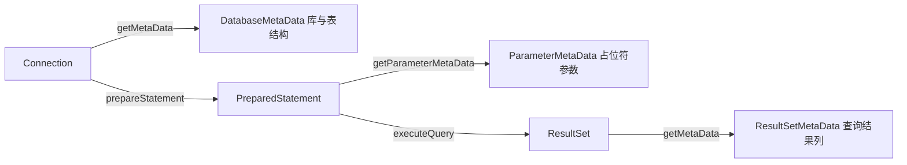

# ParameterMetaData：数一数预编译 SQL 里到底有几个问号

三种 JDBC 元数据里，参数元数据存在感最低：能干的事少，靠得住的方法更少。但它把「元数据都挂在谁身上」这件事补完整了：库信息挂在 Connection 上，结果列信息挂在 ResultSet 上，SQL 占位符参数的信息，就挂在 PreparedStatement 上。

## 先给结论

- ParameterMetaData 通过 `pstmt.getParameterMetaData()` 获取，描述预编译 SQL 里占位符参数的个数、类型等属性。
- 靠得住的方法只有 `getParameterCount()`，返回占位符个数；类型、精度、小数位等方法别轻易信。
- MySQL 5.x 驱动默认拿不到参数类型信息，getParameterType 直接抛 SQLException；打开连接参数 generateSimpleParameterMetadata 后不再抛异常，但返回的一律是 VARCHAR 的简化值。
- 它在通用 DAO、框架层有零星用途，业务代码里几乎用不到，理解即可。

## 一、获取链路：挂在预编译语句上

连接代码与前面一致，init 方法里建连接（URL 直接定位 ihrm 库），测试方法里发一条带占位符的查询：

```java
private Connection connection;

@Before
public void init() throws Exception {
    String driver = "com.mysql.jdbc.Driver";
    String url = "jdbc:mysql://127.0.0.1:3306/ihrm?useUnicode=true&characterEncoding=utf8";
    Properties props = new Properties();
    props.put("remarksReporting", "true"); // 获取数据库的备注信息
    props.put("user", "root");
    props.put("password", "111111");
    Class.forName(driver); // 注册驱动
    connection = DriverManager.getConnection(url, props);
}
```

```java
// 测试参数元数据：select * from bs_user where id = '1063705482939731968'
@Test
public void test() throws Exception {
    String sql = "select * from bs_user where id = ?";
    PreparedStatement pstmt = connection.prepareStatement(sql);
    pstmt.setString(1, "1063705482939731968");

    // 通过预编译语句获取参数元数据
    ParameterMetaData metaData = pstmt.getParameterMetaData();
    int count = metaData.getParameterCount();
    System.out.println(count); // 输出 1
}
```

SQL 里写了一个 `?`，setString 填了一个值，getParameterCount 就返回 1；问号写成两个，返回就是 2。它数的是 SQL 字符串里的占位符，和 set 了什么值、值是什么类型都没有关系。

数出来的个数还有一处容易误判：问号必须落在占位符的位置上，写进注释或字符串字面量里的问号不被驱动认作参数，赋值时会直接报参数越界。排查这类问题时，先把 SQL 原文打印出来逐个核对问号位置，再对照 getParameterCount 的返回值，两边对得上才继续赋值，否则第几个参数错了很难从堆栈里直接看出来。

## 二、方法不少，靠得住的只有一个

ParameterMetaData 接口定义了一整套方法：getParameterType 返回指定位置参数的 SQL 类型编号，getParameterTypeName 返回类型名，getParameterClassName 返回建议的 Java 类型，getPrecision 与 getScale 返回精度和小数位数，isNullable 返回是否允许 null。课程里实测的结论很直白：MySQL 驱动下，除 getParameterCount 之外的方法都不准确。

| 方法 | 返回内容 | MySQL 驱动下的表现 |
|---|---|---|
| getParameterCount | 占位符参数个数 | 准确可用 |
| getParameterType / getParameterTypeName | 参数的 SQL 类型 | 默认抛异常，开启简化开关后一律 VARCHAR |
| getPrecision / getScale | 精度、小数位数 | 不可靠 |
| getParameterClassName | 建议的 Java 类型 | 不可靠 |

原因在协议层面。MySQL 服务端对 prepare 请求的应答里，只描述结果集的列，不描述占位符的类型；占位符参数的类型本来就取决于执行前 set 进去的值，在真正执行之前谁也说不准。驱动为了不报错留了一个开关：连接参数里加 `generateSimpleParameterMetadata=true`，getParameterType 就不再抛异常，但返回的一律是 VARCHAR，属于有结果但不真实的简化信息。Oracle 这类数据库在预编译阶段就把参数描述带回来了，同一段代码换到 Oracle 上，类型方法是有意义的。写跨库程序时，参数类型元数据不能依赖。

实际工程里更省心的策略是绕开类型方法：参数个数由调用方传入的实参数组直接给出，类型交给 setObject 按实参自行推断，两者都不必向元数据求证。真正需要 ParameterMetaData 的场景只剩框架层的防御性校验，例如通用 DAO 在循环赋值前先比对 getParameterCount 与实参数组的长度，不一致就提前报错，把参数错位拦在执行之前，这类校验开销极小，却能在问题早期给出明确提示。

## 三、三种元数据的对位

三种元数据的获取入口各不相同，范围依次收窄，参数元数据夹在中间：



图里纵向看是三个对象、三个入口：整库和表结构信息在 Connection 上，单条 SQL 的参数信息在 PreparedStatement 上，单个结果集的列信息在 ResultSet 上。参数元数据描述的范围最小，一条 SQL、几个问号而已，所以工程上用到它的机会也最少：通用 DAO 里校验参数个数、框架层做兼容性判断，基本就是全部应用面。

## 常见误区

- **以为参数元数据也从 Connection 拿**：三种元数据三个入口，DatabaseMetaData 在 Connection 上，ParameterMetaData 在 PreparedStatement 上，ResultSetMetaData 在 ResultSet 上。
- **把 getParameterType 的返回值当真**：MySQL 下默认抛异常，开了 generateSimpleParameterMetadata 得到的是一律 VARCHAR 的假信息，都不代表真实类型。
- **个数与索引混为一谈**：getParameterCount 返回的是个数，参数索引从 1 开始，`setString(1, ...)` 对应第一个问号。
- **在 Oracle 上验证通过就以为全库可用**：各驱动实现差异很大，参数类型相关的元数据没有跨库一致性，跨库代码只依赖 getParameterCount。

## 面试可能被问到的问题

1. 面试官追问：「三种 JDBC 元数据分别从哪里获取？」
   答：DatabaseMetaData 从 Connection.getMetaData 拿，描述数据库与表结构；ParameterMetaData 从 PreparedStatement.getParameterMetaData 拿，描述预编译 SQL 的占位符参数；ResultSetMetaData 从 ResultSet.getMetaData 拿，描述查询结果的列。

2. 面试官追问：「getParameterCount 有什么用，什么场景用得上？」
   答：返回预编译 SQL 中占位符的个数。通用 DAO 里可以在循环赋值前校验参数个数与占位符是否匹配，框架层用它做参数绑定的一致性检查，这是它在 MySQL 下唯一完全可靠的方法。

3. 面试官追问：「为什么 MySQL 下拿不到参数的类型元数据？」
   答：MySQL 服务端对 prepare 的应答只包含结果集列的描述，不包含占位符类型；参数类型取决于执行前 set 的值，执行前无法确定。驱动默认拒绝提供，打开 generateSimpleParameterMetadata 后也只返回统一的 VARCHAR 简化值。Oracle 在预编译阶段就带回了参数描述，所以支持完整。

4. 面试官追问：「ParameterMetaData 和 ResultSetMetaData 有什么区别？」
   答：一个朝前看，一个朝后看。ParameterMetaData 描述的是执行前 SQL 里待填的占位符，ResultSetMetaData 描述的是执行后结果集里返回的列；前者在 MySQL 下基本只有参数个数可用，后者信息完整可靠，是 ORM 框架做属性映射的基础。

## 配套资料

- 连接实体（按库类型拼驱动与 URL，测试类 init 的连接信息与之一致）：`materials/code/02/day12-代码生成器原理分析/day12-代码生成器原理分析/资源/工具代码/entity/db/DataBase.java`
- 参数元数据测试类未收录进资料包，文中示例按课程写法补全
