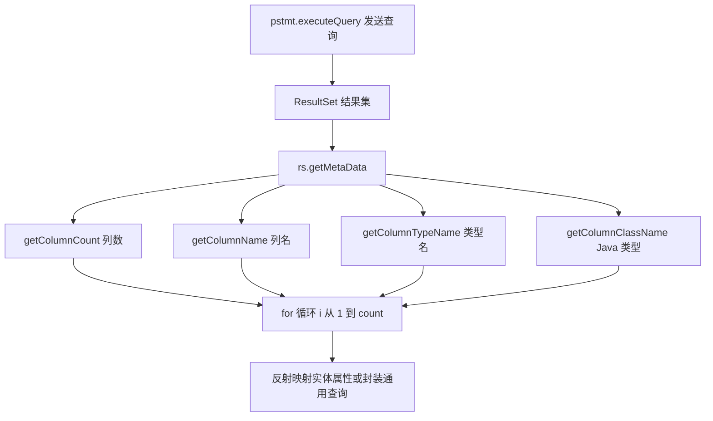

# ResultSetMetaData：把查询结果的每一列摸清楚

`select *` 一执行，数据到手了，可列的信息在编译期根本不存在：这一列叫什么、是 varchar 还是 int、映射成 Java 里的什么类型，全要等到运行时才知道。结果集元数据解决的就是这个问题，它也是三种 JDBC 元数据里被 ORM 框架用得最狠的一种。

## 先给结论

- 从结果集获取：`rs.getMetaData()`，描述的是这次查询返回的列，而不是表的定义。
- 四个高频方法：getColumnCount 列数、getColumnName(i) 列名、getColumnTypeName(i) 数据库类型名、getColumnClassName(i) 对应的 Java 类型全名。
- 列索引从 1 开始，循环条件是 `i <= count`，写成 i < count 会漏最后一列。
- 类型有三副面孔：getColumnType 返回 java.sql.Types 编号（12 是 VARCHAR、4 是 INTEGER、93 是 DATETIME），类型名给人看，ClassName 给反射用。
- 通用查询封装、ORM 的属性映射都建立在它之上，是元数据三兄弟里工程价值最高的一种。

## 一、查询之后，列信息第一次可见

连接与 SQL 准备好之后，真正发送查询拿到结果集，元数据从结果集身上取（连接复用 `@Before` 里的 init）：

```java
// 测试结果集元数据
@Test
public void test() throws Exception {
    String sql = "select * from bs_user where id = ?";
    PreparedStatement pstmt = connection.prepareStatement(sql);
    pstmt.setString(1, "1063705482939731968");

    // 发送查询，得到结果集
    ResultSet rs = pstmt.executeQuery();

    // 从结果集获取结果集元数据
    ResultSetMetaData metaData = rs.getMetaData();

    // 查询出来的列数
    int count = metaData.getColumnCount();

    for (int i = 1; i <= count; i++) {
        // 第 i 列的列名
        String columnName = metaData.getColumnName(i);
        // 第 i 列的数据库类型名
        String columnTypeName = metaData.getColumnTypeName(i);
        // 第 i 列对应的 Java 类型
        String columnClassName = metaData.getColumnClassName(i);
        System.out.println(columnName + " " + columnTypeName + " " + columnClassName);
    }
    rs.close();
    connection.close();
}
```

控制台输出（节选）：

```text
id varchar java.lang.String
mobile varchar java.lang.String
username varchar java.lang.String
password varchar java.lang.String
create_time datetime java.sql.Timestamp
```

bs_user 的 varchar 列统一映射成 java.lang.String，int 列对应 java.lang.Integer，datetime 列对应 java.sql.Timestamp。`select *` 查出来的每一列，名称、数据库类型、Java 类型一次读齐，和写 SQL 时猜列名的方式彻底告别。

列信息不依赖遍历也是它的一个特性：executeQuery 之后哪怕一次 next 都没调，元数据照样可读，驱动在执行阶段就把列描述带了回来。工程里因此可以先用元数据决定表格的列头与列顺序，再开始逐行取数，两个阶段互不干扰；读取动作本身也不会消费结果集的行，元数据循环和取数循环各走各的。

## 二、类型的三副面孔

同一个列类型，元数据给了三种表达方式，各有各的用处：

| 方法 | 返回 | 用途 |
|---|---|---|
| getColumnType(i) | int 类型编号 | 与 java.sql.Types 常量比较做逻辑分支，12 是 VARCHAR、4 是 INTEGER、93 是 TIMESTAMP |
| getColumnTypeName(i) | varchar、datetime 这类名字 | 打日志、展示给用户看 |
| getColumnClassName(i) | java.lang.String 这类全名 | 反射时确定取值目标类型，驱动已做过一次类型翻译 |

数字编号是 JDBC 规范层面的统一语言，各数据库驱动都往这套常量上对齐；类型名是数据库方言；ClassName 则是驱动帮你完成的「SQL 类型到 Java 类型」翻译。要写跨库的类型分支，用编号比较最稳；要生成代码或展示，用类型名和 ClassName。

分支写法上不必逐个编号硬记：常见做法是按大类归组，把 VARCHAR、CHAR 归为字符串一族，把 INTEGER、BIGINT 归为数值一族，按族走不同的取值与展示逻辑，比逐个编号比对更抗库间差异。java.sql.Types 的常量表在 JDK 文档里随时可查，逐个背下来没有意义，记住编号比较跨库最稳这一条就够了。

## 三、通用查询封装：它撑起 ORM 的地基

MyBatis、Hibernate 这类框架拿到查询结果后都要回答同一个问题：这一列的值该塞进实体类的哪个属性。做法就是把结果集元数据与反射串起来，列名或其驼峰形式当作属性名，按 ClassName 取值，反射调 setter 赋值。一个最小化的通用查询示例如下（资料包中无对应源码，示例为按本课写法补全）：

```java
// 示例：把任意查询结果封装成 Map 列表，列名作为 key
public List<Map<String, Object>> queryForList(Connection conn, String sql, Object... args) throws Exception {
    PreparedStatement pstmt = conn.prepareStatement(sql);
    for (int i = 0; i < args.length; i++) {
        pstmt.setObject(i + 1, args[i]);
    }
    ResultSet rs = pstmt.executeQuery();
    ResultSetMetaData metaData = rs.getMetaData();
    int count = metaData.getColumnCount();

    List<Map<String, Object>> list = new ArrayList<>();
    while (rs.next()) {
        Map<String, Object> row = new LinkedHashMap<>();
        for (int i = 1; i <= count; i++) {
            // getColumnLabel 兼容带别名的列
            row.put(metaData.getColumnLabel(i), rs.getObject(i));
        }
        list.add(row);
    }
    rs.close();
    pstmt.close();
    return list;
}
```

把 Map 的 key 从列名换成驼峰属性名，再用反射赋给实体对象，就是一行结果变成一个 Java 对象的完整过程，MyBatis 的自动映射走的就是这条路线。封装里还有两个不起眼但重要的选择：Map 用 LinkedHashMap 是为了让 key 的顺序与 SQL 的列顺序保持一致，排查数据问题时肉眼即可对照；可变参数 args 为空时赋值循环体一次都不执行，同一段代码就能同时服务带占位符与不带占位符的两种 SQL。整条链路如下：



图里 D 到 G 四路信息在循环里合流，i 从 1 起步、到 count 收尾，这条循环写对了，任意 SQL 的结果都能被程序「看懂」。

## 常见误区

- **循环写成 i < count**：列索引从 1 开始，getColumnCount 返回的是列数，条件要用 `i <= count`，否则最后一列永远拿不到。
- **取别名列还用 getColumnName**：SQL 里写了 `as` 别名时应该取 getColumnLabel，部分驱动下 getColumnName 返回的是原始列名。
- **把 getColumnType 的数字直接展示**：93 之类的编号要翻译成 Types 常量名或类型名再输出，用户看不懂裸编号。
- **以为结果集元数据能查表结构**：它只描述本次查询返回的列，查了几列就管几列，表级与库级信息在 DatabaseMetaData 里。

## 面试可能被问到的问题

1. 面试官追问：「ResultSetMetaData 怎么获取，常用方法有哪些？」
   答：执行查询拿到 ResultSet 后调 `rs.getMetaData()`。常用 getColumnCount 返回列数，getColumnName 返回列名，getColumnTypeName 返回数据库类型名，getColumnClassName 返回映射的 Java 类型，注意列索引从 1 开始。

2. 面试官追问：「getColumnType 返回 12、4、93 分别是什么？」
   答：它们是 java.sql.Types 里的常量值，12 是 VARCHAR，4 是 INTEGER，93 是 TIMESTAMP。编号是 JDBC 规范的统一表达，跨数据库比较类型时用它，展示时换成类型名。

3. 面试官追问：「MyBatis 是怎么把查询结果映射到实体属性的？」
   答：内部通过 ResultSetMetaData 读出每一列的名称与类型，把列名或其驼峰形式对准实体属性名，再通过反射调用 setter 赋值。开启 mapUnderscoreToCamelCase 后，下划线列名会自动转驼峰匹配。

4. 面试官追问：「getColumnName 和 getColumnLabel 有什么区别？」
   答：getColumnLabel 返回 SQL 里 as 指定的别名，没有别名时等于列名；getColumnName 在多数驱动下返回原始列名。通用封装里应该用 getColumnLabel，保证别名也能正确作为 key。

5. 面试官追问：「怎么封装一个任意 SQL 都能执行的通用查询？」
   答：占位符用可变参数循环 setObject 赋值，执行后用 ResultSetMetaData 读列数与列名，把每行数据按列装进 LinkedHashMap，返回 List 包 Map 的结构。要映射实体就在这一步把列名转驼峰后反射赋值。

## 配套资料

- 列实体与表实体（元数据在代码生成器中的落地形态）：`materials/code/02/day12-代码生成器原理分析/day12-代码生成器原理分析/资源/工具代码/entity/db/Column.java`、同目录 `Table.java`
- 列名驼峰处理工具（真实工具类，含 toJavaVariableName 等方法）：`materials/code/02/day12-代码生成器原理分析/day12-代码生成器原理分析/资源/工具代码/utils/StringUtils.java`
- 结果集元数据测试类未收录进资料包，test 示例按课程写法补全，queryForList 为补全示例
