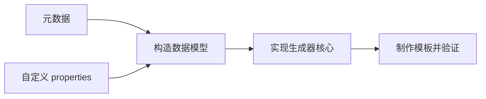
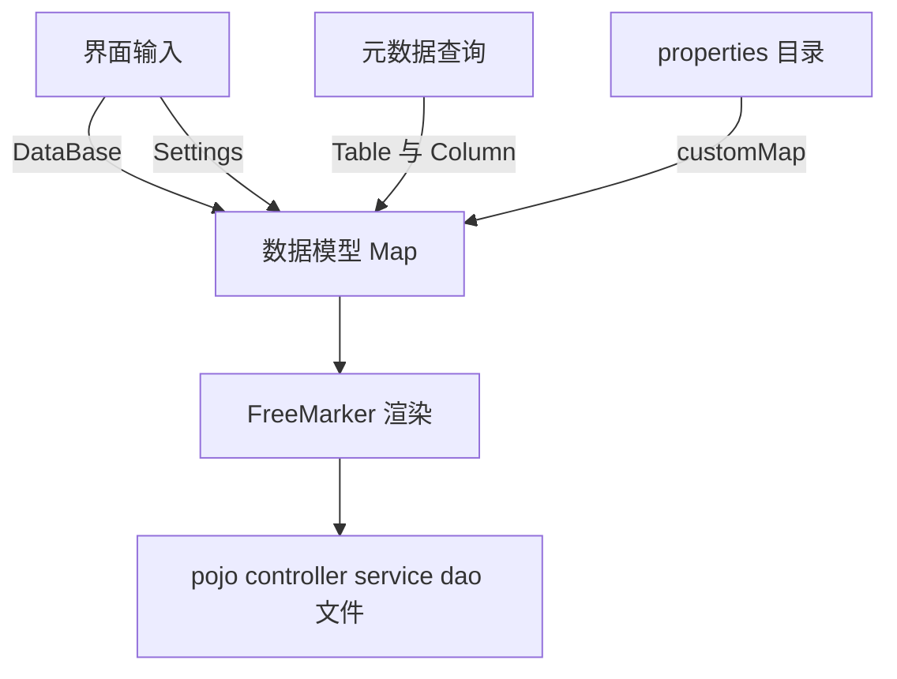

# 数据模型开工：模板要吃的两路货源与组装思想

FreeMarker 的公式已经清楚：数据模型加模板，渲染成文件。模板语法练过了，元数据怎么查也练过了，剩下的问题是把它们接起来：数据模型里到底装什么、从哪来。生成器的数据有两个来源，数据库元数据是一路，用户自定义配置是另一路，需求先拆清楚，后面写代码才不乱。

## 先给结论

- 数据模型是两路货源的汇合：元数据路（表、字段、主键、注释）加自定义路（properties 里的键值对）。
- 元数据不直接进 Map，先落成 `Table` 与 `Column` 对象，一张表一个对象，加工（去前缀、转驼峰、类型映射）在赋值阶段做完。
- 一份表数据能衍生一整套文件：表名 `bs_user` 给出类名 `User`，再派生 `UserController`、`UserService`、`UserDao`。
- 模板消费的 key 是固定的：`${ClassName}`、`${pPackage}`、`${table.name}`、`${table.columns}`、`${column.columnName2}`、`${column.columnType}`，资料包里的现成模板可逐一对号。
- 组装动作集中在一个门面里：界面输入、元数据、自定义配置在 core 汇成同一棵 Map 树，交给 FreeMarker 渲染。

## 一、实现篇的三块任务

环境搭建阶段把实体、工具、界面备齐了，实现阶段按三步走：



数据模型是第一块，也是模板的粮食；核心逻辑负责把元数据变成模型、驱动渲染、落盘；最后做一套自己的模板跑全流程，验证生成器产出是否符合预期。

## 二、元数据这一路：从表到对象，再到 Map

写 Java 的人眼里没有裸表，只有类。元数据的第一步是翻译：表名按规则转类名，`bs_user` 变 `User`；字段名转属性名，`user_name` 变 `userName`；字段类型经映射表转成 Java 类型；主键标记、表注释、列备注原样带走。这些信息在 day12 已建模成 `Table` 与 `Column`，实现时要做的就是查询元数据给它们赋值，然后以一张表为单位放进数据模型。

模板里用到哪些 key，看资料包里现成的实体类模板最直接：

```java
package ${pPackage}.pojo;

@Entity
@Table(name = "${table.name}")
public class ${ClassName} implements Serializable {

    <#list table.columns as column>
    <#if column.columnKey??>
    @Id
    </#if>
    private ${column.columnType} ${column.columnName2};
    </#list>

    <#list table.columns as column>
    public ${column.columnType} get${column.columnName2?cap_first}() {
        return this.${column.columnName2};
    }
    public void set${column.columnName2?cap_first}(${column.columnType} value) {
        this.${column.columnName2} = value;
    }
    </#list>
}
```

对照模板可以列出一张供给表，模板要的每一份内容都有明确出处：

| 模板占位符 | 数据来源 |
|---|---|
| `${ClassName}` | 表名加工：去前缀、下划线转驼峰、首字母大写 |
| `${pPackage}` | 界面输入的包名，存进 `Settings` |
| `${table.name}` | 元数据里的原始表名 |
| `${table.columns}` | 元数据里的列集合，每个元素是一个 `Column` |
| `${column.columnName2}` | 列名加工后的属性名 |
| `${column.columnType}` | 数据库类型经映射表翻译后的 Java 类型 |
| 自定义 key | `properties` 目录下的配置，进 `customMap` |

一张表的元数据喂进去，出来的就是完整 pojo；同一份 `Table` 数据换个模板，就能产出 Controller、Service、Dao。一份元数据养活一套文件，这正是表名转类名规则值得单独封装成工具方法的原因。

## 三、自定义这一路：给模板开扩展口

总有一些数据数据库里查不到：生成的文件头要写哪个作者、某个模块要不要额外生成测试类、团队约定的命名开关。这类内容约定用户写成 properties 键值对，放到工程指定的 `properties` 目录，加载器在启动时全部收进 `customMap`，模板里直接引用。元数据管「数据库里有的」，自定义配置管「数据库里没有的」，两路合流才构成完整的数据模型。

## 四、组装思想：一个门面收拢三路输入



核心门面的方法签名在搭环境时已定型：`generatorByTable(DataBase db, String tableName)`。设计是按表驱动：来一张表，查它的元数据、建 `Table` 对象、与 `Settings`、`customMap` 合并成 Map 树、选模板渲染、按包名落盘。库里有三十张表就循环跑三十轮，数据模型的结构不因表的数量而变化，模板也不用关心「我服务的是第几张表」。

## 常见误区

- **把数据模型当一个大平 Map**：所有信息拍平成键值对，表一多 key 就冲突。正确姿势是结构化对象保结构（`Table`、`Column`），Map 只做最外层容器。
- **表名转换只做首字母大写**：漏了去前缀和下划线转驼峰，生成出来的类叫 `Bs_user`，模板没写错也全盘皆输。
- **以为模板能直接用数据库类型**：`columnDbType` 里是 `VARCHAR`、`DATETIME` 这类数据库方言，直接写进字段声明编译不过，必须经类型映射翻成 `String`、`java.util.Date`。
- **按整库一次性组装**：把所有表塞进同一个模型再渲染，模板要自己处理多表循环，复杂到失控。按表驱动、一张表渲染一轮，逻辑最简单。

## 面试可能被问到的问题

1. 面试官追问：「FreeMarker 的数据模型是什么结构？」
   答：本质是一棵命名树，常用 Map 承载，模板里的 `${table.name}` 就是按路径取 `table` 下的 `name`。对象、List、Map 可以任意嵌套，`<#list table.columns as column>` 遍历的就是树上的集合节点。

2. 面试官追问：「一张表要生成 pojo、dao、service、controller 多个文件，数据模型怎么组织？」
   答：元数据只查询一次，组装成同一个 `Table` 对象，不同模板各自消费这份数据。循环粒度是表，每个文件是一次独立的模板渲染，输出路径由包名与文件类型共同决定。

3. 面试官追问：「为什么元数据要先转成实体对象再进 Map？」
   答：对象字段是强约定的，去前缀、转驼峰、类型映射这些加工在赋值时一次做完并校验；直接把查询结果塞 Map，模板就得自己处理空值和命名，逻辑散落难维护。

4. 面试官追问：「用户自定义数据为什么选 properties 而不是 JSON？」
   答：键值对场景 properties 足够，JDK 原生 `Properties` 类零依赖加载，行级注释对配置说明友好，也不用关心嵌套语法。需要结构化嵌套表达时再考虑 YAML 或 JSON。

## 配套资料

- 实体与核心壳：`materials/code/02/day12-代码生成器原理分析/day12-代码生成器原理分析/资源/工具代码/entity/db/Table.java`、`entity/db/Column.java`、`core/GeneratorFacade.java`
- 消费数据模型的现成模板：`materials/code/02/day13-代码生成器实现/day13-代码生成器实现/资源/SpringBoot模板/${path2}_${project}/src/main/java/${path1}/${path2}/${path3}/pojo/${ClassName}.java`
- 同一模板目录下还有 Controller、Service、Dao 模板，可对照看各自消费哪些 key
