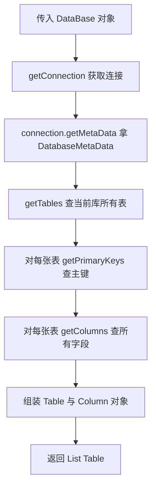

# 元数据处理上篇：把数据库的表和列反向读成 Table 与 Column

代码生成器要干活，前提是知道库里有什么。用户在界面上选好数据库、点完下一步，生成器必须把这个库里所有表、每张表的所有列都摸清楚，才有资格谈「生成」。靠人手工描述表结构不是不行，而是每换一个库就要重来一遍。这一步的正解是 JDBC 元数据：让数据库自己交代自己长什么样，代码只负责把交代结果装进对象。

## 先给结论

- 元数据处理只做一件事：加载指定数据库里的所有表和每张表的所有列，封装进 `Table` 与 `Column` 两个实体，它们就是将来模板要用的元数据模型。
- 落点在 `DataBaseUtils` 工具类里新增 `getDbInfo` 方法：static 工具方法，入参 `DataBase db`，返回 `List<Table>`，一个表一个元素。
- 操作步骤固定五步：获取连接、拿 `DatabaseMetaData`、`getTables` 查所有表、对每张表查主键与字段、组装 Java 对象。
- 表名不能直接当类名：先按配置 `tableRemovePrefixes` 删掉业务前缀，再把单词首字母转大写，`co_company` 变 `Company`。
- 主键用 `getPrimaryKeys` 查出后拼成逗号分隔的字符串存进 `Table`，复合主键也装得下。

## 一、要装什么：Table 与 Column 的字段设计

先把两个实体的长相看清楚，它们在资料包里已经备齐，属于 `entity.db` 包。`Table` 承载一张表：

```java
package com.example.generate.entity.db;

import java.util.List;

/**
 * 表实体
 */
public class Table {

    private String name;          // 表名称
    private String name2;         // 处理后的表名称，即抽象出的实体类名
    private String comment;       // 表注释
    private String key;           // 主键列，可能是复合主键拼接
    private List<Column> columns; // 列集合
    // getter/setter 省略
}
```

`Column` 承载一列，字段比表多一个维度：既存数据库侧的名字和类型，也存 Java 侧的名字和类型。

```java
package com.example.generate.entity.db;

/**
 * 列对象
 */
public class Column {

    private String columnName;     // 列名称
    private String columnName2;    // 处理后的列名称，即属性名
    private String columnType;     // 列的 Java 类型
    private String columnDbType;   // 列的数据库类型
    private String columnComment;  // 列备注
    private String columnKey;      // 是否主键
    // getter/setter 省略
}
```

两边的对应关系值得多看一眼。`name` 与 `name2`、`columnName` 与 `columnName2` 成对出现，前者是数据库里的原样，后者是加工后的 Java 名字；`columnType` 与 `columnDbType` 也是一对，数据库的 `VARCHAR` 对应 Java 的 `String`，`DATETIME` 对应 `java.util.Date`，翻译规则来自上一课的 `typeConverter.properties` 映射表。设计阶段就拆成六个独立字段，模板里才能各取所需：写建表语句用 `columnDbType`，写字段声明用 `columnType`。

## 二、方法设计：getDbInfo 的签名与五步

工具类 `DataBaseUtils` 之前已经有 `getSchemas`，负责列出所有库名。现在往同一个类里补第二个方法，专门干元数据组装：

```java
/**
 * 获取数据库中的表和字段，构造实体类 Table 对象
 * 1.参数：DataBase 数据库对象
 * 2.操作步骤：
 *   1) 获取连接
 *   2) 获取 DatabaseMetaData
 *   3) 获取当前数据库中的所有表
 *   4) 获取每个表中的所有字段
 *   5) 创建 Java 对象
 */
public static List<Table> getDbInfo(DataBase db) throws Exception {
}
```

**第一，入参为什么只有一个 `DataBase`？** 连接四要素（驱动、URL、用户名、密码）在上一阶段的实体类里已经封装好了，`DataBase` 构造时连 URL 都拼完了，方法里不需要再传散装参数。**第二，返回值为什么是 `List<Table>`？** 一个数据库有很多表，一个表对应一个 `Table` 对象，方法天然要返回集合。**第三，为什么写 static？** 它是无状态的工具方法，不依赖任何实例字段，直接类名调用最省事。

五步操作串起来是这样：



图里最关键的分叉在 F：`getTables` 是一次查询，而 `getColumns` 在循环体里对每张表各查一次，表越多，查询次数越多。这条「一查多查」的结构决定了整个方法的性能形态，也决定了连接必须保持打开直到全部查完。

## 三、查表的骨架：getTables 的四个参数

元数据的入口是连接对象，拿到 `DatabaseMetaData` 之后调 `getTables`。这四个参数在元数据练习课里拆过，这里复述一遍边界条件：

```java
// 1.获取连接
Connection connection = getConnection(db);
// 2.获取元数据
DatabaseMetaData metaData = connection.getMetaData();
// 3.获取当前数据库中的所有表
ResultSet tables = metaData.getTables(null, null, null, new String[]{"TABLE"});
List<Table> list = new ArrayList<>();
while (tables.next()) {
    Table tab = new Table();
    // 表的基本信息赋值，列集合稍后处理
    list.add(tab);
}
return list;
```

**catalog** 在 MySQL 里就是库名，传 `null` 表示不限定，直接用连接 URL 里指定的那个库；Oracle 里 catalog 概念不同，通常也是 `null`。**schemaPattern** 在 MySQL 场景下传 `null`。**tableNamePattern** 传 `null` 或空串表示查所有表，想只查某张表就在这里给表名，还可以用 `%` 做模糊匹配。**types** 是类型过滤器，`TABLE` 只要真表，`VIEW` 是视图，传 `new String[]{"TABLE"}` 就把视图挡在外面，生成的实体不会莫名其妙多出一批。

方法开头声明 `List<Table> list = new ArrayList<>()`、结尾 `return list`，先搭好骨架再填循环体，是这类「遍历结果集组装对象」代码的惯用写法，边写边编译不报错。

## 四、每个 Table 的四件套赋值与表名加工

循环体里先填 `Table` 的四个基本信息：表名、注释、主键、类名。

```java
while (tables.next()) {
    Table tab = new Table();
    // 1.表名：co_company
    String tableName = tables.getString("TABLE_NAME");
    // 2.类名：Company
    String className = removePrefix(tableName);
    // 3.表注释
    String remarks = tables.getString("REMARKS");
    // 4.主键：可能复合，逐个取出拼接
    ResultSet primaryKeys = metaData.getPrimaryKeys(null, null, tableName);
    String keys = "";
    while (primaryKeys.next()) {
        String keyname = primaryKeys.getString("COLUMN_NAME");
        keys += keyname + ",";
    }
    tab.setName(tableName);
    tab.setName2(className);
    tab.setComment(remarks);
    tab.setKey(keys);
    list.add(tab);
}
```

主键的取法和查表是同一个套路：`getPrimaryKeys` 前两个参数与 `getTables` 一样传 `null`，第三个参数是当前表名。结果集可能多行，因为存在复合主键，逐行取出列名用逗号拼进同一个字符串。拼完尾巴会多一个逗号，后续判断主键时按逗号拆分，这个尾巴不影响结果，不用急着处理。

真正的重头戏是 `removePrefix`，表名到类名的全部清洗逻辑都在这：

```java
public static String removePrefix(String tableName) {
    // 从配置读要删的前缀，如 "co_,tb_,bs_"
    String prefix = PropertiesUtils.customMap.get("tableRemovePrefixes");
    String temp = tableName;
    for (String pf : prefix.split(",")) {
        temp = StringUtils.removePrefix(temp, pf, true);
    }
    return StringUtils.makeAllWordFirstLetterUpperCase(temp);
}
```

三段逻辑各有分工：配置项 `tableRemovePrefixes` 列出所有要删的前缀，逗号分隔，想支持新前缀只改配置不改代码；`StringUtils.removePrefix` 逐个尝试删除，第三个参数传 `true` 表示忽略大小写，`CO_` 和 `co_` 一视同仁；`makeAllWordFirstLetterUpperCase` 处理下划线，按 `_` 切词后每个单词首字母大写再拼接。`co_company` 先被删掉 `co_`，剩下 `company`，再转成 `Company`；如果配置里没删干净，`co_user_info` 也会被转成 `CoUserInfo`，至少保证是合法类名。这个方法生成的名字直接进 `Table` 的 `name2`，后面模板里的类声明、文件名全靠它。

## 常见误区

- **types 参数随手传 `null`**：视图也会被查出来，库里有几十个视图时生成的实体列表里混满垃圾。明确传 `new String[]{"TABLE"}`。
- **表名直接当类名**：`co_company` 不删前缀不转驼峰，生成的类叫 `Co_company`，既不合法也不符合约定。类名必须走 `removePrefix` 加工。
- **catalog 乱填库名**：URL 里已经指定了库，再在 catalog 里填一遍反而容易因大小写或权限问题查空。拿不准就传 `null`，跟连接走。
- **在循环里提前 `return list` 或关连接**：主键、字段都还要靠这个连接查，连接一关后续全是 `SQLException`。收尾动作统一放在所有查询完成之后。

## 面试可能被问到的问题

1. 面试官追问：「JDBC 有哪三种元数据，各自管什么？」
   答：`DatabaseMetaData` 管数据库整体信息，如表列表、主键、库名；`ParameterMetaData` 管预编译 SQL 的参数个数与类型；`ResultSetMetaData` 管结果集的列信息。做逆向工程主要用第一种。

2. 面试官追问：「`getTables` 的四个参数分别是什么，怎么填？」
   答：catalog 限定库，MySQL 传 `null` 跟随连接；schemaPattern 限定模式，MySQL 传 `null`；tableNamePattern 是表名匹配模式，`null` 表示全部；types 是类型数组，传 `TABLE` 只取真表。

3. 面试官追问：「表名转类名要做哪些清洗，为什么？」
   答：删业务前缀让类名与业务语义一致，按下划线切词并大写驼峰保证是合法且符合规范的 Java 标识符。清洗规则外置到配置，换库只改配置。

4. 面试官追问：「复合主键在你的模型里怎么表示？」
   答：`getPrimaryKeys` 对复合主键返回多行，逐行取列名拼成逗号分隔字符串存进一个字段。模板渲染时按逗号拆开即可还原成多个主键列。

5. 面试官追问：「这种元数据驱动的方案有什么性能隐患？」
   答：`getTables` 和循环里的 `getColumns`、`getPrimaryKeys` 都是真实数据库往返，本质是查信息模式，表多时明显变慢。改进方向是缓存结果、按需查询，或限制 tableNamePattern 缩小范围。

## 配套资料

- Table 与 Column 实体真实代码：`materials/code/02/day12-代码生成器原理分析/day12-代码生成器原理分析/资源/工具代码/entity/db/Table.java`、`entity/db/Column.java`
- 表名加工与主键判断用到的工具类：`materials/code/02/day12-代码生成器原理分析/day12-代码生成器原理分析/资源/工具代码/utils/StringUtils.java`
- 前缀与类型映射配置：`materials/code/02/day13-代码生成器实现/day13-代码生成器实现/资源/代码/typeConverter.properties`
- `DataBaseUtils.getDbInfo` 的课堂实现未随资料包提供，文中代码按视频讲解与真实实体类补全
