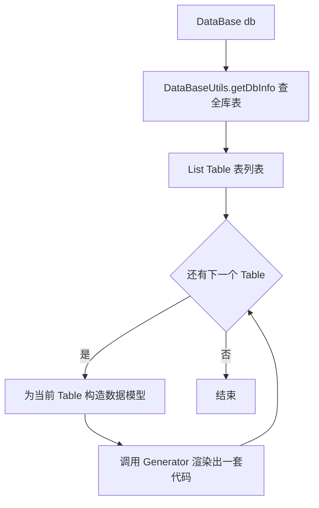

# 代码生成主流程需求分析：从 UI 到 Generator 只需要两个类

数据模型这一侧已经齐了：自定义配置装进了 `customMap`，数据库的表和列装进了 `Table` 与 `Column`。接下来轮到生成这一侧。真正动手前值得把需求分析做扎实，否则很容易把生成逻辑全写进界面按钮的监听器里，界面、取数、渲染搅成一团，改一个模板路径都要翻半天代码。

## 先给结论

- 整个生成侧只需要两个类：`GeneratorFacade` 统一调用入口，`Generator` 代码生成核心处理类，都放在 `core` 包下。
- `GeneratorFacade` 干三件事：采集 UI 界面的输入数据、根据数据库信息构造数据模型、调用核心处理类；它是过渡层，不是终点。
- `Generator` 干两件事：获取所有模板、用数据模型和模板完成代码生成。
- UI 一共传四样东西：模板路径、输出路径、`Settings` 工程配置对象、`DataBase` 数据库配置对象。
- 生成节奏是逐表驱动：`getDbInfo` 拿到全库表列表，一个 `Table` 生成一套代码，for 循环走几遍就有几套。

## 一、两个类的分工

把整个生成器画成一条链，只有三个节点：

**第一层，UI 界面。** Swing 窗口负责收集人的输入：连接库、选模板、填项目信息。它只管收集，不做任何生成动作。

**第二层，`GeneratorFacade`。** 三个职责缺一不可：采集 UI 传来的全部输入；调 `DataBaseUtils.getDbInfo(db)` 拿到 `List<Table>` 并据此构造数据模型；最后调用 `Generator` 完成生成。它自己不写文件、不碰模板，存在的意义是让 UI 与核心解耦：界面上怎么改布局、数据从哪来，`Generator` 都不用知道。

**第三层，`Generator`。** 纯粹的渲染引擎，两个动作：把模板目录下的模板全部加载进来，再对每个数据模型渲染出文件。FreeMarker 的公式在这里兑现：数据模型 + 模板 = 输出文件。

这套分工本质是门面模式的落地：`GeneratorFacade` 就是那个门面，外部只看到「new 一个、调一个方法」，内部怎么取元数据、怎么拼模型全被遮住。

## 二、UI 到底传什么

需求分析阶段最容易被含糊带过的就是「UI 传什么」。界面上能拿到的其实就四样：

| 采集项 | 类型 | 含义 |
|---|---|---|
| 模板路径 | `String` | 模板所在的文件夹路径，不是单个模板文件 |
| 输出路径 | `String` | 生成代码要放到的目标目录 |
| 工程配置 | `Settings` | 项目名、包名、中文名、作者，界面填写后封装 |
| 数据库配置 | `DataBase` | 类型、URL、用户名、密码，连接页传过来 |

模板路径这一点值得单独强调：界面上的「模板」下拉框选的不是 Vue 模板或某个具体文件，而是一个文件夹，里面放着一套模板。选路径的本质是告诉生成器「去这个目录下加载所有模板」，一套模板对应一种技术栈的工程形态。

输出路径同理，它决定生成物落在哪。后面的包名会按 `.` 拆成目录段拼在输出路径下，所以这个配置直接决定最终生成的物理目录结构。

## 三、逐表驱动：一个 Table 一套代码

数据从哪来已经定了：`DataBaseUtils.getDbInfo(db)` 返回 `List<Table>`，每个 `Table` 带着表名、类名、注释、主键和列集合。生成侧的驱动方式因此自然浮现：

一个表对应一套程序：`Company` 表生成 `Company` 实体、`CompanyDao`、`CompanyService`、`CompanyController`，资料包里那种一整个目录的生成物就是这么来的。所以循环体里每轮做两件事：为当前 `Table` 准备一份数据模型，调用一次 `Generator`。表列表有几条，套模板就执行几次，逻辑简单但边界清楚：任何一张表的数据有问题，影响的也只是它自己那套代码。

## 四、核心类的三个依赖

`Generator` 要跑起来，缺三样数据，这也是 `GeneratorFacade` 调它时的传参依据：

**第一，数据模型。** FreeMarker 渲染的唯一输入，`Map<String, Object>` 形态，里面装自定义配置、`Table` 元数据、`Settings` 的键值视图。模型怎么拼，是入口类的主活。

**第二，模板的位置。** 模板路径从 UI 一路传下来，`Generator` 据此加载模板集合。模板里 `${className}`、`<#list table.columns as column>` 这些占位符，等的就是模型里对应的数据。

**第三，生成文件的路径。** 输出路径加包名分段拼出目标目录，模板渲染出的字符串写进对应的 `.java` 文件。

需求分析到这一步，两个类的职责、传参、数据流全部落定，剩下的就是把分析结果翻译成代码：在 `core` 包下先建出 `GeneratorFacade` 与 `Generator` 两个空类，下一课开始往里填实现。

## 常见误区

- **把生成逻辑写进按钮监听器**：界面一改就全崩，也没法脱离 UI 复用。生成逻辑独立成 `GeneratorFacade` 与 `Generator`，监听器只做一次转发。
- **模板路径选成单个模板文件**：生成一套工程需要多个模板协作，选文件只能生成一个类。传目录路径，让核心类加载目录下全部模板。
- **忘了逐表循环**：拿第一个 `Table` 渲染完就收工，一整个库只出一套代码。驱动单位是 `Table`，循环必须有。
- **门面层直接写文件**：`GeneratorFacade` 一旦自己碰 IO，UI 与渲染的解耦就名存实亡。写文件是 `Generator` 的事，门面只管准备与转发。

## 面试可能被问到的问题

1. 面试官追问：「为什么中间要垫一层 `GeneratorFacade`，UI 直接调 `Generator` 不行吗？」
   答：直接调会让 UI 承担取元数据、拼模型等职责，核心类被迫暴露给界面层。门面把数据采集、模型组装集中在一个入口，UI 只传四个参数，核心类只认数据模型，两层各自演化互不影响。

2. 面试官追问：「门面模式在 Java 体系里还有哪些常见例子？」
   答：`java.net.URL` 打开了网络编程的门面，内部封装了协议处理器；SLF4J 是日志体系的门面，屏蔽底层 Logback、Log4j 的差异；MyBatis 的 `SqlSession` 也算数据操作的门面。共同点是用一个统一入口收拢复杂子系统。

3. 面试官追问：「为什么一个表一次生成，而不是把整库拼成一个大模型一次渲染？」
   答：模板的最小复用单位是一套工程文件，数据边界就是一个表。按表驱动让每次渲染的数据简单、出错时可定位，新增或重生成某张表也不牵连别的表。

4. 面试官追问：「FreeMarker 完成一次渲染需要哪三样东西？」
   答：模板（Template 对象）、数据模型（`Map<String,Object>`）、输出目标（Writer 或文件路径）。配置对象 `Configuration` 负责加载模板并组织前两者。

## 配套资料

- 门面类骨架真实代码：`materials/code/02/day12-代码生成器原理分析/day12-代码生成器原理分析/资源/工具代码/core/GeneratorFacade.java`
- UI 入口真实代码：`materials/code/02/day12-代码生成器原理分析/day12-代码生成器原理分析/资源/工具代码/ui/CodeUtil.java`（`generator` 方法）、`ui/DatabaseUtil.java`（连接页）
- 一套模板目录的真实样例：`materials/code/02/day13-代码生成器实现/day13-代码生成器实现/资源/SpringBoot模板/`
- `Generator` 核心处理类的实现未随资料包提供，职责划分按本课需求分析描述
