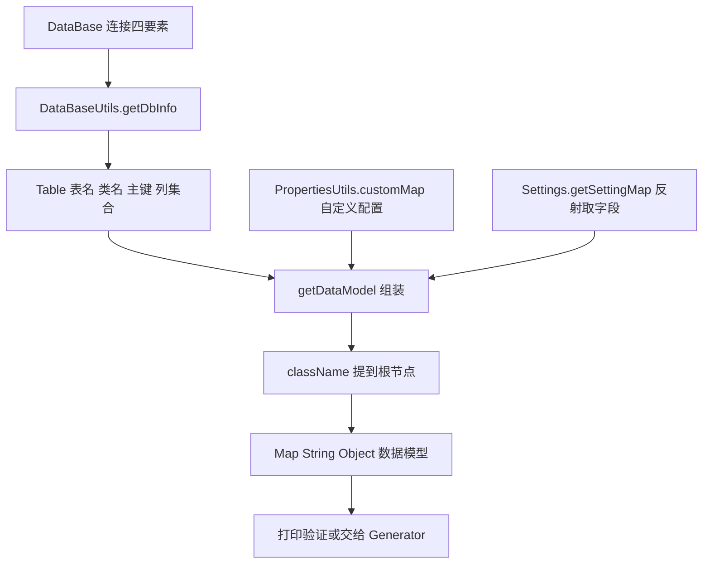

# GeneratorFacade 实战：装配数据模型并用一次打印验证全链路

需求分析把 `GeneratorFacade` 的职责定成了三条：采集 UI 输入、构造数据模型、调用核心处理类。真正写起来会发现这层类薄得惊人，四个属性、一个构造器、两个方法就完事，但恰恰是这层薄代码决定了「界面上的四个输入」如何变成「模板里的一条数据」。写完还不算完，数据模型拼得对不对，要靠一次完整的打印验证才踏实。

## 先给结论

- `GeneratorFacade` 就是四个私有属性加一个全参构造：`templatePath`、`outPath`、`settings`、`db`，对象创建的瞬间所有输入到位。
- `generatorByDatabase` 是主方法，两步走：`DataBaseUtils.getDbInfo(db)` 拿全库表列表，for 循环逐表构造并消费数据模型。
- 数据模型三部分汇成一张 `Map`：自定义配置 `PropertiesUtils.customMap`、元数据 `Table` 对象、`settings.getSettingMap()` 反射出的键值视图。
- 额外把 `className` 提到根节点，模板里 `${className}` 直取类名，不用每次都写 `table.name2`。
- 核心类还没接模板之前，验证手段就是遍历 `entrySet` 打印；控制台能看到完整的 `table=Table(name=...)` 条目，说明从连接到模型的整条链路通了。

## 一、类的骨架：四个属性与全参构造

资料包里这个类只有一个空壳方法，正式实现按课堂节奏展开。骨架先行：

```java
package com.example.generate.core;

import com.example.generate.entity.Settings;
import com.example.generate.entity.db.DataBase;

public class GeneratorFacade {

    private String templatePath; // 模板所在路径
    private String outPath;      // 代码生成路径
    private Settings settings;   // 工程配置对象
    private DataBase db;         // 数据库对象

    public GeneratorFacade(String templatePath, String outPath, Settings settings, DataBase db) {
        this.templatePath = templatePath;
        this.outPath = outPath;
        this.settings = settings;
        this.db = db;
    }
}
```

四个属性与需求分析里 UI 采集的四样输入一一对应。选择全参构造而不是一组 setter，理由很实际：这四个值是入口启动的必要条件，缺一个都没法干活，构造器把「必须传齐」变成编译期约束，`new` 的瞬间对象就是完整的，不存在半初始化状态。

## 二、generatorByDatabase：逐表驱动的主方法

主方法干两件事：准备数据模型、调用核心处理类。`Generator` 还没实现时，先把模型打印出来占位：

```java
/**
 * 1.准备数据模型
 * 2.调用核心处理类完成代码生成工作
 */
public void generatorByDatabase() throws Exception {
    List<Table> tables = DataBaseUtils.getDbInfo(db);
    for (Table table : tables) {
        // 对每一个 Table 对象进行代码生成
        Map<String, Object> dataModel = getDataModel(table);
        // 临时验证：打印模型内容，Generator 实现后替换为调用
        for (Map.Entry<String, Object> entry : dataModel.entrySet()) {
            System.out.println(entry.getKey() + "--" + entry.getValue());
        }
    }
}
```

**第一，表列表从元数据来。** `getDbInfo(db)` 一行拿到全库的 `List<Table>`，元数据处理两个课时的成果在这里被消费。**第二，循环的单位是 `Table`。** 实体类叫 `User` 还是 `City`，取决于当前循环到哪张表，一个 `Table` 对应一套将要生成的程序。**第三，打印是临时的。** 内层 `Map.Entry` 循环只为肉眼看模型，之后会被真正的 `Generator` 调用替换，这是自底向上开发时最朴素的验证手段。

## 三、getDataModel：三种数据汇成一张 Map

模型的组装独立成一个私有方法，输入一个 `Table`，输出一份完整模型：

```java
/**
 * 根据 Table 对象获取数据模型
 */
private Map<String, Object> getDataModel(Table table) {
    Map<String, Object> dataModel = new HashMap<>();

    // 1.自定义配置：类型映射、前缀规则、用户自己的 key 全在里面
    dataModel.putAll(PropertiesUtils.customMap);

    // 2.元数据：整个 Table 对象作为 table 节点
    dataModel.put("table", table);

    // 3.工程配置：Settings 的全部字段转成键值对
    dataModel.putAll(settings.getSettingMap());

    // 4.类名提到根节点，模板里 ${className} 直取
    dataModel.put("className", table.getName2());

    return dataModel;
}
```

四种数据各有来路，也各有讲究。**自定义配置用 `putAll` 整体并入**，`typeConverter.properties` 的类型映射、`tableRemovePrefixes` 前缀规则、用户自定义的 `testkey` 之类，全部平铺在模型根上，模板里 `${testkey}` 直接可用。**元数据以 `table` 为节点挂进去**，模板里 `table.name` 取表名、`table.name2` 取类名、`<#list table.columns as column>` 遍历列集合，FreeMarker 对普通 Bean 的属性访问靠 getter，`Table` 与 `Column` 早已备好。**工程配置不放对象放 Map**：`Settings` 字段太多，直接 `put` 对象后模板要写长链路，课程在 `Settings` 里专门提供了一个反射方法把全部字段转成键值对：

```java
public Map<String, Object> getSettingMap() {
    Map<String, Object> map = new HashMap<>();
    Field[] declaredFields = Settings.class.getDeclaredFields();
    for (Field field : declaredFields) {
        field.setAccessible(true);
        try {
            map.put(field.getName(), field.get(this));
        } catch (Exception e) {
        }
    }
    return map;
}
```

`getDeclaredFields` 拿到所有私有字段，`setAccessible(true)` 解开访问限制，`field.getName()` 做 key、`field.get(this)` 做值。`project`、`path1`、`path2`、`path3` 这些配置从此在模板里零成本可见，新增字段连这个方法都不用改。**类名单独上根节点**是最后一处优化：模板里类名出现频率极高，处处写 `table.name2` 太啰嗦，提一个 `className` 到根上，`public class ${className}` 一行就干净了。

一条数据从库到模型的完整旅程：



## 四、从 UI 按钮到入口：一次完整调用

模型写完要接到真实入口上。界面从连接页走到配置页后，「生成代码」按钮触发的方法就是 UI 调用程序的入口：

```java
// UI 调用程序入口
/**
 * @param templatePath 模板所在路径
 * @param outpath      选择的代码生成路径
 * @param settings     工程配置对象
 * @param db           数据库信息
 */
private void generator(String templatePath, String outpath, Settings settings, DataBase db) {
    try {
        GeneratorFacade facade = new GeneratorFacade(templatePath, outpath, settings, db);
        facade.generatorByDatabase();
    } catch (Exception e) {
        e.printStackTrace();
    }
}
```

按钮监听器从各输入框取值，拼出 `Settings` 与 `DataBase` 对象，调这个 `generator` 方法就完成了接力。跑一次全流程：连接页填用户名密码、测试连接、选库，进配置页选一个模板文件夹、选输出路径、填项目名包名与作者，点「生成代码」。控制台随即滚出每个表的数据模型。

## 五、读懂控制台输出

打印出来的模型长这样（节选，值为示例输入）：

```text
project--demo
path1--com
path2--example
path3--system
projectComment--人力资源管理系统
author--demo
VARCHAR--String
BIGINT--Long
tableRemovePrefixes--co_,tb_
testkey--testvalue
className--SysFile
table--Table(name='sys_file', name2='SysFile', comment='', key='id,',
columns=[Column(columnName='id', columnName2='id', columnType='String',
columnDbType='VARCHAR', columnComment='主键', columnKey='PRI'), ...])
```

逐段核对：开头的 `project`、`path1` 到 `path3` 来自 `Settings` 反射，包名拆分正确；`VARCHAR--String` 一类条目证明自定义配置整表并入了模型；`testkey` 是验证自定义数据能不能进模型的哨兵 key，它出现即说明用户扩展配置这条路通了；`className--SysFile` 是根节点上的类名，值与 `table.name2` 一致；最后的 `table` 条目最关键，表名、处理后的类名、主键、每一列的六元组全部在位，而且能看到 `company_id` 这类列被正确标上了主键属性。到这里，「UI 输入到数据模型」的半程链路完全打通，剩下的半程是把这张 Map 和模板一起交给 `Generator` 渲染成文件。

## 常见误区

- **把 `Settings` 对象整个 `put` 进模型**：FreeMarker 对对象取值依赖公开 getter 与可访问性，对象里字段再多模板也未必都能拿到。用 `getSettingMap` 转成平铺的键值对，模板写法最简单。
- **验证打印写 `System.out.println(dataModel)`**：Map 直接打印能看，但换行杂乱、对象字段挤在一起，靠它排查问题效率极低。遍历 `entrySet` 逐行输出才好定位。
- **`className` 忘了放根节点**：模板里 `${className}` 渲染成空，生成出的类文件名与内容全是残缺的。模型根节点要给模板的高频数据留直达通道。
- **构造器改 setter 却漏传参数**：四个输入少传一个，编译不报错、运行时才炸在某个深处。必要条件走全参构造，让缺失在编译期就暴露。

## 面试可能被问到的问题

1. 面试官追问：「门面类持有可变成员变量，线程安全吗？」
   答：这个工具是短生命周期的，一次 `new` 一次调用，字段初始化后不再改写，实际风险很低。若要并发使用，把 `generatorByDatabase` 改成接收上下文对象的纯方法、去掉可变状态更稳。

2. 面试官追问：「用反射把字段转 Map 有什么代价，有什么替代方案？」
   答：反射绕过编译期检查，字段改名静默影响模板取值，且有性能开销；异常在循环里被吞掉也不利于排障。替代方案有手动构建、Jackson 的 `convertValue`，或直接定义一个视图 DTO。

3. 面试官追问：「为什么数据模型用 `Map<String,Object>` 而不是强类型 DTO？」
   答：FreeMarker 原生就吃 Map，平铺的 key 让模板语法最短；模型要同时容纳配置、实体对象、字符串三种形态，强类型 DTO 反而要为每类模板各造一套。代价是模板里的 key 错误只能在渲染期暴露，靠测试弥补。

4. 面试官追问：「模型里既有 `table.name2` 又有 `className`，冗余吗？」
   答：是刻意冗余。`table` 节点服务遍历与批量取值，`className` 服务最高频的单点取值，两者指向同一份数据的引用，不占额外内存，换来的是模板可读性。

5. 面试官追问：「核心类还没实现时，怎么验证前面的链路是对的？」
   答：把未完成的部分替换成最简单的观察手段，这里就是遍历模型逐行打印，核对每个 key 的来源与取值。先验证数据正确再接渲染，问题出现时能一眼区分是取数错还是模板错。

## 配套资料

- 门面类真实骨架：`materials/code/02/day12-代码生成器原理分析/day12-代码生成器原理分析/资源/工具代码/core/GeneratorFacade.java`（资料包内为空壳方法，`generatorByDatabase` 与 `getDataModel` 为课堂补全实现）
- `Settings.getSettingMap` 反射方法真实代码：`materials/code/02/day12-代码生成器原理分析/day12-代码生成器原理分析/资源/工具代码/entity/Settings.java`
- UI 入口方法真实代码：`materials/code/02/day12-代码生成器原理分析/day12-代码生成器原理分析/资源/工具代码/ui/CodeUtil.java`
- 生成物参考：`materials/code/02/day13-代码生成器实现/day13-代码生成器实现/资源/测试/生成代码路径/ihrm_company/`
