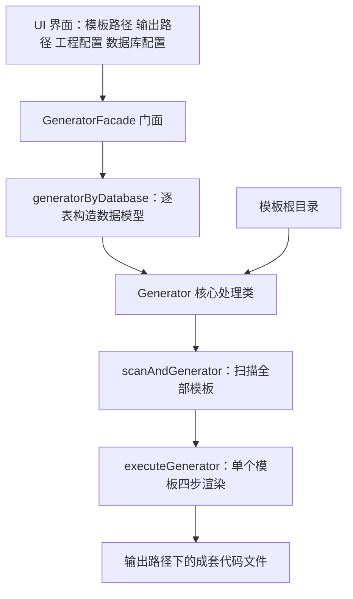
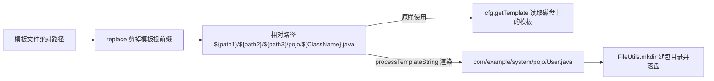

# Generator 核心类全解析：扫描模板、渲染路径、把代码写进磁盘

门面类 `GeneratorFacade` 把数据模型备齐之后，链路的下半程轮到真正的干活者登场。这个类叫 `Generator`，职责在需求分析里就被钉死了：获取模板路径下的所有模板，拿着数据模型逐个渲染，把结果写到输出路径。听起来只有一句话，实现起来却牵出四个具体问题：模板目录层层嵌套怎么扫、输出文件的包路径和文件名怎么算、渲染结果怎么落盘、多张表多个模板怎么组织循环。四个课时正好把这一个类从头写到尾，这里合并成一篇一次讲透。

## 先给结论

- `Generator` 的全部状态就是两个路径加一个 FreeMarker 配置对象：`templatePath`、`outPath`、`cfg`，三者在构造器里一次性就位。
- 主方法 `scanAndGenerator` 只有两个动作：`FileUtils.searchAllFile` 递归扫描模板目录拿到文件列表，for 循环逐个交给 `executeGenerator` 渲染。
- `executeGenerator` 固定四步：算相对路径、`cfg.getTemplate` 读模板、`FileUtils.mkdir` 建输出文件、`FileWriter` 加 `process` 写盘后关流。
- 关键设计是「路径即模板」：模板目录里的子目录名和文件名本身就带占位符，渲染之后就是输出文件的包路径与类名。
- 门面在自己的构造器里 `new` 一次 `Generator`，`generatorByDatabase` 的表循环里每张表构造一次数据模型、触发一次全量模板扫描。

## 一、职责设计：两个路径与一个 Configuration

架构图上三层各司其职：UI 界面收集模板路径、输出路径、工程配置、数据库配置四样输入；`GeneratorFacade` 负责采集输入、按表构造数据模型、统一调用核心生成器；`Generator` 则只做两件事，获取所有模板、根据数据模型和模板完成代码生成。



上图的关键分界在于「数据从哪来」：`Generator` 自己不产生模型，`scanAndGenerator` 的参数 `Map<String, Object> dataModel` 完全由门面传入，核心类只管渲染。按这个职责把类骨架写出来：

```java
package com.example.generate.core;

import freemarker.template.Configuration;

import java.io.File;
import java.util.Map;

/**
 * 代码生成器的核心处理类
 * 使用 FreeMarker 完成文件生成
 * 数据模型、模板位置、生成文件的路径
 */
public class Generator {
    private String templatePath; // 模板路径
    private String outPath;      // 代码生成路径
    private Configuration cfg;

    public Generator(String templatePath, String outPath) throws Exception {
        this.templatePath = templatePath;
        this.outPath = outPath;
        // 初始化 Configuration 对象
        cfg = new Configuration();
        FileTemplateLoader ftl = new FileTemplateLoader(new File(templatePath));
        cfg.setTemplateLoader(ftl);
    }
}
```

**两个路径是业务的必要条件，`cfg` 是渲染的基础设施。** FreeMarker 出文件必须先有一个 `Configuration`，而 `Configuration` 又必须指定模板加载器。加载器有好几种形态：`StringTemplateLoader` 吃内存里的字符串，类路径加载器从 jar 里找资源，这里模板是按工程目录组织的一整个文件夹，所以选 `FileTemplateLoader`，构造参数就是模板根目录。

**初始化时机选在构造方法。** `new Generator(...)` 的瞬间，`cfg` 就绑定好了模板根目录，之后每次读模板只需要报一个相对名字，不存在二次配置。这也是把三个属性收进构造器的原因：缺任何一个，这个对象都不具备渲染能力，不如让缺失在编译期就暴露。

## 二、扫描模板：递归把目录翻个底朝天

主方法的签名在需求阶段就定了下来：`public void scanAndGenerator(Map<String, Object> dataModel)`。实现只有两步：

```java
/**
 * 扫描生成
 * 1.扫描模板路径下的所有模板
 * 2.对每个模板进行文件生成（数据模型）
 */
public void scanAndGenerator(Map<String, Object> dataModel) throws Exception {
    // 1.根据模板路径获取此路径下所有模板文件
    List<File> fileList = FileUtils.searchAllFile(new File(templatePath));
    // 2.对每个模板进行文件生成
    for (File file : fileList) {
        executeGenerator(dataModel, file);
    }
}
```

**扫描交给工具类，自己只写流程。** 模板目录下不是平铺的一层文件，`pojo`、`dao`、`service`、`controller` 各占一个子目录，必须递归。资料包里的 `FileUtils` 已经备好了这个能力：

```java
//查询某个目录下的所有文件
public static List<File> searchAllFile(File dir) throws IOException {
    ArrayList arrayList = new ArrayList();
    searchFiles(dir,arrayList);
    return arrayList;
}

//递归获取某个目录下的所有文件
public static void searchFiles(File dir,List<File> collector) throws IOException {
    if(dir.isDirectory()) {
        File[] subFiles = dir.listFiles();
        for(int i = 0; i < subFiles.length; i++) {
            searchFiles(subFiles[i],collector);
        }
    }else{
        collector.add(dir);
    }
}
```

是目录就继续往下钻，是文件就收进集合，典型的深度优先遍历。**循环体保持一行是刻意为之。** 单个模板怎么渲染至少有四步逻辑，全塞进 for 里会让主方法膨胀到没法读，所以抽成 `executeGenerator`，扫描与渲染两个关注点就此分开。

## 三、循环渲染：executeGenerator 的四步

这是整个类的核心方法，四个步骤逐行对应模板从磁盘到落盘的完整旅程：

```java
private void executeGenerator(Map<String, Object> dataModel, File file) throws Exception {
    // 1.文件路径处理：拿到模板文件相对模板根目录的路径
    String templateFileName = file.getAbsolutePath().replace(this.templatePath, "");
    // 2.读取文件模板（相对路径，相对构造器里绑定的模板根目录）
    Template template = cfg.getTemplate(templateFileName);
    template.setOutputEncoding("utf-8"); // 指定生成文件的字符编码
    // 3.创建文件：相对路径先渲染成真实输出路径
    String outFileName = processTemplateString(templateFileName, dataModel);
    File outFile = FileUtils.mkdir(outPath, outFileName);
    // 4.模板处理（文件生成）
    FileWriter fw = new FileWriter(outFile);
    template.process(dataModel, fw);
    fw.close();
}
```

**第一步算相对路径。** `searchAllFile` 返回的是绝对路径的 `File`，而 `cfg.getTemplate` 要的是相对模板根目录的名字，用 `getAbsolutePath().replace(templatePath, "")` 把前缀剪掉，剩下的就是「子目录 + 文件名」这一段。

**第二步读模板。** `getTemplate` 的参数语义是相对路径，相对于构造器里 `FileTemplateLoader` 绑定的那个根目录。`setOutputEncoding("utf-8")` 指定的是生成文件的编码，模板里有中文注释时少这一行，输出文件就是乱码。

**第三步建文件，注意这里发生了一次渲染。** 同一个相对路径字符串还有另一重身份：它本身就是一段 FreeMarker 字符串模板。渲染这件事单独抽了个方法：

```java
public String processTemplateString(String templateString, Map dataModel) throws Exception {
    StringWriter out = new StringWriter();
    Template template = new Template("ts", new StringReader(templateString), cfg);
    template.process(dataModel, out);
    return out.toString();
}
```

它和文件模板的唯一区别在 `Template` 的数据源：文件模板由 `cfg.getTemplate` 从加载器里取，字符串模板用 `StringReader` 直接喂内容，复用同一个 `cfg` 保证配置一致。渲染结果写入 `StringWriter` 再 `toString`，就得到了替换完成的字符串。

**第四步写盘。** `FileUtils.mkdir` 的真实实现先 `new File(dir, file)` 拼出目标文件，再对父目录 `mkdirs()`，输出路径里还不存在的包目录会自动补齐。随后 `new FileWriter(outFile)` 拿到字符输出流，`template.process(dataModel, fw)` 把数据模型套进模板、以流的形式写进文件，最后 `close` 收尾。

## 四、路径计算与落盘：目录名也是模板

「路径即模板」是这个设计最值得咀嚼的地方。看资料包里那套成品模板的真实目录结构：

```text
SpringBoot模板/
└── ${path2}_${project}/
    ├── pom.xml
    └── src/main/java/${path1}/${path2}/${path3}/
        ├── CompanyApplication.java
        ├── controller/${ClassName}Controller.java
        ├── dao/${ClassName}Dao.java
        ├── pojo/${ClassName}.java
        ├── service/${ClassName}Service.java
        └── resources/application.yml
```

子目录名和文件名里全是占位符。于是 `executeGenerator` 第一步剪出来的相对路径，形如 `${path1}/${path2}/${path3}/pojo/${ClassName}.java`，拿数据模型渲染它，就得到真实的输出路径。同一根字符串的两种用法可以并排看清楚：



占位符的数据来源在数据模型里早已备好：`path1`、`path2`、`path3` 是包名拆成的三段，由 `Settings` 构造时切好并经 `getSettingMap` 反射进模型；`ClassName` 由门面从 `table.getName2()` 取出放到根节点。照这个映射，几个典型模板的落点如下：

| 模板相对路径 | 渲染后的输出路径 |
|---|---|
| `pojo/${ClassName}.java` | `pojo/City.java` |
| `${path1}/${path2}/${path3}/dao/${ClassName}Dao.java` | `com/example/system/dao/CityDao.java` |
| `${path2}_${project}/pom.xml` | `example_company/pom.xml` |

第一行来自课堂上的最小验证：模板目录放一个 `pojo/user.java`，内容只写一句 `${username}`，数据模型塞 `username=张三`，跑完输出目录里出现同名文件，内容变成了「张三」。这条最小链路通了，剩下的只是模板数量与数据丰富度的问题。

## 五、接入门面：一张表触发一次全量生成

核心类写完，最后一步是把它和入口缝合。改动的位置有两处：

```java
public class GeneratorFacade {
    private String templatePath;
    private String outPath;
    private Settings settings;
    private DataBase db;
    private Generator generator; // 核心处理类，随门面一起就位

    public GeneratorFacade(String templatePath, String outPath, Settings settings, DataBase db) throws Exception {
        this.templatePath = templatePath;
        this.outPath = outPath;
        this.settings = settings;
        this.db = db;
        // 构造门面时初始化核心类，避免每张表都 new 一遍
        this.generator = new Generator(templatePath, outPath);
    }

    public void generatorByDatabase() throws Exception {
        List<Table> tables = DataBaseUtils.getDbInfo(db);
        for (Table table : tables) {
            // 对每一个 Table 对象进行代码生成
            Map<String, Object> dataModel = getDataModel(table);
            // 调用核心处理类，完成这一轮模板的代码生成
            generator.scanAndGenerator(dataModel);
        }
    }
}
```

**`Generator` 在门面构造器里初始化一次。** 表循环里反复 `new` 的写法既啰嗦，又会让 `Configuration` 和模板加载器被无意义地重建，提出来随门面创建，循环里只剩两个动作：构造模型、触发扫描。

**循环的单位是表，扫描的单位是模板目录。** 库里有 N 张表，每张表都会把模板目录完整扫一遍、把每个模板渲染一遍。之前占位的打印代码在此时正式退役，换成真正的生成调用。

端到端验证用的是一套最小模板：文件名叫 `${ClassName}.java`，内容一行 `public class ${ClassName} {}`。从界面连库、测试连接、选库，进配置页选模板与输出路径，填项目名、包名、作者，点「生成代码」。输出目录里每张表对应一个 `.java`：`City.java`、`Company.java`、`Department.java`，逐个打开，类名与表一一对应。资料包里留有这次验证的真实生成物，连 `pom.xml` 里的坐标都替换到位。到这里，代码生成器的程序部分全部闭环，接下来的重头戏是模板本身怎么做。

## 常见误区

- **拿渲染后的路径去 `getTemplate`**：磁盘上的模板文件名就是 `${ClassName}.java`，渲染成 `User.java` 之后再找模板必然找不到。加载模板用原始相对路径，计算落盘路径才用渲染结果。
- **忘了剪掉模板根前缀**：绝对路径直接喂给 `getTemplate`，模板加载器会拿着完整盘符路径去根目录下拼，一样报找不到模板。`getAbsolutePath().replace(templatePath, "")` 这一步不能省。
- **`FileWriter` 用完不关流**：渲染结果还在缓冲区里，输出文件是空壳或半截内容。写完立刻 `close`，或者改用 try-with-resources。
- **在表循环里反复 `new Generator`**：`Configuration` 与模板加载器只需绑定一次，反复初始化纯属浪费；把核心类提为门面的成员变量，构造器里就位一次。

## 面试可能被问到的问题

1. 面试官追问：「模板目录里的子目录名也参与渲染，这个设计是怎么落地的？」
   答：扫描得到的文件先剪出相对模板根的路径，这段路径字符串被当作 FreeMarker 字符串模板，用数据模型渲染成真实输出路径。因为子目录名本身就写成 `${path1}/${path2}` 这类占位符，所以包路径不需要单独计算，跟着模板渲染自然出来。

2. 面试官追问：「`FileTemplateLoader` 和 `StringTemplateLoader` 怎么选？」
   答：前者按目录组织模板，适合模板多、有层级关系的代码生成场景；后者把模板内容放内存，适合短小的动态文本。这里模板是整套工程文件，用文件目录加载器，构造时绑定模板根目录，后续按相对路径取模板。

3. 面试官追问：「`processTemplateString` 里为什么又要 `new` 一个 `Template`？」
   答：`Template` 对象绑定的是模板数据源，文件模板的数据源在加载器里，字符串模板的数据源是 `StringReader`。传给它的配置对象复用了成员变量 `cfg`，共享编码等配置，区别只在数据来源。

4. 面试官追问：「生成文件出现中文乱码，从哪查起？」
   答：先看模板读取后的编码设置，`setOutputEncoding` 决定生成文件用什么编码写出，缺省值未必是 UTF-8；再确认输出流没有用字节流截断字符，这里用 `FileWriter` 字符流并显式指定 UTF-8，两处对齐就能解决绝大多数乱码。

5. 面试官追问：「一张表触发一次全量模板扫描，模板多了会不会成为瓶颈？」
   答：复杂度是表数量乘以模板数量，学习型工具完全够用。要优化可以把扫描提到循环外、按模板缓存 `Template` 对象，或者按表只渲染与它相关的模板；但代码生成通常是低频离线操作，牺牲一点时间换实现简单是合理取舍。

## 配套资料

- 文件工具类真实源码：`materials/code/02/day12-代码生成器原理分析/day12-代码生成器原理分析/资源/工具代码/utils/FileUtils.java`（`searchAllFile` 与 `mkdir` 均出自此文件）
- 门面类真实骨架：`materials/code/02/day12-代码生成器原理分析/day12-代码生成器原理分析/资源/工具代码/core/GeneratorFacade.java`（资料包内为空壳，`generatorByDatabase` 调用核心类的实现为课堂补全）
- 带占位符目录的真实模板：`materials/code/02/day13-代码生成器实现/day13-代码生成器实现/资源/SpringBoot模板/`（子目录与文件名均含 `${path1}`、`${ClassName}` 等占位符）
- 端到端验证的真实生成物：`materials/code/02/day13-代码生成器实现/day13-代码生成器实现/资源/测试/生成代码路径/ihrm_company/`
- 最小验证模板：`materials/code/02/day13-代码生成器实现/day13-代码生成器实现/资源/测试/模板/pojo/User.java`
