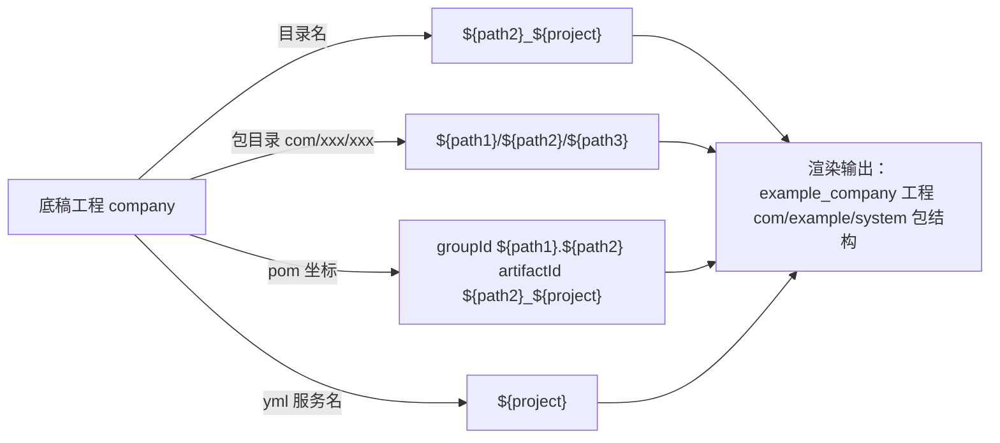

# 把一个真实微服务工程改造成模板：工程名、包目录与 pom 全部占位符化

通用模板不用凭空造，最快的路子是拿一个写好的微服务工程当底稿，把所有「因项目而异」的内容替换成占位符。听起来简单，实际要过三道关：哪些内容该换、哪些该删，pom 里的坐标怎么参数化，包名拆三段之后目录怎么搭。这一课以一个公司微服务工程为底稿，把整套目录结构模板化并跑通验证。

## 先给结论

- 换名只盯四个落点：工程目录名 `${path2}_${project}`、pom 坐标、包目录 `${path1}/${path2}/${path3}`、application.yml 里的服务名。
- `target`、`test`、IDE 的 `.iml` 一律不进模板；实体类里的 Lombok 注解先删掉，getter/setter 交给后续的手写模板生成。
- pom 的参数化公式：`groupId` 写 `${path1}.${path2}`，本模块 `artifactId` 写 `${path2}_${project}`，父工程 `${path2}_parent`，内部公共依赖 `${path2}_common`。
- 包目录直接建三层占位符文件夹 `src/main/java/${path1}/${path2}/${path3}`，渲染时由数据模型还原成 `com/example/system`。
- 验证以「生成出来的目录结构和 pom 坐标是否全部替换到位」为准，通过后包与 pom 的模板就算定稿。

## 一、选底稿：一份现成的微服务工程

底稿选的是之前写过的公司微服务工程，目录里 `pojo`、`dao`、`service`、`controller`、`resources` 一应俱全。改造成模板前先做一次全面清点，把每个部分的处理方式定下来：

| 位置 | 内容 | 处理方式 |
|---|---|---|
| 工程目录名 | 固定的工程英文名 | 换成 `${path2}_${project}` |
| `.iml`、`.idea` | IDE 配置 | 删除，不进模板 |
| `target` | 构建产物 | 清空或删除 |
| `test` | 测试代码 | 删除 |
| `pom.xml` | 父工程、坐标、依赖 | 逐项参数化 |
| `src/main/java` 包目录 | 固定的三层包名 | 换成 `${path1}/${path2}/${path3}` |
| `application.yml` | 服务名、端口、数据源 | 服务名参数化，无关配置删除 |
| 实体类 | Lombok 生成的 getter/setter | 注解删掉，留手写模板的位置 |

清点的原则只有一条：凡是换一个项目就要变的内容，全部占位符化；凡是与业务工程无关的内容，全部移出模板。

## 二、包目录：三层占位符文件夹

包名在数据模型里被约定拆成三段：`path1` 是 `com`，`path2` 是组织或项目标识，`path3` 是模块名。于是模板的 Java 源码目录不写死任何一段，直接建三层占位符文件夹：

```text
src/main/java/${path1}/${path2}/${path3}/
├── CompanyApplication.java
├── controller/
├── dao/
├── pojo/
└── service/
```

生成时数据模型里 `path1=com`、`path2=example`、`path3=system`，上一课讲过的「路径即模板」机制会把目录名渲染成 `com/example/system`，`FileUtils.mkdir` 顺着渲染后的路径自动建目录，多层包结构无需额外代码。

`application.yml` 同样只保留核心部分。底稿里的 Eureka 注册地址、Redis 等配置与生成目标无关，删掉；服务名原来是写死的工程名，属于「因项目而异」，换成占位符：

```yaml
#服务配置
server:
  port: 9001
#spring配置
spring:
  #1.应用配置
  application:
    name: ${project} #指定服务名，随工程名渲染
  #2.数据库连接池
  datasource:
    driver-class-name: com.mysql.jdbc.Driver
    url: jdbc:mysql://localhost:3306/example?useUnicode=true&characterEncoding=utf8
    username: root
    password: 111111
  #3.JPA
  jpa:
    database: MySQL
    show-sql: true
    open-in-view: true
```

资料包里的成品模板此处的服务名仍保留着底稿原值，占位符写法属于按课程做法补全的示例；端口与数据源这类环境配置留在 yml 里，交给使用者生成后微调即可。

## 三、pom 坐标：一组参数化公式

多模块工程里 pom 是替换的重灾区。底稿的坐标长这样：父工程是固定的 `xxx_parent`，本模块是 `xxx_company`，还要依赖公共模块 `xxx_common`。全部换成占位符之后，资料包里成品模板的 pom 原文如下：

```xml
<?xml version="1.0" encoding="UTF-8"?>
<project xmlns="http://maven.apache.org/POM/4.0.0"
         xmlns:xsi="http://www.w3.org/2001/XMLSchema-instance"
         xsi:schemaLocation="http://maven.apache.org/POM/4.0.0 http://maven.apache.org/xsd/maven-4.0.0.xsd">
    <parent>
        <artifactId>${path2}_parent</artifactId>
        <groupId>${path1}.${path2}</groupId>
        <version>1.0-SNAPSHOT</version>
    </parent>
    <modelVersion>4.0.0</modelVersion>

    <artifactId>${path2}_${project}</artifactId>

    <dependencies>
        <dependency>
            <groupId>org.springframework.boot</groupId>
            <artifactId>spring-boot-starter-data-jpa</artifactId>
        </dependency>
        <dependency>
            <groupId>mysql</groupId>
            <artifactId>mysql-connector-java</artifactId>
        </dependency>
        <dependency>
            <groupId>${path1}.${path2}</groupId>
            <artifactId>${path2}_common</artifactId>
            <version>1.0-SNAPSHOT</version>
        </dependency>
        <dependency>
            <groupId>org.springframework.cloud</groupId>
            <artifactId>spring-cloud-starter-netflix-eureka-client</artifactId>
        </dependency>
    </dependencies>
</project>
```

可以总结成三个公式：组织标识出现的地方用 `${path2}` 打头，模块名拼接用 `${path2}_${project}`，完整 groupId 用 `${path1}.${path2}`。Spring Boot、MySQL 这些第三方依赖的坐标保持原样，它们不随项目变。对照底稿与模板，替换关系一目了然：



## 四、生成验证：目录与坐标逐项核对

模板目录结构搭好后，把无关文件清干净，从界面发起一次生成：模板选「springboot 程序的模板」，项目名填 `company`，包名填 `com.example.system`，输出路径指向一个空目录。

核对输出物，三层结论都成立。**工程目录名正确**：输出根目录出现 `example_company`，来自 `${path2}_${project}` 的渲染。**包结构正确**：`src/main/java/com/example/system` 逐层存在，`pojo`、`dao`、`service`、`controller` 四个子包原样带出。**pom 坐标正确**：生成物 `pom.xml` 里 groupId 是 `com.example`，artifactId 是 `example_company`，父工程与公共模块坐标同步替换，第三方依赖原样保留。资料包里留有这次验证的完整生成物，可与模板并排打开逐行对照。

包目录与 pom 的模板到此定稿。它们是「工程外壳」，内部类文件的模板，从下一篇的实体类开始逐个精修。

## 常见误区

- **只换包目录不换 pom 坐标**：生成的工程包路径对了，坐标还是底稿的旧值，模块间依赖全指到错误项目上。目录、pom、yml 三处替换要一次做全。
- **把 `target` 和 `test` 留在模板里**：递归扫描不分好坏，`target` 里的构建产物会被当成模板渲染进输出目录，垃圾文件混入生成物。模板目录保持干净是底线。
- **占位符拼接漏掉分隔符**：`${path2}_${project}` 里的下划线、`${path1}.${path2}` 里的点，都是坐标的一部分，漏写后 artifactId 拼不起来，Maven 直接找不到模块。
- **服务名忘在 yml 里不替换**：生成出来的多个微服务都注册同一个服务名，注册中心里互相覆盖，这类问题运行期才暴露，排查成本远高于生成期多看一眼。

## 面试可能被问到的问题

1. 面试官追问：「为什么模板的目录名也要参与渲染，而不是生成后再移动文件？」
   答：目录名写占位符，复用了「路径即模板」的同一套机制，渲染路径与渲染内容用同一个数据模型，天然一致。生成后再移动需要额外维护一套映射规则，还要处理目录已存在的冲突，复杂度反而更高。

2. 面试官追问：「包名拆成 path1、path2、path3 三段，超过三层的包怎么办？」
   答：三段覆盖的是「组织.项目.模块」这一惯用层级，模板目录结构按约定建三层即可。需要更深层次时，可在 `path3` 之后再扩一段，或把模块内固定层级（如 `pojo`、`dao`）直接建在模板里，渲染时原样带出。

3. 面试官追问：「多模块工程里，父工程和公共模块的坐标怎么参数化？」
   答：给它们固定的命名公式：父工程 `${path2}_parent`，公共模块 `${path2}_common`，groupId 统一 `${path1}.${path2}`。所有微服务模块的模板都引用同一组公式，生成任意模块时坐标自动对齐。

4. 面试官追问：「哪些内容不应该参数化？」
   答：与具体项目无关的部分都不该动：第三方依赖坐标、框架的固定注解、通用代码骨架。参数化的粒度是「因项目而异」，粒度过粗会把不该变的也变掉，模板就失去了「通用」的意义。

## 配套资料

- 成品模板目录结构（占位符目录名与文件名）：`materials/code/02/day13-代码生成器实现/day13-代码生成器实现/资源/SpringBoot模板/`
- 模板 pom 原文：`materials/code/02/day13-代码生成器实现/day13-代码生成器实现/资源/SpringBoot模板/${path2}_${project}/pom.xml`
- 模板 application.yml：`materials/code/02/day13-代码生成器实现/day13-代码生成器实现/资源/SpringBoot模板/${path2}_${project}/src/main/resources/application.yml`
- 生成验证的完整输出物：`materials/code/02/day13-代码生成器实现/day13-代码生成器实现/资源/测试/生成代码路径/ihrm_company/`
