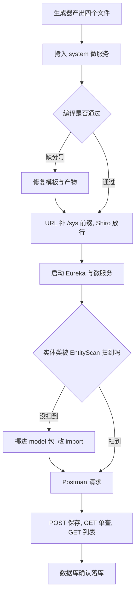

# 生成器实测：一张 City 表从生成代码到 Postman 跑通增删改查

三层模板都改完之后，还有一个绕不开的问题：生成器产出的代码到底能不能用。纸面上看着都对不算数，得拿一张真正没手写过的表，把生成物拷进微服务工程、启动、发请求、查数据库，走完一整条链路。这一课就用城市表当考题，把生成器从「能生成」验证到「能干活」，顺带抓出一个藏在模板里的低级错误。

## 先给结论

- 测试用例选字段最少的 `bs_city` 表：只有 `id`、`name`、`create_time` 三列，生成物四个文件，链路短，问题容易定位。
- 拷贝进工程第一轮就抓到 bug：模板盲写导致 getter/setter 方法体少分号，产物与模板要一起修。
- URL 按工程约定补前缀，`/city` 改成 `/sys/city`，Shiro 过滤链里给测试接口放行 `anon`。
- 实体类必须落在启动类 `@EntityScan` 扫描的包里，否则启动即报 `Not a managed type`，这是生成器包结构与目标工程约定不一致的典型翻车点。
- Postman 走完 POST、GET 单查、GET 列表三个请求，数据库确认落库，生成器全链路才算验收通过。

## 一、选一张小表当考题

生成器跑一次会产出整套工程的代码，逐个验收不现实，挑一张之前从未手写过的表最合适：`bs_city`，城市表，字段只有三列。

| 字段 | 类型 | 说明 |
|---|---|---|
| `id` | varchar | 主键，由 IdWorker 生成 |
| `name` | varchar | 城市名 |
| `create_time` | datetime | 创建时间 |

表小，生成物只有 `City.java`、`CityDao.java`、`CityService.java`、`CityController.java` 四个文件，每个文件都短，眼睛扫一遍就能核对。资料包里生成的实体类原文如下（包名已改写为 `com.example`）：

```java
@Entity
@Table(name = "bs_city")
public class City implements Serializable {

    @Id
    private String id;
    private String name;
    private java.util.Date createTime;

    public void setId(String value) {
        this.id = value          // 注意：这里少一个分号
    }
    public String getId() {
       return this.id
    }
}
```

`@Id` 落在 `id` 上，`createTime` 的类型是 `java.util.Date`，主键判断与类型映射都工作正常。

## 二、拷进工程，抓到模板的一个 bug

四个文件按层拷进 system 微服务：`City.java` 进实体包，`CityDao.java` 进 dao 包，`CityService.java` 进 service 包，`CityController.java` 进 controller 包。Dao 与 Service 拷过去没有报错，实体类一进来编辑器就标红了：方法体少分号。

回溯源头，错不在生成器逻辑，而在模板本身。写 Service 与 Controller 模板时有 IDE 的语法提示兜底，写实体类模板那段 getter/setter 循环时是纯手打，`this.${column.columnName2} = value` 末尾的分号漏了，FreeMarker 只负责原样渲染，模板里少什么产物就少什么。修复要改两处：生成物直接补分号，模板里的赋值行也补上，下一轮生成才是对的：

```java
public void setId(String value) {
    this.id = value;
}
public String getId() {
    return this.id;
}
```

这个小插曲本身比错误更值得记住：**模板是一种「盲写」的代码，没有编译器替你把关，生成物的编译验证就是模板的单元测试。**

## 三、接入工程的三处小修改

**第一，URL 补上工程前缀。** 模板生成的路径是 `/city`，而这个 system 微服务里的接口约定都挂在 `/sys` 之下，与前端路由对应，改一行注解：

```java
@RequestMapping(value="/sys/city")
```

**第二，Shiro 过滤链里放行测试接口。** 工程接了 Shiro 做认证，没登录的请求会被拦到登录页。这次只验证生成代码，不做登录，在过滤链配置里把城市接口设为匿名访问：

```java
Map<String, String> filterMap = new LinkedHashMap<>();
filterMap.put("/sys/login", "anon");
filterMap.put("/sys/faceLogin", "anon");
filterMap.put("/sys/city", "anon");   // 测试期间放行城市接口
filterMap.put("/**", "authc");
filterFactory.setFilterChainDefinitionMap(filterMap);
```

**第三，按顺序启动。** 注册中心先起，system 微服务再起，依赖关系不能颠倒。

## 四、第一次启动就报错：Not a managed type

服务启动日志直接抛异常：

```text
Not a managed type: class com.example.system.pojo.City
```

意思是 JPA 不认识这个实体类。根因不在生成的代码，而在包位置：工程里所有实体类统一放在 `model` 包，启动类上的 `@EntityScan` 只扫这一个包，生成物按模板默认进了 `pojo` 包，扫描覆盖不到，Spring Data JPA 自然把它当普通类。

修复办法是让两边对齐：把 `City.java` 挪进被扫描的 `model` 包，dao、service、controller 里引用 `City` 的 import 逐个改过来，重新启动，服务正常起来。这个坑也提示了一个模板改进点：模板里的目标包名本来就是占位符，把它配置成与目标工程实体包一致的值，生成即落位，省掉手工搬运。

## 五、Postman 走完整条链路

服务起来了，用 Postman 按增、查、列表的顺序过一遍。

```bash
# 保存城市
POST localhost:9092/sys/city
Content-Type: application/json

{"name": "北京"}
```

返回操作成功，数据库里刷新出一行新记录，`name` 是北京。单查与列表跟着验证：

```bash
GET localhost:9092/sys/city/{id}    # 返回北京, 操作成功
GET localhost:9092/sys/city         # 返回城市列表
```

三个请求全部符合预期，生成器的验收到此完成。一个细节值得留意：`create_time` 不该由前端传，更合理的位置是业务层在 `add` 里用 `new Date()` 补上，这类字段赋值属于业务逻辑，正是模板刻意不碰、留给生成后补充的部分。整条测试链路可以画成一张图：



图里两个菱形就是本课踩过的两道坎，都卡在「生成物与工程约定不一致」上，一个卡编译，一个卡包扫描。

## 常见误区

- **生成完就认为大功告成**：FreeMarker 不做语法检查，模板少分号、少花括号都会原样进产物，必须编译一次才算验证过模板。
- **实体类随手放包**：JPA 实体必须在启动类 `@EntityScan` 覆盖的包内，放在平行包里启动就报 `Not a managed type`，且报错信息不会直说「包不对」。
- **忘了工程级 URL 约定**：模板生成的是裸路径 `/city`，接入有统一前缀约定的工程时要手工补，或把前缀做成生成器的输入项。
- **让前端传创建时间**：`create_time` 这类审计字段应由服务端在业务层赋值，信任前端传入的时间等于把数据口径交出去。

## 面试可能被问到的问题

1. 面试官追问：「你怎么验证代码生成器的正确性？」
   答：拿一张字段最少、之前没手写过的真实表做端到端测试：生成、拷入工程、编译、启动、接口请求、查库确认，全链路走通才算验收。同时产物必须编译，因为 FreeMarker 只管渲染不做语法检查，产物编译是模板的有效回归手段。

2. 面试官追问：「Not a managed type 这个异常是怎么产生的？」
   答：Spring Data JPA 只把被 `@EntityScan`（或默认包扫描）覆盖到的 `@Entity` 类识别为受管实体。实体类放在扫描范围之外的包里就会出现这个异常。解决办法是把实体挪进扫描包，或调整 `@EntityScan` 的 basePackages。

3. 面试官追问：「生成器产出的代码和手写代码混在一个工程里，怎么保证风格一致？」
   答：模板本身就抄自工程的手写标准代码，包名、返回结构、异常体系、URL 约定全部沿用工程规范；生成后按工程约定做少量调整，如统一路径前缀。模板随工程规范走，而不是让工程迁就模板。

4. 面试官追问：「生成的 Service 里没有设置创建时间这类字段，为什么？」
   答：模板刻意保持零业务，只输出通用增删改查骨架。审计字段的赋值属于业务约定，不同模块口径不同，统一放在业务层补充，模板保持通用性，这也符合「生成骨架、人补业务」的分工。

5. 面试官追问：「测试时为什么要在 Shiro 过滤链里加 anon 放行？」
   答：验证目标是生成代码的 CRUD 逻辑，不是认证流程，让测试请求绕过登录可以隔离变量。`anon` 只加在临时测试路径上，回归正常流程时再收回，生产配置里不能留这类口子。

## 配套资料

- 生成物（本次测试拷贝的四个文件）：`materials/code/02/day13-代码生成器实现/day13-代码生成器实现/资源/测试/生成代码路径/ihrm_company/src/main/java/com/ihrm/system/` 下的 `pojo/City.java`、`dao/CityDao.java`、`service/CityService.java`、`controller/CityController.java`（文中包名已改写为 `com.example`，`City.java` 中缺分号的原始状态保留在资料里，可对照）
- 实体类模板（缺分号 bug 的源头）：`materials/code/02/day13-代码生成器实现/day13-代码生成器实现/资源/SpringBoot模板/${path2}_${project}/src/main/java/${path1}/${path2}/${path3}/pojo/${ClassName}.java`
- 微服务配置参考（端口、数据源、JPA）：同生成物目录 `src/main/resources/application.yml`
- Shiro 过滤链与网关过滤器的写法参考：`materials/code/02/day14 微服务网关与社保模块开发/day14/03-资料/网关相关资料/ihrm_gate/src/main/java/com/ihrm/gate/ShiroConfiguration.java`
