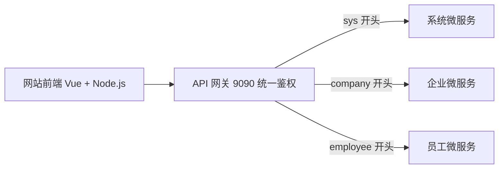

# API 网关：系统对外的唯一入口，凭什么能一口吃下路由、跨域和鉴权

前端直连微服务的三个痛点摆上桌之后，解法只剩一条路：在服务群前面立一个统一入口。这一节把这个入口的角色讲透，它到底是什么、凭什么一句话能同时解决多 URL、跨域、权限校验三个问题，以及它和 Nginx 这类常驻入口怎么分工。

## 先给结论

- API 网关是一个独立的服务器，是系统对外的唯一入口：前端只认它一个地址，内部服务一个都不暴露。
- 它的第一职责是路由转发：按请求路径前缀把 `/sys/**`、`/company/**` 之类的请求分发到对应微服务。
- 前端与网关绑在同一域上，跨域问题随之消失；权限校验集中到网关层做一次，没有权限直接返回，请求不再进入业务服务。
- 网关的本质是反向代理，对外封住内部架构，对内承接全量流量，是前后端分离加微服务架构里的核心组件。
- Nginx 与 API 网关不互斥：Nginx 管静态资源与入口层负载均衡，API 网关管业务语义的路由与过滤，常按 Nginx 在前、网关在后的形态部署。

## 一、网关是个什么角色

用一句大白话说：API 网关就是整栋写字楼的门禁兼前台。访客只需要知道大楼的一个地址，进了门之后去哪个办公室、要不要放行，都由前台安排，访客永远不用背下每间办公室的门牌号。

讲义里的定义更严谨：API 网关是一个服务器，是系统对外的唯一入口。它封装了系统的内部架构，为每个客户端提供一套定制的 API。客户端与消费端统统通过网关接入微服务，网关层统一处理这些横切性质的业务功能；网关通常还对外提供 RESTful 风格的 HTTP 访问 API，服务端则通过网关注册和管理所有服务。

这层封装的学名叫反向代理：客户端请求的是网关的地址，实际干活的是网关后面的微服务，客户端对此完全无感。正向代理替客户端出门办事，反向代理替服务端挡在门口，API 网关属于后者。

## 二、三个痛点逐一消解

把上一节那张直连架构图改造一下：三个微服务前面插入一个 API 网关节点，前端的所有请求一律打到网关。



**第一，多 URL 问题消失。** 前端维护的地址从三个收敛成一个：不管请求什么，统统发给网关。请求路径里带着业务语义，例如 `/sys/user` 表示系统微服务里的用户服务，`/company/list` 表示企业微服务的企业列表。网关根据配置好的规则，自动把请求转发到不同的微服务。前端不再关心服务拓扑，网关对外只暴露这一个入口。

**第二，跨域问题变得简单。** 前端要维护的域只剩一个，把网站前端和网关绑到同一个域上即可，不再需要逐个服务去配跨域许可。

**第三，权限校验上收到网关层。** 请求进入网关时先做身份校验：具备访问用户接口的权限，就转发到系统微服务；具备查询企业列表的权限，就转发到企业微服务；没有对应权限，网关直接返回「权限不足」，请求根本不会落到业务服务上。原来散落在三个服务里的校验逻辑，现在做一次就覆盖全量入口。

## 三、路由规则长什么样

「按路径转发」不是靠代码写死的 if else，而是网关配置文件里的一张映射表。人事系统网关工程的真实配置节选如下（服务名已按语义改写，完整文件下一节展开）：

```yaml
zuul:
  routes:
    system-service:              #路由id, 随便写
      path: /sys/**              #需要映射的路径地址
      serviceId: system-service  #注册中心中的服务id
    company-service:
      path: /company/**
      serviceId: company-service
```

两行 `path` 加 `serviceId` 就是一条转发规则：请求路径以 `/sys/` 开头的去系统服务，以 `/company/` 开头的去企业服务。前端的全部请求都汇总到网关这一个地址，再由这张表分流到各个微服务。

站在前端视角，代码也因此变得干净：只需要一个统一的 baseURL（以下为示例写法）：

```javascript
// 网关是唯一入口, 前端只认这一个地址
const api = axios.create({ baseURL: 'http://localhost:9090' })

// 查询企业列表: 网关按 /company 前缀转发到企业微服务
await api.get('/company/list')
// 查询用户: 网关按 /sys 前缀转发到系统微服务
await api.get('/sys/user/list')
```

## 四、与 Nginx 的分工

提到「统一入口」，很多人第一反应是 Nginx，两者到底是不是一回事？不是，而且它们经常一起出现。

**第一，层次不同。** Nginx 工作在 HTTP 入口层，强项是静态资源托管、连接层负载均衡、压缩缓存这类与业务无关的通用转发；API 网关站在应用层，路由规则带着业务语义（哪个前缀属于哪个服务），并且要执行鉴权、限流这类横切业务逻辑。网关需要理解「这个请求该不该放行」，Nginx 不需要。

**第二，治理能力不同。** API 网关与注册中心天然配合，服务扩容缩容后按服务名动态寻址；过滤器链可以在请求前后插入自定义逻辑。这些是 Nginx 原生不具备或做起来别扭的。

**第三，典型部署形态是叠加而非二选一。** 流量先进 Nginx（静态资源、TLS 终结、粗粒度负载均衡），动态请求再转给 API 网关做业务路由与鉴权，之后才进入微服务。一句话记分工：Nginx 管流量怎么进来，API 网关管请求怎么流转、要不要放行。

## 常见误区

- **以为有了 Nginx 就不需要 API 网关**：Nginx 只解决入口转发，不理解业务语义，鉴权、服务级路由、过滤器链都要在应用层实现。两者分工不同，正确做法是叠加部署，不是互相替代。
- **把网关当成第二个业务服务**：网关层只放横切逻辑（鉴权、路由、限流、日志），把业务计算塞进网关会让它变成新的巨型单体，改一处业务就要重新发布全站入口。
- **以为网关默认自带鉴权**：路由转发是网关的出厂能力，鉴权要靠自己在过滤器里实现并显式开启，不做任何配置的网关只会原样转发，起不到挡门的作用。
- **认为前端与网关绑同一域就万事大吉**：同一域解决的是浏览器跨域拦截；如果后端服务之间还有跨服务调用，那是服务间通信问题，与浏览器同源策略无关，不要混为一谈。

## 面试可能被问到的问题

1. 面试官追问：「什么是 API 网关，它在微服务架构里处于什么位置？」
   答：API 网关是一个独立服务器，系统对外的唯一入口。它封装系统内部架构，客户端通过它接入微服务：请求先进网关，网关按路由规则转发到对应服务，并在入口处完成鉴权、限流等横切处理。它是前后端分离与微服务架构中的核心组件，对内还可以统一调度和管理所有服务。

2. 面试官追问：「网关如何解决前端直连带来的三个问题？」
   答：多 URL 问题靠统一入口收敛，前端只请求网关一个地址，由网关按路径前缀分发；跨域问题靠前端与网关同域解决，跨域许可只需配一次；权限校验集中到网关层做一次，无权限请求直接返回，不再进入业务服务。

3. 面试官追问：「反向代理和正向代理的区别是什么？」
   答：正向代理站在客户端一侧，代替客户端向服务端发起请求，服务端看不到真实客户端；反向代理站在服务端一侧，接收客户端请求后转发给内部服务，客户端看不到真实的服务端结构。API 网关本质是反向代理，对外暴露唯一入口，对内屏蔽服务拓扑。

4. 面试官追问：「API 网关和 Nginx 有什么区别，项目中怎么选？」
   答：Nginx 工作在入口层，擅长静态资源、负载均衡等业务无关的通用转发；API 网关在应用层，做带业务语义的路由与鉴权、限流等过滤器逻辑。两者不互斥，常见形态是 Nginx 在前承接流量，动态请求转发给网关做业务路由与鉴权，再进微服务。

5. 面试官追问：「网关层的路由规则一般怎么配？」
   答：以 Spring Cloud Zuul 为例，在 `application.yml` 的 `zuul.routes` 下声明映射表，每条规则包含路由 id、匹配的 `path` 通配和转发目标。目标可以写 `url` 直连固定地址，也可以写 `serviceId` 指向注册中心里的服务名，生产环境推荐后者，扩缩容无需改配置。

## 配套资料

- 网关路由真实配置（`zuul.routes` 映射表出处）：`materials/code/02/day14 微服务网关与社保模块开发/day14/03-资料/网关相关资料/ihrm_gate/src/main/resources/application.yml`（文中服务名已按语义改写）
- 网关工程：`materials/code/02/day14 微服务网关与社保模块开发/day14/03-资料/网关相关资料/ihrm_gate/`（含启动类与过滤器目录）
- 前端 baseURL 代码片段为按本课写法补全的示例，课程资料包内无前端源码
