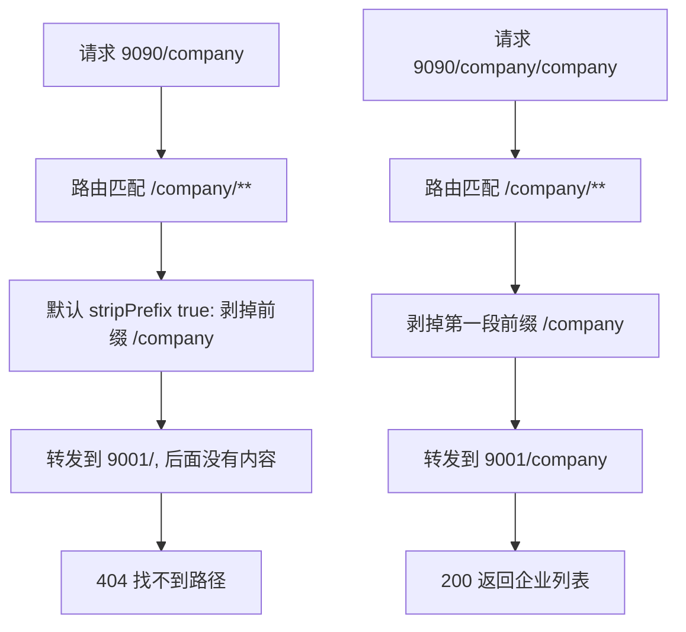
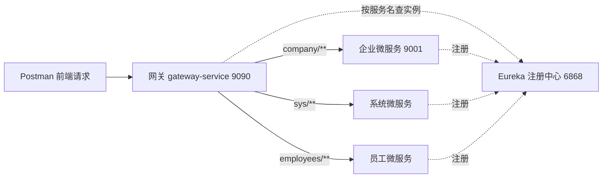

# 把网关跑起来：从建模块到打通第一跳路由转发

理论和三步法都有了，这一节全程动手：建网关模块、写启动类、配路由，然后实测一条请求从 9090 转到 9001 的完整链路。中间会撞上一个很有代表性的 404：请求里多写一层 `company` 才能拿到数据。把它解剖开，`stripPrefix` 这个最容易被忽略的路由参数就再也忘不掉了。

## 先给结论

- 网关就是一个普通 Spring Boot 微服务：建模块、引 `spring-cloud-starter-netflix-zuul` 依赖、写带 `@EnableZuulProxy` 的启动类、配 `application.yml` 路由。
- 路由最小配置三件套：路由 id（随便写）、`path`（匹配哪些请求）、`url`（转发到哪个服务）。
- Zuul 默认 `stripPrefix: true`，转发前会剥掉与 `path` 匹配的前缀；不理解这一点，`9090/company` 会莫名 404，多写一层 `9090/company/company` 反而有数据。
- 引了 Eureka 客户端依赖就要有注册中心接应，否则第一次启动就报错；不想引就先注释依赖，想用动态路由就把 Eureka 跑起来。
- 生产形态的路由目标写 `serviceId`（注册中心里的服务名），网关按服务名取实例列表，扩缩容不用改配置。

## 一、建模块与依赖

在父工程上右键新建模块，名字按语义取 `gateway-service`。依赖从课程资料包的现成 `pom.xml` 里拷贝再微调，网关工程的核心依赖如下（包名与模块名已改写）：

```xml
<dependencies>
    <!--eureka客户端: 对接注册中心时使用, 纯 url 直连可先不加-->
    <dependency>
        <groupId>org.springframework.cloud</groupId>
        <artifactId>spring-cloud-starter-netflix-eureka-client</artifactId>
    </dependency>
    <!--zuul网关: 最核心的依赖-->
    <dependency>
        <groupId>org.springframework.cloud</groupId>
        <artifactId>spring-cloud-starter-netflix-zuul</artifactId>
    </dependency>
    <!--actuator: 健康检查与端点-->
    <dependency>
        <groupId>org.springframework.boot</groupId>
        <artifactId>spring-boot-starter-actuator</artifactId>
    </dependency>
    <dependency>
        <groupId>com.example</groupId>
        <artifactId>common</artifactId>
        <version>1.0-SNAPSHOT</version>
        <exclusions>
            <!--网关不连数据库, 把 common 传递进来的 JPA starter 排除掉-->
            <exclusion>
                <groupId>org.springframework.boot</groupId>
                <artifactId>spring-boot-starter-data-jpa</artifactId>
            </exclusion>
        </exclusions>
    </dependency>
</dependencies>
```

`exclusions` 这段值得看一眼：公共模块为了统一管理工具类与实体，传递依赖了 JPA，而网关不碰数据库，排除掉可以瘦身并避免无谓的自动配置。

## 二、启动类与基础配置

启动类只有两个注解承担职责（包名已改写为 `com.example`）：

```java
package com.example.gate;

import org.springframework.boot.SpringApplication;
import org.springframework.boot.autoconfigure.SpringBootApplication;
import org.springframework.cloud.netflix.zuul.EnableZuulProxy;

//声明boot工程
@SpringBootApplication(scanBasePackages = "com.example")
//开启zuul网关功能
@EnableZuulProxy
public class GateApplication {

    public static void main(String[] args) {
        SpringApplication.run(GateApplication.class);
    }
}
```

配置文件从企业微服务的 `application.yml` 拷一份改写，服务端口取 9090，服务名 `gateway-service`，再加上本节的主角路由规则：

```yaml
#服务配置
server:
  port: 9090
#spring配置
spring:
  application:
    name: gateway-service #指定服务名
#zuul配置
zuul:
  routes:
    company-service:              #路由id, 随便写
      path: /company/**           #需要映射的路径地址
      url: http://127.0.0.1:9001  #映射路径对应的实际微服务的url路径
```

这条规则的读法：凡是路径以 `/company/` 开头的请求，转发到 `http://127.0.0.1:9001`。前端发起的企业相关请求从今往后都打网关，不再直连企业微服务。

## 三、第一次启动的报错

启动网关时它明显比普通服务慢，随后抛出异常。原因与代码无关：依赖列表里已经引入了 Eureka 客户端，它启动后会尝试注册自己、拉取注册表，而注册中心既没启动也没配置地址，客户端自然失败。

处理方式有两种，按当前阶段选：

- 测试期只用 `url` 直连转发，就把 Eureka 客户端依赖连同启动类里的相关注解先注释掉，重启后网关正常就绪；
- 要用按服务名转发的动态路由，就先把注册中心跑起来（启动带 `@EnableEurekaServer` 的 Eureka 服务，端口 6868），并在配置里补上 `defaultZone`，Eureka 客户端有地方注册即可正常启动。

课程现场走的是第一条路：注掉依赖重启，看到网关监听 9090 就绪，再回头做注册中心对接。

## 四、路由转发实测：多写一层 company 才有数据的 404 之谜

测试前做两件准备工作：把所有服务交给注册中心托管，所以 Eureka 要先启动；企业微服务里的鉴权是 Shiro 过滤器配置，为了排除干扰，测试期把这段鉴权拦截注释掉。然后启动企业微服务，监听 9001。

按顺序验证三跳：

```bash
# 第一跳: 直连企业微服务, GET /company, 有数据
curl http://127.0.0.1:9001/company

# 第二跳: 走网关, GET /company, 返回 404 Not Found
curl http://127.0.0.1:9090/company

# 第三跳: 走网关多写一层, GET /company/company, 拿到与直连一模一样的数据
curl http://127.0.0.1:9090/company/company
```

第二跳与第三跳的反差就是本节的知识核。原因：Zuul 配置路由时会自动剥离请求中与 `path` 匹配的前缀，再把剩下的部分拼到转发目标后面。两次请求的实际走向：



企业微服务的控制器声明在 `@RequestMapping("/company")` 上，接口本身就带这层前缀。默认剥离行为等于帮请求「卸掉」了一段路径：第一次请求剥干净后目标变成 `9001/`，控制器自然找不到；多写一层才能在剥离后拼出正确的 `9001/company`。这套行为在源码 `ZuulProperties` 里就是一个布尔字段，`setStripPrefix`、`getStripPrefix` 成对出现，默认值为 true。

想让网关的请求路径与微服务内部路径保持一致，显式关闭剥离即可：

```yaml
zuul:
  routes:
    company-service:
      path: /company/**
      url: http://127.0.0.1:9001
      stripPrefix: false #不删除请求前缀
```

重启网关后再请求 `9090/company`，与直连 9001 的结果完全一致。多个微服务的场景，照葫芦画瓢在 `routes` 下继续加路由规则即可，一个网关就能承接全部服务的入口职责。

## 五、对接注册中心，按服务名转发

`url` 直连适合起步，但写死 IP 的路由在服务扩容、迁移时要人肉维护。成熟的形态是把转发目标换成注册中心里的服务名，这正是当初引 Eureka 客户端依赖的用意。完整配置如下：

```yaml
#注册到eureka的服务地址
eureka:
  client:
    service-url:
      defaultZone: http://127.0.0.1:6868/eureka/
  instance:
    preferIpAddress: true
    instance-id: ${spring.cloud.client.ip-address}:${spring.application.name}:${server.port}
#服务配置
server:
  port: 9090
#spring配置
spring:
  application:
    name: gateway-service #指定服务名
#配置路由规则
zuul:
  routes:
    #路由id, 随便写
    company-service:
      path: /company/**            #需要映射的路径地址
      serviceId: company-service   #指定Eureka注册中心中的服务id
      stripPrefix: false           #不删除请求前缀
      customSensitiveHeaders: true #对指定路由开启自定义敏感头
    system-service:
      path: /sys/**
      serviceId: system-service
      stripPrefix: false
      customSensitiveHeaders: true
    #员工服务与社保服务两条规则同理, 分别映射 /employees/** 与 /social_securitys/**
```

启动类同步加上服务发现注解，网关自己也成为注册中心的一个客户端：

```java
@SpringBootApplication(scanBasePackages = "com.example")
@EnableZuulProxy          //开启zuul网关功能
@EnableDiscoveryClient    //开启服务发现功能
public class GateApplication {

    public static void main(String[] args) {
        SpringApplication.run(GateApplication.class);
    }
}
```

`url` 换成 `serviceId` 后，Zuul 拿到的是服务名，转发前会从 Eureka 查出该服务当前的实例列表再发起调用，多实例负载均衡与实例上下线对网关配置完全透明。`customSensitiveHeaders: true` 配合敏感头置空，是给 Authorization 这类请求头开通行证，下一节在网关上做统一鉴权时要靠它把 token 透传给下游。

整体链路最终长这样：



## 常见误区

- **不看 `stripPrefix` 默认值就配路由**：默认会剥离 path 匹配的前缀，下游接口自带同名前缀时就会 404。要么接受剥离并调整 `path` 写法，要么显式配 `false`，本项目的约定是服务自带前缀、网关不剥离。
- **敏感头配置项拼错还以为配了**：放行 Authorization 的正确键名是 `sensitiveHeaders`，课程资料里出现过拼成 `sentiviteHeaders` 的写法，Spring 绑定配置时对未知键名不报错、也不生效，排查时极易被「我明明配了」骗过。
- **引了 Eureka 客户端却没给它注册中心**：依赖在 classpath 里，客户端就会尝试注册与拉取注册表，注册中心没启动、`defaultZone` 没配，网关启动直接报错。依赖与配置要成对出现。
- **测试期注释鉴权配置忘了恢复**：为方便联调把 Shiro 过滤器配置注释掉没问题，但要记入待办，上线前恢复，否则企业服务裸奔在内网之外。

## 面试可能被问到的问题

1. 面试官追问：「Zuul 的路由规则里 url 和 serviceId 有什么区别？」
   答：`url` 直连固定地址，配置简单但不感知实例变化，服务扩容迁移都要改网关；`serviceId` 指向注册中心里的服务名，转发时按服务名拉取实例列表再做客户端负载均衡，实例上下线对配置透明。生产环境一律推荐 serviceId。

2. 面试官追问：「`stripPrefix` 是干什么的，默认值是什么？」
   答：它控制转发前是否剥离与 path 匹配的请求前缀，默认 true。例如 path 配 `/company/**`，请求 `/company/list` 会被剥成 `/list` 再拼到目标地址后；下游接口自带 company 前缀时就要显式配 false，否则会出现多写一层路径才 404 变 200 的现象。

3. 面试官追问：「网关引入了 Eureka 客户端却启动报错，可能是什么原因？」
   答：最常见的是注册中心不可用：Eureka 服务没启动、`defaultZone` 地址配错或网络不通，客户端注册与拉取注册表失败就会抛异常。排查顺序是先确认注册中心进程在监听，再核对 `eureka.client.service-url.defaultZone` 与端口，确认网关自身服务名与实例配置正确。

4. 面试官追问：「为什么网关工程要把 common 模块里的 JPA 依赖排除？」
   答：common 模块为统一提供工具类与公共实体，传递依赖了 JPA starter；网关不做持久化，引入它只会带来多余的自动配置与数据源探测，启动时还可能因为无数据源配置而报错。用 exclusions 排除是对传递依赖做减法的标准做法。

5. 面试官追问：「多个微服务接入同一个网关，路由要怎么扩展？」
   答：在 `zuul.routes` 下继续增加规则，每条规则由路由 id、path 通配与 serviceId 组成，按业务前缀划分，例如 `/sys/**` 到系统服务、`/employees/**` 到员工服务、`/social_securitys/**` 到社保服务。所有前端请求统一打网关，网关按前缀分发，服务地址变化只影响注册中心里的注册信息，路由表无需改动。

## 配套资料

- 网关工程完整源码：`materials/code/02/day14 微服务网关与社保模块开发/day14/03-资料/网关相关资料/ihrm_gate/`（含 `pom.xml`、`GateApplication.java`、`application.yml` 路由与注册中心配置，文中包名与服务名已改写为 `com.example` 与语义化服务名）
- 企业微服务 `/company` 接口出处：`materials/code/02/day13-代码生成器实现/day13-代码生成器实现/资源/测试/生成代码路径/ihrm_company/src/main/java/com/ihrm/system/controller/CompanyController.java`
- day14 库表脚本：`materials/code/02/day14 微服务网关与社保模块开发/day14/ihrm.sql`
