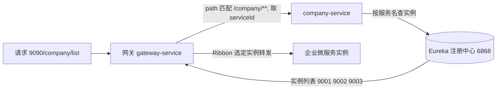

# 把转发地址从写死 IP 换成服务名：Zuul 动态路由

上一节的网关已经能把请求转进微服务了，但路由规则里写的是 `url: http://127.0.0.1:9001` 这样的死地址。企业微服务一旦扩实例、换端口、迁机器，网关配置就得跟着改一遍再重启。服务一多，这笔维护账会越滚越大。Zuul 对此给出的答案是动态路由：借助 Eureka 服务发现组件，让网关按服务名自动找到目标实例，地址不再钉死在配置文件里。

## 先给结论

- 动态路由的核心动作只有一个：路由配置里的 `url` 换成 `serviceId`，值是注册中心里登记的服务名。
- 前提三步：所有微服务都注册到注册中心；网关开启服务发现功能；路由规则改用服务名转发。
- 就算一条 `zuul.routes` 都不写，Zuul 也有默认路由规则：`/<服务名>/**` 自动映射到同名服务，不想暴露就用 `zuul.ignored-services` 排除。
- 这套机制的本质是动静结合：`path` 匹配规则是写死在配置里的静态部分，实例地址是运行时从注册中心动态拉取的部分。
- 走 `serviceId` 的转发由 Ribbon 完成客户端负载均衡，同一服务多实例时自动分流。

## 一、写死 url 的路由差在哪

先看改造前的配置长什么样：

```yaml
zuul:
  routes:
    company-service:              #路由id, 随便写
      path: /company/**           #需要映射的路径地址
      url: http://127.0.0.1:9001  #映射路径对应的实际微服务的url路径
      stripPrefix: false          #不删除请求前缀
```

这条规则把 `/company/**` 的请求固定转发到 `127.0.0.1:9001`。问题不在它能不能用，而在它把「网关配置」和「服务实例」绑死了：加实例要改配置，实例迁移要改配置，端口调整还是要改配置，每次都得重启网关。

微服务架构里实例本来就是经常变的。可持续的形态是把实例清单交给注册中心维护、网关只认服务名。两种写法摆在一起看：

| 对比项 | url 直连 | serviceId 动态路由 |
|---|---|---|
| 转发目标 | 写死的 ip 与端口 | 注册中心里的服务名 |
| 实例上下线 | 改网关配置并重启 | 不用动配置 |
| 多实例分流 | 没有，只有一个地址 | Ribbon 自动负载均衡 |
| 额外依赖 | 无 | 网关要接入服务发现 |

## 二、动态路由的三步配置

**第一，所有微服务都注册到注册中心。** 网关要按服务名找人，人得先到登记处签到。企业、系统、员工这些微服务的 `application.yml` 里都已经配好 Eureka 客户端（以企业微服务为例，节选）：

```yaml
#注册到eureka的服务地址
eureka:
  client:
    service-url:
      defaultZone: http://127.0.0.1:6868/eureka/
  instance:
    preferIpAddress: true
    instance-id: ${spring.cloud.client.ip-address}:${spring.application.name}:${server.port}
spring:
  application:
    name: company-service #指定服务名
```

注册中心拿到的是「company-service 在 9001」这类登记信息，实例的请求路径就存在注册表里，网关随时可以来查。

**第二，网关开启服务发现功能。** 网关工程引入 Eureka 客户端坐标（`spring-cloud-starter-netflix-eureka-client`，与 `spring-cloud-starter-netflix-zuul` 并列），并在启动类上加 `@EnableDiscoveryClient`：

```java
@SpringBootApplication(scanBasePackages = "com.example")
@EnableZuulProxy          //开启zuul网关功能
@EnableDiscoveryClient    //开启服务发现功能
public class GateApplication {

    public static void main(String[] args) {
        SpringApplication.run(GateApplication.class);
    }
}
```

配置文件里补上网关自己的注册中心地址后，它就能拉取到所有服务的登记信息。

**第三，路由规则用 serviceId 替换 url。** 把上一节写死地址的配置改成：

```yaml
#注册到eureka的服务地址
eureka:
  client:
    service-url:
      defaultZone: http://127.0.0.1:6868/eureka/
  instance:
    preferIpAddress: true
    instance-id: ${spring.cloud.client.ip-address}:${spring.application.name}:${server.port}
#服务配置
server:
  port: 9090
#spring配置
spring:
  application:
    name: gateway-service #指定服务名
  redis:
    host: 127.0.0.1
    port: 6379
#配置路由规则
zuul:
  routes:
    company-service:              #路由id, 随便写
      path: /company/**           #需要映射的路径地址
      serviceId: company-service  #指定Eureka注册中心中的服务id
      stripPrefix: false          #不删除请求前缀
    system-service:               #系统微服务
      path: /sys/**
      serviceId: system-service
      stripPrefix: false
```

关键变化在 `serviceId` 这一行：请求路径以 `/company/` 开头时，转发目标不再是某个固定地址，而是「名叫 company-service 的那个服务」。网关去注册中心拉取该服务当前的实例地址，再发起调用。

## 三、默认路由规则与动静结合

**第一，不写 routes 也有路由。** 网关接入服务发现之后，Zuul 会给注册中心里的每个服务自动生成一条默认路由：路径规则就是 `/<服务名>/**`，转发目标就是该服务名本身。理论上一条 `zuul.routes` 都不配，请求 `9090/company-service/xxx` 也能到达企业微服务。项目里仍然手写规则，是因为显式配置可以自定义 path 前缀（`/company/**` 比服务名更贴近业务语义），并顺带控制 `stripPrefix` 与敏感头透传。某个服务不想被默认路由暴露时，用 `zuul.ignored-services` 把它排除即可。

**第二，动静结合是这套机制的本质。** `path` 与 `serviceId` 的对应关系写在配置文件里，属于静态部分，决定「什么请求去找哪个服务」；服务名背后的实例地址列表由网关运行时从注册中心拉取，属于动态部分，决定「这个服务当前有哪些地址可用」。



图里最关键的一跳是「按服务名查实例」：网关配置里从头到尾没出现过 ip 和端口，地址全靠注册中心在运行时供给。企业微服务再开一个实例，只要它注册上来，网关的流量自然分过去，配置一行不改。

## 四、验证转发链路

重启网关后，用网关地址请求企业接口：

```bash
# 走网关按服务名转发, 拿到的数据与直连 9001 完全一致
curl http://127.0.0.1:9090/company
```

返回企业数据说明链路已经打通：请求先进网关，网关匹配 `path` 拿到 `serviceId`，再从注册中心查到实例地址完成转发。原来那行 `url: http://127.0.0.1:9001` 可以删掉了，动态路由正式接管。

## 常见误区

- **serviceId 写成自造词**：`serviceId` 的值必须与该服务注册时的 `spring.application.name` 完全一致，拼错或大小写对不上，网关查无此服务，请求直接 404。
- **服务名命名风格混乱**：有人写 `company_service`，有人写 `company-service`，注册中心里就成了两个服务。团队约定统一用中划线，命名不一致是动态路由 404 的高发原因。
- **只加依赖，不加注解或地址**：Eureka 客户端依赖引了，`@EnableDiscoveryClient` 没加、或 `defaultZone` 没配，网关都拿不到服务清单，动态路由无从谈起。
- **以为默认路由是额外功能**：默认路由是 Zuul 接入服务发现后自带的行为，不需要任何开关。排查「明明没配路由却能访问」时，先想到它。

## 面试可能被问到的问题

1. 面试官追问：「Zuul 的动态路由是怎么实现的？」
   答：路由配置里不写目标 url，只写注册中心里的服务名 serviceId。网关接入 Eureka 后持有一份服务清单，转发时按服务名查当前实例列表，再用 Ribbon 做客户端负载均衡选出实例发起调用。服务实例上下线只影响注册表，不影响网关配置。

2. 面试官追问：「不配置 zuul.routes 能转发请求吗？」
   答：能。接入服务发现后 Zuul 会为每个注册服务自动生成默认路由，路径规则是「/服务名/**」映射到同名服务。需要自定义前缀、stripPrefix 或敏感头策略时才显式写 routes；不想暴露某服务可用 zuul.ignored-services 排除。

3. 面试官追问：「为什么说这套路由是动静结合的？」
   答：静态指 path 与 serviceId 的映射规则，写在网关配置里；动态指实例地址，由注册中心运行时提供，随服务上下线自动变化。两者结合后路由语义稳定，地址解析交给注册中心，网关配置不必追着实例变化改。

4. 面试官追问：「serviceId 路由下同一个服务起了三个实例，请求怎么分？」
   答：网关从注册中心拿到三个实例地址后交给 Ribbon 做客户端负载均衡，默认轮询策略在实例间分配请求。某实例下线后注册表更新，流量自动避开它，网关无需干预。

5. 面试官追问：「网关自身要不要注册到注册中心？」
   答：要。网关本身也是微服务，注册上去后前端只依赖网关地址，其他服务也能通过服务名发现网关；而且网关要消费注册表完成按服务名转发，注册与拉取本来就是 Eureka 客户端的基本动作。

## 配套资料

- 网关工程完整源码（含 `pom.xml`、`GateApplication.java`、serviceId 路由的 `application.yml`）：
  `materials/code/02/day14 微服务网关与社保模块开发/day14/03-资料/网关相关资料/ihrm_gate/`
  （文中包名与服务名已改写为 `com.example` 与语义化命名）
- day14 库表脚本：`materials/code/02/day14 微服务网关与社保模块开发/day14/ihrm.sql`
